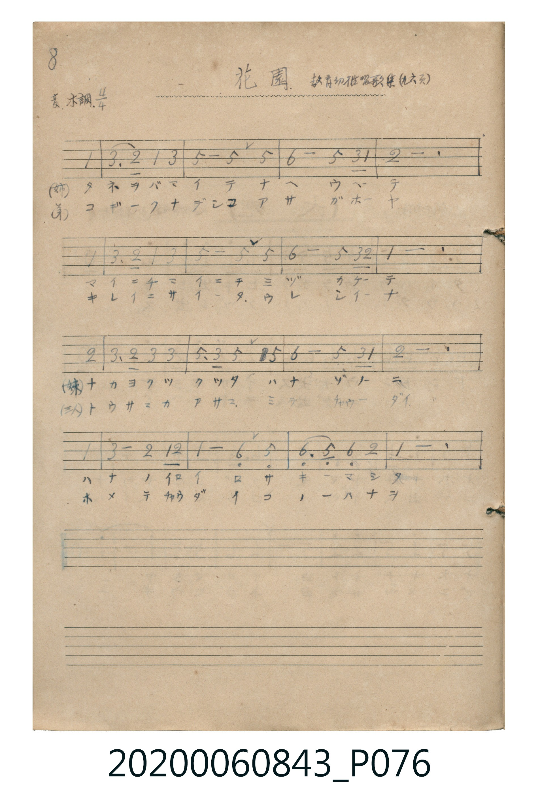

# 花園

<audio controls src="hanazono.mp3"></audio>

- 曲：教育幼稚唱歌集

## 說明

花園 (Hanazono)
Source: 唱歌帖 (Shōkachō, NMTH 2020.006.0843) — P076.jpg (Notebook 2, p.8)
Notation: Handwritten numbered notation (Jianpu)
Annotations: 変ホ調 4/4, 教育幼稚唱歌集 (九六頁)

## 歌詞

```text
（TMD 檔案未包含歌詞註解）
```

## ABC

```abc
X:1
T:花園
C:曲：教育幼稚唱歌集
M:4/4
L:1/16
Q:1/4=100
K:Eb
V:V1 name="Vocal" snm="Voc"
[V:V1]
!mf! z12 E4 | G6 F2 E4 G4 | B8 B4 B4 | c8 B4 G2 E2 |
F12 E4 | G6 F2 E4 G4 | B8 B4 B4 | c8 B4 G2 F2 |
E12 F4 | G6 F2 G4 G4 | B6 G2 B4 B4 | c8 B4 G2 E2 |
F12 E4 | G8 F4 E2 F2 | E8 C4 B,4 | C6 B,2 C4 F4 |
E12 z4 |
```

## TMD 檔案連結

- [主旋律 TMD 檔案](hanazono.tmd) [[在 TMD Studio 編輯](https://tmdlang.github.io/Tmd-TS/#tmd=s7IKdvYPcrWy4tLSUnjRtfHpnEkKWlpcirYKhgYGXPa2Cq46XDYm-iZ2XHUKSs9mb3q_Z9azqTNfNG16unPP8xWznk7Z-Gxtz8vZbUpcXPpaCrbUAlwKCjDXaHgk5iVW5efla4IEg_NLi5JTrRQgFj_dMU1BIzjjaG92YjKQ1FHw8w3xUDAyMDLQMzAw0zOwMDHWVHjUMEUhwMDcTC-rIF1Bwy-_JDUpPz9bwUhHoUDPAmwoUCyxJDM_z0oBaFdKeVFmSUlqnkJeaW5SalFqikIeVFpBwyszMa-gFKzHMQ8mXAx0zZLOx82zX6zarwAMKh0FrCGkoPFk59ynrWtfLmgEG0B5IEGBgpY-FxcskKzC8pMTcxxqDGoUqkG2KNgYmmnZgVnA-AG65MXKeVYgHVARQz0FjafLOzUVHjftf9zc-7h5k8Lj5gmPm-c9blryuLkNyOl63DwDKLsMSIEE9IFCEMnux82NQE43Mmf-4-ZWoOLVj5s2ghQj7NF4umwn0BKgaUDJ5hWPm9YDOS1A6nFzM9BqIKcfLLnvcXMfyFCwPWAhEB9kw1oICeRsfdy0FuyI7SCdCDuMQH7ZMx_kl82Pm9ZB7AAa0A5WuRkovAiseQ0wroAyS0B2gExaA_EBxOQlYNeAvAsUBmpbAjID2SNPdnQ-2bUL5JcOkDKgnmaQ0UAvg00HcUDBAAq6xsfNi8FGNYDMAflo9uPmhdjkQC4Gexzi5U0wC2sUDBR0scLq3LRaBUMop0bBGEnKCIhhMjDxGgVTNANgfBhdo2CGQwXIDJB5NWCTsUG4O2Ch5ABOhlagVAX0VC8Qg9MVKO2AYhNIg5MWEIPTFoQGi-0Bq0GEN8IkUCivA2JQrIJUgXS3A_nboXKLQBEIxGtA4QyOX7C6prWIwKR1KIHMrIGbig5hoYcllEBuBSZASIZC488HYnCmAuKNSKGEnCrhJjUDfQ_TDQ4NUNoCxQEoJEDhDJIHhRgkXUNM6sAdQjA-9hACidIpHQF937wCGvstULoZ6rd-iF-a9gFpSOkB8Vc_1nQEDAVQyEByLSLdQDIuNHyhuRPIaoCGFci82djDCTluQT7AngrM4mHBAWMAQwrGhIvDReCJBWdygpUMmIEFjlhwsQmkQSUmjAYlCCANzoSgRIBceiJ0L8QXCKCsBimpoPaAy6paLi5dO1DtCa6EFIBsZS4A)]
- [鋼琴伴奏 TMD 檔案](hanazono_piano.tmd) [[在 TMD Studio 編輯](https://tmdlang.github.io/Tmd-TS/#tmd=s7IKdvYPcrWy4tLSUnjRtfHpnEkKGo-bpzxuWvS4ue_Jni1Pl_Y_2T1DU0FLi0vRVsHQwIDL3lbBVYfLxkTfxI6rTkHp2exN7_fMejZ15oumTU937nm-YtbTKRufre15ObtNiYtLX0vBllqAS0EB7kSPxLzEqvy8fE2FRw1TFAIyE_PyFRyTk_NzCxLzMnNT80pAioPzS4uSU60UIA56umOagkZwxtHe7MRkIKmj4Ocb4qFgZGBkoGdgYKZnYGFiDDXNwNxML6sgXUHDL78kNSk_P1vBSEehQM9CE2Qo5f6AAgUtfS4umD-swvKTE3McagxqFKpBtijYGJpp2YFZNQoGCrpYYXVuWq2CIZRTo2CMJGUExDAZmHiNgimaATA-jK5RMMOhAmQGyLwasMnYINwdYEcD490B7CUrIOdx036Fx829QLwJiCcA8Tyg2BIg3QbEXUA8A8hfBqHBYnvAaoABhMWszUC8DojXQ9WB9LcD-duhcouAeCsQrwGKzwZikD1AdU1rYebRPqRAZtbATUWHsBCEhBSma2B87K4BidIu3lBdg-xakDrs_jKLh1kKYwDdA2PCxeEicO_jDCBYeq_hqkXKIeBMHuRBch4pqAU6QBuRTUAcbZgvgRzzeG2Yk5DUoagCOlXbWBsWpsSwQTpMtGGxgspGqEKzBMMx-Hjo8Ta4vIVkO6bTcHOQtRHnL-xGofoMRWrwxhgeb2IEJ6apJvHa8CxmHK-NlBdxySCLo9sBVgc3Gx8PT2b1ITWzIjIpwoNoUsYIfxGjxgThWTRFyAUClGmEUZDhrdRAFUs3EDdCaBT-fCBuBYqtBuKNSJVaF_ZKrRlYWcH0gysvIBtcaYIqLlDFCJIHVXAgNaAKD2RWB6JCo11wwVWbxiMZhSmIJIQvzIDh0bwCWnm3QOlmqF_7IX5r2gek-6BhCfJnP46GADBcQGHVDKr0QeEMrfhBfHD4g8K88XHzYkgINkBDD2TibHqEHNUSGjjCgQECdv5aJBqUUIA0uDUFShz7cSSuhfgCA9RmAgc3NPiBbTSMwIH7Eyk1YIQOXBFGCCCFDqK0wm0QIlBgDJQyRtdOAVbMKADZylwA)]

## 分析

```text
================================================================================
📊 TMD Song Profile: [ 花園 ]
================================================================================
⏱  Duration:       0:40 (40.8s), 17 measures total
🎼 Key & Tempo:    首調基準 E,, != 100.0 BPM, <4/4>
   - 分析範圍：      由實際發聲的音符與和弦推測調性；播放脈絡另行呈現
🎤 人聲音域:    A#3 (MIDI 58) – C5 (MIDI 72) [跨度: 14 個半音 / 1.2 個八度, 難度: moderate]
   - 最低音:  A#3 in [Hanazono #1 @ m.15, 0:35]
   - 最高音: C5 in [Hanazono #1 @ m.4, 0:07]
   - 適合: soprano, mezzo-soprano, contralto, tenor, baritone, bass
🏛  結構:      Hanazono (40.8s)
⚡ 編曲密度:        Peak 1 軌道同時演奏
🗝  調性診斷：       D# 大調（純淨自然大調，未偵測到可信轉調）
   - 風格氣質:    純淨自然大調（陽光明朗、易唱易記，無明顯調外色彩）
   - 轉調歷程:    全曲維持單一推測調性（未偵測到可信轉調）
   - 核心骨幹音:  A#, D#, G, F, C
   - 調性數值:    D# 大調 [相關度: 0.83, 穩定度: Moderate, 自然音純度: 100.0%]
   - 候選調性 (K-S): D# 大調 (0.83), A# 大調 (0.78), G 小調 (0.64)
   - 五度圈歷程:   -3
   - 各段落調性細節:
     • [Hanazono #1]: D# 大調 (r: 0.83, 自然音純度: 100.0%)

  [ 五度圈游移軌跡 ]
               C  
         F            G  
      Bb               D  
     [Eb]*              A  
         Ab           E  
            Db       B  
               F# 
     (* = active key center)

  [ 十二半音累積音高分佈 ]
     C  : ██████████████            14.8%
     C# :                            0.0%
     D  :                            0.0%
     D# : ██████████████████████    22.7%
     E  :                            0.0%
     F  : █████████████████         18.0%
     F# :                            0.0%
     G  : ███████████████████       19.5%
     G# :                            0.0%
     A  :                            0.0%
     A# : ████████████████████████  25.0%
     B  :                            0.0%
--------------------------------------------------------------------------------
Assignment 軌道音域：
  - Vocal         : A#3 – C5 (14 個半音 / 1.2 個八度, 53 個音符)
================================================================================
```


## 原書掃描頁




