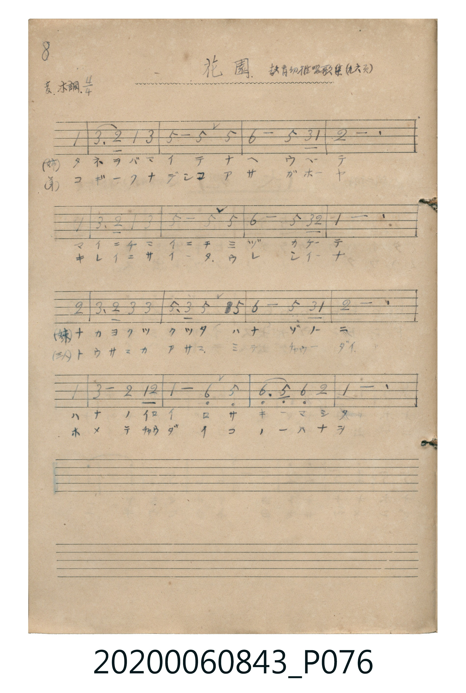

# 花園

> Re:Shōka 使用 AI 協助辨識與重建樂譜，可能會有錯誤。歡迎回報。

- **鋼琴伴奏版**：<br><audio controls src="hanazono.mp3"></audio>

- 曲：教育幼稚唱歌集

## 說明

花園 (Hanazono)
Source: 唱歌帖 (Shōkachō, NMTH 2020.006.0843) — P076.jpg (Notebook 2, p.8)
Notation: Handwritten numbered notation (Jianpu)
Annotations: 変ホ調 4/4, 教育幼稚唱歌集 (九六頁)


## 歌詞

```text
（TMD 檔案未包含歌詞註解）
```

## ABC

<div class="abc-score" data-abc-src="hanazono.abc" aria-label="五線譜載入中"></div>

[下載 ABC 原始檔](hanazono.abc)

## TMD 檔案連結

- [主旋律 TMD 檔案](hanazono.tmd) [[在 TMD Studio 編輯](https://tmdlang.github.io/Tmd-TS/#tmd=s7IKdvYPcrWy4qpTUCpJTLdSSM7PyUlNLsnMz7MqzsjPTkzOyFeCS5bl55TmploBqXgDI4RwcX5pUXJqfEFieqpVgIG5GboM3KT4vPyS1KT8_GyEioKi_LLUvMQ8oKrcxLzS4uSizIKS-OT8gkqEmtSyzJRUkIrUlMyS_KLMxBwkJ6UWFYMdC3FDSVFiHsQMoCBCVUlGKtDdBTmJeSUIQaBJ6Zl5VrmpmVmZ8SWpFSWoLssvKsnITy9KLMiotMrILAZZnJyYE5-dmJeoxKWlpfCia-PTOZMUtLS4FG0VDA0MuOxtFVx1uGxM9E3sQIY8m73p_Z5Zz6bOfNG06enOPc9XzHo6ZeOztT0vZ7cpcXHpaynYUgtwKSjAXKPhAXReVX5eviZIMBgS_AoQi5_umKagEZxxtBcUF0d7dRT8fEM8FIwMjAz0DAzM9AwsTIw1FR41TFEAxaFeVkG6goYfNL4UjHQUCvQswIYCxRLB6UMBaFdKeVFmSUlqnkJeaW5SalFqigIwisHSChpemYl5BaVgPY55MOFioGuWdD5unv1i1X4FYFDpKGANIQWNJzvnPm1d-3JBI9gAygMJChS09Lm4YIFkFQB0Yr5DjUFNNcgSBRtDMy07MAsYPUCHvFg5zwqkASpiqKeg8XR5p6bC46b9j5t7HzdvUnjcPOFx87zHTUseN7cBOV2Pm2cAZZcBKZCAPlAIItn9uLkRyOlG5sx_3NwKVLz6cdNGkGKEPRpPl-0EWgI0DSjZvOJx03ogpwVIPW5uBloN5PSDJfc9bu4DGQq2BywE4oNsWAshgZytj5vWgh2xHaQTYYcRyC975oP8svlx0zqIHUAD2sEqNwOFF4E1rwFGFVBmCcgOkElrID6AmLwE7BqQd4HCQG1LQGYge-TJjs4nu3aB_NIBUgbU0wwyGuhlsOkgDigYQEHX-Lh5MdioBpA5IB_Nfty8EJscyMVgj0O8vAlmYY2CgYIuVlidm1arYAjl1CgYI0kZATFMBiZeo2CKZgCMD6NrFMxwqACZATKvBmwyNgh3ByyUHMLygQWLFShVAT3VC8TgdAVKO6DYBNLgpAXE4LQFocFie8BqEOGNMAkUyuuAGBSrIFUg3e1A_nao3CJQBALxGlA4g-MXrK5pLSIwaR1KIDNr4KaiQ1joYQklkFuBCRCSodD484EYnKmAeCNSKCGnSrhJzUDfw3SDQwOUtkBxAAoJUDiD5EEhBknXEJM6cIcQjI89hECidEpHQN83r4DGfguUbob6rR_il6Z9QBpSekD81Y81HQFDARQykFyLSDeQjAsNX2juBLIaoGEFMm829nBCjluQD7CnArN4WHDAGMCQgjHh4nAReGLBmZxgJQNmYIEjFlxsAmlQiQmjQQkCSIMzISgRIJeeCN0L8QUCKKtBSiqoPeCyqpaLS9cOVHmC6yAFIFuZCwA)]
- [鋼琴伴奏 TMD 檔案](hanazono_piano.tmd) [[在 TMD Studio 編輯](https://tmdlang.github.io/Tmd-TS/#tmd=s7IKdvYPcrWy4qpTUCpJTLdSyC8qychPL0osyKi0ysgsLskvykxOzInPTsxLVIIrKs4vLUpOjS9ITE-1CjAwN0PIlGSk5qZaFacmFufnFStxaWkpvOja-HTOJAWNx81THjctetzc92TPlqdL-5_snqGpoKXFpWirYGhgwGVvq-Cqw2Vjom9iBzLr2exN7_fMejZ15oumTU937nm-YtbTKRufre15ObtNiYtLX0vBllqAS0EB7kQPoCer8vPyNRUeNUxRCMhMzMtXcExOzs8tSMzLzE3NKwEpDgb73UoB4qCnO6YpaARnHO3NTkwGkjoKfr4hHgpGBkYGegYGZnoGFibGUNOAwaSXVZCuoOGXX5KalJ-frWCko1CgZ6EJMpRyf0CBgpY-FxfMH1ZgLzjUGNRUgyxRsDE007IDs2oUDBR0scLq3LRaBUMop0bBGEnKCIhhMjDxGgVTNANgfBhdo2CGQwXIDJB5NWCTsUG4O8COBka7Q1g-MDVaATmPm_YrPG7uBeJNQDwBiOcBxZYA6TYg7gLiGUD-MggNFtsDVgMMHyxmbQbidUC8HqoOpL8dyN8OlVsExFuBeA1QfDYQg-wBqmtaCzOP9iEFMrMGbio6hIUgJKQwXQPjY3cNSJR28YbqGmTXgtRh95dZPMxSGAPoHhgTLg4XgXsfZwDB0nsNVy16BgnyIDWLFNQC7ddG5BIQRxvmSSDHPF4b5iIkdSiqgC7VNtaGBSkxbJAOE21YpKCyEarQLMFwDD4eerQNLm8h2Y7pNNwcZG3E-Qu7Uag-Q5EavDGGx5sYwYlpqkm8NjyHGcdrI2VFXDLI4uh2gNXBzcbHw5NXfZDzqglaVjUE53-gYwyBBqKxTeJByBCsBihqFA-Rw1qzgEr3biBuhNAo_PlA3AoUWw3EG5Fqli7sNUszsMaA6QfXIEA2uOYC1R6g2gkkD6plQGpAtQ7IrA5ErYLfO0C-aTxYCsIAU9j9BHRv8wpoDdcCpZuhbumH2N20D0j3Qf0Kckc_jtoS6G6QX5pBNSMoHKC1I4gPDh9QmDQ-bl4M8WED1HcgE2cT6zOiIgocYEAHg41fi0SDAhpIg5sEoMDdjyNyFuJzLKjiBwcHNHiADQ0kxwPdCg59GAfsZrDrDaExA_NWPDB1glOyrp0CLDErANnKXAA)]

## 分析

```text
================================================================================
📊 TMD Song Profile: [ 花園 ]
================================================================================
⏱  Duration:       0:40 (40.8s), 17 measures total
🎼 Key & Tempo:    首調基準 E,, != 100.0 BPM, <4/4>
   - 分析範圍：      由實際發聲的音符與和弦推測調性；播放脈絡另行呈現
🎤 人聲音域:    A#3 (MIDI 58) – C5 (MIDI 72) [跨度: 14 個半音 / 1.2 個八度, 難度: moderate]
   - 最低音:  A#3 in [Hanazono #1 @ m.15, 0:35]
   - 最高音: C5 in [Hanazono #1 @ m.4, 0:07]
   - 適合: soprano, mezzo-soprano, contralto, tenor, baritone, bass
🏛  結構:      Hanazono (40.8s)
⚡ 編曲密度:        Peak 1 軌道同時演奏
🗝  調性診斷：       D# 大調（純淨自然大調，未偵測到可信轉調）
   - 風格氣質:    純淨自然大調（陽光明朗、易唱易記，無明顯調外色彩）
   - 轉調歷程:    全曲維持單一推測調性（未偵測到可信轉調）
   - 核心骨幹音:  A#, D#, G, F, C
   - 調性數值:    D# 大調 [相關度: 0.83, 穩定度: Moderate, 自然音純度: 100.0%]
   - 候選調性 (K-S): D# 大調 (0.83), A# 大調 (0.78), G 小調 (0.64)
   - 五度圈歷程:   -3
   - 各段落調性細節:
     • [Hanazono #1]: D# 大調 (r: 0.83, 自然音純度: 100.0%)

  [ 五度圈游移軌跡 ]
               C  
         F            G  
      Bb               D  
     [Eb]*              A  
         Ab           E  
            Db       B  
               F# 
     (* = active key center)

  [ 十二半音累積音高分佈 ]
     C  : ██████████████            14.8%
     C# :                            0.0%
     D  :                            0.0%
     D# : ██████████████████████    22.7%
     E  :                            0.0%
     F  : █████████████████         18.0%
     F# :                            0.0%
     G  : ███████████████████       19.5%
     G# :                            0.0%
     A  :                            0.0%
     A# : ████████████████████████  25.0%
     B  :                            0.0%
--------------------------------------------------------------------------------
Assignment 軌道音域：
  - Piano         : A#3 – C5 (14 個半音 / 1.2 個八度, 53 個音符)
================================================================================
```


## 原書掃描頁




