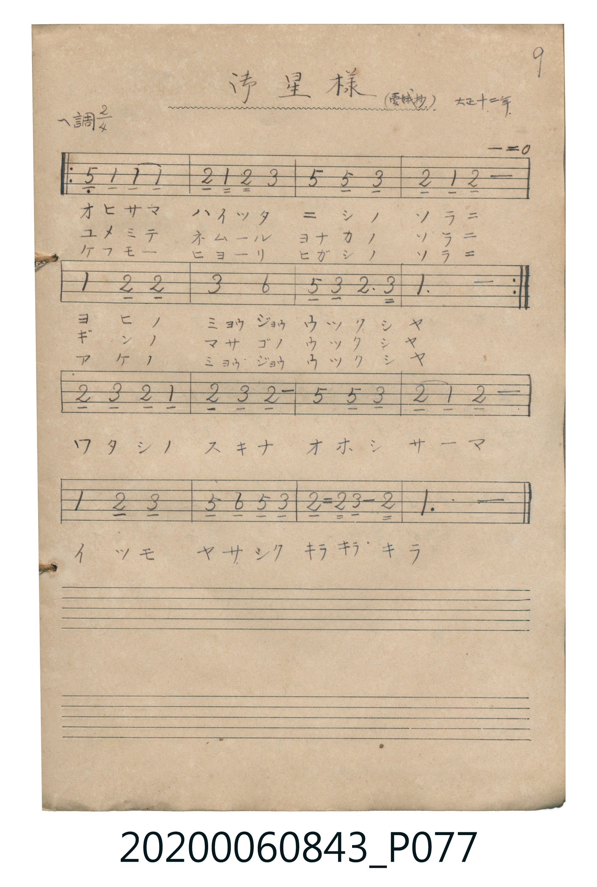

# お星様

> Re:Shōka 使用 AI 協助辨識與重建樂譜，可能會有錯誤。歡迎回報。

- **鋼琴伴奏版**：<br><audio controls src="ohoshisama.mp3"></audio>

- 曲：愛吟抄（大正十二年）
- 唱歌帳（2020.006.0843）P077.jpg（第 9 頁）

## 說明

> [!NOTE]
> **原頁資訊與校勘記**（對應 `P077.jpg`，手抄簡譜第 9 頁）：
> - **調性、拍號與出處註記**：題首左標「ヘ調 2/4」（F 大調 `?= F`、`<2/4>`），中題「お星様」（首字作草體／變體假名風「お」），右註「（愛吟抄）大正十二年」，第 4 小節上方特註記譜凡例 **`– = 0`**（表示句尾短橫線 `–` 代表休止符 `0`）。
> - **曲式結構（`||: 第 1–8 小節 :||` 接第 9–16 小節）**：前兩行（第 1–8 小節）首尾明確標示反覆記號 `||: ... :||`，譜下並列三排歌詞（分別詠夕暮「ヨヒノミヨウジヨウ」、夜半「ギンノマサゴ」、破曉「アケノミヨウジヨウ」）；後兩行（第 9–16 小節）無反覆記號，譜下為單排結尾歌詞（「ワタシノスキナ　オホシサーマ　イツモヤサシク　キラキラキラ」），故依實際曲式展開為 `-> PartA[L1] -> PartA[L2] -> PartA[L3] -> PartB -> #`。
> - **手抄記譜與歌詞筆誤校勘（依 Policy A 校訂）**：
>   1. **第三節第二小節歌詞筆誤**：原抄第三節第二小節將「ヒヨリ／ヒヨーリ」（日和，「ケフモーヒヨーリ」＝今日も日和）筆誤作「ニヨーリ」，今依 Policy A 校訂還原為 `ヒ ヨ - リ` 並備載原貌。
>   2. **第 3 小節節奏**：原抄作 `5 5_ 3_`（四分音符接兩個八分音符，與第 11 小節同型），修正先前版本誤植之 `5_ 5_ 3`。
>   3. **第 4、8、10、12、16 小節休止符與漏底線**：依原抄右上凡例 `– = 0`，句尾 `–` 均轉為八分休止符 `0 -`；其中第 7 小節 `2. 3=` 之 `2.` 漏畫單底線、第 12 小節 `2_ 1 2_ –` 之 `1` 漏畫單底線（比照第 4 小節 `2_ 1_ 2_ –`），第 16 小節 `1. . –` 多點一墨點，均依 Policy A 校訂為標準拍值。
>   4. **第 15–16 小節「キラキラキラ」特殊簡譜記法**：原抄第 15 小節寫作 `2_ = 2= 3_ – 2=`、第 16 小節寫作 `1. . –`，譜下對位「キ ラ キ ラ ' キ｜ラ」（第四字「ラ」右上附換氣撇號 `'`）。因本頁單橫線 `–` 已定義為休止符 `0`，楊氏於第 15 小節第一拍第二音以雙橫線 `=` 表示同音十六分音符 `2=`（與第 2 小節 `2_ 1= 2=` 同為「前八後十六」節奏），第二拍則以 `3_ – 2=` 表示「八分音符 `3` ＋十六分休止符 `0` ＋十六分音符 `2`」接次小節 `1.`（「キラキラ、キラ」），全小節拍數與字音嚴密吻合（`| 2 - 2 2 3 - 0 2 | 1 - - - - - 0 - |`）。
>
> **前半段（第 1–8 小節，`||: ... :||` 反覆三遍）**
> 1. オヒサマ　ハイツタ　ニシノ　ソラニ
>    ヨヒノ　ミヨウジヨウ　ウツクシヤ
> 2. ユメミテ　ネムール　ヨナカノ　ソラニ
>    ギンノ　マサゴノ　ウツクシヤ
> 3. ケフモー　ヒヨーリ（原抄筆誤作「ニヨーリ」）　ヒガシノ　ソラニ
>    アケノ　ミヨウジヨウ　ウツクシヤ
>
> **後半段（第 9–16 小節）**
> ワタシノ　スキナ　オホシ　サーマ
> イツモ　ヤサシク　キラキラ'キラ


## 歌詞

```text
（TMD 檔案未包含歌詞註解）
```

## ABC

<div class="abc-score" data-abc-src="ohoshisama.abc" aria-label="五線譜載入中"></div>

[下載 ABC 原始檔](ohoshisama.abc)

## TMD 檔案連結

- [主旋律 TMD 檔案](ohoshisama.tmd) [[在 TMD Studio 編輯](https://tmdlang.github.io/Tmd-TS/#tmd=s7IKdvYPcrWy4qpTUCpJTLdSSM7PyUlNLsnMz7MqzsjPTkzOyFeCS5bl55TmploBqXgDI4RwcX5pUXJqfEFieqpVgIG5OboM3KT4vPyS1KT8_GyEioKi_LLUvMQ8oKrcxLzS4uSizIKS-OT8gkqEmtSyzJRUkIri5MS8-LLUosy0zNQUJGelFhWDHQxxR0lRYh7EHKAgQlV-UUlGfnpRYkFGpVVGZnFJflFmcmJOfHZiXiJCUUlGKtCDeYklpUWp6KIlmbmp8flp8SmJSG4DmpKemWdVkpgJ9GQ8EJcnxucmZublJOYBXailpfC4sevZjPnPls9Q0NLiUrRVsDTjsrdVcOOyMdI3sQMZ82z2pvd7Zj1rmf10wvxnXS3v93Q8XbL82drFT3sbn-zqebpzy_s9nWD7nk7Z-Gxtz9Mdm4FKjAyMDPQMDMz0DCxMjIEKQMGul1WQDpR6vmaNgqXCywWNYH1c-loKttQCXAoKCnYK0Yp-_iGusRCOltbTvvlAy15sbn-xoutFR_uzBQufds94sWKGlhbIKxt6n7V3KiTA3Jfwfk_Ps85uoD-fb1j4Yu0cZMcCQwFipi7Q1Ber9j9rWP64ofFZd--LmfOBBj9t3_Vi5tQXK3ZDzZ71cmHPy2XTnm5f9mzFzMcNPY-bZwA1KQCD9XFDL9BqNwVgOIJEEkDhnQA0KgEc5kAnAK3qebJjLdAAkD5YBEG0gYxcO_3J3jkvejtfrp7yfk__i3VdQMbTxvanE3pfLloB0QJWDDLnaf9moJuAgkC9SJHYiRaJYPU9IO-aKDzd0P98fcOTHV3Ppu183rkT4iVgYDxtX_hkXzfQ8wmPGiYr2CoYJIDD8MXCFc-X7Hrav_Tphn3P5699tnL18-2zFEBqEhSe7F4MlH6yZ-KztYuer1mmkGAA8t7jhiZESALT19M9_c-3Tni2vBtoWkJNjZUCyB2GQAMsoG5RsKqpSVB41rcUHB9ACUMzqAzQNHBgP-3sfdq68sVCkDfRdQPVgEJtw75nM_qeL9oFjA6we3tfLGsDeWzmfAWwpXp6emB7gOEA9OyTHd1Pdix72jH9yY7OZ32TgCn7xcp5oBTT0fa0Y-mLlQueLpn6bNY6cMSueNw86XFz3-Pm-SB207LHTTugjIZeYLw-XTLnaS8wRnoeN6173LwZrHLe46atj5tAwQ5U8HzBlmezgaECVLDocdNGXEaBI3T20309KD5FD47nLQuR_Qb3zfOmXU-nrQN6BRjUoLCAeQjsg_WPm_Y_btoOsrlp5-OmtY-bge5teNy06nHzbJA40LHNe0CuBgkuedzc8rh50ePmJWBPAGXXg8WBulaikLA0-Gxq65N9c5-uX_Zy1mxIdD_dOPXlNJCTFBJ07RQCEotKHKN9DGMVEBwjZI4xnOMEYigDcwtyCgJnWEgaBeVwsM-er217sWoJJLcDfQm0XyEgPyczuVLBUQEo-mJFEyzpQAxSUDDUA5oFDFFghANDEsQA5gxwqCKbCEltfaBchFXt0w3t4BAFJghgslgFzJ8wNjD8VkHy8LPpS59OAsYfOHuD4nsqODiBCtBUzn2yuwuo-HFTE0xLJ8QVwPwPtqUbVX0PUD0Wn75sagG6GBzaQCsUgHqA4QbUA8yfwCTeNPMFsDjom_9iE9A90GBVUDCChoaCMTRpgfy2tB_J-0A3KCSYKpjGKxjHAzNNx9PZs4GZ4-X8zcCMDsyqwET6tKH7aetquCAoKXa0g3OnIdTQpxN6ns4DZntwibd_HahEau0A5uXnnR3P5qwBReCS3ic7u4H2xIMtQkS8goIxzIXAArXRAogNDUCEEYiA5Qd4yQNKF8Bkt2sqsGwC-wGUIMHeABaQwKIOWrbBSzZwyQkq0aAF2dO57S_2doLyENhDyCWagi5Q9eynrduARTbIOeawQisBGIbGtsBABnnASA9YgAHLuamrgbkQ4g5QzgcFhhFCQ7yCoQKQgJSdIG2GGLpA6Wf9lOety5ELa4jWeJheSICCDYeFBNAoPQU9iMlPl8x6uXvekx0NTxetADJAfp3bjiXdAL0LLCyf7ZoGrOSeNuxBCnsTWNgbmiIXP-D0jKUYANYiz9Z1QapUYD59tnkqajYCGgNLEOtXg9MV0CO2Cka2wKQFcjKQBaogUTwEUwn3FrykA1bqT_YCy1WQW4DJfKUCjFYHsd4Dsw60bAKVn6BUu3Y6ODOBBCGp4eXMlmf9s59tWPxsUju4flCHVltPZy8ApktgewBUlCJXdE-3b3q6btbzfSuBYYZW3fU8W9r1bEP_s2l7UHwKLj0agCELKT2AWeTJ7qUvZ8-EGQtMONCadQJIElhTP21dC89LwBCyBWU6aIZCTUKgkAM6aUIP0DFAn4HrxtWgegNsBig-wHkZnkqA1oNiuLMd6AKFBESQQx0AMgIpGwNVJCi839MNdxGKf1Fk4G4Fxl4vsEx4tmYhIjWCnI-eYBoa0aqOp60roGVwd--zqTtA7ay100HBMWvL0_VtTyfsfjqhA9xqAAaBLhAbAcsrXQUDIF0DzEq6cAjMpQqgqh3e9oA3D4GB09v1bN1WrA2HHpSWgQKkYgUW-i8bQe4DtpjBpgCTILiqnASuJ8GVZHM_tJ4E1qsgbje0dgXVk3tBHmzuhuUlUHkMbUCAVGJW_EAty8BGAWtpoCFLIBqBhcvjZqD4QrCWNrDe3sfNC8DVwWowF2hs1-Om1TjthTdHQIphLRKoYiw2AgtclNoKpAtRYYFqAEh-xldDAcMfrKtpDb4AgTeDSAgQeISC0jlShGI2FyEqURo9ICOxtXtAbGjTB6oL3voBOQ1nA0gdQoH0UN6tgQIFLX0uLnCDyCogMzEv36HGoKYaZIOCjaGZFtj_CtW5BbVgBrZuFahZDSxygJkMmOGBDUgFDYx2NlJq11GAdYo0sRgFdAvImhpQrawLzmkwDMmJwGoMnBNBEKgIygLRIFGYGlCOheZNsHE-hjWgnARunUwCkU1bwex5YD3ATAUWWwJktQDp_XDzgYkHygbGBlhHH0S8aS-YtxJMgtSAXAu1ywikbxlYZiGYnA8m26Am9oJ5C8DkaiSbQJkKbhlIgijLjEHyG8EyU8HkIiQjwV6FNcqQxYHZhCR_QeMEVvBBikSQBlhUmMFNh0UFSB7EwlJcIqIE7DawM6BuhToDljfhjoRmUYQfwGxQdIFk18O9AtK7BMk-tGhpWge3bzOKfaBCCm4ZqKyixCZwnMDiARY7tPFZLSTnOlGUc4FlZyOwuQLPuSglG5HZFRTdsGhH5FaYCDjaic-tIL-CfA7JiuhJdCdYbC1YDJRjwCEBzd6QuJ0N1wUSh0csOLvjTNAQF4HcBkrMqG4kUP_DXQ0sQmB2geMPnBthMQctdCC-AccsSAfEH4i2JMiFIDZIF4iHEd_k9Gu5AA)]
- [鋼琴伴奏 TMD 檔案](ohoshisama_piano.tmd) [[在 TMD Studio 編輯](https://tmdlang.github.io/Tmd-TS/#tmd=s7IKdvYPcrWy4qpTUCpJTLdSSM7PyUlNLsnMz7MqzsjPTkzOyFeCS5bl55TmploBqXgDI4RwcX5pUXJqfEFieqpVgIG5OboM3KT4vPyS1KT8_GyEioKi_LLUvMQ8oKrcxLzS4uSizIKS-OT8gkqEmtSyzJRUkIri5MS8-LLUosy0zNQUJGelFhWDHQxxR0lRYh7EHKAgQlV-UUlGfnpRYkFGpVVGZnFJflFmcmJOfHZiXiJCUWIRUHN6am5qXolVQWZiXn58YnJyfm5BYl4mSAyhsCQDqMgqNaU0ORFijZaWwuPGrmcz5j9bPuP9no6X3XueT9jyZM-Wp0v7n3d2vN_TqaClxaVoq2BpxmVvq-DGZWOkb2IHMu7Z7E3v98x61jL76YT5z7pagHqfLln-bO3ip72NT3b1PN25BagXbO_TKRufre15umMzUImRgZGBnoGBmZ6BhYkxUAEo2PWyCtKBUs_XrFGwVHi5oBGsjysgsajE0SoA5BeHGoOaai4FILAxNNOyA7OqcwtqwYwaBdN4BV0FQyRco2AEZhkpGANpEAQqgrJANEgUpkYXTBuARMDG-RjWKDxuWgXkP26eBCKbtoLZ88B6Hjf3g8WWAFktQHo_3PzHzd1Q9uOm7WAdfRDxpr1g3kowCVIDci3ULiOQvmVgmYVgcj6YbIOa2AvmLQCTq5FsWvG4uQtuGUiCKMuMQfIbwTJTweQiJCPBXm1eASZBnoeLP25aQ5K_oHECClgQBAUuCNfAo8IMbjosKkDyIBZCFwiiRQnYbWBnQN0KdUbzfFB4NIECEeLIHSh8kEMhAdwCll0P9wpI7xIk-9CipWkd3L7NKPbNg6QIiDFbIOJk2wSOE1g8wGKHNj6rRclSQR5YMxU8TxnHa4OzFZjWBsULlIJGXby2ebw2JOIgUtqIrAZka8OzG6oUQp9JvLYZ3GCoGCLKoQ6A24hqH9gchLGG2ibaiFQFsx2uBF0vqsmIpIYaQD7IAWSCET6G8UBz4sEuiQdx0ERAGOYToASYC2KYwBhwEQOEzU5ElXYgj8ByDaKwg4mAvUJ8YQdKKqCEAynJ0HP4TrDYWrAYqMABJyRo6QjJGrPhukDi8HwBLi1xlgcQF4HcBoo1VDcaQQttAyCNszwA2QVL4NDkDy7MYAkfWmZDfAPOGCAdEH-sBLMg5VY8mA3SBeJhzS7QOCGUXTDzA5SJRQo5sdM2r8ANRNgDyyvI9uLMzgZwCYK5BhpOBHINPLPA8whx2QZTDzTb6NopgPNstI9hrAKCY4TMMYZznEAMZS4A)]

## 分析

```text
================================================================================
📊 TMD Song Profile: [ お星様 ]
================================================================================
⏱  Duration:       0:40 (40.0s), 32 measures total
🎼 Key & Tempo:    首調基準 F, != 96.0 BPM, <2/4>
   - 分析範圍：      由實際發聲的音符與和弦推測調性；播放脈絡另行呈現
🎤 人聲音域:    C4 (MIDI 60) – D5 (MIDI 74) [跨度: 14 個半音 / 1.2 個八度, 難度: moderate]
   - 最低音:  C4 in [PartA[L1] #1 @ m.1, 0:00]
   - 最高音: D5 in [PartA[L1] #1 @ m.6, 0:06]
   - 適合: soprano, mezzo-soprano, contralto, tenor, baritone, bass
🏛  結構:      PartA[L1] (10.0s) -> PartA[L2] (10.0s) -> PartA[L3] (10.0s) -> PartB (10.0s)
⚡ 編曲密度:        Peak 1 軌道同時演奏
🗝  調性診斷：       F 大調（推測轉調經歷 1 次）
   - 風格氣質:    純淨自然大調（陽光明朗、易唱易記，無明顯調外色彩）
   - 轉調歷程:    F 大調起奏 ➔ [PartB] 轉至 C 大調 (-5 半音 / 五度圈 +1 步)
   - 核心骨幹音:  F, G, A, C, D
   - 調性數值:    F 大調 [相關度: 0.79, 穩定度: Moderate, 自然音純度: 100.0%]
   - 候選調性 (K-S): F 大調 (0.79), C 大調 (0.67), A 小調 (0.53)
   - 五度圈歷程:   -1 -> -1 -> -1 -> +0
   - 各段落調性細節:
     • [PartA[L1] #1]: F 大調 (r: 0.82, 自然音純度: 100.0%)
     • [PartA[L2] #1]: F 大調 (r: 0.82, 自然音純度: 100.0%)
     • [PartA[L3] #1]: F 大調 (r: 0.82, 自然音純度: 100.0%)
     • [PartB #1]: C 大調 (r: 0.71, 自然音純度: 100.0%)

  [ 五度圈游移軌跡 ]
              [C ]*
        [F ]*          G  
      Bb               D  
      Eb               A  
         Ab           E  
            Db       B  
               F# 
     (* = active key center)

  [ 十二半音累積音高分佈 ]
     C  : ██████████████            16.9%
     C# :                            0.0%
     D  : █████                      5.9%
     D# :                            0.0%
     E  :                            0.0%
     F  : ████████████████████████  30.0%
     F# :                            0.0%
     G  : █████████████████████     25.7%
     G# :                            0.0%
     A  : █████████████████         21.5%
     A# :                            0.0%
     B  :                            0.0%
--------------------------------------------------------------------------------
Assignment 軌道音域：
  - Piano         : C4 – D5 (14 個半音 / 1.2 個八度, 98 個音符)
================================================================================
```


## 原書掃描頁




