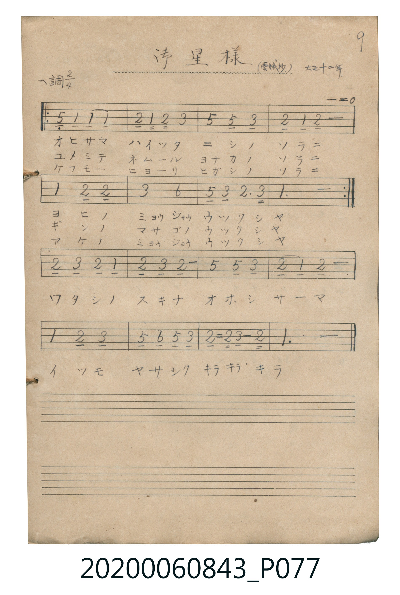

# お星様

> Re:Shōka 使用 AI 協助辨識與重建樂譜，可能會有錯誤。歡迎回報。

- **鋼琴伴奏版**：<br><audio controls src="ohoshisama.mp3"></audio>

- 曲：愛吟抄 (大正十二年)

## 說明

お星様 (Ohoshisama)
Source: 唱歌帖 (Shōkachō, NMTH 2020.006.0843) — P077.jpg (Notebook 2, p.9)
Notation: Handwritten numbered notation (Jianpu)
Annotations: ヘ調 2/4, (愛吟抄) 大正十二年, - = 0


## 歌詞

```text
（TMD 檔案未包含歌詞註解）
```

## ABC

<div class="abc-score" data-abc-src="ohoshisama.abc" aria-label="五線譜載入中"></div>

[下載 ABC 原始檔](ohoshisama.abc)

## TMD 檔案連結

- [主旋律 TMD 檔案](ohoshisama.tmd) [[在 TMD Studio 編輯](https://tmdlang.github.io/Tmd-TS/#tmd=s7IKdvYPcrWy4qpTUCpJTLdSSM7PyUlNLsnMz7MqzsjPTkzOyFeCS5bl55TmploBqXgDI4RwcX5pUXJqfEFieqpVgIG5OboM3KT4vPyS1KT8_GyEioKi_LLUvMQ8oKrcxLzS4uSizIKS-OT8gkqEmtSyzJRUkIrUlMyS_KLMxBwkJ6UWFYMdC3FDSVFiHsQMoCBCFVBTemaeVUliJtAp8UBcnhifm5iZl5OYl6LEpaWl8Lix69mM-c-Wz1DQ0uJStFWwNOOyt1Vw47Ix0jexAxnzbPam93tmPWuZ_XTC_GddLQoaT5csf7Z28dPexie7ep7u3KKpxMWlr6VgSy3ApaCA5CgN_4z84ozM4sTcRE2QTDAkXBWeTtn4bG3P0x3TFDSCM472ggL5aK-Ogp9viIeCkYGRgZ6BgZmegYWJsabCo4YpCqDI0csqSFfQ8INGhIKRjkKBniXYUKBYIjjiFTyAwVJelFlSkpqnkFeam5RalJqiAIw7sLSChldmYl5BKViPYx5MuNhK4XHzjBer9isAg0xHQQMeVJoKaEGlo6CrYKtgANJOeThBgYKWPhcXIpCswvKTE3McagxqqkHWKNgYmmnZgVnAOAKG2IuV86xAWqAihnoKj5tWPW6e9Lhp6-PmeUCP9D9uWvK4uflx034gp_tx0_bHzX1ANXsfN68E8hX0gaIrQOpBos3zHzcvf9y07HHTDggDqHDZ4-aWx03rwRqXINlkBLSpGSi5EKyrDcjpfdy84HHznsfNqyFmdj1uWo1hWdO6x82bIZbNA7mxaQtECS5rjEEe2vi4eerj5kVAw8F-ADoNZM0qIAfozzXY_NS0CKyLRD9pBKWmFQEzkyZQG1B2P9zknY-b1gI9BAnb2UBhIAsYvkBHzAPbBgzhFqADgdqWgD21HWg6UBioZyUyCbOqRqE6t6BWwTQemH4MkXCNghGYZaRgDKRBsEbBFEiCMEIEokYXTINFYM53AKcVYOptAgcNyI2gYAYlAogbm4FMYBBCkgKQBnoDEnBAeiVYDBEWcMOagSHWvBAUkEAMjmcgBkU0xDB4bAPNATGxmlcDdjAIghwNwjVwD5mheBUkCvGYMZIuEDTA6tXmFRCvIkc10AVIcQ0UbwHSoPgA-Rc5vhEBtg4osxlqCjDAQAHXtAWfbkg0wFyLiDyE-2E-AkGYz4iJvGaQXcAYgsfOTlBKArLByQ9Iz4bIgRMg2LlYAxliHchiUACjOgCUviC0EVGB3LQEEgyQFA4NHpATwIkcEtlYaKC7arm4dO0UEMWZApCnzAUA)]
- [鋼琴伴奏 TMD 檔案](ohoshisama_piano.tmd) [[在 TMD Studio 編輯](https://tmdlang.github.io/Tmd-TS/#tmd=s7IKdvYPcrWy4tLSUnjc2PVsxvxny2coaDxunvK4adHj5r4ne7Y8Xdr_ZPcMTQUtLS5FWwVLMy57WwU3LhsjfRM7rjoFpWezN73fM-tZy-ynE-Y_62pR0Hi6ZPmztYuf9jY-2dXzdOcWTSUuLn0tBVtqAS4FBWSX-mfkF2dkFifmJmoqPGqYohCQmZiXr-CYnJyfW5CYl5mbmlcC0hGcX1qUnGql8HTKxmdre57umKagEZxxtDc7MRlI6ij4-YZ4KBgZGBnoGRiY6RlYmBhDTTMwN9fLKkhX0PDLL0lNys_PVjDSUSjQs9QEGUq5Z6BAQUufiwvhE6uw_OTEHIcag5pqkDUKNoZmWnZgVo1CdW5BrYJpvIKugiESrlEwArOMFIyBNAjWKJgCSRBGiEDU6IJpsAjYTGDkOIAttAKFbNMqhcfNk4D0ViA9D4j7gewlj5ubgcw9QOZ-IN0NpLcD6T4gvRdIrwSLAf2AaVzzMiBeCMTzgbgNiHuBeAHYKDBeDcQrHjd3AU0CMbGaWAN2NAiCHA7CNXBPmaF4FyQK8Zwxki4QNIB7FxIMMJWIwEPohZkGgjBTcQUeqtsgKkF6QO5C1QuKGghthNVttSgpAJyMgzxwpAFgEjCO1zaN14YZg8QE2h-vbR6vDXMnSEobkQaAbG2451ClMPQh8WC-RbUTWQGqaYbaJtqIuEGzFEUbqkdAYYFmH243EZClqldxhSEym5CDcHkVS9T7IEe9CTzmDYFmgK0BspB5pvFABrbstwKSm0EZq3n-4-blj5uAGbJpB5wFyp4tQHo9NEsvwZ6Nm9YB5TZDzQGWCqDSoWkLPv0g1wEdBqJMkB2pYBgP9DlWt4LMABYv8KJlJxCvBbJBhQOoVJoNkWvaCik65iGsAhpuhGoJwZBpWgJxefMisKshPgKZDnIFyFZgEYSFRvId2AYcvgPGqK6dAiJSFYA8ZS4A)]

## 分析

```text
================================================================================
📊 TMD Song Profile: [ お星様 ]
================================================================================
⏱  Duration:       0:20 (20.0s), 16 measures total
🎼 Key & Tempo:    首調基準 F, != 96.0 BPM, <2/4>
   - 分析範圍：      由實際發聲的音符與和弦推測調性；播放脈絡另行呈現
🎤 人聲音域:    C4 (MIDI 60) – D5 (MIDI 74) [跨度: 14 個半音 / 1.2 個八度, 難度: moderate]
   - 最低音:  C4 in [Ohoshisama #1 @ m.1, 0:00]
   - 最高音: D5 in [Ohoshisama #1 @ m.6, 0:06]
   - 適合: soprano, mezzo-soprano, contralto, tenor, baritone, bass
🏛  結構:      Ohoshisama (20.0s)
⚡ 編曲密度:        Peak 1 軌道同時演奏
🗝  調性診斷：       F 調性不明確（純淨自然大調，未偵測到可信轉調）
   - 風格氣質:    純淨自然大調（陽光明朗、易唱易記，無明顯調外色彩）
   - 轉調歷程:    全曲維持單一推測調性（未偵測到可信轉調）
   - 核心骨幹音:  G, F, A, C, D
   - 調性數值:    F 調性不明確 [相關度: 0.68, 穩定度: Ambiguous, 自然音純度: 100.0%]
   - 候選調性 (K-S): F 大調 (0.68), C 大調 (0.67), G 小調 (0.46)
   - 五度圈歷程:   -1
   - 各段落調性細節:
     • [Ohoshisama #1]: F 調性不明確 (r: 0.68, 自然音純度: 100.0%)

  [ 五度圈游移軌跡 ]
               C  
        [F ]*          G  
      Bb               D  
      Eb               A  
         Ab           E  
            Db       B  
               F# 
     (* = active key center)

  [ 十二半音累積音高分佈 ]
     C  : ███████████               14.5%
     C# :                            0.0%
     D  : ████                       4.8%
     D# :                            0.0%
     E  :                            0.0%
     F  : ███████████████████       26.6%
     F# :                            0.0%
     G  : ████████████████████████  33.1%
     G# :                            0.0%
     A  : ███████████████           21.0%
     A# :                            0.0%
     B  :                            0.0%
--------------------------------------------------------------------------------
Assignment 軌道音域：
  - Vocal         : C4 – D5 (14 個半音 / 1.2 個八度, 51 個音符)
================================================================================
```


## 原書掃描頁




