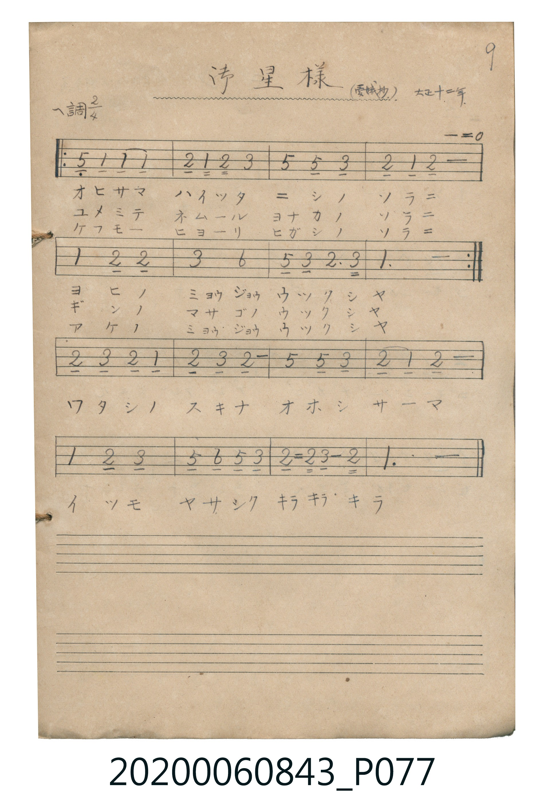

# お星様

> Re:Shoka 使用 AI 協助辨識與重建樂譜，可能會有錯誤。歡迎回報。

<audio controls src="ohoshisama.mp3"></audio>

- 曲：愛吟抄 (大正十二年)

## 說明

お星様 (Ohoshisama)
Source: 唱歌帖 (Shōkachō, NMTH 2020.006.0843) — P077.jpg (Notebook 2, p.9)
Notation: Handwritten numbered notation (Jianpu)
Annotations: ヘ調 2/4, (愛吟抄) 大正十二年, - = 0

## 跨冊／重複收錄參照

> 同名異曲（各冊收錄之不同詞曲版本）

- **[同名異曲]** 《新定兒童唱歌》尋常科第一學年用（2020.006.0847.0001）：[**〈オホシサマ〉**](../../../shintei_jido_shoka/grade_1_2020.006.0847.0001/1_08_ohoshisama/index.md)（`F` / `2/4` — [原始 TMD](../../../shintei_jido_shoka/grade_1_2020.006.0847.0001/1_08_ohoshisama/ohoshisama.tmd)）
- 總表：[跨冊重複與同名歌曲總索引](../../../duplicate_songs.md)

## 歌詞

```text
（TMD 檔案未包含歌詞註解）
```

## ABC

```abc
X:1
T:お星様
C:曲：愛吟抄 (大正十二年)
M:2/4
L:1/16
Q:1/4=96
K:F
V:V1 name="Vocal" snm="Voc"
[V:V1]
!mp! C2 F2 F2 F2 | G2 F G A4 | c2 c2 A4 | G2 F2 G4 |
F4 G2 G2 | A4 d4 | c2 A2 G3 A | F6 z2 |
G2 A2 G2 F2 | G2 A2 G4 | c4 c2 A2 | G2 F2 G4 |
F4 G2 A2 | c2 d2 c2 A2 | G2 G A G2 G G | F6 z2 |
```

## TMD 檔案連結

- [主旋律 TMD 檔案](ohoshisama.tmd) [[在 TMD Studio 編輯](https://tmdlang.github.io/Tmd-TS/#tmd=s7IKdvYPcrWy4qpTUCpJTLdSSM7PyUlNLsnMz7MqzsjPTkzOyFeCS5bl55TmploBqXgDI4RwcX5pUXJqfEFieqpVgIG5OboM3KT4vPyS1KT8_GyEioKi_LLUvMQ8oKrcxLzS4uSizIKS-OT8gkqEmtSyzJRUkIrUlMyS_KLMxBwkJ6UWFYMdC3FDSVFiHsQMoKASl5aWwuPGrmcz5j9bPkNBS4tL0VbB0ozL3lbBjcvGSN_EDmTMs9mb3u-Z9axl9tMJ8591tShoPF2y_NnaxU97G5_s6nm6c4umEheXvpaCLbUAl4ICkqM0_DPyizMyixNzEzVBMsGQEFN4OmXjs7U9T3dMU9AIzjjaCwq-o706Cn6-IR4KRgZGBnoGBmZ6BhYmxpoKjxqmKICCXS-rIF1Bww8axApGOgoFepZgQ4FiieAoVfBIzEspL8osKUnNU8grzU1KLUpNUQDGClhaQcMrMzGvoBSsxzEPJlxspfC4ecaLVfsVgEGmo6ABDypNBbSg0lHQVbBVMABppzycoEBBS5-LCxFIVmH5yYk5DjUGNQrVIHsUbAzNtOzALGAkAYPsxcp5ViA9UBFDPYXHTaseN0963LT1cfM8oE_6Hzctedzc_LhpP5DT_bhp--PmPqCavY-bVwL5CvpA0RUg9SDR5vmPm5c_blr2uGkHhAFUuOxxc8vjpvVgjUuQbDIC2tQMlFwI1tUG5PQ-bl7wuHnP4-bVEDO7HjetxrCsad3j5s0Qy-aB3Ni0BaIElzXGIA9tfNw89XHzIqDhYD8AnQayZhWQA_TnGmx-aloE1kWinzSCUtOKEjPzNIHagLL74SbvfNy0FughSNjOBgoDWcDwBTpiHtg2YAi3AB0I1LYE7KntQNOBwkA9K5FJmFXAyMwtqFUwjQcmIEMkXKNgBGYZKRgDaRCsUTAFkiCMEIGo0QXTYBGY8x3AiQWYfJvAQQNyIyiYQYkA4sZmIBMYhJCkAKSB3oAEHJBeCRZDhAXcsGZgiDUvBAUkEIPjGYhBEQ0xDB7bQHNATKzm1YAdDIIgR4NwDdxDZiheBYlCPGaMpAsEDbB6tXkFxKvIUQ10AVJcA8VbgDQoPkD-RY5vRICtA8pshpoCDDBQwDVtwacbEg0w1yIiD-F-mI9AEOYzYiKvGWQXMIbgsbMTlJKAbHDyA9KzIXLgBAh2LtZAhlgHshgUwKgOAKUvCG1EVCA3LYEEAySFQ4MH5ARwIodENhYa6K5aLi5dOwVEeaYA5ClzAQA)]
- [鋼琴伴奏 TMD 檔案](ohoshisama_piano.tmd) [[在 TMD Studio 編輯](https://tmdlang.github.io/Tmd-TS/#tmd=s7IKdvYPcrWy4tLSUnjc2PVsxvxny2coaDxunvK4adHj5r4ne7Y8Xdr_ZPcMTQUtLS5FWwVLMy57WwU3LhsjfRM7rjoFpWezN73fM-tZy-ynE-Y_62pR0Hi6ZPmztYuf9jY-2dXzdOcWTSUuLn0tBVtqAS4FBWSX-mfkF2dkFifmJmoqPGqYohCQmZiXr-CYnJyfW5CYl5mbmlcC0hGcX1qUnGql8HTKxmdre57umKagEZxxtDc7MRlI6ij4-YZ4KBgZGBnoGRiY6RlYmBhDTTMwN9fLKkhX0PDLL0lNys_PVjDSUSjQs9QEGUq5Z6BAQUufiwvhE6uw_OTEHIcagxqFapA9CjaGZlp2YBZQJLegVsE0XkFXwRAJ1ygYgVlGCsZAGgRrFEyBJAgjRCBqdME0WARsJjB2HMA2WoGCtmmVwuPmSUB6K5CeB8T9QPaSx83NQOYeIHM_kO4G0tuBdB-Q3gukV4LFgJ7ANK55GRAvBOL5QNwGxL1AvABsFBivBuIVj5u7gCaBmFhNrAE7GgRBDgfhGrinzFC8CxKFeM4YSRcIGsC9CwkGmEpE4CH0wkwDQZipuAIP1W0QlSA9IHeh6gVFDYQ2wuq2WpQkAE7HQR64EgEwDRjHa5vGa8PMQWICHRCvbR6vDXMoSEobkQiAbG2471ClMPQh8WDeRbUTWQGqaYbaJtqIyEGzFEUbqkdAgYFmH243EZClqldxhSEym5CDcHkVS9z74Ip7mG5jUBkAsxTmFoQL8agyjYcLYsuxKyAFACgvNs9_3Lz8cRMwDzftgLNAOboFSK-HlgJLsOf8pnVAuc1Qc4AFCahAadqCTz_C1XCnIoRM8HtEwRDGRE1AaH4D2QksweCl104gXgtkg8ofUME3GyLXtBVSOs1DOA1uqREhh5Ad8k1LICHTvAgcKpAQA7kG5GqQK4GlIhYaI_SQbKYg9IBpUtdOAZEsFYA8ZS4A)]

## 分析

```text
================================================================================
📊 TMD Song Profile: [ お星様 ]
================================================================================
⏱  Duration:       0:20 (20.0s), 16 measures total
🎼 Key & Tempo:    首調基準 F, != 96.0 BPM, <2/4>
   - 分析範圍：      由實際發聲的音符與和弦推測調性；播放脈絡另行呈現
🎤 人聲音域:    C4 (MIDI 60) – D5 (MIDI 74) [跨度: 14 個半音 / 1.2 個八度, 難度: moderate]
   - 最低音:  C4 in [Ohoshisama #1 @ m.1, 0:00]
   - 最高音: D5 in [Ohoshisama #1 @ m.6, 0:06]
   - 適合: soprano, mezzo-soprano, contralto, tenor, baritone, bass
🏛  結構:      Ohoshisama (20.0s)
⚡ 編曲密度:        Peak 1 軌道同時演奏
🗝  調性診斷：       F 調性不明確（純淨自然大調，未偵測到可信轉調）
   - 風格氣質:    純淨自然大調（陽光明朗、易唱易記，無明顯調外色彩）
   - 轉調歷程:    全曲維持單一推測調性（未偵測到可信轉調）
   - 核心骨幹音:  G, F, A, C, D
   - 調性數值:    F 調性不明確 [相關度: 0.68, 穩定度: Ambiguous, 自然音純度: 100.0%]
   - 候選調性 (K-S): F 大調 (0.68), C 大調 (0.67), G 小調 (0.46)
   - 五度圈歷程:   -1
   - 各段落調性細節:
     • [Ohoshisama #1]: F 調性不明確 (r: 0.68, 自然音純度: 100.0%)

  [ 五度圈游移軌跡 ]
               C  
        [F ]*          G  
      Bb               D  
      Eb               A  
         Ab           E  
            Db       B  
               F# 
     (* = active key center)

  [ 十二半音累積音高分佈 ]
     C  : ███████████               14.5%
     C# :                            0.0%
     D  : ████                       4.8%
     D# :                            0.0%
     E  :                            0.0%
     F  : ███████████████████       26.6%
     F# :                            0.0%
     G  : ████████████████████████  33.1%
     G# :                            0.0%
     A  : ███████████████           21.0%
     A# :                            0.0%
     B  :                            0.0%
--------------------------------------------------------------------------------
Assignment 軌道音域：
  - Vocal         : C4 – D5 (14 個半音 / 1.2 個八度, 51 個音符)
================================================================================
```


## 原書掃描頁




