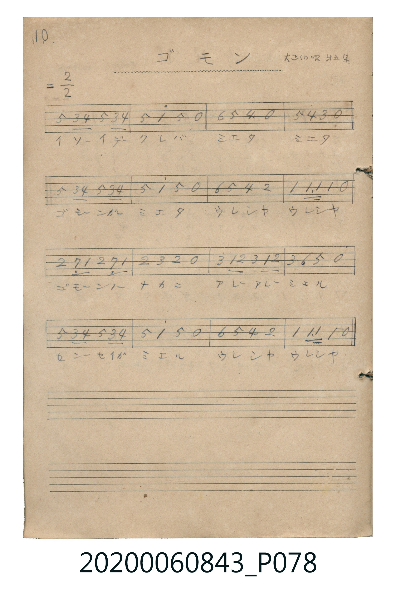

# ゴモン

<audio controls src="gomon.mp3"></audio>

- 曲：大正幼年唱歌 第五集

## 說明

ゴモン (Gomon)
Source: 唱歌帖 (Shōkachō, NMTH 2020.006.0843) — P078.jpg (Notebook 2, p.10)
Notation: Handwritten numbered notation (Jianpu)
Annotations: = 2/2, 大正幼唱 第五集

## 歌詞

```text
（TMD 檔案未包含歌詞註解）
```

## ABC

```abc
X:1
T:ゴモン
C:曲：大正幼年唱歌 第五集
M:4/4
L:1/16
Q:1/4=112
K:D
V:V1 name="Vocal" snm="Voc"
[V:V1]
!mf! A4 F2 G2 A4 F2 G2 | A4 d4 A4 z4 | B4 A4 G4 z4 | A4 G4 F4 z4 |
A4 F2 G2 A4 F2 G2 | A4 d4 A4 z4 | B4 A4 G4 E4 | D4 D2 D2 D4 z4 |
E4 C2 D2 E4 C2 D2 | E4 F4 E4 z4 | F4 D2 E2 F4 D2 E2 | F4 B4 A4 z4 |
A4 F2 G2 A4 F2 G2 | A4 d4 A4 z4 | B4 A4 G4 E4 | D4 D2 D2 D4 z4 |
```

## TMD 檔案連結

- [主旋律 TMD 檔案](gomon.tmd) [[在 TMD Studio 編輯](https://tmdlang.github.io/Tmd-TS/#tmd=s7IKdvYPcrWy4qpTUCpJTLdSSM7PyUlNLsnMz7MqzsjPTkzOyFeCS5bl55TmploBqXgDI4RwcX5pUXJqfEFieqpVgIG5BboM3KT4vPyS1KT8_GyEioKi_LLUvMQ8oKrcxLzS4uSizIKS-OT8gkqEmtSyzJRUkIrUlMyS_KLMxBwkJ6UWFYMdC3FDSVFiHsQMoKASl5aWwuOmLY-bFz1u3qygpcWlaKtgaGjEZW-r4MJlY6JvYgcy59nsTe_3zHq6ZPmztYuf7tzzdOeWp1M2Plvbo_B8zZonu6a8nN2mxMWlr6VgSy3ApaCA5CwN9_zc_DxNkGAwJLgUIPY_3TFNQSM442gvKOyO9uoo-PmGeCgYGRgZ6BkYmOkZWJgYayo8apiiAApzvayCdAUNP2j4KhjpKBToGRqATQUKJoIjVMEjMS-lvCizpCQ1TyGvNDcptSg1RQEYJ2BpBQ2vzMS8glKwHsc8mHCxlYKtgpE-0EBECE3ZiAgbkGrKgwQKFLT0ubjA4WEVlp-cmONQY1CjUA2yQsHG0EzLDswCRgUwdF6snGcFUg4Vedy05HHT3sfNe0CM5nYgf_3j5jWPmycoPG6e_7hpxeOm_UgsfXj47wFGweOmNciqmpaBdDZtf9y8BJWDbBuS7uY-oO6ux02rHzd3A2WAwkDjoBTE1ObVYBt3g1UDXbgb7FpkaYKWAoMhN61WwVRBFwyNgdgEiNH5NXARwzgoAyZgAKVrFMzQZEAaUVWgy4CMR1EBCwgHcDRZgYIfiEHhD2FCYgBIgzwJjgMgfwUQg2MBzoZ7jqb-MoKrMIQZgoQJ-GsL0MGgmAZSm4FccKQh_NK0DOLHpu1AGinmwDy472AOMI-H2okhgFADC2oYH-E9mAzMAHQ-QgV6QBDtPUhSBgoDUyQkMUO9B6VhXgem2CEQdbtBnoIkSSATnCwR7icYdbVcXLp2CuDCSAHIUOYCAA)]
- [鋼琴伴奏 TMD 檔案](gomon_piano.tmd) [[在 TMD Studio 編輯](https://tmdlang.github.io/Tmd-TS/#tmd=s7IKdvYPcrWy4tLSUnjctOVx86LHzZsVNB43T3ncBGT2Pdmz5enS_ie7Z2gqaGlxKdoqGBoacdnbKrhw2Zjom9hx1SkoPZu96f2eWU-XLH-2dvHTnXue7tzydMrGZ2t7FJ6vWfNk15SXs9uUuLj0tRRsqQW4FBSQ3eqen5ufp6nwqGGKQkBmYl6-gmNycn5uQWJeZm5qXglIcXB-aVFyqpUCxF1Pd0xT0AjOONqbnZgMJHUU_HxDPBSMDIwM9AwMzPQMLEyMoaYZmFvoZRWkK2j45ZekJuXnZysY6SgU6BkaaIJMpdwjUKCgpc_FBfaFVVh-cmKOQ41BjUI1yAoFG0MzLTswCyiSm1arYKqgC4bGQGwCxOj8GriIYRyUARMwgNI1CmZoMiCNqCrQZUDGo6gAuwkYqQ5gF1uBY2QJEO993LwHwmxuB9LrgfQaIJ4AxPOB_BVAvB-FDfQ7xHs09ZkRXIUhzBAkjOmzGrgO83ioIgwBhBpY6MD4CPfAZGAGoPMRKtBdju6eQRM8tbC0Cs5sQR44U2tBrYKhtrE23FnacM9jFQXajSQOZGnDPYIsgfCMobaJNsxDyCrM47WNtDGTNE4lpvHaCFegB_vA-wDoPBAfrsk4XhvkYpgteHgYSQjFJDAPqx3IMlh0ITyMKoVUeqApgjkIlziaDmCwqMPDBRwWuDLF8Igd1BzlgytHIUIR5ih0AYQaY0TMYvjLBKd-JL_jsgtvBbAFWLID62RgBQCslx83gQp-pEK_aRmkMmjaDqRBdcUyIBfGg1cDtPelaTySSZiCcCESvNrcB8RdQOHVQLobSC-CehVKw4KheTVSfQezxwjDF3ARJFXkRBZSkJnhtg2vP3eDPAip04FMcL2O8MsQjlJgntO1UwBnOwUgQ5kLAA)]

## 分析

```text
================================================================================
📊 TMD Song Profile: [ ゴモン ]
================================================================================
⏱  Duration:       0:34 (34.3s), 16 measures total
🎼 Key & Tempo:    首調基準 D, != 112.0 BPM, <4/4>
   - 分析範圍：      由實際發聲的音符與和弦推測調性；播放脈絡另行呈現
🎤 人聲音域:    C#4 (MIDI 61) – D5 (MIDI 74) [跨度: 13 個半音 / 1.1 個八度, 難度: moderate]
   - 最低音:  C#4 in [Gomon #1 @ m.9, 0:17]
   - 最高音: D5 in [Gomon #1 @ m.2, 0:02]
   - 適合: soprano, mezzo-soprano, contralto, tenor, baritone, bass
🏛  結構:      Gomon (34.3s)
⚡ 編曲密度:        Peak 1 軌道同時演奏
🗝  調性診斷：       D 大調（純淨自然大調，未偵測到可信轉調）
   - 風格氣質:    純淨自然大調（陽光明朗、易唱易記，無明顯調外色彩）
   - 轉調歷程:    全曲維持單一推測調性（未偵測到可信轉調）
   - 核心骨幹音:  A, D, F#, E, G
   - 調性數值:    D 大調 [相關度: 0.90, 穩定度: High, 自然音純度: 100.0%]
   - 候選調性 (K-S): D 大調 (0.90), A 大調 (0.76), F# 小調 (0.58)
   - 五度圈歷程:   +2
   - 各段落調性細節:
     • [Gomon #1]: D 大調 (r: 0.90, 自然音純度: 100.0%)

  [ 五度圈游移軌跡 ]
               C  
         F            G  
      Bb              [D ]*
      Eb               A  
         Ab           E  
            Db       B  
               F# 
     (* = active key center)

  [ 十二半音累積音高分佈 ]
     C  :                            0.0%
     C# : █                          1.8%
     D  : ████████████████          20.0%
     D# :                            0.0%
     E  : ██████████                12.7%
     F  :                            0.0%
     F# : ███████████               14.5%
     G  : ██████████                12.7%
     G# :                            0.0%
     A  : ████████████████████████  30.9%
     A# :                            0.0%
     B  : ██████                     7.3%
--------------------------------------------------------------------------------
Assignment 軌道音域：
  - Vocal         : C#4 – D5 (13 個半音 / 1.1 個八度, 67 個音符)
================================================================================
```


## 原書掃描頁




