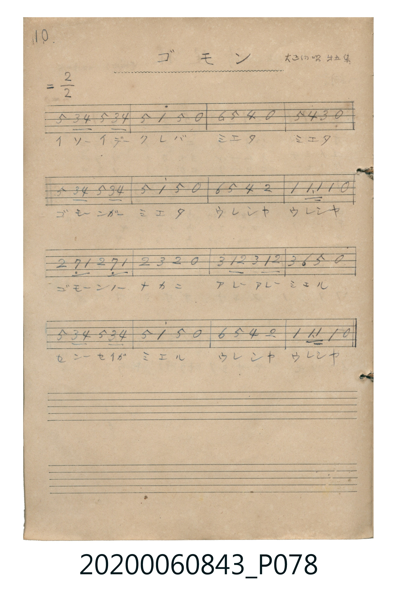

# ゴモン

> Re:Shōka 使用 AI 協助辨識與重建樂譜，可能會有錯誤。歡迎回報。

- **鋼琴伴奏版**：<br><audio controls src="gomon.mp3"></audio>

- 曲：大正幼年唱歌 第五集

## 說明

ゴモン (Gomon)
Source: 唱歌帖 (Shōkachō, NMTH 2020.006.0843) — P078.jpg (Notebook 2, p.10)
Notation: Handwritten numbered notation (Jianpu)
Annotations: = 2/2, 大正幼唱 第五集


## 歌詞

```text
（TMD 檔案未包含歌詞註解）
```

## ABC

<div class="abc-score" data-abc-src="gomon.abc" aria-label="五線譜載入中"></div>

[下載 ABC 原始檔](gomon.abc)

## TMD 檔案連結

- [主旋律 TMD 檔案](gomon.tmd) [[在 TMD Studio 編輯](https://tmdlang.github.io/Tmd-TS/#tmd=s7IKdvYPcrWy4qpTUCpJTLdSSM7PyUlNLsnMz7MqzsjPTkzOyFeCS5bl55TmploBqXgDI4RwcX5pUXJqfEFieqpVgIG5BboM3KT4vPyS1KT8_GyEioKi_LLUvMQ8oKrcxLzS4uSizIKS-OT8gkqEmtSyzJRUkIrUlMyS_KLMxBwkJ6UWFYMdC3FDSVFiHsQMoCBCFVBTemaeVW5qZlZmfElqRQmqI6DSJYmZQJfGA3F5YnxuYmZeTmJeCrKqkoz89KLEgoxKq4zMYpBLkhNz4rMT8xIRikoyUoEhlJpSmpwIcYKWlsLjpi2Pmxc9bt6soKXFpWirYGhoxGVvq-DCZWOib2IH0vps9qb3e2Y9XbL82drFT3fuebpzy9MpG5-t7VF4vmbNk11TXs5uU-Li0tdSsKUW4FJQQHKWhnt-bn6eJkgwGBJjChD7n-6YpqARnHG0FxR9R3t1FPx8QzwUjAyMDPQMDMz0DCxMjDUVHjVMUQBFu15WQbqChh80ihWMdBQK9AwNwKYCBcHBYaXgAQzS8qLMkpLUPIW80tyk1KLUFAVgsgBLK2h4ZSbmFZSC9TjmwYSLrRRsFYz0gQYiQmjKRkTYgFRTHiRQoKClz8UFDg-rsHxg_DrUGNRUg2xQsDE007IDs4AxAQycFyvnWYFUQ0UeNy153LT3cfMeEKO5Hchf_7h5zePmCQqPm-c_blrxuGk_EksfHvx7gDHwuGkNsqqmZSCdTdsfNy9B5SDbhqS7uQ-ou-tx0-rHzd1AGaAw0DgoBTG1eTXYxt1g1UAX7ga7FlmaoKU1CtW5abUKpgq6YGgMxCZAjM6vgYsYxkEZMAEDKF2jYIYmA9KIqgJdBmQ8igpYQDiAY8kKFPxADAp_CBMSA0Aa5ElwHAD5K4AYHAtwNtxzNPWXEVyFIcwQJEzAX1uADgbFNJDaDOSCIw3hl6ZlED82bQfSSDEH5sF9B3OAeTzUTgwBhBpYUMP4CO_BZGAGoPMRKtADgmjvQZIyUBiYIiGJGeo9KA3zOjDFDoGo2w3yFCRJApngZIlwP8Goq-Xi0rVTAJdFCkCGMhcA)]
- [鋼琴伴奏 TMD 檔案](gomon_piano.tmd) [[在 TMD Studio 編輯](https://tmdlang.github.io/Tmd-TS/#tmd=s7IKdvYPcrWy4qpTUCpJTLdSyC8qychPL0osyKi0ysgsLskvykxOzInPTsxLVIIrKs4vLUpOjS9ITE-1CjAwt0DIlGSk5qZapaaUJieWZObnKXFpaSk8btryuHnR4-bNChqPm6c8bgIy-57s2fJ0af-T3TM0FbS0uBRtFQwNjbjsbRVcuGxM9E3sQOY9m73p_Z5ZT5csf7Z28dOde57u3PJ0ysZna3sUnq9Z82TXlJez25S4uPS1FGypBbgUFJDd6p6fm5-nqfCoYYpCQGZiXr6CY3Jyfm5BYl5mbmpeCUhxMDgYrBQg7nq6Y5qCRnDG0d7sxGQgqaPg5xvioWBkYGSgZ2BgpmdgYWIMNQ0YYnpZBekKGn75JalJ-fnZCkY6CgV6hgaaIFMp9wgUKGjpc3GBfWEVlg-MRIcag5pqkA0KNoZmWnZgVo1CdW5arYKpgi4YGgOxCRCj82vgIoZxUAZMwABK1yiYocmANKKqQJcBGY-iAuwmYJw6gB1sBY6QJUC893HzHgizuR1IrwfSa4B4AhDPB_JXAPF-FDbQ6xDv0dRnRnAVhjBDkDCmz2rgOszjoYowBBBqYKED4yPcA5OBGYDOR6hAdzm6ewZN8NTCkio4rwV54EqsBbUKhtrG2nBXacP9jlUUaDWSOJClDfcHsgTCL4baJtow_yCrMI_XNtLGTNE4lZjGayNcgR7qA-8DoPNAfLgm43htkIthtuDhYaQgFJPAPKx2IMtg0YXwMKoUUuGBpgjmIFziaDqAwaIODxdwWODKE8MjdlAzlA9yhjKB5ydDoFUQAsQ2jgexDIBsE6goiA1VA2RiK523AItdYH0JLJ2BdebjJlCpjFQiNy2DlNRN24E0qCBfBuTCePAympArTOPBMhAGkCLKKc19QNwFFF4NpLuB9CKoU6A0zJnNq5Eqi3gFI7DtQBLMQw8EsBPNYKpwuGM3yAGQCgvIBFdaCLtoGCTAGNe1UwBHugKQocwFAA)]

## 分析

```text
================================================================================
📊 TMD Song Profile: [ ゴモン ]
================================================================================
⏱  Duration:       0:34 (34.3s), 16 measures total
🎼 Key & Tempo:    首調基準 D, != 112.0 BPM, <4/4>
   - 分析範圍：      由實際發聲的音符與和弦推測調性；播放脈絡另行呈現
🎤 人聲音域:    C#4 (MIDI 61) – D5 (MIDI 74) [跨度: 13 個半音 / 1.1 個八度, 難度: moderate]
   - 最低音:  C#4 in [Gomon #1 @ m.9, 0:17]
   - 最高音: D5 in [Gomon #1 @ m.2, 0:02]
   - 適合: soprano, mezzo-soprano, contralto, tenor, baritone, bass
🏛  結構:      Gomon (34.3s)
⚡ 編曲密度:        Peak 1 軌道同時演奏
🗝  調性診斷：       D 大調（純淨自然大調，未偵測到可信轉調）
   - 風格氣質:    純淨自然大調（陽光明朗、易唱易記，無明顯調外色彩）
   - 轉調歷程:    全曲維持單一推測調性（未偵測到可信轉調）
   - 核心骨幹音:  A, D, F#, E, G
   - 調性數值:    D 大調 [相關度: 0.90, 穩定度: High, 自然音純度: 100.0%]
   - 候選調性 (K-S): D 大調 (0.90), A 大調 (0.76), F# 小調 (0.58)
   - 五度圈歷程:   +2
   - 各段落調性細節:
     • [Gomon #1]: D 大調 (r: 0.90, 自然音純度: 100.0%)

  [ 五度圈游移軌跡 ]
               C  
         F            G  
      Bb              [D ]*
      Eb               A  
         Ab           E  
            Db       B  
               F# 
     (* = active key center)

  [ 十二半音累積音高分佈 ]
     C  :                            0.0%
     C# : █                          1.8%
     D  : ████████████████          20.0%
     D# :                            0.0%
     E  : ██████████                12.7%
     F  :                            0.0%
     F# : ███████████               14.5%
     G  : ██████████                12.7%
     G# :                            0.0%
     A  : ████████████████████████  30.9%
     A# :                            0.0%
     B  : ██████                     7.3%
--------------------------------------------------------------------------------
Assignment 軌道音域：
  - Vocal         : C#4 – D5 (13 個半音 / 1.1 個八度, 67 個音符)
================================================================================
```


## 原書掃描頁




