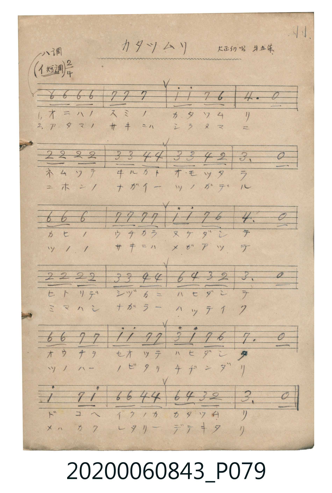

# カタツムリ

> Re:Shōka 使用 AI 協助辨識與重建樂譜，可能會有錯誤。歡迎回報。

- **鋼琴伴奏版**：<br><audio controls src="katatsumuri.mp3"></audio>

- 曲：大正幼年唱歌 第五集
- 唱歌帳（2020.006.0843）P079.jpg（第 11 頁）

## 說明

> [!NOTE]
> **原頁資訊與校勘記**（對應 `P079.jpg`，手抄簡譜第 11 頁）：
> - **調性、拍號與出處註記**：題首左標「ハ調（イ短調） 2/4」（關係調 `?= C`、`key= Am`、`<2/4>`，實際旋法為日本都節音階 `E–F–A–B–C–E`，終止音落於 `3` = `E4`），中題「カタツムリ」，右註「大正幼唱 才五集」（《大正幼年唱歌》第五集，有別於文部省《尋常小學唱歌》「でんでんむしむし」同名異曲）。每行第 2 小節末小節線上均標有換氣記號 `v`。
> - **跨行八度錯置修正**：原簡譜全曲 24 小節中，`2, 3, 4, 6, 7` 均無低音點（對應 `D4–B4`），高音 `1̇`（第 3、11、18、19、21 小節）與 `3̇`（第 19 小節）明確標有高音點（對應 `1^` = `C5`、`3^` = `E5`），全曲音域為 `D4–E5`。先前版本於第 1、3、5、6 行誤加低八度 `_` 並漏標 `^`，導致跨行突兀八度斷層，今據原譜完整修復。
> - **手抄歌詞對位與塗改細節**：
>   1. 第 2 小節第二節於四分音符 `7` 下並書雙假名「ニハ」（「サキニハ」），第 21 小節第二節於四分音符 `1̇` 下並書「メハ」（「メハ　カク｜レタリー｜デテキタ｜リ」），修正先前版本漏字與錯位。
>   2. 第 20 小節第一節末字原誤寫「テ」（受第 12、16 小節「ヌケダシテ／ハヒダシテ」影響），楊氏隨即以重墨改寫為「タ」（「ハヒダシタ」）。
>   3. 保留「オニハ」「ヰル」「カヒ」「シヅカニ」「ハヒダシ」「ミマハシ」「チヂンダリ」「ドコヘ」等歷史假名遣與大字促音「ツ」。
>
> - **參考音檔 / Reference Audio**：
>   大正幼年唱歌チャンネル (YouTube): https://www.youtube.com/@%E5%A4%A7%E6%AD%A3%E5%B9%BC%E5%B9%B4%E5%94%B1%E6%AD%8C%E3%83%81%E3%83%A3%E3%83%B3%E3%83%8D%E3%83%AB/videos
>
> **1.**
> オニハノ　スミノ　カタツムリ
> ネムツテ　ヰルカト　オモツタラ
> カヒノ　ウチカラ　ヌケダシテ
> ヒトリデ　シヅカニ　ハヒダシテ
> オウチヲ　セオツテ　ハヒダシタ
> ドコヘ　イクノカ　カタツムリ
>
> **2.**
> アタマノ　サキニハ　シラヌマニ
> ニホンノ　ナガイー　ツノガデル
> ツノノ　サキニハ　メガアツテ
> ミマハシ　ナガラー　ハツテイク
> ツノハー　ノビタリ　チヂンダリ
> メハカク　レタリー　デテキタリ


## 歌詞

```text
（TMD 檔案未包含歌詞註解）
```

## ABC

<div class="abc-score" data-abc-src="katatsumuri.abc" aria-label="五線譜載入中"></div>

[下載 ABC 原始檔](katatsumuri.abc)

## TMD 檔案連結

- [主旋律 TMD 檔案](katatsumuri.tmd) [[在 TMD Studio 編輯](https://tmdlang.github.io/Tmd-TS/#tmd=s7IKdvYPcrWy4qpTUCpJTLdSSM7PyUlNLsnMz7MqzsjPTkzOyFeCS5bl55TmploBqXgDI4RwcX5pUXJqfEFieqpVgIG5JboM3KT4vPyS1KT8_GyEioKi_LLUvMQ8oKrcxLzS4uSizIKS-OT8gkqEmtSyzJRUkIri5MS8-LLUosy0zNQUJGelFhWDHQxxR0lRYh7EHKAgQlV-UUlGfnpRYkFGpVVGZnFJflFmcmJOfHZiXiJCUUlGKtCDiXmZuYk5yFoz0zPzrHLz85JKgX7BlEjNzMqML0mtKEH1HFS6JDETqCseiMsT43MTM_NyEvOAztfSUnjctPpx0_7HzS2Pmxc8bl6loKXFpWirYGnGZW-r4MyVnVppq-CYy2VjpG9iBzL02exN7_fMerpk-bO1i5_u3PN055anUzY-W9uj8HzNmie7pryc3Qa2GyL4dMfm93s6jAyMDPQMDMz0DCxMjN_v6QTFj15WQTpQCqhJwdBQ4eWCRqC4EheXvpaCLbUAl4KCgp1CtKKff4hrLISjpfW0bz7Qsheb21-s6HrR0f5swcKn3TNerJihpQV0zdMNvc_aOxUSYA5MeL-n51ln97OulucbFr5YOwfFtcBQgBiqCzT2xar9zxqWP25ofNbd-2LmfKDJT9t3vZg59cWK3VDDZ71c2PNy2bSn25c9WzHzcUPP4-Z-oCagpY-bljyfvxbM7lQAhvLjhl6g6Mvpc57sbwKKKiSA4iEBaHQCNC7AbHB8gNz3dP2yl7NmP5ve_Wzz1OdNu55NX_pszpqXzXufr294OX_zy1l9CgmujxomuwGxIxA7AbEzELuC9D7f2vRs7SKgshcT9j6btkchwThBwRao3gQoCfRfz5Mda4GuBjkWNY2AndjztH8z0HtAWURimLJR4VlnLyQZQPzxuKELM608buiGpxZQEM_pfNqxFOiAZ9PaXzaveD6nEaRrQ_fTHTuebuh_unYHXBfIKY3LHzdNhpJNDY8bp0PJht6nE3qeTuh9PnUDOI12Pm5oera-_8XCHlC0GSkAjQKGybM5qyGM59tnPdnR9XRuOzA6gA541j_72YbFwLgCxp5CQhkwjJuQYnf7CqAxT1tXP9217GXP-ud71z3Zvw7oJ3C8AlMUJHU8bV0BtFjByARqFTD0gJ5LMNJRMNZRMNFRMNNRME9QANr4vGXhk719oNjZPQ8p1bmYgOIHFvYvV88AqlBIMDzTDhQBZxRjYMQbGoIICxBhCSSMDKGWATUBEx0wBhHKDS0Rcs9m9D1ftAviVYjJqHYbxoFj3tkUnLiMITxXU6hbID4Dano6fz4wjUGdCpQGhtLT1o6nnb3POzuAyQ4YhWCLgWaA3GoKxGYKwJB7sWrJ064FQD9DglAhIT5B4cmOZc_29ANdpJAQB07HG_petG-BhPTzVY1PWxsgip9N2_504xJQYtzd9WwyKLRBQb2u59nULcBIeLpvJUpMQXIrMLG8WDkP6Lcne3tBWXHh9GdTdj7fsgEYFuAog6hXUDDUA5Va8LQBTpM9oEQybc_T2bOfdrQBvfx8DdC9wHh7sqMb5OTZO17Onvm0sR2Y0MCZuBuYj2EpHZhNtj5uWoskCAo8sA2waMJtBSieEZaAzV6IYjaU2wDOi-vf753zuHkNOFOuety8B8xtf9zcBrK_aT-YC8mm4HwMTq0oMbUHmK-mA8MGmJyBgQQPQwUFI2iYGCC5eEcDNOesnQ4Kf2Bsrl8NdhI0kz_tnw6OdyNQsjSDagQrAAbJxsfNQDdvByp-v6cf5IXmSXARUKbdu_HlfFDZByoIlnY929D_ctaKp72bn-xe-rK99-miFcCoA1oHTHbgAN6PFCBIRkHFQXke5hFjPYUn--c-nwoubJuAgQSNFbDWDY-bgT4As4HBCTQGygY6qhUsAixqICqRLIGKzH_cPA8kjhBpfNzc9Lh5M0gZONTBgp2Pm4AiM4Dc52s7n63d_rR_EyTdvGxcDEqUS5YDg_PJ_mZgAgCrbwFrhDgfkaCf9je_aACpebZqioK-QlBqWmoRqB2i4FiakpmPkpqxlLMgly0Gu6wX6GEFjcj80pDSpFRNK4WMkpKCYit9_fLycr3K_NISoKhecn6uvoOqq6mqo4mqo7mqq5mqo4uqozFIxMlS1ckZxjABMSxNVJ0MoWosgFLGqhZABBQBM0C6wAwnGMPCBSblpA9qS-UXI_lUS8tQD9juALMRcdXcB07uO8FBDmGjVENQ9SC_AblAQWB6AsYAOG5BcQhMJUAtQNMWgWRBGlfCrADHOdTMZaBgAokAixKgdpQkC7MCqLgDnNPawVqQkwlQC0qaRvgCYnLzJrCW3WCXwB2JknZhtsCTDFB8CTCTg1wItAW7x2EhZ4QUcovAqoCpE-Iz5NII4rqVIP-BFHTD7ATKzganELCW5q7HTcBSZQmwSAFzgRYCnbAGXLashmkBC2K1AlhGgbSDwxsReMgZBmYFyCUQK4AhAQ4VsI9RrQBKQdQA2cDKHlzWgbgo-Q2mBVw8gstGsBpE2QjmIspGkBaQHsobmFCgoKXPxeWdWJJYUlyaW1qUaRWQmZiX71BjUFMNskfBxtBMCxxbCtW5BbVgBrZmLrgBvaMBWP0paIBLU2AVC2tK6CjAmqSaWDQC7QcZWqNgBiwykHGNgjmQhGEQrFEwjANSYAIkBlFlApUFQQOQCNg8H8MaUDIG8oERDCb7wWQfWA8wX4J58-FiEPOBUQASadoPFm8BkwsgMsDOBcKeeIQ9RiBdi5B0zUOxZytYZi3EHRBHwKzaDhZcCSZ74FpBVoEcjGoV_oDf1QMPeFNgwFuQFvBGQBuQcY2CMZAEYVDQgjCqCEINjmBv7oUHHCwQ26A-2wDmQQIZTDZ3QEMDElXggIToAQcnSA8ohHAEPDRqZ4PJzcgB39wFNmMNmFyCCHWoe0CqoLLN7VAZkHtICfUdnfBQtwSGuiGsJUZGeoc4Djm9gzDp6R0SpJPgXoQltWVgkUakYAcFKsjT4ITXtBEs1gBmg5IlSAYUZbiCHSkQUexBSe1gEpTgQToWIkUHIpKx24M32IENT0QpYwwKd1ibjYrJHRTSIBZIlHByh4Q3KCFDSgl4koJm8VakcAeFCkgPpDSC6CQ-3CHlFaSEAZsA14WU3OEZBmEPIhNCMgPIbetJC3dghxcR7ubAcIc3sklM77hSN0TMGEuKh5X_2FI8OLyR03fzJqj_doNlIPGBWgjhDHtwkUNMmkcqxqEik8HmQGoAkJ0gGYh7msAkpHAC2Ya9LsGf5lvXwsPeCFS1wrvpRIY9OEBBEBSUYA4iPshN9Z1QcWCzD-y3GdAwBKUvSOqCFbOglE923QpuGsGtghgBMhwkBSlOEIEOixJQ9oMld3BhBK9LMC2q5eLStVNAagFF-xjGKqALGYGFlLkA)]
- [鋼琴伴奏 TMD 檔案](katatsumuri_piano.tmd) [[在 TMD Studio 編輯](https://tmdlang.github.io/Tmd-TS/#tmd=s7IKdvYPcrWy4qpTUCpJTLdSSM7PyUlNLsnMz7MqzsjPTkzOyFeCS5bl55TmploBqXgDI4RwcX5pUXJqfEFieqpVgIG5JboM3KT4vPyS1KT8_GyEioKi_LLUvMQ8oKrcxLzS4uSizIKS-OT8gkqEmtSyzJRUkIri5MS8-LLUosy0zNQUJGelFhWDHQxxR0lRYh7EHKAgQlV-UUlGfnpRYkFGpVVGZnFJflFmcmJOfHZiXiJCUWIRUHN6am5qXolVQWZiXn58YnJyfm5BYl4mSAyhsCQDqMgqNaU0ORFijZaWwuOm1Y-b9j9ubnncvOBx86r3ezpedu95PmHLkz1bni7tf97Z8X5Pp4KWFpeirYKlGZe9rYIzV3Zqpa2CYy6XjZG-iR3I8GezN73fM-vpkuXP1i5-unPP051bnk7Z-Gxtj8LzNWue7JrycnYb2A0Qwac7NgMtMTIwMtAzMDDTM7AwMQZaAYoCvayCdKAUUJOCoaHCywWNQHElLi59LQVbagEuBQWFx43djxvnP25c8rip4XFTl4KGd2JJYklxaW5pUaamwqOGKQoBoEBUcEQORJDGYEjCUID5Y5qCRnDG0V5QKjnaq6Pg5xvioYDiL6hpUK8paPhBU5KCkY5CgZ6hoSbIVMc8YAIDx0cx0GisYfi0dS0wDBWe9jY-bV0NDBewL5p3B6WmpRaB0piCY2lKZr6VQjSm9sfNjY-bFz9u3vy4ufdx82oFjcj80pDSpFTNWI2MkpKCYit9_fLycr3K_NISoKge0Mf6DqqupqqOJqqO5qquZqqOLqqOxiARJ0tVJ2cYwwTEsDRRdTKEqrEAShmrWgARUATMAOkCM5xgDAsXmJSTPih35BeDA4DyWIUCBS19Li6kyLQCx6NDjUFNNcgeBRtDMy07MKs6t6AWzKhRMFPQRcE1CuZAEoZBsEbBMA5IgQmQGESVCVQWBA1AImDzfAxrgDlqFZD_uLkbTPaDyT6wnsdNO8G8-XAxiPnAPAgSadoPFm8BkwsgMs0gs2AwHmGPEUjXIiRd81Ds2QqWWQtxB8QRMKu2gwVXgskeuFaQVSAHo1oFDSMjIAcZ1ygYA0kQBoUCCKOKINTgCKHmXrgfYf5tgzpiA5gHCQ8w2dwBdTgkVMF-hugB-xykB-QZHGEEjYXZYHIzchg1d4HNWAMmlyACCOoekCqobHM7VAbkHqwBhJyAIMYgJyIQJj0RQTw_Ce4YWPwtA4s0IgUQyPsg54Fjs2kjWKwBzAbFNUgGFLi4AgjJuyj2oCQhMAlKRSAdC5ECDhEd2O0hIQWBggTEAokSTkGQgAGlDUgegccSNIG3IgUQyPkgPZC8CNFJfABBciskf4FNgOtCSkHwNIiwB5GuIekL5Lb1uAIIlnpwpReImDGWNAQrprClIXDAIKeY5k1Qh-wGy0ACDjUD4gwkcHYjJhUhlTZQkclgcyAFFchOkAzEPU1gEpIxQbZhL_KggQT2OQiC_AzmIAKO3HTUCRV_3ARxxAyoZ0ExBokvWFkASktkl9XNCxHhAjMCZDhICpKTEKEDCztQgoYlIHA-hBd4mBbVYqn5gjyw1n3wqs9YG1ZeIVggUViKQrDAarXhwY-s3Cxe21AbezkGLN_itYHyoEgAQVQeVCssblDMQZND12geD5dCt3Ew-wnIhltCppdwOh4hARLWBhcUuEMBixXohsGFQO5GmEKpl7ClUx_kdGqCkUzN4hWM40GOjAcaCWLABEzigYbCvGAUDxSHygIlwDRQDKwNoYpMs4AEbrOQaLBiXIqwmQQMDl07BaQQifYxjFVAFzICCylzAQA)]

## 分析

```text
================================================================================
📊 TMD Song Profile: [ カタツムリ ]
================================================================================
⏱  Duration:       1:00 (60.0s), 48 measures total
🎼 Key & Tempo:    首調基準 C, != 96.0 BPM, <2/4>
   - 分析範圍：      由實際發聲的音符與和弦推測調性；播放脈絡另行呈現
🎤 人聲音域:    D4 (MIDI 62) – E5 (MIDI 76) [跨度: 14 個半音 / 1.2 個八度, 難度: moderate]
   - 最低音:  D4 in [Katatsumuri[L1] #1 @ m.5, 0:05]
   - 最高音: E5 in [Katatsumuri[L1] #1 @ m.19, 0:22]
   - 適合: soprano, mezzo-soprano, contralto, tenor, baritone, bass
🏛  結構:      Katatsumuri[L1] (30.0s) -> Katatsumuri[L2] (30.0s)
⚡ 編曲密度:        Peak 1 軌道同時演奏
🗝  調性診斷：       A 小調（純淨自然小調，未偵測到可信轉調）
   - 風格氣質:    純淨自然小調（陰鬱抒情、旋律集中，無明顯調外色彩）
   - 轉調歷程:    全曲維持單一推測調性（未偵測到可信轉調）
   - 核心骨幹音:  B, E, A, F, D
   - 調性數值:    A 小調 [相關度: 0.72, 穩定度: High, 自然音純度: 100.0%]
   - 候選調性 (K-S): A 小調 (0.72), A 大調 (0.49), E 大調 (0.43)
   - 五度圈歷程:   +3 -> +3
   - 各段落調性細節:
     • [Katatsumuri[L1] #1]: A 小調 (r: 0.72, 自然音純度: 100.0%)
     • [Katatsumuri[L2] #1]: A 小調 (r: 0.72, 自然音純度: 100.0%)

  [ 五度圈游移軌跡 ]
               C  
         F            G  
      Bb               D  
      Eb              [A ]*
         Ab           E  
            Db       B  
               F# 
     (* = active key center)

  [ 十二半音累積音高分佈 ]
     C  : █████████████             11.1%
     C# :                            0.0%
     D  : ██████████████            12.2%
     D# :                            0.0%
     E  : ███████████████████████   20.0%
     F  : ███████████████████       16.7%
     F# :                            0.0%
     G  :                            0.0%
     G# :                            0.0%
     A  : █████████████████████     18.9%
     A# :                            0.0%
     B  : ████████████████████████  21.1%
--------------------------------------------------------------------------------
Assignment 軌道音域：
  - Piano         : D4 – E5 (14 個半音 / 1.2 個八度, 150 個音符)
================================================================================
```


## 原書掃描頁




