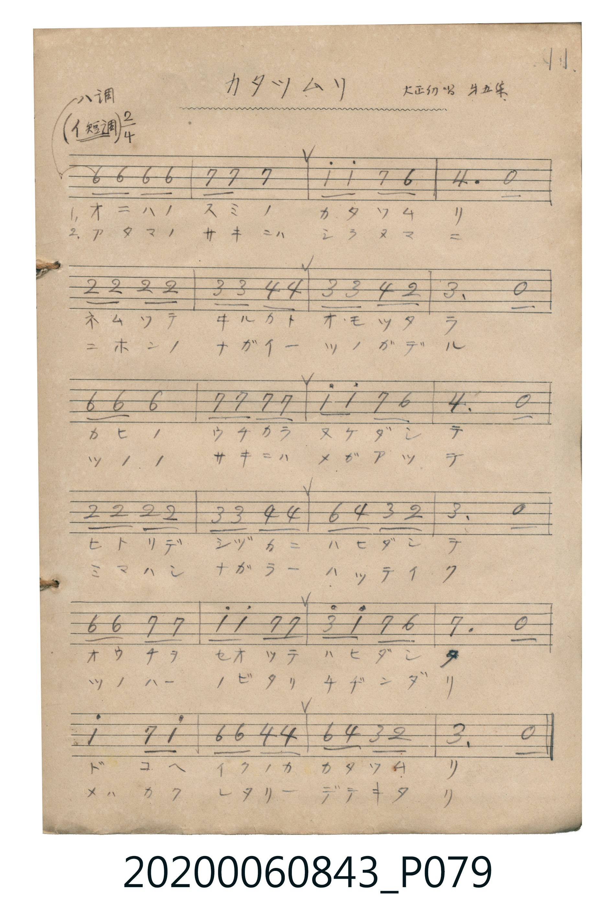

# カタツムリ

> Re:Shoka 使用 AI 協助辨識與重建樂譜，可能會有錯誤。歡迎回報。

<audio controls src="katatsumuri.mp3"></audio>

- 曲：大正幼年唱歌 第五集

## 說明

カタツムリ (Katatsumuri)
Source: 唱歌帖 (Shōkachō, NMTH 2020.006.0843) — P079.jpg (Notebook 2, p.11)
Notation: Handwritten numbered notation (Jianpu)
Annotations: ハ調 (イ短調) 2/4, 大正幼唱 第五集

## 跨冊／重複收錄參照

> 同名異曲（各冊收錄之不同詞曲版本）

- **[同名異曲]** 《新定兒童唱歌》尋常科第一學年用（2020.006.0847.0001）：[**〈カタツムリ〉**](../../../shintei_jido_shoka/grade_1_2020.006.0847.0001/1_06_katatsumuri/index.md)（`D` / `2/4` — [原始 TMD](../../../shintei_jido_shoka/grade_1_2020.006.0847.0001/1_06_katatsumuri/katatsumuri.tmd)）
- 總表：[跨冊重複與同名歌曲總索引](../../../duplicate_songs.md)

## 歌詞

```text
（TMD 檔案未包含歌詞註解）
```

## ABC

```abc
X:1
T:カタツムリ
C:曲：大正幼年唱歌 第五集
M:2/4
L:1/16
Q:1/4=96
K:C
V:V1 name="Vocal" snm="Voc"
[V:V1]
!mp! A,2 A,2 A,2 A,2 | B,2 B,2 B,4 | C2 C2 B,2 A,2 | F,6 z2 |
D2 D2 D2 D2 | E2 E2 F2 F2 | E2 E2 F2 D2 | E6 z2 |
A,2 A,2 A,4 | B,2 B,2 B,2 B,2 | C2 C2 B,2 A,2 | F,6 z2 |
D2 D2 D2 D2 | E2 E2 F2 F2 | A2 F2 E2 D2 | E6 z2 |
A,2 A,2 B,2 B,2 | C2 C2 B,2 B,2 | E2 C2 B,2 A,2 | B,6 z2 |
C4 B,2 C2 | A,2 A,2 F,2 F,2 | A,2 F,2 E,2 D,2 | E,6 z2 |
```

## TMD 檔案連結

- [主旋律 TMD 檔案](katatsumuri.tmd) [[在 TMD Studio 編輯](https://tmdlang.github.io/Tmd-TS/#tmd=s7IKdvYPcrWy4qpTUCpJTLdSSM7PyUlNLsnMz7MqzsjPTkzOyFeCS5bl55TmploBqXgDI4RwcX5pUXJqfEFieqpVgIG5JboM3KT4vPyS1KT8_GyEioKi_LLUvMQ8oKrcxLzS4uSizIKS-OT8gkqEmtSyzJRUkIrUlMyS_KLMxBwkJ6UWFYMdC3FDSVFiHsQMoCBCVUlGKtDdiXmZuSC9WloKj5tWP27a_7i55XHzgsfNqxS0tLgUbRUszbjsbRWcuWyM9E3sQJqfzd70fs-sp0uWP1u7-OnOPU93bnk6ZeOztT0Kz9esebJrysvZbUpcXPpaCrbUAlwKChhu0_BOLEksKS7NLS3K1AQpCIaEqgLELU93TFPQCM442gsK4qO9Ogp-viEeCkYGRgZ6BgZmegYWJsaaCo8apiiAokYvqyBdQcMPGg0KRjoKBXqGhmBTgYKJ4HhX8EjMSykvyiwpSc1TyCvNTUotSk1RAEYdWFpBwyszMa-gFKzHMQ8mXGyl8Li5_8Wq_Qoaj5uWPJ-_FsjUVACGo44CIvimbEQEHEg75eEFBQpa-lxcSMFkFZafnJjjUGNQo1ANskjBxtBMyw7MAsYWMNBerJxnBdIEFTHUA4b6qsfN3UA_PG7uA3J2Pm6eD2GhRoY-0Ju9YHbz4-Y2IGfD42agitWPmzsgRiwCyYB0rEQyH6xgEsS8ZY-bG8H8lUDdPY-bNj5ubnjctB1kGshwoKoOoEWPm9uBaoGirWC13aDQBUvC1CIbvgpqavMmIGc32BlQ1yHpadoPNr_zcdPmx80zgAqXPG5aD3QS0HzM7AA33AgUMovAkvMg7t_6uGktJKQgDlwJ8gVIshtsPlBi9uNmoBVAtc1dj5vWAC0CsoAmA21aA_QWMLyQHQ-RwTC5eSFYKzg0oSEDjA-gLf1AS2Emg4MQ6EWQEoh_sJgMMgxITQb7YRWQAwynJrALG2ARuhDiGWAYAAMEaCtUIdCpQGPXQvlQk4EpKregVsEsXkEXnahRMAdRCAIEaxQMgSQIg4WgCk1g0iBoABKCOdsBnHSBuakJ5ARwvIM8AEqSoDCAskFRth_kRSBeAMTIUYYwYRFU1Tyorq1AvBZiKjgQwSkQKt-N8KAR0D3IuEbBGEiCsAkUo4og1OD3UXMv1LXNQAzOO0AMTnxAGpx9gDTQzSB5sLuRsxDCFFCYzAbizRBfNXcBVa8BpWcgew80TEC-BYqBMhEiudWgRxgkftAiDUyQH2sgv0yCumAZKLVBxaBh3bQRSDdAwx85FyP8B3U_eoxBcgXUr9BQQphAXKyZQVkgUaJjDeQbYOxAsgTU5a1QX8HcBVKD31eglAtKZ-BSAxFr4HABxRrIFGi6AMUkIisjxxrOCIKKgXyDHmnwnIg_q8EiC1KGQhMjLKGieRGYOPFFHEg1yEsg9mRoUgYXPEDcBMSghAs0CblMATkaBMGOBXGQfQ1OdmACKgpmG4MII6i_CfuxuRPoEpDN4KIfHMCIooSo4gSU-GB-A-sAmQBKjDD_gTIbKPqACRYSQrVcXLp2Ckj1sgKQq8wFAA)]
- [鋼琴伴奏 TMD 檔案](katatsumuri_piano.tmd) [[在 TMD Studio 編輯](https://tmdlang.github.io/Tmd-TS/#tmd=s7IKdvYPcrWy4tLSUnjctPpx0_7HzS2Pmxc8bl6loPG4ecrjpkWPm_ue7NnydGn_k90zNBW0tLgUbRUszbjsbRWcuWyM9E3suOoUlJ7N3vR-z6ynS5Y_W7v46c49T3dueTpl47O1PQrP16x5smvKy9ltSlxc-loKttQCXAoKmA72TixJLCkuzS0tytRUeNQwRSEgMzEvX8ExOTk_tyAxLzM3Na8EpDE4v7QoOdVKAeLGpzumKWgEZxztzU5MBpI6Cn6-IR4KRgZGBnoGBmZ6BhYmxlDTDMwt9bIK0hU0_PJLUpPy87MVjHQUCvQMDTVBplLuKShQ0NLn4kLyi1VYfnJijkONQY1CNcgiBRtDMy07MAsokltQq2AWr6CLTtQomIMoBAGCNQqGQBKEwUJQhSYwaRA0AAmBDQfGlwPYaitwYK9SeNzcDcT9QNwH5O8E0vOh7NVAvB_IbgHiBUC8CuQHLGYsgqqbB9W3FYjXQsxt2g6kVwJxD1S-G2ZGjYIR0E3IuEbBGEiCsAkUo4og1GD6qgY9oCDhghZYYIKk0CLOlWZQFkiUWFfidBBUDGQCuiPhMY5uLEghCIIVgDjINoG9BiagomC2MYgwgtqFaW4tamIF57kgD1zJFZhajeO14QGPzAaZrm2qHq8Ndzw6H6zCLF4b5glU3Ubx2iZIAiDXgSWgVoPltEGBDoKoPJB3tQ21YXEBktEGRRNhOYj74LLolg5FvyK46BpJ8ywh76DJo7gKf1hhtRiP0cimgUMOLoMWjubxQO-iKACJQAzEsBtbwvfBlfCRAgbJWQhrkYIBUyE482F6HLVwbe6FFr7NQNwGxBuAGFQwA3FzB7QABxbAIHlwIbwSeyENLuRnA_FmSCHd3AVUvwaIlwDZe6CFPKjwBoo1t4PtQBTUMIeaYfMRXBa7GNzD-HwJ9s0kqAuWAelGqBi06mjaCKQboNVJGw4fQn2AXgWBq7aFUN9CQwphBl3iEOQzYFwBK1Bw2IJ90Qr1IcyFIDWEfAiqmEGVKFA9WB00DsGhBIpDkDnQdAKK16b1ZMQhnElyHAJ9B4u75k1A9m5o6oSlXDRfAlMr_ngEqQf5CsSeDE3dIPNA5jcBMSglA81CNEuwRxFeMeTQIMqXzZ1Al4BsngEPY0RjicgGEyg1wnwH1gMyA5Q6YT4E5T9QHAJTMCKUCPgEWxQS8B2wqNO1U0Aq7RSAXGUuAA)]

## 分析

```text
================================================================================
📊 TMD Song Profile: [ カタツムリ ]
================================================================================
⏱  Duration:       0:30 (30.0s), 24 measures total
🎼 Key & Tempo:    首調基準 C, != 96.0 BPM, <2/4>
   - 分析範圍：      由實際發聲的音符與和弦推測調性；播放脈絡另行呈現
🎤 人聲音域:    D3 (MIDI 50) – A4 (MIDI 69) [跨度: 19 個半音 / 1.6 個八度, 難度: challenging]
   - 最低音:  D3 in [Katatsumuri #1 @ m.23, 0:28]
   - 最高音: A4 in [Katatsumuri #1 @ m.15, 0:17]
   - 適合: contralto, tenor, baritone, bass
🏛  結構:      Katatsumuri (30.0s)
⚡ 編曲密度:        Peak 1 軌道同時演奏
🗝  調性診斷：       A 小調（純淨自然小調，未偵測到可信轉調）
   - 風格氣質:    純淨自然小調（陰鬱抒情、旋律集中，無明顯調外色彩）
   - 轉調歷程:    全曲維持單一推測調性（未偵測到可信轉調）
   - 核心骨幹音:  B, E, A, F, D
   - 調性數值:    A 小調 [相關度: 0.72, 穩定度: High, 自然音純度: 100.0%]
   - 候選調性 (K-S): A 小調 (0.72), A 大調 (0.49), E 大調 (0.43)
   - 五度圈歷程:   +3
   - 各段落調性細節:
     • [Katatsumuri #1]: A 小調 (r: 0.72, 自然音純度: 100.0%)

  [ 五度圈游移軌跡 ]
               C  
         F            G  
      Bb               D  
      Eb              [A ]*
         Ab           E  
            Db       B  
               F# 
     (* = active key center)

  [ 十二半音累積音高分佈 ]
     C  : █████████████             11.1%
     C# :                            0.0%
     D  : ██████████████            12.2%
     D# :                            0.0%
     E  : ███████████████████████   20.0%
     F  : ███████████████████       16.7%
     F# :                            0.0%
     G  :                            0.0%
     G# :                            0.0%
     A  : █████████████████████     18.9%
     A# :                            0.0%
     B  : ████████████████████████  21.1%
--------------------------------------------------------------------------------
Assignment 軌道音域：
  - Vocal         : D3 – A4 (19 個半音 / 1.6 個八度, 75 個音符)
================================================================================
```


## 原書掃描頁




