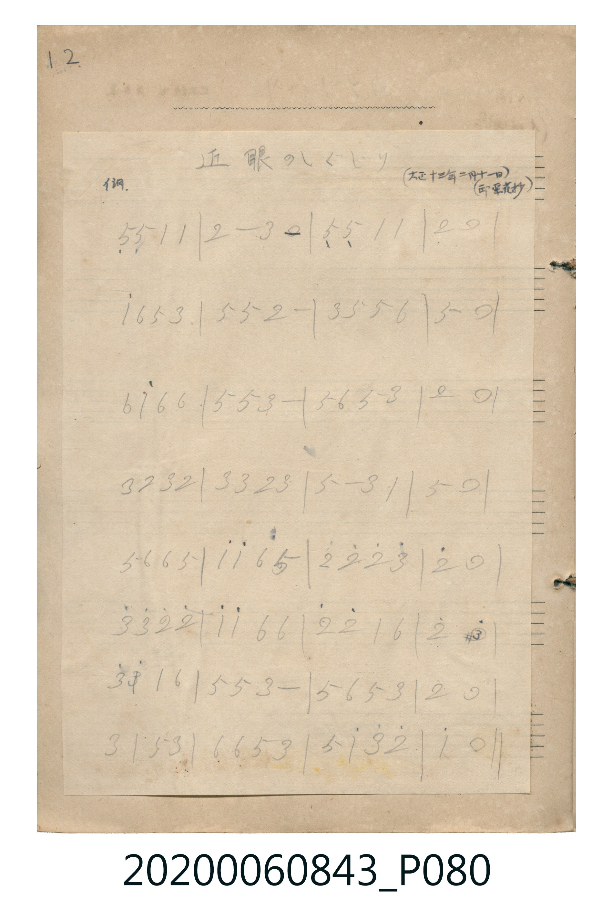

# 近眼のしくじり

> Re:Shōka 使用 AI 協助辨識與重建樂譜，可能會有錯誤。歡迎回報。

- **鋼琴伴奏版**：<br><audio controls src="kingan_no_shikujiri.mp3"></audio>

- 曲：不詳 (大正十三年二月十一日 邱氏より抄)

## 說明

近眼のしくじり (Kingan no Shikujiri)
Source: 唱歌帖 (Shōkachō, NMTH 2020.006.0843) — P080.jpg (Notebook 2, p.12)
Notation: Handwritten numbered notation (Jianpu) on pasted grid sheet
Annotations: イ調, (大正十三年二月十一日) (邱氏より抄)


## 歌詞

```text
（TMD 檔案未包含歌詞註解）
```

## ABC

<div class="abc-score" data-abc-src="kingan_no_shikujiri.abc" aria-label="五線譜載入中"></div>

[下載 ABC 原始檔](kingan_no_shikujiri.abc)

## TMD 檔案連結

- [主旋律 TMD 檔案](kingan_no_shikujiri.tmd) [[在 TMD Studio 編輯](https://tmdlang.github.io/Tmd-TS/#tmd=s7IKdvYPcrWy4qpTUCpJTLdSSM7PyUlNLsnMz7MqzsjPTkzOyFeCS5bl55TmploBqXgDI4RwcX5pUXJqfEFieqpVgIGFAboM3KT4vPyS1KT8_GyEioKi_LLUvMQ8oKrcxLzS4uSizIKS-OT8gkqEmtSyzJRUkIrUlMyS_KLMxBwkJ6UWFYMdC3FDSVFiHsQMoCBCFVBTemaeVUliJtAp8UBcnhifm5iZl5OYl6LEpaWl8GL_xOdz9jxuXPe4cfrjxv7HjTMeN3UpaGlxKdoqGBpYcNnbKjhy2Zjom9iBzHw2e9P7PbOe7Oh9sXKzgsbTJcufrV38tLfxyY7Opzu3PNnV82xOB5jb8Gz6UoWXTRufbeh_3NQBNPFZV4umEheXvpaCLbUAl4ICDtdreGfmpSfmKeTlKwRnZGaXZmUWZWqClAdDYkXh6ZSNz9b2PN0xTUEjOONoLyiKjvbqKPj5hngoGBkYGegZGJjpGViYGGsqPGqYogCKWr2sgnQFDT9oNCoY6SgU6BkagU0FCiaC042CBzBUy4syS0pSgZaX5ialFqWmAF0BkVbQ8MpMzCso1VQAsgsSi0uAculFmSkKxRmpqSUggxzzYGqLrRQeNy15sWq_DqFQ1lTQQA9nkFGUBy8UKGjpc3FBwtMvHx6a8Y5Wvqk5-SmVDjUGNdUgCxVsDM207MAsYCQ_7Zv_Yu2cx43rgcH8YuW8x42rwBG07tnUDU_XTgdKvd8DdC3Ig48bGp-2rjA2erqh__n6hvd7OkEWgkypUajOTatVMI1X0AVDOMMQja5RMIKyYNAYShvAVZBjCgzCTYE6yzAOKmAGMxPNWqB1aDLoRtfA1aKrhJmJMIOQc2A6MJyFaRS6QxHOQbce00vEhg5MB0w9Oh-hApdKTK_DZBBxRThwarGlWifMVGsCTbQgM82A0BQSw0AEYRvFQZFxHIQHsQbuXbAERAVCoxlcI5gL1WeiDiKRdIIEoApMgRDkTYgzQGxYkCPZBQwAiAzEoSCWKcgAiAvgKROkA-h9XTsFLPlWAauwE0hYmQsA)]
- [鋼琴伴奏 TMD 檔案](kingan_no_shikujiri_piano.tmd) [[在 TMD Studio 編輯](https://tmdlang.github.io/Tmd-TS/#tmd=s7IKdvYPcrWy4tLSUnixf-LzOXseN6573Dj9cWP_48YZj5u6FDQeN0953LTocXPfkz1bni7tf7J7hqaClhaXoq2CoYEFl72tgiOXjYm-iR1XnYLSs9mb3u-Z9WRH74uVmxU0ni5Z_mzt4qe9jU92dD7dueXJrp5nczrA3IZn05cqvGza-GxD_-OmDqA1z7paNJW4uPS1FGypBbgUFHB5yTszLz0xTyEvXyE4IzO7NCuzKFNT4VHDFIWAzESgoGNycn5uQWJeZm5qXgnImOD80qLkVCuFp1M2Plvb83THNAWN4IyjvdmJyUBSR8HPN8RDwcjAyEDPwMBMz8DCxBhqmoGFgV5WQbqChl9-SWpSfn62gpGOQoGeoZEmyFTKvQgFClr6XFwQP_nlw30U72jlm5qTn1LpUGNQUw2yUMHG0EzLDsyqUajOTatVMI1X0AVDOMMQja5RMIKyYNAYShvAVZBjCgzCTYE6yzAOKmAGMxPNWqB1aDLoRtfA1aKrhJmJMIOQc2A6MJyFaRS6QxHOQbce00vEhg5MB0w9Oh-hApdKTK_DZBBxRThwarGnN3D2CfLAleAKahWM47XhiQSZbRqvDbMfiQlKWtrm8dowT2DwDLUxUyOVrUDiYcSGtqk2PGEYaptow1OLNlAKmyuB6RtJCk0ZTnvBbkQYgssIoAvU4U6oUQAZAJfDzcHIgEj-MNY2w-VBBBuvnxCuxhsORAUd-RGF7hBciQhvsBNrCJHhAU6aSMmQ5OjClwd9kPOgCTwLGoJKaEOg1ZBCG8wxwBQ3AknFg2Tg-kzg8mAKrBnOMwTpwK4TqA-CDBHWAAlUI7FbiawWYiWSGVj0YQ0PJ8w6EBEcpsAS2QxIgmsdIIKwjeKgyDgOwoMEOzzTgyUgKhAazeAawVyoPhN1EImkEyQAVWAKhKC0AHEGiA2rBpDsAnkXLANxKIhlCjIA4gJ4bYnH-3iLZNyZEHuGRCvyiCr_gL4CKjOH8nCxUYwiTgve0hiFg8sEkB6kAo7I0s4IqAyaKkDGIXFQCmC00hi3j3CZhtVfKCpwOnioFcmoZSHe2pNwIsXjK-KSCL6khMIhUBZDMx_Oshi5YASWZ1A2pFyGlnbYS0ZYAQwqF-KhWoEImMjAyiEIZhKUB9cM5AA1gZWTVh6DC3qwPMzhMMVgI2D1AYgPL5B17RSw1FEKWIWdQMLKXAA)]

## 分析

```text
================================================================================
📊 TMD Song Profile: [ 近眼のしくじり ]
================================================================================
⏱  Duration:       1:11 (71.1s), 32 measures total
🎼 Key & Tempo:    首調基準 A, != 108.0 BPM, <4/4>
   - 分析範圍：      由實際發聲的音符與和弦推測調性；播放脈絡另行呈現
🎤 人聲音域:    E4 (MIDI 64) – D#6 (MIDI 87) [跨度: 23 個半音 / 1.9 個八度, 難度: difficult]
   - 最低音:  E4 in [KinganNoShikujiri_A #1 @ m.1, 0:00]
   - 最高音: D#6 in [KinganNoShikujiri_B #1 @ m.24, 0:52]
🏛  結構:      KinganNoShikujiri_A (35.6s) -> KinganNoShikujiri_B (35.6s)
⚡ 編曲密度:        Peak 1 軌道同時演奏
🗝  調性診斷：       E 大調（純淨自然大調，未偵測到可信轉調）
   - 風格氣質:    純淨自然大調（陽光明朗、易唱易記，無明顯調外色彩）
   - 轉調歷程:    全曲維持單一推測調性（未偵測到可信轉調）
   - 核心骨幹音:  E, B, C#, A, F#
   - 調性數值:    E 大調 [相關度: 0.84, 穩定度: High, 自然音純度: 100.0%]
   - 候選調性 (K-S): E 大調 (0.84), A 大調 (0.69), C# 小調 (0.62)
   - 五度圈歷程:   +4 -> +4
   - 各段落調性細節:
     • [KinganNoShikujiri_A #1]: E 大調 (r: 0.87, 自然音純度: 100.0%)
     • [KinganNoShikujiri_B #1]: E 大調 (r: 0.72, 自然音純度: 100.0%)

  [ 五度圈游移軌跡 ]
               C  
         F            G  
      Bb               D  
      Eb               A  
         Ab          [E ]*
            Db       B  
               F# 
     (* = active key center)

  [ 十二半音累積音高分佈 ]
     C  :                            0.0%
     C# : ██████████████████        19.2%
     D  :                            0.0%
     D# : ██                         2.5%
     E  : ████████████████████████  25.8%
     F  :                            0.0%
     F# : ████████████              13.3%
     G  :                            0.0%
     G# :                            0.0%
     A  : ██████████████            15.0%
     A# :                            0.0%
     B  : ██████████████████████    24.2%
--------------------------------------------------------------------------------
Assignment 軌道音域：
  - Melody        : E4 – D#6 (23 個半音 / 1.9 個八度, 99 個音符)
================================================================================
```


## 原書掃描頁




