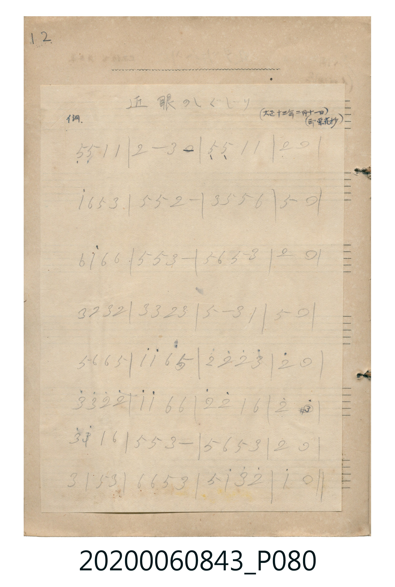

# 近眼のしくじり

> Re:Shōka 使用 AI 協助辨識與重建樂譜，可能會有錯誤。歡迎回報。

- **鋼琴伴奏版**：<br><audio controls src="kingan_no_shikujiri.mp3"></audio>

- 詞：葛原しげる
- 曲：梁田貞
- 大正十三年二月十一日 邱氏より抄（唱歌帖 P080）

## 說明

近眼のしくじり (Kingan no Shikujiri)
Source: 唱歌帖 (Shōkachō, NMTH 2020.006.0843) — P080.jpg (Notebook 2, p.12)
Notation: Handwritten numbered notation (Jianpu) on pasted grid sheet
Annotations: イ調, (大正十三年二月十一日) (邱氏より抄)
Note: 同曲亦收錄於 Vol.07 P257（蓬萊唱歌集 76頁）。


## 歌詞

```text
（TMD 檔案未包含歌詞註解）
```

## ABC

<div class="abc-score" data-abc-src="kingan_no_shikujiri.abc" aria-label="五線譜載入中"></div>

[下載 ABC 原始檔](kingan_no_shikujiri.abc)

## TMD 檔案連結

- [主旋律 TMD 檔案](kingan_no_shikujiri.tmd) [[在 TMD Studio 編輯](https://tmdlang.github.io/Tmd-TS/#tmd=s7IKdvYPcrWy4qpTUCpJTLdSSM7PyUlNLsnMz7MqzsjPTkzOyFeCS5bl55TmploBqXgDI4RwcX5pUXJqfEFieqpVgIGFAboM3KT4vPyS1KT8_GyEioKi_LLUvMQ8oKrcxLzS4uSizIKS-OT8gkqEmtSyzJRUkIrUlMyS_KLMxBwkJ6UWFYMdC3FDSVFiHsQMoCBCFVBTemaeVUliJtAp8UBcnhifm5iZl5OYl4KsqiQjP70osSCj0iojsxhkVXJiTnx2Yl4iQlFJRiowCFJTSpMTIXZoaSm82D_x-Zw9jxvXPW6c_rix_3HjjMdNXQpaWlyKtgqGBhZc9rYKzlw2JvomdiBjXqyc937PrBcTZz_tmw_WMOlxUzfYgmezNwFlni1qfD5lw4tN88BiT5csf7Z28dPexic7Op_u3PJkV8-zOR1gbsOz6UsVXjZtfLah_3FTB9DGZ10t7_d0PJ2y8dnanqc7pimA4uL9nk4lLi59LQVbagEuBQUcHtbwzsxLT8xTyMtXCM7IzC7NyizK1AQpD4YkAwWE0zSCM472gtLE0V4dBT_fEA8FIwMjAz0DAzM9AwsTY02FRw1TwO7XyypIV9Dwg6YbBSMdhQI9QyOwqUBBcBRYKXgAo7G8KLOkJBVoeWluUmpRagrQFRBpBQ2vzMS8glJNBSC7ILG4BCiXXpSZolCckZpaAjLIMQ-mtthK4XHTkher9usoaOAPeE0FDbSgh7kJ5M8JPcCofLJr2bMp2172tDybtkchLD9Hz8BcIcDI1BwYRy8mr3kxoQsSHC9ntymYm71c0AiMqscNTSBTKI8kKFDQ0ufi8gUmdKsAYBjkO9QY1FSDLFCwsdCyAzNqFEwVDONASFfBCEQYgwiQKEwcLAqCNSCeGVDcGCxrBBaCsEGiUEVQU80gikESIA0QIyGaQRoh5oHYEAwhIdYaKxhiGAfSC9INcRIQmQIFgS6DIKCbkVwJ5EEEgAii2AwsDhcxg6g2Ugd7FWoDRBfUh_icDHKcMdQ5ECcDNUEsBIcixNm1XFy6dgqgoFcA0spcAA)]
- [鋼琴伴奏 TMD 檔案](kingan_no_shikujiri_piano.tmd) [[在 TMD Studio 編輯](https://tmdlang.github.io/Tmd-TS/#tmd=s7IKdvYPcrWy4qpTUCpJTLdSyC8qychPL0osyKi0ysgsLskvykxOzInPTsxLVIIrKs4vLUpOjS9ITE-1CjCwMEDIlGSk5qZapaaUJieWZObnKXFpaSm82D_x-Zw9jxvXPW6c_rix_3HjjMdNXQoaj5unPG5a9Li578meLU-X9j_ZPUNTQUuLS9FWwdDAgsveVsGZy8ZE38QOZPaLlfPe75n1YuLsp33zwaZMetzUDbb12exNQJlnixqfT9nwYtM8sNjTJcufrV38tLfxyY7Opzu3PNnV82xOB5jb8Gz6UoWXTRufbeh_3NQBdMazrpb3ezqeTtn4bG3P0x3TFEC-eb-nU4mLS19LwZZagEtBAVcoeGfmpSfmKeTlKwRnZGaXZmUWZWoqPGqYohCQmQgUdExOzs8tSMzLzE3NKwEZEwwOeisFhJM1gjOO9mYnJgNJHQU_3xAPBSMDIwM9AwMzPQMLE2OoaUB_6WUVpCto-OWXpCbl52crGOkoFOgZGmmCTKXci1CgoKXPxeWbmJlnBXa_Q41BTTXIAgUbCy07MKNGwVTBMA6EdBWMQIQxiACJwsTBoiBYA-KZAcWNwbJGYCEIGyQKVQQ11QyiGCQB0gAxEqIZpBFiHogNwRASYq2xgiGGcSC9IN0QJwGRKVAQ6DIIAroZyZVAHkQAiCCKzcDicBEziGojdbBXoTZAdEF9iM_JIMcZQ50DcTJQE8RCcChCnF2LHO5BHlhD3lgbaII2SDeI0FUw1Qa7y1QbGgcQeWQ1UBVQp4BETLTNwGoMtYGBCFVvHq8NiRxkQZhC1HAFiZrBzIEpgZkHcwOyHVCzoekBJoDCQOEgfAHimcZrGyoYYbgCZgnCATAPQwlQbIP9jkwAQwklPKAiMGEwgTAEZDZIlRlIGEyYqIPF1YESRupAOaAgSopAmIcS0iSFDtjDMFlkLyKHDThiYc6GpgUsqcgHORWZwFORYTzQFhACMsA8Y5gAmAeXRuKBVMISQDwIQWSwqIcoxjQLYTeSbogcqm4zsApg5osHISAPSGLXjc2tEGmYyUCmASRQdO0UQOGiAKSVuQA)]

## 分析

```text
================================================================================
📊 TMD Song Profile: [ 近眼のしくじり ]
================================================================================
⏱  Duration:       0:35 (35.6s), 16 measures total
🎼 Key & Tempo:    首調基準 C, != 108.0 BPM, <4/4>
   - 分析範圍：      由實際發聲的音符與和弦推測調性；播放脈絡另行呈現
🎤 人聲音域:    C4 (MIDI 60) – E5 (MIDI 76) [跨度: 16 個半音 / 1.3 個八度, 難度: moderate]
   - 最低音:  C4 in [Main #1 @ m.8, 0:16]
   - 最高音: E5 in [Main #1 @ m.1, 0:01]
   - 適合: soprano, mezzo-soprano, contralto, tenor, baritone, bass
🏛  結構:      Main (35.6s)
⚡ 編曲密度:        Peak 1 軌道同時演奏
🗝  調性診斷：       G 大調（純淨自然大調，未偵測到可信轉調）
   - 風格氣質:    純淨自然大調（陽光明朗、易唱易記，無明顯調外色彩）
   - 轉調歷程:    全曲維持單一推測調性（未偵測到可信轉調）
   - 核心骨幹音:  D, G, E, C, A
   - 調性數值:    G 大調 [相關度: 0.82, 穩定度: High, 自然音純度: 98.4%]
   - 候選調性 (K-S): G 大調 (0.82), C 大調 (0.70), E 小調 (0.60)
   - 五度圈歷程:   +1
   - 各段落調性細節:
     • [Main #1]: G 大調 (r: 0.82, 自然音純度: 98.4%, 調外音: D#)

  [ 五度圈游移軌跡 ]
               C  
         F           [G ]*
      Bb               D  
      Eb               A  
         Ab           E  
            Db       B  
               F# 
     (* = active key center)

  [ 十二半音累積音高分佈 ]
     C  : ███████████████           16.4%
     C# :                            0.0%
     D  : ████████████████████████  25.8%
     D# : █                          1.6%
     E  : ██████████████████        19.5%
     F  :                            0.0%
     F# :                            0.0%
     G  : ███████████████████████   25.0%
     G# :                            0.0%
     A  : ███████████               11.7%
     A# :                            0.0%
     B  :                            0.0%
--------------------------------------------------------------------------------
Assignment 軌道音域：
  - Piano         : C4 – E5 (16 個半音 / 1.3 個八度, 98 個音符)
================================================================================
```


## 原書掃描頁




