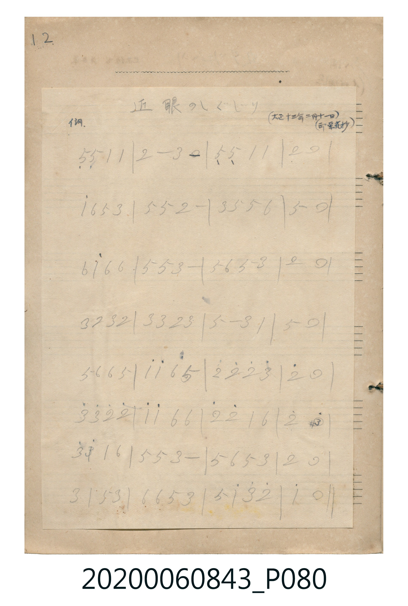

# 近眼のしくじり

<audio controls src="kingan_no_shikujiri.mp3"></audio>

- 曲：不詳 (大正十三年二月十一日 邱氏より抄)

## 說明

近眼のしくじり (Kingan no Shikujiri)
Source: 唱歌帖 (Shōkachō, NMTH 2020.006.0843) — P080.jpg (Notebook 2, p.12)
Notation: Handwritten numbered notation (Jianpu) on pasted grid sheet
Annotations: イ調, (大正十三年二月十一日) (邱氏より抄)

## 跨冊／重複收錄參照

> 同曲（滑稽唱歌〈近眼のしくじり〉；《唱歌帖》P080 與 P257）

- **[同曲]** 楊金土手抄《唱歌帖》第 7 冊・VII（2020.006.0843）：[**〈近眼のしくじり (近視眼的失誤)〉**](../../vol_07/p257_chikame_no_shikujiri/index.md)（`C` / `4/4` — [原始 TMD](../../vol_07/p257_chikame_no_shikujiri/chikame_no_shikujiri.tmd)）
- 總表：[跨冊重複與同名歌曲總索引](../../../duplicate_songs.md)

## 歌詞

```text
（TMD 檔案未包含歌詞註解）
```

## ABC

```abc
X:1
T:近眼のしくじり
C:曲：不詳 (大正十三年二月十一日 邱氏より抄)
M:4/4
L:1/16
Q:1/4=108
K:A
V:V1 name="Melody" snm="Mel"
[V:V1]
!mf! E4 E4 A4 A4 | B8 c4 z4 | E4 E4 A4 A4 | B12 z4 |
a4 f4 e4 c4 | e4 e4 B8 | c4 e4 e4 f4 | e12 z4 |
f4 a4 f4 f4 | e4 e4 c8 | e4 f4 e4 c4 | B12 z4 |
c4 B4 c4 B4 | c4 c4 B4 c4 | e8 c4 A4 | e12 z4 |
e4 f4 f4 e4 | a4 a4 f4 e4 | b4 b4 b4 c'4 | b12 z4 |
c'4 c'4 b4 b4 | a4 a4 f4 f4 | b4 b4 a4 f4 | b8 ^d'8 |
c'4 ^d'4 a4 f4 | e4 e4 c8 | e4 f4 e4 c4 | B12 z4 |
c4 A4 e4 c4 | f4 f4 e4 c4 | e4 a4 c'4 b4 | a12 z4 |
```

## TMD 檔案連結

- [主旋律 TMD 檔案](kingan_no_shikujiri.tmd) [[在 TMD Studio 編輯](https://tmdlang.github.io/Tmd-TS/#tmd=s7IKdvYPcrWy4tLSUnixf-LzOXseN6573Dj9cWP_48YZj5u6FLS0uBRtFQwNLLjsbRUcuWxM9E3suOoUlJ7N3vR-z6wnO3pfrNysoPF0yfJnaxc_7W18sqPz6c4tT3b1PJvTAeY2PJu-VOFl08ZnG_ofN3UATXzW1aKpxMWlr6VgSy3ApaCAw_Ua3pl56Yl5Cnn5CsEZmdmlWZlFmZog5cH5pUXJqVYKT6dsfLa25-mOaQoawRlHe7MTk4GkjoKfb4iHgpGBkYGegYGZnoGFibGmwqOGKQoBBhYGelkF6QoafvklqUn5-dkKRjoKBXqGRmBTgYKJJZn5eVYKHol5KeVFmSUlqUDLS3OTUotSU4CugEgraHhlJuYVlGoqANkFicUlQLn0oswUheKM1NQSkEGOeTC1xVYKj5uWvFi1X4dQKGsqaKCHM8goyoMXChS09Lm4IOHplw8PzXhHK9_UnPyUSocagxqFapCNCjaGZlp2YBYwlp_2zX-xds7jxvXAcH6xct7jxlXgGFr3bOqGp2unA6Xe7wE6F-TDxw2NT1tXGBs93dD_fH3D-z2dIBtBpgDNzU2rVTCNV9AFQzjDEI2uUTCCsmDQGEobwFWQYwoMwk2BOsswDipgBjMTzVqgdWgy6EbXwNWiq4SZiTCDkHNgOjCchWkUukMRzkG3HtNLxIYOTAdMPTofoQKXSkyvw2QQcUU4cGqxJVsnfMkWMxTQQwMp7nEmAmBIwaQwGcYwBpIq3F6ABiiGZkxz8TkMkQww9WEoxuIuE3V0EQyXIZRgMXAgEh8soWCahCtqMRMf3CuY4Y4U3LhdBEyAunYKWIpOBazCTiBhZS4A)]
- [鋼琴伴奏 TMD 檔案](kingan_no_shikujiri_piano.tmd) [[在 TMD Studio 編輯](https://tmdlang.github.io/Tmd-TS/#tmd=s7IKdvYPcrWy4tLSUnixf-LzOXseN6573Dj9cWP_48YZj5u6FDQeN0953LTocXPfkz1bni7tf7J7hqaClhaXoq2CoYEFl72tgiOXjYm-iR1XnYLSs9mb3u-Z9WRH74uVmxU0ni5Z_mzt4qe9jU92dD7dueXJrp5nczrA3IZn05cqvGza-GxD_-OmDqA1z7paNJW4uPS1FGypBbgUFHB5yTszLz0xTyEvXyE4IzO7NCuzKFNT4VHDFIWAzESgoGNycn5uQWJeZm5qXgnImOD80qLkVCuFp1M2Plvb83THNAWN4IyjvdmJyUBSR8HPN8RDwcjAyEDPwMBMz8DCxBhqmoGFgV5WQbqChl9-SWpSfn62gpGOQoGeoZEmyFTKvQgFClr6XFwQP_nlw30U72jlm5qTn1LpUGNQo1ANslHBxtBMyw7MAorkptUqmMYr6IIhnGGIRtcoGEFZMGgMpQ3gKsgxBQbhpkCdZRgHFTCDmYlmLdA6NBl0o2vgatFVwsxEmEHIOTAdGM7CNArdoQjnoFuP6SViQwemA6YenY9QgUslptdhMoi4Ihw4tdgTHDj_BHngTHEFtQrG8drwVILMNo3XhjkAiQlKW9rm8dowX2DwDLUxkyOVrUDiYUSHtqk2PGUYaptow5OLNlAKmyuBCRxJCk0ZTnvBbkQYgssIoAvU4U6oUQAZAJfDzcHIgUj-MNY2w-VBBBuvnxCuxhsORAUd-RGF7hBciQhvsBNrCJHhAU6aSMmQ5OjClwl9cGVCRA6AuQ_uHCRf41KEyGQkmWOEMBDGwkh1UL4JHvMwhJAcikcVTADuCtJcBncRJgMReTiDAy5AnBfJCTJi7MQMMiLcTrK7sKZIJ_ztEPTKEb2SRGoS4GwbACtQmBQmwxjGQFKFDjEKdgzNmObicxiiaMTUh6EYi7tM1NFFMFyGUILFwIFok8CTEYZJuKIWs00C9wpmuCMFN24X4UiA-NsluGsi7LUSWr1PVCMAGJxAZeYwT-FgoxhFnBa8TRIUDi4TQHqQankiq3wjoDJE2kbmoLRC0JokuH2EyzSs_kJRgdPBQ61dgtogwNuEJJxI8fiKuCSCLymhcIjLfQQbJMTUrvAKCYsazEYLlqqOnOoVW2sDbqAZoqOB0x_AZI9hLSYDmw-wqEJzHFwC7hAkaweyUYLR-kIyD3dUY7MUw9HYGnsI1VhbJbp2CliaygpYhZ1AwspcAA)]

## 分析

```text
================================================================================
📊 TMD Song Profile: [ 近眼のしくじり ]
================================================================================
⏱  Duration:       1:11 (71.1s), 32 measures total
🎼 Key & Tempo:    首調基準 A, != 108.0 BPM, <4/4>
   - 分析範圍：      由實際發聲的音符與和弦推測調性；播放脈絡另行呈現
🎤 人聲音域:    E4 (MIDI 64) – D#6 (MIDI 87) [跨度: 23 個半音 / 1.9 個八度, 難度: difficult]
   - 最低音:  E4 in [KinganNoShikujiri_A #1 @ m.1, 0:00]
   - 最高音: D#6 in [KinganNoShikujiri_B #1 @ m.24, 0:52]
🏛  結構:      KinganNoShikujiri_A (35.6s) -> KinganNoShikujiri_B (35.6s)
⚡ 編曲密度:        Peak 1 軌道同時演奏
🗝  調性診斷：       E 大調（純淨自然大調，未偵測到可信轉調）
   - 風格氣質:    純淨自然大調（陽光明朗、易唱易記，無明顯調外色彩）
   - 轉調歷程:    全曲維持單一推測調性（未偵測到可信轉調）
   - 核心骨幹音:  E, B, C#, A, F#
   - 調性數值:    E 大調 [相關度: 0.84, 穩定度: High, 自然音純度: 100.0%]
   - 候選調性 (K-S): E 大調 (0.84), A 大調 (0.69), C# 小調 (0.62)
   - 五度圈歷程:   +4 -> +4
   - 各段落調性細節:
     • [KinganNoShikujiri_A #1]: E 大調 (r: 0.87, 自然音純度: 100.0%)
     • [KinganNoShikujiri_B #1]: E 大調 (r: 0.72, 自然音純度: 100.0%)

  [ 五度圈游移軌跡 ]
               C  
         F            G  
      Bb               D  
      Eb               A  
         Ab          [E ]*
            Db       B  
               F# 
     (* = active key center)

  [ 十二半音累積音高分佈 ]
     C  :                            0.0%
     C# : ██████████████████        19.2%
     D  :                            0.0%
     D# : ██                         2.5%
     E  : ████████████████████████  25.8%
     F  :                            0.0%
     F# : ████████████              13.3%
     G  :                            0.0%
     G# :                            0.0%
     A  : ██████████████            15.0%
     A# :                            0.0%
     B  : ██████████████████████    24.2%
--------------------------------------------------------------------------------
Assignment 軌道音域：
  - Melody        : E4 – D#6 (23 個半音 / 1.9 個八度, 99 個音符)
================================================================================
```


## 原書掃描頁




