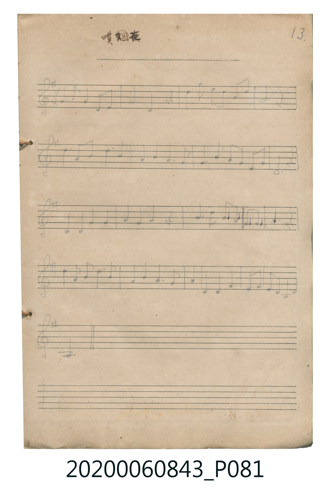

# 嘆烟花

> Re:Shōka 使用 AI 協助辨識與重建樂譜，可能會有錯誤。歡迎[回報](https://github.com/TMDLang/reshoka/issues)。

- **鋼琴伴奏版**：<br><audio controls src="tan_yenhua.mp3"></audio>

- 曲：台湾伝統曲 (歌仔調)

## 說明

嘆烟花 (Tan Yenhua)
Source: 唱歌帖 (Shōkachō, NMTH 2020.006.0843) — P081.jpg (Notebook 2, p.13)
Notation: Handwritten 5-line staff (1 sharp = G major, 4/4 time, 17 bars)


## 歌詞

```text
（TMD 檔案未包含歌詞註解）
```

## ABC

<div class="abc-score" data-abc-src="tan_yenhua.abc" aria-label="五線譜載入中"></div>

[下載 ABC 原始檔](tan_yenhua.abc)

## TMD 檔案連結

- [主旋律 TMD 檔案](tan_yenhua.tmd) [[在 TMD Studio 編輯](https://tmdlang.github.io/Tmd-TS/#tmd=s7IKdvYPcrWy4qpTUCpJTLdSSM7PyUlNLsnMz7MqzsjPTkzOyFeCS5bl55TmploBqXgDI4RwcX5pUXJqfEFieqpVgIGFIboM3KT4vPyS1KT8_GyEioKi_LLUvMQ8oKrcxLzS4uSizIKS-OT8gkqEmtSyzJRUkIrUlMyS_KLMxBwkJ6UWFYMdC3FDSVFiHsQMoCBCFVBTemaeFVAWaAJQJjEnPjWxuCQ-sTgzEUVZSUZ-elFiQUalVUZmMciuZKDS7MS8RISikoxUYBikppQmJ0Is0dJSeDqj7Xnz_BddGxW0tLgUbRUsLLjsbRXcuWxM9E3sQDqfzd70fs-sp_0bnu3c92TP3OdbNwJFFDSere15snvKi1X7NZW4uPS1FGypBbgUFJAcpRGSmKcQmZqXUZqoCZIJhkSLwtMpG4EueLpjmoJGcMbRXlAcHe3VUfDzDfFQMDIwMtAzMDDTM7AwMdZUeNQwRQEUt3pZBekKGn7QeFQw0lEo0DM0BpsKFASHiJWCR2JeSnlRZklJap6CqW5OZl6qQnFJYlqagoahQnFGYlGBAjBwFHITs_KLdBSAQaRQkpmbqqNgaK6QlFhUDDaM8iCAAgUtfS4uoP8h3rfyTc3JT6l0qDGoqQZZo2BjaKZlB2YBg_9p3_wXa-c8blwPDJUXK-c9blz1uHH648Z1T3ZNeb59FlDq_Z6Ox80dL6duB0bZ44ZGoNOfdfc-XTsByH7ausLQ_OmG_ufrG97v6QTZCjK0RqE6t6BWwUhBFw6NgRjGN40HEmYgokbBEEkNSB4sB4IGULpGwRRJiRlICZqRqIYgQ7gZUFeBdCBbBuODTASZjLALJoPuBYRdIBkQG-wPdF_BfUHIRXCFcAbMfBhdA3cDss2oIYTsL5APYCED0gEJIWQREIS7GmYQehDBggc5QEBshHMIBxFq0GB6CtlRmGoxggh3WNZycenaKcCTuwKQo8wFAA)]
- [鋼琴伴奏 TMD 檔案](tan_yenhua_piano.tmd) [[在 TMD Studio 編輯](https://tmdlang.github.io/Tmd-TS/#tmd=s7IKdvYPcrWy4qpTUCpJTLdSyC8qychPL0osyKi0ysgsLskvykxOzInPTsxLVIIrKs4vLUpOjS9ITE-1CjCwMETIlGSk5qZapaaUJieWZObnKXFpaSk8ndH2vHn-i66NChqPm6c8blr0uLnvyZ4tT5f2P9k9Q1NBS4tL0VbBwoLL3lbBncvGRN_EDmTcs9mb3u-Z9bR_w7Od-57smft860agiILGs7U9T3ZPebFqv6YSF5e-loIttQCXggKyS0MS8xQiU_MyShM1FR41TFEIyEzMy1dwTE7Ozy1IzMvMTc0rAekIBoeElcLTKRuBLnu6Y5qCRnDG0d7sxGQgqaPg5xvioWBkYGSgZ2BgpmdgYWIMNQ0YaHpZBekKGn75JalJ-fnZCkY6CgV6hsaaIFMp9w0UKGjpc3EBvQLxiZVvak5-SqVDjUFNNcgaBRtDMy07MKtGoTq3oFbBSEEXDo2BGMY3jQcSZiCiRsEQSQ1IHiwHggZQukbBFEmJGUgJmpGohiBDuBlQV4F0IFsG44NMBJmMsAsmg-4FhF0gGRAb7A90X8F9QchFcIVwBsx8GF0DdwOyzaghhOwvkA9gIQPSAQkhZBEQhLsaZhB6EMGCBzlAQGyEcwgHEWrQYHoK2VGYajGCCHdY1iInS3DeCvLAkS6BydI0Xts8XhuRGHHzjOK1Ec5RMAbxtGFewMJDd5eCobaxNiwAcbFRbSTCFjgPMy1pAw1GGIuDg2w5qhPR9eAMF_yuNInXhscmMhsY6WB15jAB_Fx07yFHBjIbn1PAgYLqDZgUqgRSaYMrrHCahKYHwz3wACA-wnAlFmz-ISvGkOMFOe0SHXzIBqBkE-TYIj2qMXOyD3JONoFnZKCFRvEg0jQ-HpSMIQwgZQAugIASYALGBotDtUJljSGyQArZFCDXBIwQViDrhYhBNcMsgVgJMcgQxgaGDnYrYbrgVgItg1gMlQPyQS5H8yjEOGD46NopwINIAchR5gIA)]

## 分析

```text
================================================================================
📊 TMD Song Profile: [ 嘆烟花 ]
================================================================================
⏱  Duration:       0:46 (46.4s), 17 measures total
🎼 Key & Tempo:    首調基準 G, != 88.0 BPM, <4/4>
   - 分析範圍：      由實際發聲的音符與和弦推測調性；播放脈絡另行呈現
🎤 人聲音域:    D4 (MIDI 62) – E5 (MIDI 76) [跨度: 14 個半音 / 1.2 個八度, 難度: moderate]
   - 最低音:  D4 in [TanYenhua #1 @ m.1, 0:02]
   - 最高音: E5 in [TanYenhua #1 @ m.3, 0:06]
   - 適合: soprano, mezzo-soprano, contralto, tenor, baritone, bass
🏛  結構:      TanYenhua (46.4s)
⚡ 編曲密度:        Peak 1 軌道同時演奏
🗝  調性診斷：       D 大調（純淨自然大調，未偵測到可信轉調）
   - 風格氣質:    純淨自然大調（陽光明朗、易唱易記，無明顯調外色彩）
   - 轉調歷程:    全曲維持單一推測調性（未偵測到可信轉調）
   - 核心骨幹音:  D, A, G, B, E
   - 調性數值:    D 大調 [相關度: 0.84, 穩定度: Moderate, 自然音純度: 100.0%]
   - 候選調性 (K-S): D 大調 (0.84), G 大調 (0.79), B 小調 (0.63)
   - 五度圈歷程:   +2
   - 各段落調性細節:
     • [TanYenhua #1]: D 大調 (r: 0.84, 自然音純度: 100.0%)

  [ 五度圈游移軌跡 ]
               C  
         F            G  
      Bb              [D ]*
      Eb               A  
         Ab           E  
            Db       B  
               F# 
     (* = active key center)

  [ 十二半音累積音高分佈 ]
     C  :                            0.0%
     C# :                            0.0%
     D  : ████████████████████████  28.8%
     D# :                            0.0%
     E  : █████████                 10.4%
     F  :                            0.0%
     F# :                            0.0%
     G  : █████████████████         20.8%
     G# :                            0.0%
     A  : ██████████████████        21.6%
     A# :                            0.0%
     B  : ███████████████           18.4%
--------------------------------------------------------------------------------
Assignment 軌道音域：
  - Melody        : D4 – E5 (14 個半音 / 1.2 個八度, 68 個音符)
================================================================================
```


## 原書掃描頁




