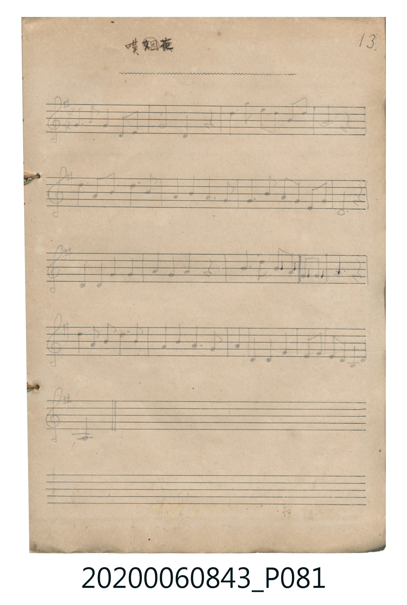

# 嘆烟花

> Re:Shoka 使用 AI 辨識樂譜，可能會有錯誤。歡迎回報。

<audio controls src="tan_yenhua.mp3"></audio>

- 曲：台湾伝統曲 (歌仔調)

## 說明

嘆烟花 (Tan Yenhua)
Source: 唱歌帖 (Shōkachō, NMTH 2020.006.0843) — P081.jpg (Notebook 2, p.13)
Notation: Handwritten 5-line staff (1 sharp = G major, 4/4 time, 17 bars)

## 歌詞

```text
（TMD 檔案未包含歌詞註解）
```

## ABC

```abc
X:1
T:嘆烟花
C:曲：台湾伝統曲 (歌仔調)
M:4/4
L:1/16
Q:1/4=88
K:G
V:V1 name="Melody" snm="Mel"
[V:V1]
!mp! A6 B2 A4 D2 E2 | G6 A2 D4 z4 | d6 e2 d4 B2 A2 | G12 z4 |
B6 A2 B4 d2 e2 | d4 B4 A6 B2 | G4 A2 G2 E4 D2 E2 | D12 z4 |
D4 D4 G4 G4 | A4 G4 A4 z4 | B6 d2 B2 A2 G2 A2 | B2 A2 G4 E6 z2 |
B4 A2 B2 d4 B2 d2 | A4 B4 A6 B2 | G4 E4 D4 G4 | A2 B2 A2 G2 E4 D4 |
D12 z4 |
```

## TMD 檔案連結

- [主旋律 TMD 檔案](tan_yenhua.tmd) [[在 TMD Studio 編輯](https://tmdlang.github.io/Tmd-TS/#tmd=s7IKdvYPcrWy4qpTUCpJTLdSSM7PyUlNLsnMz7MqzsjPTkzOyFeCS5bl55TmploBqXgDI4RwcX5pUXJqfEFieqpVgIGFIboM3KT4vPyS1KT8_GyEioKi_LLUvMQ8oKrcxLzS4uSizIKS-OT8gkqEmtSyzJRUkIrUlMyS_KLMxBwkJ6UWFYMdC3FDSVFiHsQMoKASl5aWwtMZbc-b57_o2qigpcWlaKtgYcFlb6vgzmVjom9iBzLm2exN7_fMetq_4dnOfU_2zH2-dSNQREHj2dqeJ7unvFi1X1OJi0tfS8GWWoBLQQHJURohiXkKkal5GaWJmiCZYEiIKTydshHogqc7piloBGcc7QUF39FeHQU_3xAPBSMDIwM9AwMzPQMLE2NNhUcNUxRAwa6XVZCuoOEHDWIFIx2FAj1DY7CpQMFEcJwqeCTmpZQXZZaUpOYpmOrmZOalKhSXJKalKWgYKhRnJBYVKAADRyE3MSu_SEcBGEQKJZm5qToKhuYKSYlFxWDDKA8CKFDQ0ufiAvof4n0r39Sc_JRKhxqDGoVqkD0KNoZmWnZgFjD8n_bNf7F2zuPG9cBgebFy3uPGVY8bpz9uXPdk15Tn22cBpd7v6Xjc3PFy6nZgnD1uaAS6_Vl379O1E4Dsp60rDM2fbuh_vr7h_Z5OkLUgQ4HW5BbUKhgp6MKhMRDD-KbxQMIMRNQoGCKpAcmD5UDQAErXKJgiKTEDKUEzEtUQZAg3A-oqkA5ky2B8kIkgkxF2wWTQvYCwCyQDYoP9ge4ruC8IuQiuEM6AmQ-ja-BuQLYZNYSQ_QXyASxkQDogIYQsAoJwV8MMQg8iWPAgBwiIjXAO4SBCDRpMTyE7ClMtRhDhDstaLi5dOwV4elcAcpS5AA)]
- [鋼琴伴奏 TMD 檔案](tan_yenhua_piano.tmd) [[在 TMD Studio 編輯](https://tmdlang.github.io/Tmd-TS/#tmd=s7IKdvYPcrWy4tLSUng6o-158_wXXRsVNB43T3nctOhxc9-TPVueLu1_snuGpoKWFpeirYKFBZe9rYI7l42JvokdV52C0rPZm97vmfW0f8Oznfue7Jn7fOtGoIiCxrO1PU92T3mxar-mEheXvpaCLbUAl4ICsktDEvMUIlPzMkoTNRUeNUxRCMhMzMtXcExOzs8tSMzLzE3NKwHpCM4vLUpOtVJ4OmUj0GVPd0xT0AjOONqbnZgMJHUU_HxDPBSMDIwM9AwMzPQMLEyMoaYZWBjqZRWkK2j45ZekJuXnZysY6SgU6Bkaa4JMpdw3UKCgpc_FBfQKxCdWvqk5-SmVDjUGNQrVIHsUbAzNtOzALKBIbkGtgpGCLhwaAzGMbxoPJMxARI2CIZIakDxYDgQNoHSNgimSEjOQEjQjUQ1BhnAzoK4C6UC2DMYHmQgyGWEXTAbdCwi7QDIgNtgf6L6C-4KQi-AK4QyY-TC6Bu4GZJtRQwjZXyAfwEIGpAMSQsgiIAh3Ncwg9CCCBQ9ygIDYCOcQDiLUoMH0FLKjMNViBBHusKxFTpfgzBXkgSthAtOlaby2ebw2IjXi5hnFayPco2AM4mnD_ICFh-4wBUNtY21YCOJio9pIhC1wHmZi0gYajDAWBwfZclQnouvBGS74XWkSrw2PTmQ2MNbB6sxhAvi56N5DjgxkNj6ngAMF1RswKVQJpOIGV1jhNAlND4Z74AFAfIThSizY_ENWjCHHC3LaJTr4kA1AySbIsUV6VGNmZR9cWRkpMcCdB2cg0pwhpiBcCCmnohuBIYBNDa6IxWmaMaZpcCH8rocrM8FgYA8K3IkOXS0Wx-EOBswgw_QAIvlgqMGZF4gJMtyuwhpk8ADCDEQsZsFV466B8IYuMOXq2inAE68CkKPMBQA)]

## 分析

```text
================================================================================
📊 TMD Song Profile: [ 嘆烟花 ]
================================================================================
⏱  Duration:       0:46 (46.4s), 17 measures total
🎼 Key & Tempo:    首調基準 G, != 88.0 BPM, <4/4>
   - 分析範圍：      由實際發聲的音符與和弦推測調性；播放脈絡另行呈現
🎤 人聲音域:    D4 (MIDI 62) – E5 (MIDI 76) [跨度: 14 個半音 / 1.2 個八度, 難度: moderate]
   - 最低音:  D4 in [TanYenhua #1 @ m.1, 0:02]
   - 最高音: E5 in [TanYenhua #1 @ m.3, 0:06]
   - 適合: soprano, mezzo-soprano, contralto, tenor, baritone, bass
🏛  結構:      TanYenhua (46.4s)
⚡ 編曲密度:        Peak 1 軌道同時演奏
🗝  調性診斷：       D 大調（純淨自然大調，未偵測到可信轉調）
   - 風格氣質:    純淨自然大調（陽光明朗、易唱易記，無明顯調外色彩）
   - 轉調歷程:    全曲維持單一推測調性（未偵測到可信轉調）
   - 核心骨幹音:  D, A, G, B, E
   - 調性數值:    D 大調 [相關度: 0.84, 穩定度: Moderate, 自然音純度: 100.0%]
   - 候選調性 (K-S): D 大調 (0.84), G 大調 (0.79), B 小調 (0.63)
   - 五度圈歷程:   +2
   - 各段落調性細節:
     • [TanYenhua #1]: D 大調 (r: 0.84, 自然音純度: 100.0%)

  [ 五度圈游移軌跡 ]
               C  
         F            G  
      Bb              [D ]*
      Eb               A  
         Ab           E  
            Db       B  
               F# 
     (* = active key center)

  [ 十二半音累積音高分佈 ]
     C  :                            0.0%
     C# :                            0.0%
     D  : ████████████████████████  28.8%
     D# :                            0.0%
     E  : █████████                 10.4%
     F  :                            0.0%
     F# :                            0.0%
     G  : █████████████████         20.8%
     G# :                            0.0%
     A  : ██████████████████        21.6%
     A# :                            0.0%
     B  : ███████████████           18.4%
--------------------------------------------------------------------------------
Assignment 軌道音域：
  - Melody        : D4 – E5 (14 個半音 / 1.2 個八度, 68 個音符)
================================================================================
```


## 原書掃描頁




