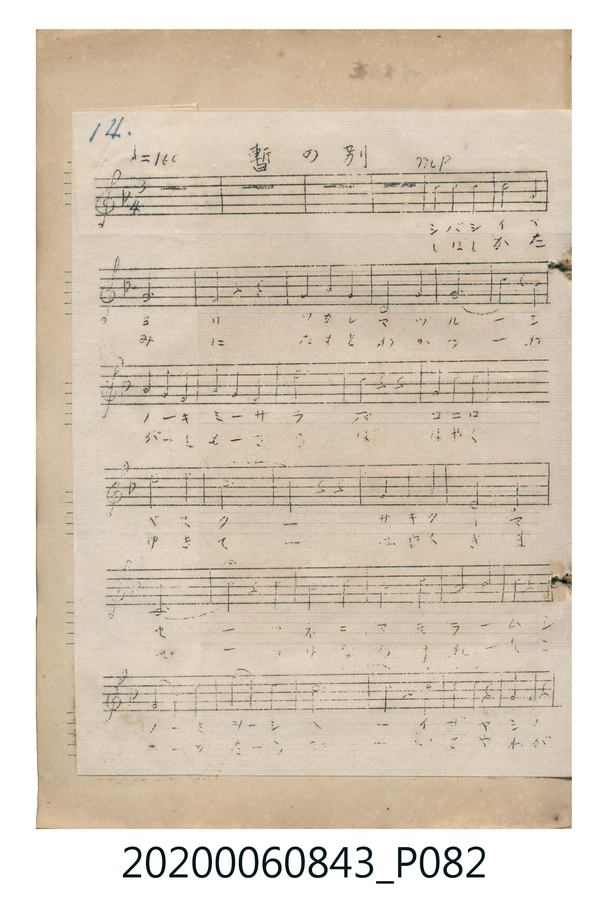
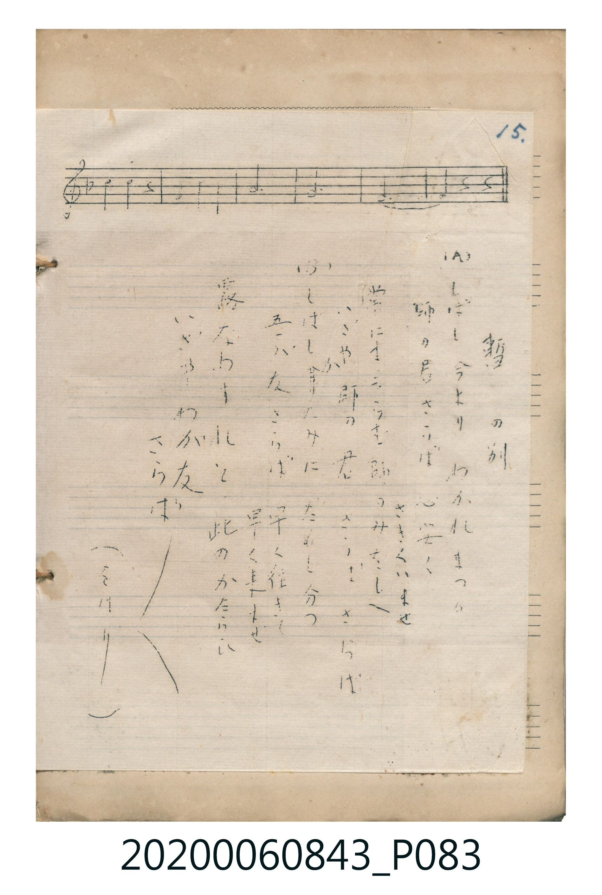

# 暫の別

> Re:Shōka 使用 AI 協助辨識與重建樂譜，可能會有錯誤。歡迎[回報](https://github.com/TMDLang/reshoka/issues)。

- **鋼琴伴奏版**：<br><audio controls src="shibashi_no_wakare.mp3"></audio>

- 曲：不詳

## 說明

暫の別 (Shibashi no Wakare)
Source: 唱歌帖 (Shōkachō, NMTH 2020.006.0843) — P082.jpg – P083.jpg (Notebook 2, p.14–15)
Notation: Handwritten 5-line staff (1 flat = F major, 3/4 time, 30 bars)


## 歌詞

```text
（TMD 檔案未包含歌詞註解）
```

## ABC

<div class="abc-score" data-abc-src="shibashi_no_wakare.abc" aria-label="五線譜載入中"></div>

[下載 ABC 原始檔](shibashi_no_wakare.abc)

## TMD 檔案連結

- [主旋律 TMD 檔案](shibashi_no_wakare.tmd) [[在 TMD Studio 編輯](https://tmdlang.github.io/Tmd-TS/#tmd=s7IKdvYPcrWy4qpTUCpJTLdSSM7PyUlNLsnMz7MqzsjPTkzOyFeCS5bl55TmploBqXgDI4RwcX5pUXJqfEFieqpVgIEFhgzcpPi8_JLUpPz8bISKgqL8stS8xDygqtzEvNLi5KLMgpL45PyCSoSa1LLMlFSQitSUzJL8oszEHCQnpRYVgx0LcUNJUWIexAygIEJVSUYq0N1pRZmpeSnFGZkFCBmgcemZeValeSArSjLTMlNTkCVLMvLTixILMiqtMjKLQXYnJ-bEZyfmJSpxaWkpPJu1-nHjuqcdSxW0tLgUbRUMzQy47G0V3LhsjPVN7EDGPJu96f2eWU929L5YuVmJi0tfS8GWWoBLQQHJARrBGZlJiUC_KeTlK4QnZicWpWqCVARDYkDh6ZSNz9b2PN0xDaTyaC8oOo726ij4-YZ4KBgZGBnoGRiY6RlYmBhrKjxqmKIAika9rIJ0IGcyiGMM5mj4QeNPwUhHoUDP0AQoa2gKtgcokwhONQoeiXkp5UWZJSWpeQqmujmZeakKxSWJaWkKGoYKaTmJJQrAAFLITczKL9JRAAaTQklmbiqQZaCQlFhUDDaL8rCBAgUtfS4uWMD45UOCJd4zr6Qo3yogMzEv36HGoKYaZKWCjYmWHZhRo2AAhjhprlosZjpimGdoBjUQGOfAkH-xcp4VyDlQEQ1HTYXHjdMfN24AkgpPdnc9bup43NSl8Lip_3Fj9-OmnseN-x43Lnnc1K2gr_B0BziWJ8wGapn6uKkTqEvh6f7mp-uArH6gPEi0sRfIftzYAtY3G8mmpzt2PG4E6t_3uKkJpLepAWre48b9j5smgR2xA2wIUO-0x00tWK1DsJD84ITih11AszYBrQKKzQfZ1bjiaUcb0A8gs0G-6nna341kzrPpK4EufrqvAez0ZUBVEJFnc5di-OFxU9vjpsbHjavABs0EB89cYKguAXujG2wh0NBNKN7AZimGN2oUqnMLahVMFXTBEJ2uUTCDsmAQIWOMJgODNQqGUJYBGl0D849DWD6wHLEChR4Qg5wFooFObt4DpPcBnd4BYYMwMFUgQgK7zvlA3APEm4AYGP4wnUAM96YR1A3odI2CaTy6F2ECCJ9g-hEWDjC_wUID049N_UBXASOhCeRCoN_AflwC5APFYC4F-gKbH4H-amoC0isgpoBVgqITqBseOv2YfoS52hzTIzAlcOfCRTC9CJMhIhrXAXEvEO8HpTCgozohkYMZESi6QAEC8hrIi3h14Y0-NHcjZExw-gzmeyJ8NhmCm4C-A-UpcBTMBGJodODx3XqIDpDKpjaoTlAYLcPvQ5jbYK4HZkH0BIolXjH9iJ4JEaka06nAwAc7DZRSkXIhsAxCpNAlhDwJMgGbTqDn4Z6kRjkD8xhmkMGjHtOdayElA7hsASY3sLuAyQ1YGcDyHyQRAxNw0yRsPm1qBMquguZmYAIAmwBKwHOhJoASCsgEUP6cj_Ax8REET4Rw_6DT-HI41gISHnk7IBHbOA0aXTDv9mL1KjBg4DpBRSqSTrD3IfkW4cU4mKtgDIRXcEYREQFDjgwRORoYxWCfIZU4IDY8uSL7HlIaYQsjaCIizRRgy0nXTgF7g0wBm4wjSFSZCwA)]
- [鋼琴伴奏 TMD 檔案](shibashi_no_wakare_piano.tmd) [[在 TMD Studio 編輯](https://tmdlang.github.io/Tmd-TS/#tmd=s7IKdvYPcrWy4qpTUCpJTLdSyC8qychPL0osyKi0ysgsLskvykxOzInPTsxLVIIrKs4vLUpOjS9ITE-1CjCwMNIFEsYI6ZKM1NxUq9SU0uTEksz8PCUuLS2FZ7NWP25c97RjqYLG4-Ypj5sWPW7ue7Jny9Ol_U92z9BU0NLiUrRVMDQz4LK3VXDjsjHWN7EDmfds9qb3e2Y92dH7YuVmJS4ufS0FW2oBLgUFZFcFZ2QmJRZnZCrk5SuEJ2YnFqVqKjxqmKIQkJkIFHFMTs7PLUjMy8xNzSsB6QwGB4GVwtMpG5-t7Xm6YxrIhKO92YnJQFJHwc83xEPByMDIQM_AwEzPwMLEGGoaMLT0sgrSgZzJII4xmKPhl1-SmpSfn61gpKNQoGdoApQ1NNUE2UO5P6FAQUufiwvmSb98iBfjPfNKivKtwH50qDGoqQZZqWBjomUHZtQoGIAhTpqrFr-ZQR5IphqawY2tzi2oVTDUNtY2VdAFQ1zsGiDPRNsMLoPMRlZlGq9tHq9tBOXj49UoGMdrA4UMoXwDNJqgn3yQ_YQIKUOgPUCjgSyTeAVDIAK7SsEoHkiCRIFCuIPMESMK0AML5lV0ukYBFiAwiJAxRpOBQZBjcXkeZCUwlzmE5QOzvRWQ87hxOhBvgNItCo-b9wDpfQqPmzogbBBu6gIlLwJ65wNxDxBvAuLVCL1ADNVbowCLJHQaHJRo3oQJIHyD6U9YWMD8BwsRiD8R9sFMMMc0FKYErhUugmkdTAZ7sOL1HppZCBkTnLbBXETINpg6mEnAJIMemFj8jWkfeqJBxADUQmqkUZglmM6HBwk8wxHrUHjAwM1Cp_GlBJh1cTAVMAbCWJxOJcKR5MgQV2ZBCxWcZTCwVIEZgLv4RajAVfQikoM2UAIbh3CRC6ts4JrxFN8wVUZgM-HxhMZFqEO1G5UHql4QfsHqE3jiRncUzAxUW9ElUHQghQhxfkXlUyfcQIJwL-NVBCswUDgQL8J9gstNZjh8DhJHMgumzSReG14okRON2BMYWBTNYTRL8uhOwhP9aKGO5jJyfIooi4jJjsSlZaizgB7Xhpd5KByEpcT7lUhfoqQLuDgqj0ohhq_sxNnWg7SCgS09A3BDD9H4gzfzMBtDTf3Ahk83kAY1goANKHBDagmQDxSDNYaADSXsDSlg46mpCUivgJgDVgvUB9IPb4T1IxpSQOdAnAhqfEJYQJeBOEAK4gGQc7HZtA6Ie4F4PxBPBZraCWnCYTbX0PSBfAVyHciVePUhuQ4cbugtZZgsNksmQ3AT0IFNsLboTCCGBgleB66H6AGpbWqD6gV5dBkBR2IPS5xOBPodbCwotpGay42zkWJ5CWEngszAphfodERzGZzogKkQmhSBLoXHszG014HHpWshDXFwYx4Ya2DTgbHW1ABPi5DUAEwJTZOwu7ipESi_Cpq2gREBNgOUEuZCzQBFGMgMUFqdj3A5lhwESZGQ0AYnBBz9CXgg7oAEcOM0aKDBnNuLw6lAr8H1gvogSHrBzockYIQTsYYj3OX4UikwwMC2IGUDEBsehcgugWQR7C6GRgrp5oCcCQxNuDvhXVB4CWACZoASD540AywZde0UsHeGFbDJOIJElbkA)]

## 分析

```text
================================================================================
📊 TMD Song Profile: [ 暫の別 ]
================================================================================
⏱  Duration:       0:42 (42.8s), 38 measures total
🎼 Key & Tempo:    首調基準 F, != 160.0 BPM, <3/4>
   - 分析範圍：      由實際發聲的音符與和弦推測調性；播放脈絡另行呈現
🎤 人聲音域:    C4 (MIDI 60) – F5 (MIDI 77) [跨度: 17 個半音 / 1.4 個八度, 難度: challenging]
   - 最低音:  C4 in [ShibashiNoWakare_A #1 @ m.10, 0:10]
   - 最高音: F5 in [ShibashiNoWakare_A #1 @ m.33, 0:36]
   - 適合: soprano, mezzo-soprano, contralto, tenor, baritone, bass
🏛  結構:      ShibashiNoWakare_Intro (4.5s) -> ShibashiNoWakare_A (38.2s)
⚡ 編曲密度:        Peak 1 軌道同時演奏
🗝  調性診斷：       F 大調（純淨自然大調，未偵測到可信轉調）
   - 風格氣質:    純淨自然大調（陽光明朗、易唱易記，無明顯調外色彩）
   - 轉調歷程:    全曲維持單一推測調性（未偵測到可信轉調）
   - 核心骨幹音:  F, G, C, A, D
   - 調性數值:    F 大調 [相關度: 0.88, 穩定度: High, 自然音純度: 100.0%]
   - 候選調性 (K-S): F 大調 (0.88), C 大調 (0.68), D 小調 (0.55)
   - 五度圈歷程:   -1 -> -1
   - 各段落調性細節:
     • [ShibashiNoWakare_Intro #1]: ? 音樂資料不足 (r: 0.00, 自然音純度: 100.0%)
     • [ShibashiNoWakare_A #1]: F 大調 (r: 0.88, 自然音純度: 100.0%)

  [ 五度圈游移軌跡 ]
               C  
        [F ]*          G  
      Bb               D  
      Eb               A  
         Ab           E  
            Db       B  
               F# 
     (* = active key center)

  [ 十二半音累積音高分佈 ]
     C  : █████████████             16.9%
     C# :                            0.0%
     D  : █████                      6.7%
     D# :                            0.0%
     E  : ███                        3.4%
     F  : ████████████████████████  31.5%
     F# :                            0.0%
     G  : ████████████████          21.3%
     G# :                            0.0%
     A  : ████████████              15.7%
     A# : ███                        4.5%
     B  :                            0.0%
--------------------------------------------------------------------------------
Assignment 軌道音域：
  - Piano         : C4 – F5 (17 個半音 / 1.4 個八度, 65 個音符)
================================================================================
```


## 原書掃描頁






