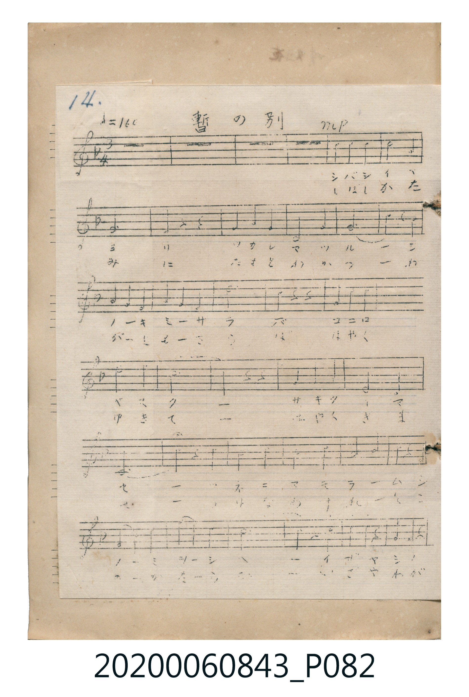
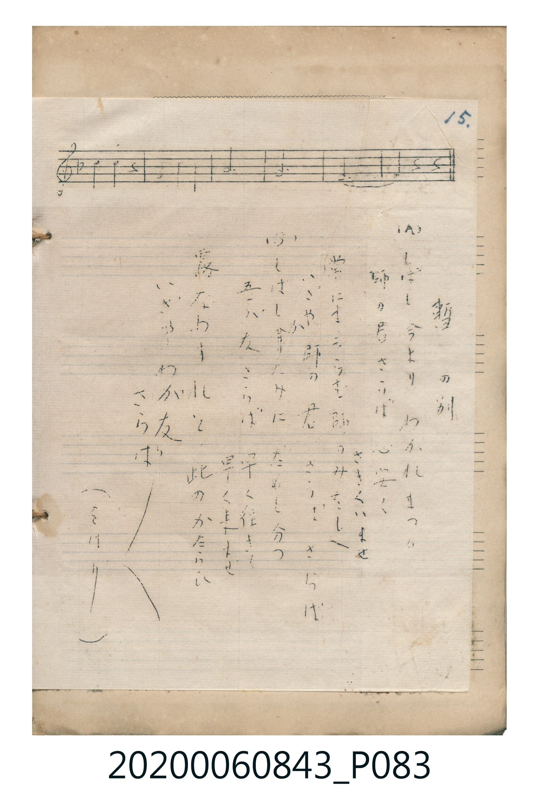

# 暫の別

<audio controls src="shibashi_no_wakare.mp3"></audio>

- 曲：不詳

## 說明

暫の別 (Shibashi no Wakare)
Source: 唱歌帖 (Shōkachō, NMTH 2020.006.0843) — P082.jpg – P083.jpg (Notebook 2, p.14–15)
Notation: Handwritten 5-line staff (1 flat = F major, 3/4 time, 30 bars)

## 歌詞

```text
（TMD 檔案未包含歌詞註解）
```

## ABC

```abc
X:1
T:暫の別
C:曲：不詳
M:3/4
L:1/16
Q:1/4=160
K:F
V:V1 name="Vocal" snm="Voc"
[V:V1]
z4 z4 z4 | z4 z4 z4 | z4 z4 z4 | z4 z4 z4 |
!mp! c4 c4 c4 | d8 c4 | A12 | F4 z4 z4 |
G4 G4 G4 | C8 C4 | F12 | c4 z4 A4 |
G4 F4 E4 | F4 G4 A4 | G12 | G4 z4 z4 |
G4 G4 G4 | c8 G4 | B12 | A4 z4 z4 |
G4 A4 B4 | D8 E4 | F12 | F4 z4 C4 |
c4 c4 c4 | d8 c4 | A8 F4 | G4 A4 G4 |
F12 | F4 z4 z4 | A4 A4 A4 | G4 F4 E4 |
f4 f4 z4 | G4 A4 G4 | F12 | F12 |
F12 | F4 z4 z4 |
```

## TMD 檔案連結

- [主旋律 TMD 檔案](shibashi_no_wakare.tmd) [[在 TMD Studio 編輯](https://tmdlang.github.io/Tmd-TS/#tmd=s7IKdvYPcrWy4tLSUng2a_XjxnVPO5YqaGlxKdoqGJoZcNnbKrhx2Rjrm9hx1SkoPZu96f2eWU929L5YuVmJi0tfS8GWWoBLQQHJARrBGZlJicUZmQp5-QrhidmJRamaIBXB-aVFyalWCk-nbHy2tufpjmkglUd7sxOTgaSOgp9viIeCkYGRgZ6BgZmegYWJsabCo4YpCgEGFkZ6WQXpQM5kEMcYzNHwyy9JTcrPz1Yw0lEo0DM0AcoamoLtAcoklmTm51kpeCTmpZQXZZaUpOYpmOrmZOalKhSXJKalKWgYKqTlJJYoAANIITcxK79IRwEYTAolmbmpQJaBQlJiUTHYLMrDBgoUtPS5uGAB45cPCZZ4z7ySonyrsPzkxByHGoMahWqQnQo2hmZadmBWjYKBgi4YotNUluGqxeI6RzwuAyYfYCS-WDnPCuQzqIiGo6bC48bpjxs3AEmFJ7u7Hjd1PG7qUnjc1P-4sftxU8_jxn2PG5c8bupW0Fd4ugOcYCbMBmqZ-ripE6hL4en-5qfrgKx-oDxItLEXyH7c2ALWNxvJpqc7djxuBOrf97ipCaS3qQFq3uPG_Y-bJoEdsQNsCFDvtMdNLVitQ7CQ_OCE4oddQLM2Aa0Cis0H2dW44mlHG9APILNBvup52t-NZM6z6SuBLn66rwHs9GVAVRCRZ3OXYvjhcVPb46bGx42rwAbNBAfPXGCoLgF7oxtsIdDQTSjewGYphjeA0ZVbUKtgCo1ddLpGwQzKgkGEjDGaDAzWKBjiTDtQ_ziAU4sVKPSAGOQsEA10cvMeIL0P6PQOCBuEgakCERLYdc4H4h4g3gTEwPCH6QRiuDeNoG5Ap2sUTOPRvQgTQPgE04-wcID5DRYamH5s6ge6ChgJTSAXAv0G9uMSIB8oBnMp0BfY_Aj0V1MTkF4BMQWsEhSdQN3w0OnH9CPM1eaYHoEpgTsXLoLpRZgMEdG4Doh7gXg_KIUBHdUJiRzMiEDRBQoQkNdAXsSrC2_0obkbIWOC02cw3xPhs8kQ3AT0HShPgaNgJhBDowOP79ZDdIBUNrVBdYLCaBl-H8LcBnM9MAuiJ1As8YrpR_RMiEjVmE4FBj7YaaCUipQLgWUQIoUuIeRJkAnYdAI9D_ckNcoZmMcwgwwe9ZjuXAspGcBlCzC5gd0FTG7AygCW_yCJGJiAmyZh82lTI1B2FTQ3AxMA2ARQAp4LNQGUUEAmgPLnfISPiY8gRN0L8w86jS-HYy0g4ZG3AxKxjdOg0QXzbi9WrwIDBq4TVKQi6QR7H5JvEV6Mg7kKxkB4BWcUEREw5MgQkaOBUQz2GVKJA2LDkyuy7yGlEbYwgiYi0kwBNp107RSwt-0UsMk4gkSVuQA)]
- [鋼琴伴奏 TMD 檔案](shibashi_no_wakare_piano.tmd) [[在 TMD Studio 編輯](https://tmdlang.github.io/Tmd-TS/#tmd=s7IKdvYPcrWy4tLSUng2a_XjxnVPO5YqaDxunvK4adHj5r4ne7Y8Xdr_ZPcMTQUtLS5FWwVDMwMue1sFNy4bY30TO646BaVnsze93zPryY7eFys3K3Fx6Wsp2FILcCkoILsqOCMzKbE4I1MhL18hPDE7sShVU-FRwxSFgMxEoIhjcnJ-bkFiXmZual4JSGdwfmlRcqqVwtMpG5-t7Xm6YxrIhKO92YnJQFJHwc83xEPByMDIQM_AwEzPwMLEGGqagYWRXlZBOpAzGcQxBnM0_PJLUpPy87MVjHQUCvQMTYCyhqaaIHso9ycUKGjpc3HBPOmXD_FivGdeSVG-VVh-cmKOQ41BjUI1yE4FG0MzLTswq0bBQEEXDNFpKstw1eJ0HTgGgjxwuK86t6BWwVDbWNsUahQudg2QZ6JtBpdBZiOrMo3XNo_XNoLy8fFqFIzjtYFChuR6ygeXp2AmmsZDGcYwRo2CCYxpCGcguR3KNIIxTOMROuEaiHOoI950AQ53WKih0zUKsLCFQYSMMZoMDCJ8jek8kJXAvO8AdpAVkPO4cToQb4DSLQqPm_cA6X0Kj5s6IGwQbuoCJXoCeucDcQ8QbwLi1Qi9QAzVW6MAi290Gim84d5ECm2c_oSFBcx_sBCB-BNhH8wEc0xDYUrgWuEimNbBZLAHK17voZmFkDHBaRvMRYRsg6mDmQRMMuiBicXfmPahJxpEDEAtpEYaReQwdOfDgwQt5xJ2KKJQhJmFTuNLCTDr4mAqYAyEsTidSoQjyZEhtlQhUJ4DixWYCbiLcoQKXMU4Ij1oAyWwcQgX36g1IP6qAKbKCGwmPKLQuAh1qHaj8kBVFcIvWH0CT93ojkJUHci2okug6EAKEeL8isqnTriBBOFexqsIVmKgcCBehPsEl5vMcPgcJI5kFkybSbw2vFQiJxqxJzCwKJrDaJbk0Z2EJ_rRQh3NZeT4FLPhhy87EpeWoc4CelwbXuihcBCWEu9XIn2Jki7g4qg8KoUYvsKTYLsRM_zhrUZ4MoJL4Wts4mkyYrarmvqBbahuIA1qTwHbYuA22RIgHygGa1cB21zY22TAdlhTE5BeATEHrBaoD6Qf3p7rR7TJ4I7F9CqiyYspB_cPQhFcCDP4EAGBzcXrgLgXiPcD8VSg6zohrUrMFiSaPlDogHwJ8i1efXh9iRFrxPYCcJuJzbGTIbgJ6NEmWDN7JhBDowivR9dD9IDUNrVB9YICbBnJnqU0tonyKjAuwM4DpWKkHkXjbKTUu4SwV0FmYNMLDAJEjwIjq8HzJ5asitypwIxRY5QeHkk-Xgvp84D7TcDUCHYlMDU2NcDzKiSVA1N40yTsPm9qBMqvguZ9YMIAmwFK4XOhZoASEMgMUF6ejwgBikoqzPyJmUKQkjyOLiA8UndAIrxxGjQSYd7uxeFlYBDB9YK6jUh6wcEAyeAIr5IdZ3hCibRcDIxAsGuRihsQG540kX0EKYqw-xyaSEg3B-EVeJzh8QvWQQusJbYJkiAiK1ElvwDrX107BezDNwrYZBxBospcAA)]

## 分析

```text
================================================================================
📊 TMD Song Profile: [ 暫の別 ]
================================================================================
⏱  Duration:       0:42 (42.8s), 38 measures total
🎼 Key & Tempo:    首調基準 F, != 160.0 BPM, <3/4>
   - 分析範圍：      由實際發聲的音符與和弦推測調性；播放脈絡另行呈現
🎤 人聲音域:    C4 (MIDI 60) – F5 (MIDI 77) [跨度: 17 個半音 / 1.4 個八度, 難度: challenging]
   - 最低音:  C4 in [ShibashiNoWakare_A #1 @ m.10, 0:10]
   - 最高音: F5 in [ShibashiNoWakare_A #1 @ m.33, 0:36]
   - 適合: soprano, mezzo-soprano, contralto, tenor, baritone, bass
🏛  結構:      ShibashiNoWakare_Intro (4.5s) -> ShibashiNoWakare_A (38.2s)
⚡ 編曲密度:        Peak 1 軌道同時演奏
🗝  調性診斷：       F 大調（純淨自然大調，未偵測到可信轉調）
   - 風格氣質:    純淨自然大調（陽光明朗、易唱易記，無明顯調外色彩）
   - 轉調歷程:    全曲維持單一推測調性（未偵測到可信轉調）
   - 核心骨幹音:  F, G, C, A, D
   - 調性數值:    F 大調 [相關度: 0.88, 穩定度: High, 自然音純度: 100.0%]
   - 候選調性 (K-S): F 大調 (0.88), C 大調 (0.68), D 小調 (0.55)
   - 五度圈歷程:   -1 -> -1
   - 各段落調性細節:
     • [ShibashiNoWakare_Intro #1]: ? 音樂資料不足 (r: 0.00, 自然音純度: 100.0%)
     • [ShibashiNoWakare_A #1]: F 大調 (r: 0.88, 自然音純度: 100.0%)

  [ 五度圈游移軌跡 ]
               C  
        [F ]*          G  
      Bb               D  
      Eb               A  
         Ab           E  
            Db       B  
               F# 
     (* = active key center)

  [ 十二半音累積音高分佈 ]
     C  : █████████████             16.9%
     C# :                            0.0%
     D  : █████                      6.7%
     D# :                            0.0%
     E  : ███                        3.4%
     F  : ████████████████████████  31.5%
     F# :                            0.0%
     G  : ████████████████          21.3%
     G# :                            0.0%
     A  : ████████████              15.7%
     A# : ███                        4.5%
     B  :                            0.0%
--------------------------------------------------------------------------------
Assignment 軌道音域：
  - Vocal         : C4 – F5 (17 個半音 / 1.4 個八度, 65 個音符)
================================================================================
```


## 原書掃描頁






