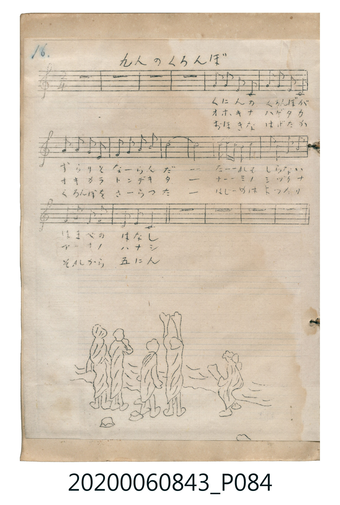

# 九人のくろんぼ

> Re:Shoka 使用 AI 辨識樂譜，可能會有錯誤。歡迎回報。

<audio controls src="kunin_no_kuronbo.mp3"></audio>

- 曲：不詳

## 說明

九人のくろんぼ (Kunin no Kuronbo)
Source: 唱歌帖 (Shōkachō, NMTH 2020.006.0843) — P084.jpg (Notebook 2, p.16)
Notation: Handwritten 5-line staff (C major, 2/4 time, 18 bars) + seaside illustration

## 歌詞

```text
（TMD 檔案未包含歌詞註解）
```

## ABC

```abc
X:1
T:九人のくろんぼ
C:曲：不詳
M:2/4
L:1/16
Q:1/4=100
K:C
V:V1 name="Vocal" snm="Voc"
[V:V1]
z8 | z8 | z8 | z8 |
!mp! D2 E2 D2 C2 | D2 E2 D2 A, A, | G2 G2 G2 E2 | D2 E2 G2 A2 |
c8 | c8 | d2 d2 c2 d2 | e2 c2 A2 c2 |
G2 A2 G2 E2 | D2 E2 C4 | z8 | z8 |
z8 | z8 |
```

## TMD 檔案連結

- [主旋律 TMD 檔案](kunin_no_kuronbo.tmd) [[在 TMD Studio 編輯](https://tmdlang.github.io/Tmd-TS/#tmd=s7IKdvYPcrWy4qpTUCpJTLdSSM7PyUlNLsnMz7MqzsjPTkzOyFeCS5bl55TmploBqXgDI4RwcX5pUXJqfEFieqpVgIGFCboM3KT4vPyS1KT8_GyEioKi_LLUvMQ8oKrcxLzS4uSizIKS-OT8gkqEmtSyzJRUkIrUlMyS_KLMxBwkJ6UWFYMdC3FDSVFiHsQMoKASl5aWwpOdc5_s2vW4cd3jxv7HTb2PmyY_btyjoKXFpWirYGhgwGVvq-DMZWOkb2IHMvPZ7E3v98x6sqP3xcrNSlxc-loKttQCXAoKOByj4V2al5mnkJev4F1alJ-XlK8JUhsMCTuFp1M2Plvb83THNAWN4IyjvaCAPNqro-DnG-KhYGRgZKBnYGCmBwx1Y02FRw1TFEARoJdVkK6g4QcNbAUjHYUCPUMzsKlAwURw7Cp4JOallBdllpSk5imY6uZk5qUqFJckpqUpaDgr5CZm5RfpKABDRaEkMzdVR8HQQiEpsahYU0FboTg1sRgYHwqZOTmlxcDwBpkGMpnyEIICBS19Li5wkPjlQwMk3jOvpCjfKiw_OTHHocagRqEaZKOCjaGZlh2YVaNgoKCLAskU4arFsNsRj73ABAKMnBcr51mBXA0VMdRTAMVv42pw_K4Dc2CR_bixR0EfKDLrcVPn46aux40rgJxVYA5QegFYbv7jpp7HTU1A1nSQBFC6sQUssf5x477HjTshZgI5QInpSPYaAe1tWvW4efbjprWPm7sUHjcD7d30uGn_46bVIP1AOaBE0-rHzSuBch2Pmzc_bm4HC-0HSTd3PW6e_7i5D6hw--PmVrDCLrC-RY-btoIlgAYCVTVtR7LUGORZoD92P27sBboI4rBJIE80doMdjeT3pklA_lSwn5YAVcD8NONxUyOQAbSoAyIBDBiw3FxQQDR2AzUoPNk1BRKgMKuBcZFbUKtgBIw0YyAG0YbgKEUWMYsHoRqYWx3AEWkFchQQrwZaOBlIgyMIyO6F8vcAcQ-SD-G6moC-a54NpNeCAgsUGkD2JiDeD8RA05qB5QqmrkagysbdQAw0HxI-QAwKiPlA3I2sq0bBFOhmGAb5AeEbkIgZWMQwDiMVYwphumIW0I2dQAxyDTjNgW2GiIF8vQCX-0G-BvkY7ENwwgHizUDcDhUH-h6Hz9FDdSrCzsYlkBBA9r0RyBtgAuwhMKtGwRguAPI_mAEJKBAXM6BAiQBHEECsA6YpIAbnLqhTQJHSAo2YfUC8E5ooQHyQHHIeg5sGTgBA05pBpoLzDJBuhQYTUK5pEdS2rRB5UGIBiyNnHoTbQHbNAMo2QthNwECGBRE4yuZC3A1KMGA3T4EnYKBpmGWWfykdy0tdO2DFhVlcK2CKO2IRAzsVJK7MBQA)]
- [鋼琴伴奏 TMD 檔案](kunin_no_kuronbo_piano.tmd) [[在 TMD Studio 編輯](https://tmdlang.github.io/Tmd-TS/#tmd=s7IKdvYPcrWy4tLSUniyc-6TXbseN6573Nj_uKn3cdPkx417FDQeN0953LTocXPfkz1bni7tf7J7hqaClhaXoq2CoYEBl72tgjOXjZG-iR1XnYLSs9mb3u-Z9WRH74uVm5W4uPS1FGypBbgUFHC50Ls0LzNPIS9fwbu0KD8vKV9T4VHDFIWAzESgkGNycn5uQWJeZm5qXgnIjOD80qLkVCuFp1M2Plvb83THNAWN4IyjvdmJyUBSR8HPN8RDwcjAyEDPwMBMz8DCxBhqGpCpl1WQrqDhl1-SmpSfn61gpKNQoGdopgkylXL_QYGClj4XF9hDfvlQ78R75pUU5VuF5Scn5jjUGNQoVINsVLAxNNOyA7NqFAwUdFEgmSJctTjsBodlkAcO26tzC2oVTOK1zeK1jaBGmcZrG2obw21ClQTz4HIoSoEcc4TCGgXjeG2QPJQPczABh_rgcqgRzFaYgUhCZvHIToI7ByFoCGPic4Uj3mgCBxTIcyDvgmiQO4BuQBIBBgwQ1YA1ALOPA9g4KyAHmOSBeLUCMNED6XUQflMvlL8HiHtAaQdTX9MqhcfNs4H0WiDdBcQgfZuAeD8QA81r3oNdXyNQbeNuIAba0Qg0o3E9EE8C4vlA3I2sDxhgoLCCYpBPEH4CiZhBwi8OGm6IBIgpBIsokASYACsBs4CJAS4AMhHMgFgN4mJaDY9krPFEIEljpGgID5Fw8CRpqBnAVK0NchWW_ICazA21TbRBXoAmeW1TbXjAoHDQ5BDpEBpoQElzqBgyG6TNDKEN1TaiHYmaE_GEKeHch5zVsAliS4yzgIm1E4hBiXIFJEECEyBEDJQBFuBOyKAMAEr84MS-Eog7gHgzELdDxYEZAWcmQM9kUxH2Ni6BZAbkjAALH2MshYkJUlkCD3EMIdRYRXMNxLbHTT1A3ATkT4e6BJQ9W6BZdB8Q74QWESA-SG46dt-BiwOgec0gc_uAZm0H0q3QkALKNS2C2rcVIg8qOsDi23GEFsi-GUD5Rgi7CRjSsFACx9xciNtBxQfY3VPgRRqiKEGUvfCwgWctLEGILaThRTW2ZOpfOnC1KcRuImpT5GxJZoYlvypFciXOzAwzh8gYIVyR6toBm2-YNboCprgjFjGwk0HiylwA)]

## 分析

```text
================================================================================
📊 TMD Song Profile: [ 九人のくろんぼ ]
================================================================================
⏱  Duration:       0:21 (21.6s), 18 measures total
🎼 Key & Tempo:    首調基準 C, != 100.0 BPM, <2/4>
   - 分析範圍：      由實際發聲的音符與和弦推測調性；播放脈絡另行呈現
🎤 人聲音域:    A3 (MIDI 57) – E5 (MIDI 76) [跨度: 19 個半音 / 1.6 個八度, 難度: challenging]
   - 最低音:  A3 in [KuninNoKuronbo_A #1 @ m.6, 0:06]
   - 最高音: E5 in [KuninNoKuronbo_A #1 @ m.12, 0:13]
   - 適合: soprano, mezzo-soprano, contralto, tenor, baritone, bass
🏛  結構:      KuninNoKuronbo_Intro (4.8s) -> KuninNoKuronbo_A (12.0s) -> KuninNoKuronbo_Outro (4.8s)
⚡ 編曲密度:        Peak 1 軌道同時演奏
🗝  調性診斷：       C 大調（純淨自然大調，未偵測到可信轉調）
   - 風格氣質:    純淨自然大調（陽光明朗、易唱易記，無明顯調外色彩）
   - 轉調歷程:    全曲維持單一推測調性（未偵測到可信轉調）
   - 核心骨幹音:  C, D, E, G, A
   - 調性數值:    C 大調 [相關度: 0.84, 穩定度: High, 自然音純度: 100.0%]
   - 候選調性 (K-S): C 大調 (0.84), G 大調 (0.62), A 小調 (0.60)
   - 五度圈歷程:   +0 -> +0 -> +0
   - 各段落調性細節:
     • [KuninNoKuronbo_Intro #1]: ? 音樂資料不足 (r: 0.00, 自然音純度: 100.0%)
     • [KuninNoKuronbo_A #1]: C 大調 (r: 0.84, 自然音純度: 100.0%)
     • [KuninNoKuronbo_Outro #1]: ? 音樂資料不足 (r: 0.00, 自然音純度: 100.0%)

  [ 五度圈游移軌跡 ]
              [C ]*
         F            G  
      Bb               D  
      Eb               A  
         Ab           E  
            Db       B  
               F# 
     (* = active key center)

  [ 十二半音累積音高分佈 ]
     C  : ████████████████████████  35.0%
     C# :                            0.0%
     D  : ███████████████           22.5%
     D# :                            0.0%
     E  : ████████████              17.5%
     F  :                            0.0%
     F# :                            0.0%
     G  : ██████████                15.0%
     G# :                            0.0%
     A  : ███████                   10.0%
     A# :                            0.0%
     B  :                            0.0%
--------------------------------------------------------------------------------
Assignment 軌道音域：
  - Vocal         : A3 – E5 (19 個半音 / 1.6 個八度, 34 個音符)
================================================================================
```


## 原書掃描頁




