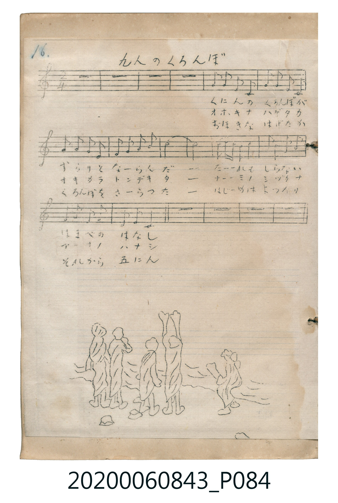

# 九人のくろんぼ

> Re:Shōka 使用 AI 協助辨識與重建樂譜，可能會有錯誤。歡迎回報。

- **鋼琴伴奏版**：<br><audio controls src="kunin_no_kuronbo.mp3"></audio>

- 曲：不詳

## 說明

九人のくろんぼ (Kunin no Kuronbo)
Source: 唱歌帖 (Shōkachō, NMTH 2020.006.0843) — P084.jpg (Notebook 2, p.16)
Notation: Handwritten 5-line staff (C major, 2/4 time, 18 bars) + seaside illustration


## 歌詞

```text
（TMD 檔案未包含歌詞註解）
```

## ABC

<div class="abc-score" data-abc-src="kunin_no_kuronbo.abc" aria-label="五線譜載入中"></div>

[下載 ABC 原始檔](kunin_no_kuronbo.abc)

## TMD 檔案連結

- [主旋律 TMD 檔案](kunin_no_kuronbo.tmd) [[在 TMD Studio 編輯](https://tmdlang.github.io/Tmd-TS/#tmd=s7IKdvYPcrWy4qpTUCpJTLdSSM7PyUlNLsnMz7MqzsjPTkzOyFeCS5bl55TmploBqXgDI4RwcX5pUXJqfEFieqpVgIGFCboM3KT4vPyS1KT8_GyEioKi_LLUvMQ8oKrcxLzS4uSizIKS-OT8gkqEmtSyzJRUkIrUlMyS_KLMxBwkJ6UWFYMdC3FDSVFiHsQMoCBCFVBTemaeVWkeyKCSzLTM1BQlLi0thSc75z7Ztetx47rHjf2Pm3ofN01-3LhHQUuLS9FWwdDAgMveVsGZy8ZI38QOZNSz2Zve75n1ZEfvi5Wblbi49LUUbKkFuBQUcDhGwxvo6jyFvHwF79Ki_LykfE2Q2mBIwCo8nbLx2dqepzumKWgEZxztBYXy0V4dBT_fEA8FIwMjAz0DAzM9YJQYayo8apiiAIodvayCdAUNP2hMKBjpKBToGZqBTQUKJoKjXsEjMS-lvCizpCQ1T8FUNyczL1WhuCQxLU1Bw1khNzErv0hHARgqCiWZuak6CoYWCkmJRcWaCtoKxamJxcAwVsjMySktBkYGyDSQyZSHEBQoaOlzcYGDxC8fGiDxnnklRflWYfnJiTkONQY11SALFWyMtOzAjBoFA1TMVYthgiOGbkMzqHZgLAND-MXKeVYgq6EihnoKoEhqXA2OpHVgDizGHjf2KOgDRWY9bup83NT1uHEFkLMKzAFKLwDLzX_c1PO4qQnImg6SAEo3toAl1j9u3Pe4cSfETCAHKDEdyV4joL1Nqx43z37ctPZxc5fC42agvZseN-1_3LQapB8oB5RoWv24eSVQruNx8-bHze1gof0g6eaux83zHzf3ARVuf9zcClbYBda36HHTVrAE0ECgqqbtSJYagzwL9Mfux429QBdBHDYJ5InGbrCjkfzeNAnInwr20xKgCpifZjxuagQygBZ1QCSAAQOWmwsKiMZuoAaFJ7umQAIUZnWNQnVuQa2CkYKugjEQg2hDIK5BETGLB6EamFsdwPFoBXIUEK8GWjgZSIMjCMjuhfL3AHEPkg_hupqAvmueDaTXggILFBpA9iYg3g_EQNOagYUDpq5GoMrG3UAMNB8SPkAMCoj5QNyNrKtGwRToZhgG-QHhG5CIGVjEMA5IIUNsQpiumAV0YycQg1wDTnNgmyFiIF8vwOV-kK9BPgb7EJxwgHgzELdDxYG-x-Fz9FCdirCzcQkkBJB9bwTyBpgAewjMqlEwhguA_A9mQAIKxMUMKFAiwBEEEOuAaQqIwbkL6hRQpLRAI2YfEO-EJgoQHySHnMfgpoETANC0ZpCp4DwDpFuhwQSUa1oEtW0rRB6UWMDiyJkH4TaQXTOAso0QdhMwkGFBBI6yuRB3gxIM2M1T4AkYaBpmkeVfSnKhp2sHrEMwS04FTHFHLGJgC0HiylwA)]
- [鋼琴伴奏 TMD 檔案](kunin_no_kuronbo_piano.tmd) [[在 TMD Studio 編輯](https://tmdlang.github.io/Tmd-TS/#tmd=s7IKdvYPcrWy4tLSUniyc-6TXbseN6573Nj_uKn3cdPkx417FDQeN0953LTocXPfkz1bni7tf7J7hqaClhaXoq2CoYEBl72tgjOXjZG-iR1XnYLSs9mb3u-Z9WRH74uVm5W4uPS1FGypBbgUFHC50Ls0LzNPIS9fwbu0KD8vKV9T4VHDFIWAzESgkGNycn5uQWJeZm5qXgnIjOD80qLkVCuFp1M2Plvb83THNAWN4IyjvdmJyUBSR8HPN8RDwcjAyEDPwMBMz8DCxBhqGpCpl1WQrqDhl1-SmpSfn61gpKNQoGdopgkylXL_QYGClj4XF9hDfvlQ78R75pUU5VuF5Scn5jjUGNRUgyxUsDHSsgMzahQMUDFXLQ4TwCES5IFkhqEZ3JDq3IJaBZN4bbN4bSMFXTA0jdc21DaGcmrQJME8uByKUiDHHKGwRsE4XhskD-UbwMTxu9MH2Z0mcGcaxSsYQiiz-HiwxUAEYhjG4_C7I0bIofsa5FKQ20E0yJVA45FEgL4EohqwBmCCdgCbZgXkABMhEK9WACZDIL0Owm_qhfL3AHEPKDYx9TWtUnjcPBtIrwXSXUAM0rcJiPcDMdC85j3Y9TUC1TbuBmKgHY1AMxrXA_EkIJ4PxN3I-oDhAooHKAb5BOEnkIgZWMQwDhoVMIhNCBbuIAkwAVYCZgFjFi4AMhHMgFgN4mJaDUsC2KMJf_LESJ0QHtxIfMkTagYwhWqDHIUlbaMmWUNtE22QD6DJV9tUGx4uKBw0OUTKhoYZUNIcKobMBmkzQ2hDtY1oR6LmKjxBijsnQbIQjIEtxc0CpshOIAalvBWQVAdMZRAxUCpfgDu1glI5KIWDU_RKIO4A4s1A3A4VB6Z2nCkdPSdNRdjbuASS4pFTuyEwNCCFgQm4LACxQBSoRMBiOkT346YeIG4C8qdDTQblqRZovtoHxDuh-RrEB8lNx-5acB4GmtcMMrcPaNZ2IN0K9TlQrmkR1L6tEHlQfgeLb8fhe5B9M4DyjRB2EzDkYL4Gx8RciNtBeR7s7inwcgiR_0HlIpAGZgJokMBCCFhQYkss_qWUVjIQEwhXMsgpnMy0T34Ng-RIHPnCED3A0OsXXTtgQwOz2lLAFHfEIgZ2AEhcmQsA)]

## 分析

```text
================================================================================
📊 TMD Song Profile: [ 九人のくろんぼ ]
================================================================================
⏱  Duration:       0:21 (21.6s), 18 measures total
🎼 Key & Tempo:    首調基準 C, != 100.0 BPM, <2/4>
   - 分析範圍：      由實際發聲的音符與和弦推測調性；播放脈絡另行呈現
🎤 人聲音域:    A3 (MIDI 57) – E5 (MIDI 76) [跨度: 19 個半音 / 1.6 個八度, 難度: challenging]
   - 最低音:  A3 in [KuninNoKuronbo_A #1 @ m.6, 0:06]
   - 最高音: E5 in [KuninNoKuronbo_A #1 @ m.12, 0:13]
   - 適合: soprano, mezzo-soprano, contralto, tenor, baritone, bass
🏛  結構:      KuninNoKuronbo_Intro (4.8s) -> KuninNoKuronbo_A (12.0s) -> KuninNoKuronbo_Outro (4.8s)
⚡ 編曲密度:        Peak 1 軌道同時演奏
🗝  調性診斷：       C 大調（純淨自然大調，未偵測到可信轉調）
   - 風格氣質:    純淨自然大調（陽光明朗、易唱易記，無明顯調外色彩）
   - 轉調歷程:    全曲維持單一推測調性（未偵測到可信轉調）
   - 核心骨幹音:  C, D, E, G, A
   - 調性數值:    C 大調 [相關度: 0.84, 穩定度: High, 自然音純度: 100.0%]
   - 候選調性 (K-S): C 大調 (0.84), G 大調 (0.62), A 小調 (0.60)
   - 五度圈歷程:   +0 -> +0 -> +0
   - 各段落調性細節:
     • [KuninNoKuronbo_Intro #1]: ? 音樂資料不足 (r: 0.00, 自然音純度: 100.0%)
     • [KuninNoKuronbo_A #1]: C 大調 (r: 0.84, 自然音純度: 100.0%)
     • [KuninNoKuronbo_Outro #1]: ? 音樂資料不足 (r: 0.00, 自然音純度: 100.0%)

  [ 五度圈游移軌跡 ]
              [C ]*
         F            G  
      Bb               D  
      Eb               A  
         Ab           E  
            Db       B  
               F# 
     (* = active key center)

  [ 十二半音累積音高分佈 ]
     C  : ████████████████████████  35.0%
     C# :                            0.0%
     D  : ███████████████           22.5%
     D# :                            0.0%
     E  : ████████████              17.5%
     F  :                            0.0%
     F# :                            0.0%
     G  : ██████████                15.0%
     G# :                            0.0%
     A  : ███████                   10.0%
     A# :                            0.0%
     B  :                            0.0%
--------------------------------------------------------------------------------
Assignment 軌道音域：
  - Vocal         : A3 – E5 (19 個半音 / 1.6 個八度, 34 個音符)
================================================================================
```


## 原書掃描頁




