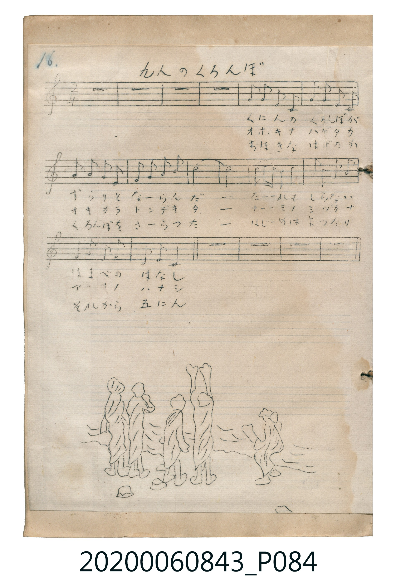

# 九人のくろんぼ

> Re:Shōka 使用 AI 協助辨識與重建樂譜，可能會有錯誤。歡迎回報。

- **鋼琴伴奏版**：<br><audio controls src="kunin_no_kuronbo.mp3"></audio>

- 曲：不詳

## 說明

九人のくろんぼ (Kunin no Kuronbo)
Source: 唱歌帖 (Shōkachō, NMTH 2020.006.0843) — P084.jpg (Notebook 2, p.16)
Notation: Handwritten 5-line staff (C major, 2/4 time, 18 bars) + seaside illustration


## 歌詞

```text
（TMD 檔案未包含歌詞註解）
```

## ABC

<div class="abc-score" data-abc-src="kunin_no_kuronbo.abc" aria-label="五線譜載入中"></div>

[下載 ABC 原始檔](kunin_no_kuronbo.abc)

## TMD 檔案連結

- [主旋律 TMD 檔案](kunin_no_kuronbo.tmd) [[在 TMD Studio 編輯](https://tmdlang.github.io/Tmd-TS/#tmd=s7IKdvYPcrWy4qpTUCpJTLdSSM7PyUlNLsnMz7MqzsjPTkzOyFeCS5bl55TmploBqXgDI4RwcX5pUXJqfEFieqpVgIGFCboM3KT4vPyS1KT8_GyEioKi_LLUvMQ8oKrcxLzS4uSizIKS-OT8gkqEmtSyzJRUkIrUlMyS_KLMxBwkJ6UWFYMdC3FDSVFiHsQMoCBCFVBTemaeVWkeyKCSzLTM1BRkyZKM_PSixIKMSquMzGKQDcmJOfHZiXmJCEUlGalAn6emlCYnQozW0lJ4snPuk127Hjeue9zY_7ip93HT5MeNexS0tLgUbRUMDQy47G0VnLlsjPRN7EDGPJu96f2eWU929L5YuVmJi0tfS8GWWoBLQQGHYzS8gX7OU8jLV_AuLcrPS8rXBKkNhkSLwtMpG5-t7Xm6Y5qCRnDG0V5QHB3t1VHw8w3xUDAyMDLQMzAw0wNGqLGmwqOGKQqguNXLKkhX0PCDxqOCkY5CgZ6hGdhUoCA4bKwUPBLzUsqLMktKUvMUTHVzMvNSFYpLEtPSFDScFXITs_KLdBSAoaJQkpmbqqNgaKGQlFhUrKmgrVCcmlgMjCGFzJyc0mJgVIJMA5lMeQhBgYKWPhcXOEj88qEBEu-ZV1KUbxWQmZiX71BjUFMNslDBxkjLDsyoUTBAxVy1GCY4Yug2NINqB8YyMIRfrJxnBbIaKmKopwCKpMbV4EhaB-bAYuxxY4-CPlBk1uOmzsdNXY8bVwA5q8AcoPQCsNz8x009j5uagKzpIAmgdGMLWGL948Z9jxt3QswEcoAS05HsNQLa27TqcfPsx01rHzd3KTxuBtq76XHT_sdNq0H6gXJAiabVj5tXAuU6HjdvftzcDhbaD5Ju7nrcPP9xcx9Q4fbHza1ghV1gfYseN20FSwANBKpq2o5kqTHIs0B_7H7c2At0EcRhk0CeaOwGOxrJ702TgPypYD8tAaqA-WnG46ZGIANoUQdEAhgwYLm5oIBo7AZqUHiyawokQGFW1yhU5xbUKhgp6CoYAzGINgTiGhQRs3gQqoG51SEsH5jzrUCOAuLVQAsnA2lwBAHZvVD-HiDuQfIhXFcT0HfNs4H0WlBggUIDyN4ExPuBGGhaM7BwwNTVCFTZuBuIgeZDwgeIQQExH4i7kXXVKJgC3QzDID8gfAMSMQOLGMYBKWSITQjTFbOAbuwEYpBrwGkObDNEDOTrBbjcD_I1yMdgH4ITDhBvBuJ2qDjQ9zh8jh6qUxF2Ni6BhACy741A3gATYA-BWTUKxnABkP_BDEhAgbiYAQVKBDiCAGIdME0BMTh3QZ0CipQWaMTsA-Kd0EQB4oPkkPMY3DRwAgCa1gwyFZxngHQrNJiAck2LoLZthciDEgtYHDnzINwGsmsGULYRwm4CBjIsiMBRNhfiblCCAbt5CjwBA03DLLL8S0ku9HTtgHUIZsmpgCnuiEUMbCFIXJkLAA)]
- [鋼琴伴奏 TMD 檔案](kunin_no_kuronbo_piano.tmd) [[在 TMD Studio 編輯](https://tmdlang.github.io/Tmd-TS/#tmd=s7IKdvYPcrWy4qpTUCpJTLdSyC8qychPL0osyKi0ysgsLskvykxOzInPTsxLVIIrKs4vLUpOjS9ITE-1CjCwMEHIlGSk5qZapaaUJieWZObnKXFpaSk82Tn3ya5djxvXPW7sf9zU-7hp8uPGPQoaj5unPG5a9Li578meLU-X9j_ZPUNTQUuLS9FWwdDAgMveVsGZy8ZI38QOZPaz2Zve75n1ZEfvi5Wblbi49LUUbKkFuBQUcLnQuzQvM08hL1_Bu7QoPy8pX1PhUcMUhYDMRKCQY3Jyfm5BYl5mbmpeCciMYHCYWCk8nbLx2dqepzumKWgEZxztzU5MBpI6Cn6-IR4KRgZGBnoGBmZ6wDAzhpoGZOplFaQraPjll6Qm5ednKxjpKBToGZppgkyl3H9QoKClz8UF9pBfPtQ78Z55JUX5VmD_ONQY1FSDLFSwMdKyAzNqFAxQMVctPhOCPJDMMDSDG1KdW1CrYBKvbRavbaSgC4am8dqG2sZQTg2aJJgHl0NRCuSYIxTWKBjHa4PkoXwDmDh-d_ogu9ME7kyjeAVDCGUWHw-2GIhADMN4HH53xAg5dF-DXApyO4gGuRJoPJII0JdAVAPWAEzQDmH5wIxmBeQAEyEQr1YAJkMgvQ7Cb-qF8vcAcQ8oNjH1Na1SeNw8G0ivBdJdQAzStwmI9wMx0LzmPdj1NQLVNu4GYqAdjUAzGtcD8SQgng_E3cj6gOECigcoBvkE4SeQiBlYxDAOGhUwiE0IFu4gCTABVgJmAWMWLgAyEcyAWA3iYloNSwJ4ogln8sRInRAe3Eh8yRNqBjCFaoMchSVtoyZZQ20TbZAPoMlX21QbHi4oHDQ5RMqGhhlQ0hwqhswGaTNDaEO1jWhHouYqPEGKOydBshCMgS3FzQKmyE4gBqW8FZBUB0xlEDFQKl-AO7WCUjkohYNT9Eog7gDizUDcDhUHpnacKR09J01F2Nu4BJLikVO7ITA0IIWBCbgsALFAFKhEwGI6RPfjph4gbgLyp0NNBuWpFmi-2gfEO6H5GsQHyU3H7lpwHgaa1wwytw9o1nYg3Qr1OVCuaRHUvq0QeVB-B4tvx-F7kH0zgPKNEHYTMORgvgbHxFyI20F5HuzuKfByCJH_QeUikAZmAmiQwEIIWFBiSyz-pZRWMkgm4K1kkFM4mWmf_BoGyZE48oUheoCh1y-6dsCGBma1pYAp7ohFDOwAkLgyFwA)]

## 分析

```text
================================================================================
📊 TMD Song Profile: [ 九人のくろんぼ ]
================================================================================
⏱  Duration:       0:21 (21.6s), 18 measures total
🎼 Key & Tempo:    首調基準 C, != 100.0 BPM, <2/4>
   - 分析範圍：      由實際發聲的音符與和弦推測調性；播放脈絡另行呈現
🎤 人聲音域:    A3 (MIDI 57) – E5 (MIDI 76) [跨度: 19 個半音 / 1.6 個八度, 難度: challenging]
   - 最低音:  A3 in [KuninNoKuronbo_A #1 @ m.6, 0:06]
   - 最高音: E5 in [KuninNoKuronbo_A #1 @ m.12, 0:13]
   - 適合: soprano, mezzo-soprano, contralto, tenor, baritone, bass
🏛  結構:      KuninNoKuronbo_Intro (4.8s) -> KuninNoKuronbo_A (12.0s) -> KuninNoKuronbo_Outro (4.8s)
⚡ 編曲密度:        Peak 1 軌道同時演奏
🗝  調性診斷：       C 大調（純淨自然大調，未偵測到可信轉調）
   - 風格氣質:    純淨自然大調（陽光明朗、易唱易記，無明顯調外色彩）
   - 轉調歷程:    全曲維持單一推測調性（未偵測到可信轉調）
   - 核心骨幹音:  C, D, E, G, A
   - 調性數值:    C 大調 [相關度: 0.84, 穩定度: High, 自然音純度: 100.0%]
   - 候選調性 (K-S): C 大調 (0.84), G 大調 (0.62), A 小調 (0.60)
   - 五度圈歷程:   +0 -> +0 -> +0
   - 各段落調性細節:
     • [KuninNoKuronbo_Intro #1]: ? 音樂資料不足 (r: 0.00, 自然音純度: 100.0%)
     • [KuninNoKuronbo_A #1]: C 大調 (r: 0.84, 自然音純度: 100.0%)
     • [KuninNoKuronbo_Outro #1]: ? 音樂資料不足 (r: 0.00, 自然音純度: 100.0%)

  [ 五度圈游移軌跡 ]
              [C ]*
         F            G  
      Bb               D  
      Eb               A  
         Ab           E  
            Db       B  
               F# 
     (* = active key center)

  [ 十二半音累積音高分佈 ]
     C  : ████████████████████████  35.0%
     C# :                            0.0%
     D  : ███████████████           22.5%
     D# :                            0.0%
     E  : ████████████              17.5%
     F  :                            0.0%
     F# :                            0.0%
     G  : ██████████                15.0%
     G# :                            0.0%
     A  : ███████                   10.0%
     A# :                            0.0%
     B  :                            0.0%
--------------------------------------------------------------------------------
Assignment 軌道音域：
  - Piano         : A3 – E5 (19 個半音 / 1.6 個八度, 34 個音符)
================================================================================
```


## 原書掃描頁




