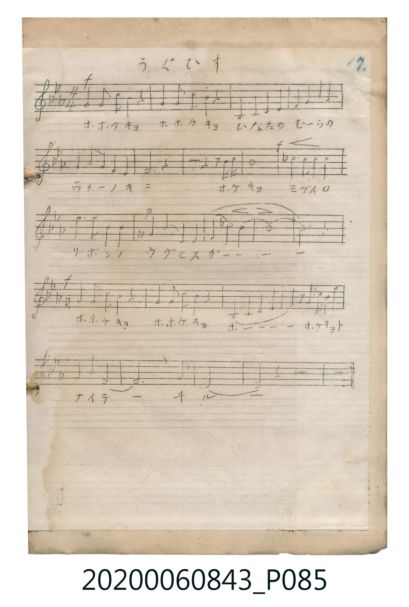

# うぐひす

<audio controls src="uguisu.mp3"></audio>

- 曲：不詳

## 說明

うぐひす (Uguisu)
Source: 唱歌帖 (Shōkachō, NMTH 2020.006.0843) — P085.jpg (Notebook 2, p.17)
Notation: Handwritten 5-line staff (3 flats = Eb major, 4/4 time, 24 bars)

## 跨冊／重複收錄參照

> 同名異曲（各冊收錄之不同詞曲版本）

- **[同名異曲]** 《新定兒童唱歌》尋常科第六學年用（2020.006.0847.0006）：[**〈鶯〉**](../../../shintei_jido_shoka/grade_6_2020.006.0847.0006/3_05_uguisu/index.md)（`C` / `4/4` — [原始 TMD](../../../shintei_jido_shoka/grade_6_2020.006.0847.0006/3_05_uguisu/uguisu.tmd)）
- 總表：[跨冊重複與同名歌曲總索引](../../../duplicate_songs.md)

## 歌詞

```text
（TMD 檔案未包含歌詞註解）
```

## ABC

```abc
X:1
T:うぐひす
C:曲：不詳
M:4/4
L:1/16
Q:1/4=96
K:Eb
V:V1 name="Vocal" snm="Voc"
[V:V1]
!f! G4 G3 F E4 z4 | G4 G3 F E4 z4 | !mp! B,4 B,4 C4 D4 | E4 E4 F4 G4 |
F4 G2 E2 C4 B,4 | C12 z4 | z8 z2 B2 c2 d2 | e16 |
!f! _d6 c2 c4 c4 | c6 B2 G4 G4 | !p! ^F4 G2 C2 B,4 C4 | B,4 _d2 c2 B8 |
B16 | B12 z4 | !f! G4 G3 F E4 z4 | G4 G3 F E4 z4 |
B,4 C4 D4 F4 | z2 g2 f2 e2 c4 z4 | F4 G4 C4 D4 | E6 G2 F4 C4 |
E16 | E8 z8 | z16 | z16 |
```

## TMD 檔案連結

- [主旋律 TMD 檔案](uguisu.tmd) [[在 TMD Studio 編輯](https://tmdlang.github.io/Tmd-TS/#tmd=s7IKdvYPcrWy4tLSUnjc2Pa4ccLjxk2PG2cqaGlxKdoqWJpx2dsquOpw2Zjom9hx1SkoPZu96f2eWU929L5YuVmJi0tfS8GWWoBLQQHVDRqh6aWZxaWaIIng_NKi5FQrhadTNj5b2_N0xzQFjeCMo73ZiclAUkfBzzfEQ8HIwMhAz8DATM_AwsRYU-FRwxSFAAMLU72sgnQFDb_8ktSk_PxsBSMdhQI9Q3OwqUDBxJLM_DwrBY_EvJTyosySktQ8BVPdnMy8VIXiksS0NAUNY4W0nMSSYgVgOCQp5CZm5RfpKABDQ6EkMzdVR8HIRCEpsagYbBrlQQAFClr6XFwQz1uF5Scn5jjUGNQoVIPsULAxNNOyA7OAYQ8Mihcr51mB1ENFHjfPBqGmjY-b1j5uXo7JBwXtqseN8x83rlN43NTwuKkTxEIyoGnZ4-aFj5v7gBqAurvBJjRtBIpDzZv_uLn1cdOSx81rUaxd9bh5zuPmzUCNYCOaNjxunvS4aSeQs4YU5zXPhloIEXjc3IGiuwtscxuQtQGIV8PkgIGTVqtgrKALhhDaSMEQyjeA0jVEqKjOLahVMI2H8uEMMxjDHMaogWuG0UYohgNVwJztAI5DK5jngEGCFJyYQo2bgHgVEM8HYnAkAZXsAdKdYD7cy8j2gdwAdyPc1TUIMXSI8DGMhSxjCjIO5FuIR-NwGAKDkOA310ESAukGYRgbe4A0LQN6bSHEe-CEA09yUC8jpzsgbgVylwBpeNID-hDJUpCzUaMY7DZgjBqpIwmDAwUzamsQYmCvgEwGmYjqU3QRzLDApQIe5JjpAhjbzXOAeDM0GIDB0gRK4JOANCQLQYIIFVM98eNJ7rDEBkkvxqAUYQQiwGkDFgd4fEhUyodFOxyjScPLAtTEj93FiAwKUwfTgxTjyEqwQUwV6NkFMwNhmkFQBWZ4dUFTOqioA4UEKDWA6NXoKaCWi0vXTgFSWSgAWcpcAA)]
- [鋼琴伴奏 TMD 檔案](uguisu_piano.tmd) [[在 TMD Studio 編輯](https://tmdlang.github.io/Tmd-TS/#tmd=s7IKdvYPcrWy4tLSUnjc2Pa4ccLjxk2PG2cqaDxunvK4adHj5r4ne7Y8Xdr_ZPcMTQUtLS5FWwVLMy57WwVXHS4bE30TO646BaVnsze93zPryY7eFys3K3Fx6Wsp2FILcCkooDksNL00s7hUU-FRwxSFgMzEvHwFx-Tk_NyCxLzM3NS8EpCG4PzSouRUK4WnUzY-W9vzdMc0BY3gjKO92YnJQFJHwc83xEPByMDIQM_AwEzPwMLEGGqagYWpXlZBuoKGX35JalJ-fraCkY5CgZ6huSbIVMo9AwUKWvpcXBBvWIXlJyfmONQY1ChUg-xQsDE007IDs4AiabUKxgq6YAihjRQMoXwDKF1DhIrq3IJaBdN4KB_OMIMxzGGMGrhmGG2EYjhQBdhpwAh2ADvcChQ7zbMhuGkjEK993Lwcq1DjJiBeBcTzgXgdULgBqGQPkO4E84FBAvE0so0gV8BdCXd3DUIMHSL8DGMhy5iCjAP5F-LVOByGwCAkAsx1kIRAukEYxkYECdBRSOpANqHGC9g4YDQYqSMJg_2BGR81CDGw7SCTQSaiOg5dBNP5uFTAQ4nK6QxPyoLFKiRijEFBbwQiwJEACzl0d6EnPnwJFqYOpgcpMJGVYIOYKtATD2ZywjSDoAquWnimBxdbQR64sn0uMD5M47UNtWEeB3LM47VhXgNJoTkUFPakqQenxXhteJQhs03itZFyHdAoFFswTcW0Du4SWFTiUWKijmSdMZIzaiAOgVuDj4fwGNBgbVjCR2aDrMfOASZtbVNteHFAJAcaT0baJtrwIsIQyIElZlxsWIigyiPciR6RSGEJjjSgp-FlCIo0ctAhxyDQe8jxjOpe7GFVgye08IUjkQoxyh96JHhiEjiqMfjSBXLsoXsHX1onNmfh8BmWeIVrQ-Xhyyz4deJOFLiSNIaHUQMRxXR0iAg8tOLRB1fxiAgmmFPQjSJGCWZzyARLQwMRQrhMxNYgaloGbNoshDRvmvtALSAg3Q1tFYGaPEgNJWBrqLkVyF0CpNciWkEY9hghSki46-AuNsTwAz6PYjLwhBg26zAZ-EKjGdjoa54DxJuhoQEMnaYNQPYkIL0TiNdAQwoVw4MCwxIsToNnCgw5uG7i_IhUH6KrhotgV4UR8mS3lGHJBI7RpDsQYUPlvICZBRD-wpIZMFMbNj93QVN3G9Q3oKgH0auxRzeGO0nLlygOxhQ0wcLCqpCo9I_fVnSIUtTp2ilASjsFIEuZCwA)]

## 分析

```text
================================================================================
📊 TMD Song Profile: [ うぐひす ]
================================================================================
⏱  Duration:       1:00 (60.0s), 24 measures total
🎼 Key & Tempo:    首調基準 E,, != 96.0 BPM, <4/4>
   - 分析範圍：      由實際發聲的音符與和弦推測調性；播放脈絡另行呈現
🎤 人聲音域:    A#3 (MIDI 58) – G5 (MIDI 79) [跨度: 21 個半音 / 1.8 個八度, 難度: difficult]
   - 最低音:  A#3 in [Uguisu #1 @ m.3, 0:05]
   - 最高音: G5 in [Uguisu #1 @ m.18, 0:42]
   - 適合: soprano, mezzo-soprano, tenor, baritone
🏛  結構:      Uguisu (60.0s)
⚡ 編曲密度:        Peak 1 軌道同時演奏
🗝  調性診斷：       D# 大調（純淨自然大調，未偵測到可信轉調）
   - 風格氣質:    純淨自然大調（陽光明朗、易唱易記，無明顯調外色彩）
   - 轉調歷程:    全曲維持單一推測調性（未偵測到可信轉調）
   - 核心骨幹音:  D#, A#, C, G, F
   - 調性數值:    D# 大調 [相關度: 0.84, 穩定度: Moderate, 自然音純度: 96.1%]
   - 候選調性 (K-S): D# 大調 (0.84), C 小調 (0.77), A# 大調 (0.66)
   - 五度圈歷程:   -3
   - 各段落調性細節:
     • [Uguisu #1]: D# 大調 (r: 0.84, 自然音純度: 96.1%, 調外音: C#, F#)

  [ 五度圈游移軌跡 ]
               C  
         F            G  
      Bb               D  
     [Eb]*              A  
         Ab           E  
            Db       B  
               F# 
     (* = active key center)

  [ 十二半音累積音高分佈 ]
     C  : ████████████████████      20.4%
     C# : ███                        2.6%
     D  : █████                      4.6%
     D# : ████████████████████████  24.3%
     E  :                            0.0%
     F  : ████████                   8.6%
     F# : █                          1.3%
     G  : █████████████████         17.1%
     G# :                            0.0%
     A  :                            0.0%
     A# : █████████████████████     21.1%
     B  :                            0.0%
--------------------------------------------------------------------------------
Assignment 軌道音域：
  - Vocal         : A#3 – G5 (21 個半音 / 1.8 個八度, 71 個音符)
================================================================================
```


## 原書掃描頁




