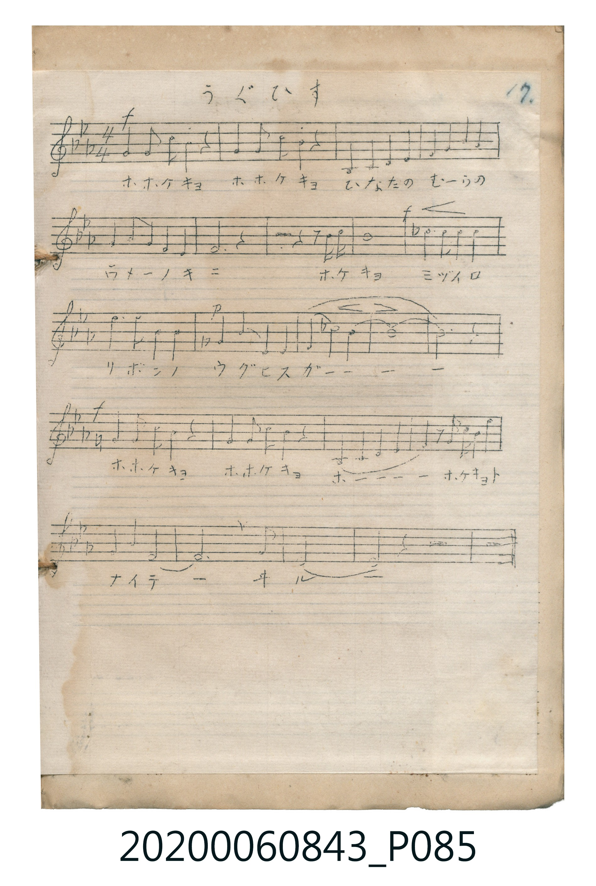

# うぐひす

> Re:Shōka 使用 AI 協助辨識與重建樂譜，可能會有錯誤。歡迎回報。

- **鋼琴伴奏版**：<br><audio controls src="uguisu.mp3"></audio>

- 曲：大正・昭和初期童謠唱歌（原冊未載作者）
- 唱歌帳（2020.006.0843）P085.jpg（第 17 頁）

## 說明


- 出處：唱歌帳（2020.006.0843）P085.jpg（第 17 頁）
- 調性與拍號：調號 ?= E,，拍號 <4/4>，速度 != 96


## 歌詞

```text
> [!NOTE]
> **原頁資訊與校勘記**（對應 `P085.jpg`，手抄五線譜第 17 頁）：
> - **調性、拍號與表情記號**：高音譜號標示 **3 個降記號**（E♭ 大調，`?= E,`）、拍號 `4/4`（`<4/4>`），共 5 行五線譜。第 1、9、15 小節標有力度 `f`，第 9 小節附漸強 `<`，第 11 小節標 `p`，第 12–13 小節圓滑線內附 `< >` 漸強漸弱。
> - **五線譜全面重校**：先前版本多處錯讀譜線（如將第 1–2、15–16 小節鶯啼動機 `3 - 3 6 | 5` 誤作 `3 - 3 2 | 1`，將第 3–4 小節上行音階 `5_ 6_ 7_ 1 | 2 3 4 5` 錯移音高等），今逐行依五線幾何位置重新轉錄。
> - **手抄記譜筆誤與異常校勘（依 Policy A 校訂）**：
>   1. **第 1、2、15、16 小節下向符桿漏繪符尾**：各小節第 2 拍後半 `6`（`C5`，「ケ」）符桿朝下漏繪八分符尾（前半拍 `3` 上向符桿明確繪有八分符尾，第 3 拍 `5` 為附斷音點之四分音符，第 4 拍為四分休止符），依拍數算術校訂為 `| 3 - - - 3 - 6 - 5 - - - 0 - - - |`。
>   2. **第 7 小節休止符與雙符尾**：原抄依序繪有全／二分休止符方塊、四分休止符曲線、`7` 形八分休止符，並於末半拍以雙斜槓符尾連寫兩個十六分音符 `5 6`（「ホケ」＝`B♭4–C5`，共 `2 + 1 + 0.5 + 0.5 = 4` 拍）接第 8 小節全音符 `5`（「キョ」）。
>   3. **第 11–12 小節臨時記號與空心符頭**：第 11 小節首音於第一線標還原記號 `♮`（`E♮4` = `1'`，半音上行導向 `F4` = `2`，「ウグヒス」）；第 12 小節（「ガーーー」）原抄依序為四分音符 `3`（`G4`）、第四線帶 `♭` 之空心二分音符 `7,`（`D♭5`，2 拍）與第三間四分音符 `6`（`C5`），合計 4 拍（`| 3 - - - 7, - - - - - - - 6 - - - |`）。
>   4. **第 18 小節（「ーホケキョト」）符尾漏標**：首拍四分音符 `2`（`F4`，承接第 17 小節圓滑線上行「ホーーー」）、第 2 拍八分休止符接上向八分音符 `3`（「ホ」）、第 3 拍下向八分音符 `6`（「ケ」）與漏繪下向符尾之 `5`（「キョ」）、第 4 拍四分音符 `7`（`D5`，「ト」），依 Policy A 補齊第 3 拍後半八分時值（`| 2 - - - 0 - 3 - 6 - 5 - 7 - - - |`）。
>   5. **第 20–22 小節終止式（「ナイテー　ヰー　ルー」）與行末空白休止小節**：第 20 小節於附點二分音符 `7_.`（延音「ー」）與換氣記號 `v` 後，末拍「ヰ」（`2` = `F4`）誤加八分符尾致少半拍，校訂為 1 拍四分音符；第 21 小節「ル」（`1` = `E♭4`）原抄誤作帶符桿之二分音符（2 拍）並延音至第 22 小節（二分音符加四分休止符），依 4/4 拍終止式校訂為全音符延結附點二分音符加四分休止符（第 21–22 小節）。第五行右端另有兩格填滿預設譜表之全休止符空格，屬手抄版面留白，不計入聲樂主體。
>
> **歌詞全文（原抄片假名・平假名混寫）**
> ホホケキョ　ホホケキョ　ひなたの　むーらの
> ウメーノキ　ニ　ホケキョ　ミヅイロ
> リボンノ　ウグヒス　ガーーー
> ホホケキョ　ホホケキョ　ホーーーー　ホケキョト
> ナイテー　ヰ　ルー
```

## ABC

<div class="abc-score" data-abc-src="uguisu.abc" aria-label="五線譜載入中"></div>

[下載 ABC 原始檔](uguisu.abc)

## TMD 檔案連結

- [主旋律 TMD 檔案](uguisu.tmd) [[在 TMD Studio 編輯](https://tmdlang.github.io/Tmd-TS/#tmd=s7IKdvYPcrWy4qpTUCpJTLdSSM7PyUlNLsnMz7MqzsjPTkzOyFeCS5bl55TmploBqXgDI4RwcX5pUXJqfEFieqpVgIGFKboM3KT4vPyS1KT8_GyEioKi_LLUvMQ8oKrcxLzS4uSizIKS-OT8gkqEmtSyzJRUkIri5MS8-LLUosy0zNQUJGelFhWDHQxxR0lRYh7EHKAgQlV-UUlGfnpRYkFGpVVGZnFJflFmcmJOfHZiXiJCUUlGKtCDiXmZuYk56KJ5iSWlRanIBmamZ-ZZleaBXFcCdZOWlsLjxrbHjRMeN2563DhTQUuLS9FWwdKMy95WwVWHy8ZE38QOZMKz2Zve75n1dMnyZ2sXP27e_WzG2qeTep52zH02Z_7z1UtfrFnwdMrGZ2t73u_peNo3_2lb17M5q17s6Xyyd86Lhtb3ezrBroAoebpjM1CVkYGRgZ6BgZmegYWJMVABKB70sgrSgVLP16xRMDRXeLmgEayRS19LwZZagEtBQcFOIVrRzz_ENRbC0dICuhho2YvN7S9WdL3oaH-2YOHT7hkvVszQ0gJ5Z0Pvs_ZOhQSYAxPe7-l51tn9rKvlya4pz7fPerF2DoqDgaEEMVcXaPKLVfufNSx_3ND4rLv3xcz5QMNfLFzxrLkVaDiQCzJ_1svVM17O3ww0BSjwbMXM50t2AfUZKzxt6H45sxehrsP10cy1CsDwBxoJdEECOHqAbumEG66QAIwroEhHAjjSQHJAhU9bNyqYKrxY2AN37eOGJrCDgRotgdjQVOHphv7n6xuAlj-b0_m0a_bTXcsUEtJA_gSps4RKv5zZ8mzPjqd7tisk2MDkDA0RehUSCuDCRo8aJhsC_QCWezpn8rPdE4F2P21dDjQEqF3BLkEBYhaY3Ah0ESLI4O582rri5dxFL9t7gfEBDqmnrR1PO3ufd3Y8m7Pm6ZJZL2ZOfdmz_sW6BlAMbJ8FiqplTU83tINdAHSAEdhzIJeYwbywbf3TqXuedk99thIYWsZA64wVzBRqFEwTFF6sWgJMqzBBI6CgIcg3UOOMgaaYQA15sqMLGJrAKHs5q08hwTRewSxewTxewRCoxQio1QRkGtBdz5fvBqlZPeP5WmA0gGLiye6ulw0TQDGxby7Ek0937nuyd-qTvb3P964D-XPahhd7O1_2tKCEByStgRIC0Jtr24AOBaai51M3PN2xA5JQgR4HmqgQkJ-TmVyp4KgAFH2xogloJzjQIAYpKBjqAc2CxTskaEAELGie7Oh-OmHi8zXLni3c_2xP__Odq4Dspxv2QQJ-QgtEFUi_kQIwuT3d1_O0t0shwQyc3pxNQWH1uKHncRMwLnuBVkMNmjMXaC7EuKetq592tEEMBUVVZy_QAKBJwCBPUACGKcL2GX3PF-0C6gAlRhRN4LRlDLIeGO4JCs-bdoHS5LTtoHDePe_Jzu6ns2cDlQO5QB1Q5SYg5UCVEKkneyY-W7sILAuOkX1zgbLPpu54vm76i4WTIQEHVKyQUAO0RxcMQbQZEJtC-QZQuiYBHksKCkawwDWHBSfMImBcvZw9Ezks--aDio59c5_uAgUL2JMr3u_pf7ILWJoiHPhs2s6nC7uAMYTmcGAxDEw4QPEE8wSFp3sXQUIIyV89T3YANe95Nmc1JHyf7F4KdMCzaXOeLZ8MccbLhsVP169-2roSWMQ87W182roWHmjAcFUARykoLptnw6JzboITsPAxAWYCSEyDypQEIwVtYKLXVjDQM4WStgomwHzdDYr_Z31LQcFhASsCgFkZZgHM-Ka1j5uBJSNINVJIGsOTKSgLGxpBDXjRvuLZzCZIaQhK_it3Pd3fDDTv5YK14FBFKYxeLpsGtA0YCEDRJzsagOEFLJ5eNrUAgx5igkLCo5nrwCkXWKiuAzraViHBUB3ss94uoFZIFn-6oQ-YKBUS3CAKjOBpfNnjpg2Pmyc9btoJcf77PbMhpR7UfpgH1zxu3gNFYHUoUQ9LkrBwMQa7xx1UgIOKdKCBQHlQGbFjG8i5a4GZZGc3xN-QpALTaA6qBToSXIBqwJEDzp9AQ0DBBPJ_58tpk1GtQsq04BpiQseLFR2QnAKSQKR9cx0oAwZBGQGS-FFjzQQea7AYh6UhoO_ByQgS281AQWjxAEyIwIIBGDGQSnDZNFCpguJMUIB3gEIfXOHuhyYpYD2LVq1AYguaYlFDHBKQ0CILNacAjYOUOhBxlGiAmoVsBLjYgRSSqBrg2QVW9IEaEOASD16kAr0KjDtcSR9sPDjwUb1vDolWeNEKCztIuYUo7l8snvNybxfcjZCSGeJGYJZ52rAHEqdGSOUXcplmjiNKTWFRamQAqkthafv51iZg-D3d0w8Lpq7HTUseN7eBg7zhcTMwY0AYq-GRAG709AALJGDqfT5zLyQGIKbB866RAawhMW0PsFAHFeeoiTxeDxQcT3dvA4pAExY8tPtnP9uwGJazy4DF4j5gMxRkITA4wGo3gNV2AFMUKCODU1QnsB592rUAuYJ50b7l6YaJkFITpB9eGxiiRw40wxvBChywJauhlhiCLQG11sD2QDI9pHkBzMuQOg6YHJD9B2oOQ3MtsPSGePJFO1AGaAdSoYKsBeR2HFWaArD1B671YFEF9wm8GAZa8XzrBMyAxmYquDluBG5QIdwCSimg0mXXFFBB2b_5-er1T_uXgSuzlc8W7Hm6cPWz3ftfLpjwYsVaUMt24QpQ7dy6Am4sMCkAlYEKn41rIA0cYLMO2Np7PnUmMImAazFg27fjaevSF42bnq1oerJj98vVU2DJE9ZuB3YmXqycBzT32bR2SMcDbFD708b2pxN6gb2Upzs3Q9jPtm8H1nngNhFEM7isQCqZQEkWQwTUI1r1uHH-48Z1IG4TUM2ex02dQC7UEGBV0LwQXOD0gXSBDOmGGoVi8vzHza3gfLIWZvuqx81zHjdvBmkEmYxcpQC5iJqDBNcil37QTIhS9MKMwsixsOwKUkB5DwsKFLT0ubhC00szi0utwvKBHVeHGoOaapAVCjaGZlrgOFTA1rNTgNTawHSloAFrysPa3joKsF6YJhaNQBtBhtYoVKfVEm6_EaGiOregVgHYwodWfjAGsLUPYRjCVcJKV5iZJlAaZmYN2GU-NaCYhApBWMAIApOgOIJKwEwnVXHjJpjixlVw1nw4ax1CZVMDlA2DwESNqY4LfxTt6oFHEaiTBesmEhlFyAEFYsMCEDNI0SEiemAsdBkQDWzHgjp2OMyAQUhSQWnmgFICrJkDb-7AY69pGVQImO_hrD4Yq2kt3FxgQYDDTkSMwVjoMiAaFOGg6AbZiRTduD0CLGSQ-MDyBuygJXA-3GkEonVHJyLngWp-QxLzHizMQBAU_Mi5DOLSamCmMlRHUgaKaSx5inArlIj4xaUCnooQGROWaSDhNQdMbobzYZGMnAjAMk0bwPKT4PydSCrXEHQgfnl8KuAJCX-MAit0RIyCh0NgbXQ6l6YkFaQ4m6l0KEjhignHCSyrYhgJrG_hLiZQjoKaUNDosURuZREZPehVDzxQMV2LDmFagYNdRPsYHWLJSF1QIeTip41oA4EtErgaYLuEbIchskctF5eunQKkLaIAZClzAQA)]
- [鋼琴伴奏 TMD 檔案](uguisu_piano.tmd) [[在 TMD Studio 編輯](https://tmdlang.github.io/Tmd-TS/#tmd=s7IKdvYPcrWy4qpTUCpJTLdSSM7PyUlNLsnMz7MqzsjPTkzOyFeCS5bl55TmploBqXgDI4RwcX5pUXJqfEFieqpVgIGFKboM3KT4vPyS1KT8_GyEioKi_LLUvMQ8oKrcxLzS4uSizIKS-OT8gkqEmtSyzJRUkIri5MS8-LLUosy0zNQUJGelFhWDHQxxR0lRYh7EHKAgQlV-UUlGfnpRYkFGpVVGZnFJflFmcmJOfHZiXiJCUWIRUHN6am5qXolVQWZiXn58YnJyfm5BYl4mSEyJS0tL4XFj2-PGCY8bNz1unPl-T8fL7j3PJ2x5smfL06X9zzs73u_pVNDS4lK0VbA047K3VXDV4bIx0TexA1nxbPam93tmPV2y_NnaxY-bdz-bsfbppJ6nHXOfzZn_fPXSF2sWPJ2y8dnaHqChT_vmP23rejZn1Ys9nU_2znnR0Ao0F-xMiJKnOzYDVRkZGBnoGRiY6RlYmBgDFYACXy-rIB0o9XzNGgVDc4WXCxrBGrlC00szi0utwvKBfnaoMaip5lIAAhtDMy07MKtGoTqtVsFYQRcMQbQZEJtC-QZQuoYIFdW5BbUKpvFQvhmMYQ5jGMJVGiGZBYImUBpmZg3YZT41Co-bZ0OFIKzHTRvB5NrHzcuhEjDTSVXcuAmmuHEVnDUfzlqHUNnUAGXD4OOmTkx1XNDQRPYTiA3zK6bv0SEiJGEsdBkQbQoM_Rp4SOGCkFg110ESAkUaCMPYEFfDArppGVTocfNCOKsPxmpaCzf3cXM3DjsRgQtjocuAaFDcgGIGZCdSzOD2yONmWKxAHNUKdtASOB_uNFgMwDwHgqBwQk65ECOrgQnVUB1JGShKsKRTmA6UcARBePgRERG4VMCjG5HYYQkR4rE5YHIznA-LDeTYAss0bQDLT4LzdyKpXEPQgfjl8amAxzgs6KlVlJBUioC0IRtlDncV7UsRuGLCgQdL_BhGPm7ugLsYGo7oBSTc95jGokOY1hp4SBF2GjrEkjS7oELIOa-NaAMfN4OSKETN4-bVZDsMkeBq4TVbAKi2DvLAUbflAlOkaby2oTYsKCEsQ20TbVB6AfK0sSU_EjWAChSjeG14sjWJ14anXKBh8OgDGYxsi3m8Niy-UOw0A3FgtSJIEdxOSJSgORGuHC6KaTZua3HyEP5DcQJuDskaUL0GiS1g-GqjFLiIoIfQyGLIQYIsBo04sNkoQYXCgUQcKPSQKwMgHxQC-OINYQSGazFcR2ZYkBrk9E3wFCZ2cEMGZie6TUDPaaOW4XjzCtgpCFvRuFCn4pRH46LaA6yqwNIwb6DywP7GIYeuEx0iog2tIPNBLshMkMoxUJMlHooMQKkdmQNKxqbx8UAnxYNpoDAozMAMmBg8m4BFUVQZQZWAjMLHB9EobgGZDcIws0FsiIwxRCk4e8WDMdxGuMvBOrFYgOYE4oIAl_ehfkUkJLgQpmVghTBpqF_gfIg9oPjStVOARJkCkKXMBQA)]

## 分析

```text
================================================================================
📊 TMD Song Profile: [ うぐひす ]
================================================================================
⏱  Duration:       0:55 (55.0s), 22 measures total
🎼 Key & Tempo:    首調基準 E,, != 96.0 BPM, <4/4>
   - 分析範圍：      由實際發聲的音符與和弦推測調性；播放脈絡另行呈現
🎤 人聲音域:    A#3 (MIDI 58) – D5 (MIDI 74) [跨度: 16 個半音 / 1.3 個八度, 難度: moderate]
   - 最低音:  A#3 in [Uguisu #1 @ m.3, 0:05]
   - 最高音: D5 in [Uguisu #1 @ m.18, 0:44]
   - 適合: soprano, mezzo-soprano, contralto, tenor, baritone, bass
🏛  結構:      Uguisu (55.0s)
⚡ 編曲密度:        Peak 1 軌道同時演奏
🗝  調性診斷：       A# 大調（流行色彩大調，未偵測到可信轉調）
   - 風格氣質:    流行大調（略帶和弦色彩音與裝飾副屬和弦）
   - 轉調歷程:    全曲維持單一推測調性（未偵測到可信轉調）
   - 核心骨幹音:  A#, G, D#, C, D
   - 調性數值:    A# 大調 [相關度: 0.87, 穩定度: Moderate, 自然音純度: 91.6%]
   - 候選調性 (K-S): A# 大調 (0.87), G 小調 (0.80), D# 大調 (0.74)
   - 五度圈歷程:   -2
   - 各段落調性細節:
     • [Uguisu #1]: A# 大調 (r: 0.87, 自然音純度: 91.6%, 調外音: C#, E, G#)

  [ 五度圈游移軌跡 ]
               C  
         F            G  
     [Bb]*              D  
      Eb               A  
         Ab           E  
            Db       B  
               F# 
     (* = active key center)

  [ 十二半音累積音高分佈 ]
     C  : ████████████              12.7%
     C# : ████                       4.5%
     D  : ███████████               11.7%
     D# : ██████████████            14.3%
     E  : ██                         1.9%
     F  : ███████████               11.0%
     F# :                            0.0%
     G  : ████████████████          16.9%
     G# : ██                         1.9%
     A  :                            0.0%
     A# : ████████████████████████  25.0%
     B  :                            0.0%
--------------------------------------------------------------------------------
Assignment 軌道音域：
  - Vocal         : A#3 – D5 (16 個半音 / 1.3 個八度, 64 個音符)
================================================================================
```


## 原書掃描頁




