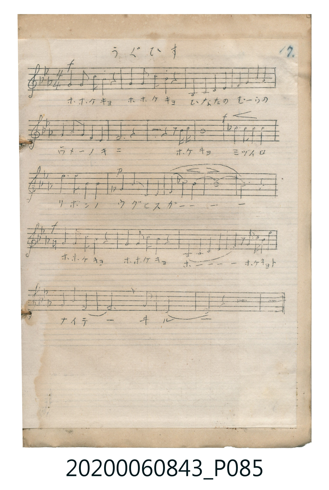

# うぐひす

> Re:Shōka 使用 AI 協助辨識與重建樂譜，可能會有錯誤。歡迎回報。

- **鋼琴伴奏版**：<br><audio controls src="uguisu.mp3"></audio>

- 曲：不詳

## 說明

うぐひす (Uguisu)
Source: 唱歌帖 (Shōkachō, NMTH 2020.006.0843) — P085.jpg (Notebook 2, p.17)
Notation: Handwritten 5-line staff (3 flats = Eb major, 4/4 time, 24 bars)


## 歌詞

```text
（TMD 檔案未包含歌詞註解）
```

## ABC

<div class="abc-score" data-abc-src="uguisu.abc" aria-label="五線譜載入中"></div>

[下載 ABC 原始檔](uguisu.abc)

## TMD 檔案連結

- [主旋律 TMD 檔案](uguisu.tmd) [[在 TMD Studio 編輯](https://tmdlang.github.io/Tmd-TS/#tmd=s7IKdvYPcrWy4qpTUCpJTLdSSM7PyUlNLsnMz7MqzsjPTkzOyFeCS5bl55TmploBqXgDI4RwcX5pUXJqfEFieqpVgIGFKboM3KT4vPyS1KT8_GyEioKi_LLUvMQ8oKrcxLzS4uSizIKS-OT8gkqEmtSyzJRUkIrUlMyS_KLMxBwkJ6UWFYMdC3FDSVFiHsQMoCBCVUlGKtDdiXmZuch6gUalZ-ZZleaBjC_JTMtMTVHi0tJSeNzY9rhxwuPGTY8bZypoaXEp2ipYmnHZ2yq46nDZmOib2IFMeDZ70_s9s57s6H2xcrMSF5e-loIttQCXggKqGzRC00szi0s1QRLBkCBVeDpl47O1PU93TFPQCM442gsK36O9Ogp-viEeCkYGRgZ6BgZmegYWJsaaCo8apiiA4kUvqyBdQcMPGgcKRjoKBXqG5mBTgYKJ4EhX8EjMSykvyiwpSc1TMNXNycxLVSguSUxLU9AwVkjLSSwpVgCGQ5JCbmJWfpGOAjA0FEoyc1N1FIxMFJISi4rBplEeBFCgoKXPxQXxvFVYfnJijkONQU01yAoFG0MzLTswCxj0wJB4sXKeFUg5VORx82wQatr4uGnt4-blmHxQyK563Dj_ceM6hcdNDY-bOkEsJAOalj1uXvi4uQ-oAai7G2xC00agONS8-Y-bWx83LXncvBbF2lWPm-c8bt4M1Ag2omnD4-ZJj5t2AjlrSHFe82yohRCBx80dKLq7wDa3AVkbgHg1TK5GoTqtVsFYQRcMIbSRgiGUbwCla4hQUZ1bUKtgGg_lwxlmMIY5jFED1wyjjVAMB6qAOdsBHIVWMM8BgwQpODGFGjcB8Sogng_E4EgCKtkDpDvBfLiXke0DuQHuRriraxBi6BDhYxgLWcYUZBzItxCPxuEwBAYhwW-ugyQE0g3CMDb2AGlaBvTaQoj3wAkHnuSgXkZOd0DcCuQuAdLwpAf0IZKlIGejRjHYbcAYNVJHEgYHCmbU1iDEwF4BmQwyEdWn6CKYYYFLBTzIMdMFMLab5wDxZmgwAIOlCZTAJwFpSBaCBBEqpnrix5PcYYkNkl6MQSnCCESA0wYsDvD4kKiUD4t2OEaThpcFqIkfu4sRGRSmDqYHKcaRlWCDmCrQswtmBsI0g6AKzPDqgqZ0UFEHCglQagDRq9FTQC0Xl66dAqSuUACylLkA)]
- [鋼琴伴奏 TMD 檔案](uguisu_piano.tmd) [[在 TMD Studio 編輯](https://tmdlang.github.io/Tmd-TS/#tmd=s7IKdvYPcrWy4tLSUnjc2Pa4ccLjxk2PG2cqaDxunvK4adHj5r4ne7Y8Xdr_ZPcMTQUtLS5FWwVLMy57WwVXHS4bE30TO646BaVnsze93zPryY7eFys3K3Fx6Wsp2FILcCkooDksNL00s7hUU-FRwxSFgMzEvHwFx-Tk_NyCxLzM3NS8EpCG4PzSouRUK4WnUzY-W9vzdMc0BY3gjKO92YnJQFJHwc83xEPByMDIQM_AwEzPwMLEGGqagYWpXlZBuoKGX35JalJ-fraCkY5CgZ6huSbIVMo9AwUKWvpcXBBvWIXlJyfmONQY1FSDrFCwMTTTsgOzahSq02oVjBV0wRBCGykYQvkGULqGCBXVuQW1CqbxUD6cYQZjmMMYNXDNMNoIxXCgCrDTgPHrAHa3FShymmdDcNNGIF77uHk5VqHGTUC8CojnA_E6oHADUMkeIN0J5gNDBOJpZBtBroC7Eu7uGoQYOkT4GcZCljEFGQfyL8SrcTgMgUFIBJjrIAmBdIMwjI0IEqCjkNSBbEKNF7BxwGgwUkcSBvsDMz5qEGJg20Emg0xEdRy6CKbzcamAhxKV0xmelAWLVUjEGIOC3ghEgCMBFnLo7kJPfPgSLEwdTA9SYCIrwQYxVaAnHszkhGkGQRVctfA8Dy61gjxw5PpcYHSYxmsbasP8DeSYx2vDfAaSQnMnKOhJUw9OivHa8BhDZpvEayNlOqBRKLZgmoppHdwlsJjEo8REHck6YyRn1EAcArcGHw_hMaDB2rB0j8wGWY-dA0zZ2qba8NKASA40noy0TbThJYQhkANLy7jYsBBBlUe4Ez0ikcISHGlAT8OLEBRp5KBDjkGg95DjGdW92MOqBk9o4QtHIhViFD_0SPDEJHBUY_ClC-TYQ_cOvrRObM7C4TMs8QrXhsrDl1nw68SdKHAlaQwPowYiiunoEBF4aKWjD3LpaAIvHA1BlYwhUBsKE8gAIhMwCZIwBrMMsbZWmpYB2x0LIW2P5j5Q8wRId0ObLKD2CFIrBthUaW4FcpcA6bWIJgrYbKN4kDWgQkrBEGw3wiEQBHchTBkEYXdVM7Bl1DwHiDdDXQV0ZdMGIHsSkN4JxGugLkbFcCeBDYZaBUwiYBZQDNUNQBbQ1RASwQO7nOxmHSzY4BhNugPhRpxxB4k4kEugkQcJTWxu6oLGRhvUNlAQgejV2IMFbAt6uoBaBGGYQDFcACW-kFVDkis4oeraKUDSqgKQpcwFAA)]

## 分析

```text
================================================================================
📊 TMD Song Profile: [ うぐひす ]
================================================================================
⏱  Duration:       1:00 (60.0s), 24 measures total
🎼 Key & Tempo:    首調基準 E,, != 96.0 BPM, <4/4>
   - 分析範圍：      由實際發聲的音符與和弦推測調性；播放脈絡另行呈現
🎤 人聲音域:    A#3 (MIDI 58) – G5 (MIDI 79) [跨度: 21 個半音 / 1.8 個八度, 難度: difficult]
   - 最低音:  A#3 in [Uguisu #1 @ m.3, 0:05]
   - 最高音: G5 in [Uguisu #1 @ m.18, 0:42]
   - 適合: soprano, mezzo-soprano, tenor, baritone
🏛  結構:      Uguisu (60.0s)
⚡ 編曲密度:        Peak 1 軌道同時演奏
🗝  調性診斷：       D# 大調（純淨自然大調，未偵測到可信轉調）
   - 風格氣質:    純淨自然大調（陽光明朗、易唱易記，無明顯調外色彩）
   - 轉調歷程:    全曲維持單一推測調性（未偵測到可信轉調）
   - 核心骨幹音:  D#, A#, C, G, F
   - 調性數值:    D# 大調 [相關度: 0.84, 穩定度: Moderate, 自然音純度: 96.1%]
   - 候選調性 (K-S): D# 大調 (0.84), C 小調 (0.77), A# 大調 (0.66)
   - 五度圈歷程:   -3
   - 各段落調性細節:
     • [Uguisu #1]: D# 大調 (r: 0.84, 自然音純度: 96.1%, 調外音: C#, F#)

  [ 五度圈游移軌跡 ]
               C  
         F            G  
      Bb               D  
     [Eb]*              A  
         Ab           E  
            Db       B  
               F# 
     (* = active key center)

  [ 十二半音累積音高分佈 ]
     C  : ████████████████████      20.4%
     C# : ███                        2.6%
     D  : █████                      4.6%
     D# : ████████████████████████  24.3%
     E  :                            0.0%
     F  : ████████                   8.6%
     F# : █                          1.3%
     G  : █████████████████         17.1%
     G# :                            0.0%
     A  :                            0.0%
     A# : █████████████████████     21.1%
     B  :                            0.0%
--------------------------------------------------------------------------------
Assignment 軌道音域：
  - Vocal         : A#3 – G5 (21 個半音 / 1.8 個八度, 71 個音符)
================================================================================
```


## 原書掃描頁




