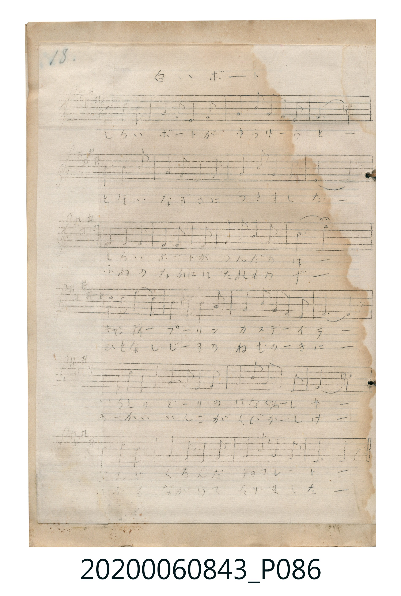

# 白いボート

<audio controls src="shiroi_boto.mp3"></audio>

- 曲：不詳

## 說明

白いボート (Shiroi Bōto)
Source: 唱歌帖 (Shōkachō, NMTH 2020.006.0843) — P086.jpg (Notebook 2, p.18)
Notation: Handwritten 5-line staff (1 sharp = G major, 6/8 time, 24 bars)

## 歌詞

```text
（TMD 檔案未包含歌詞註解）
```

## ABC

```abc
X:1
T:白いボート
C:曲：不詳
M:6/8
L:1/16
Q:3/8=64
K:G
V:V1 name="Vocal" snm="Voc"
[V:V1]
!mp! B2 B2 B2 d2 B2 A2 | G3 A3 B2 A2 G2 | E2 G2 E2 D2 E2 G2 | A6 z6 |
B2 B2 B2 d2 B2 A2 | G3 A3 B2 A2 G2 | A2 B2 A2 D2 F2 A2 | G6 z6 |
E2 E2 E2 E2 F2 G2 | A3 A3 A2 G2 E2 | D2 G2 A2 B2 A2 B2 | d6 z6 |
e2 e2 e2 d2 B2 A2 | G3 A3 B2 A2 G2 | A2 A2 A2 B2 A2 E2 | D6 z6 |
B2 B2 B2 d2 B2 A2 | G3 A3 B2 A2 G2 | E2 G2 E2 D2 E2 G2 | A6 z6 |
B2 d2 e2 d2 B2 G2 | A3 B3 A2 G2 E2 | D2 G2 A2 B2 A2 F2 | G6 z6 |
```

## TMD 檔案連結

- [主旋律 TMD 檔案](shiroi_boto.tmd) [[在 TMD Studio 編輯](https://tmdlang.github.io/Tmd-TS/#tmd=s7IKdvYPcrWy4tLSUng-c-_jxpbHzXMeN-953NyhoKXFpWirYGnGZW-r4M5lY6ZvYcdVp6D0bPam93tmPdnR-2LlZiUuLn0tBVtqAS4FBQxXaARnZBblZyo4He0tydcEqQjOLy1KTrVSeDpl47O1PU93TAOpOdqbnZgMJHUU_HxDPBSMDIwM9AwMzPQMLEyMNRUeNUxRCDCwMNPLKkhX0PDLL0lNys_PVjDSUSjQM7QAmwoUTCzJzM-zUvBIzEspL8osKUnNUzDVzcnMS1UoLklMS1PQMFQozkgsKlAAhodCbmJWfpGOAjBUFEoyc1N1FIxMFJISi4rBhlEeFFCgoKXPxQUJAaf8knyrsPzkxByHGoMahWqQPQo2hmZadmAWMB6AofFi5TwrkB6oiKGewuPG6Y-beoFBqgAP08eNPQqPm9oeN3WCSKBQUydQ2QoFfRD5uHE3WHHjqseNfY8bpz5uXA3kLHncCDRjH8iwxvlIFuAyHaihafLjxgWPG9cBOetBRjetfdy8-HHz5sfN7Y-bgIw9QC3TwVpWAUWB8qsfN-183Axx0JLHzStRrGkBW7PicVMXkLMSrKYLajjYqRMeN_WDRBunA01qAXulD-yE5UBW_-Omboh7gHY2Pm5e_rgJ6Iw1sHQOt8ZIT0Hj6b6ep71dmkBdWx83roVYATS_GxgOII8Avf-4qedxU9PjpglAziywTZvA4QZUBbS8cQbYGcCgAulc-7ipAcgCC_UC-atRPNUEFgcaDQpvoA-BLgQiUPD1P27cDJKB-qhxEtieiSBHNTVBXAR0ROPjxmVA7wL9DgwLtMgBppDcgloFYwVdODaF0kZAXKNgCCQhbIQoSKxGwSweygQzTEEEXKgGqgMCDZDYNTB_OYATqRUobQAdB_I1OHUAMSjKO4B8cPIDYmCyg9HA5AfBuyHqG1eBYhCIp4JDDZigEB4jx08gFkwE7CNzEIGsi1IfAV0IjEEgDUxk0FQPT_NAVe1A3mJQkofqAvoPkuoR_gIHMhoBdiZywCNIeAzVQHwE4iN7E0QDpYj3HNBTYM8BowGSzaA01DPgKAEm-qZ-SECAogfsYXAWA7K7EQEAzmVIaR1hyVZQroAaCjIQqAkcv-CsBTQAlDaAKRyau4B5C5ouQGrB2QuI90H1r0UKO1BgQDEpaQKGYTLIATqYgg1_MABLGSgbUsgAixZo0IJLFqgFIAwuXCjLSoO7eECxAX8oAMtYqDykiAUWsEAMTKCQIhbqkkYgDS5lUUMNFFrIiQ3Z9yA-cXkUnL1JKoEIph5g3QZkrkEKT3xakKs_hCX4wwGSvEGpDxRuwEyLTz2kRqrl4tK1U0A0ZBSAPGUuAA)]
- [鋼琴伴奏 TMD 檔案](shiroi_boto_piano.tmd) [[在 TMD Studio 編輯](https://tmdlang.github.io/Tmd-TS/#tmd=s7IKdvYPcrWy4tLSUng-c-_jxpbHzXMeN-953NyhoPG4ecrjpkWPm_ue7NnydGn_k90zNBW0tLgUbRUszbjsbRXcuWzM9C3suOoUlJ7N3vR-z6wnO3pfrNysxMWlr6VgSy3ApaCA6bTgjMyi_EwFp6O9JfmaCo8apigEZCbm5Ss4Jifn5xYk5mXmpuaVgHQG55cWJadaKTydsvHZ2p6nO6aB9B7tzU5MBpI6Cn6-IR4KRgZGBnoGBmZ6BhYmxlDTDCzM9LIK0hU0_PJLUpPy87MVjHQUCvQMLTRBplLuKyhQ0NLn4oJ4xim_JN8qLD85McehxqBGoRpkj4KNoZmWHZgFFMktqFUwVtCFY1MobQTENQqGQBLCRoiCxGoUzOKhTDDDFETAhWqgOiDQAIldA7YWGJMOYEdZATmPG6crPG7qBdItCsDIAOI9QNwB5PcAxduAuBNBN66A4t0Q9Y2rgLgPiKcC8WogXgLyPMRr5PgKxIKJgP1kDiKQdeHyEzRE0AiwduQgQZDwsKuB2ATiI1sPooFShCwFmQLFpHgShmEyyC7BZx-9kwrERpBNyD5E1gniExei4MjAF4-1KNkGnPmDPHBlHGC-MY3XNtSG2A-BGAIgl2BRg6LCJF7bDFXMOF4bQxVQwDxem1BgUcdFmHZhigAjBsOV2FyE6TtMEaAqdbAgsgVYhLDZicWDIJdqE8o4htom2qAkBYNAQ1D0EBVzRLraCOxqcPLD56QhkJywhhKaQdjiF2u8kZyisORPH1z5EzUAUKzBI2WCzEUPMZzuIq1OA9ZRj5smA-kFQLwOiNcD-WsfNy9-3LwZqKodyFsMpIEmgHUBaziQeNNqRM1Gnt9QPGAaj6aPJN8BfQX2HbAmbuoC0iuhNNQ34Fp5AlCsHxISoBoa7OPlQAwUa-pGhEBz4-Pm5TCvoVmzFYjXQo0FGQnUBq7kQVbMBxoBaiA0ATHQqsZZQLwJ2jgAqQVZOwOI90H1r0UEH0oko3BAWRWJi8JBDVtK0gadQg9_aDxuaoCyQU4BhSowJMEhDGpWgZwIsgKEQUm2H0fooQYDnsSHL1yplrPIby2i2YE_KB43AvMjWB4UrJOAeCIQAxMrKDGC7QC5pRFILwMnTgrzLdXKJILp6HETqABagxSo-LR04Ag8_IEBSeqgdAgKPGAuxqceKE9M4KEEA1qGJrfUA9Y1unYKiOpGAchT5gIA)]

## 分析

```text
================================================================================
📊 TMD Song Profile: [ 白いボート ]
================================================================================
⏱  Duration:       0:45 (45.0s), 24 measures total
🎼 Key & Tempo:    首調基準 G, != 96.0 BPM, <6/8>
   - 分析範圍：      由實際發聲的音符與和弦推測調性；播放脈絡另行呈現
🎤 人聲音域:    D4 (MIDI 62) – E5 (MIDI 76) [跨度: 14 個半音 / 1.2 個八度, 難度: moderate]
   - 最低音:  D4 in [ShiroiBoto #1 @ m.3, 0:04]
   - 最高音: E5 in [ShiroiBoto #1 @ m.13, 0:22]
   - 適合: soprano, mezzo-soprano, contralto, tenor, baritone, bass
🏛  結構:      ShiroiBoto (45.0s)
⚡ 編曲密度:        Peak 1 軌道同時演奏
🗝  調性診斷：       D 大調（純淨自然大調，未偵測到可信轉調）
   - 風格氣質:    純淨自然大調（陽光明朗、易唱易記，無明顯調外色彩）
   - 轉調歷程:    全曲維持單一推測調性（未偵測到可信轉調）
   - 核心骨幹音:  A, G, B, D, E
   - 調性數值:    D 大調 [相關度: 0.69, 穩定度: Moderate, 自然音純度: 100.0%]
   - 候選調性 (K-S): D 大調 (0.69), G 大調 (0.65), A 大調 (0.60)
   - 五度圈歷程:   +2
   - 各段落調性細節:
     • [ShiroiBoto #1]: D 大調 (r: 0.69, 自然音純度: 100.0%)

  [ 五度圈游移軌跡 ]
               C  
         F            G  
      Bb              [D ]*
      Eb               A  
         Ab           E  
            Db       B  
               F# 
     (* = active key center)

  [ 十二半音累積音高分佈 ]
     C  :                            0.0%
     C# :                            0.0%
     D  : ███████████               13.5%
     D# :                            0.0%
     E  : ███████████               13.5%
     F  :                            0.0%
     F# : ██                         2.4%
     G  : █████████████████         20.6%
     G# :                            0.0%
     A  : ████████████████████████  29.8%
     A# :                            0.0%
     B  : ████████████████          20.2%
--------------------------------------------------------------------------------
Assignment 軌道音域：
  - Vocal         : D4 – E5 (14 個半音 / 1.2 個八度, 108 個音符)
================================================================================
```


## 原書掃描頁




