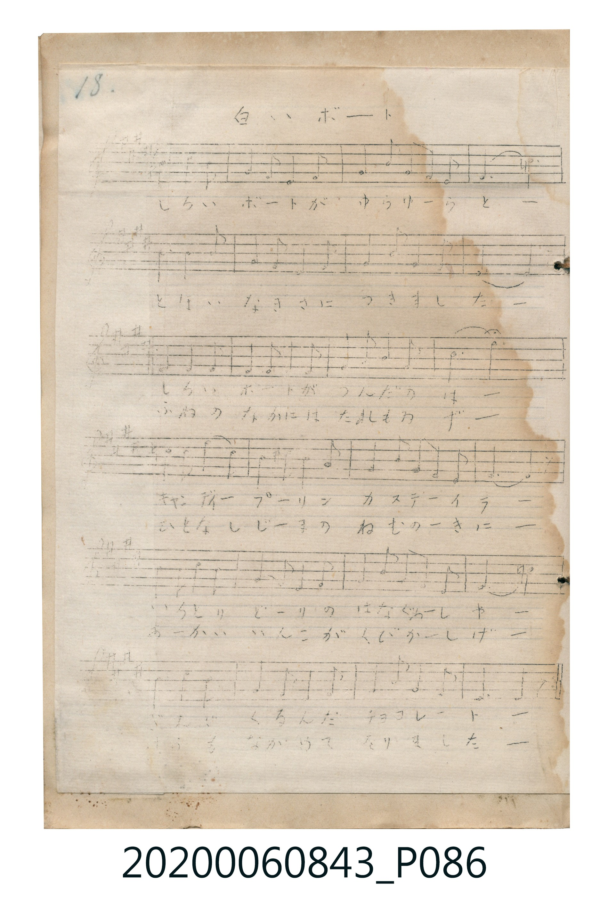

# 白いボート

> Re:Shōka 使用 AI 協助辨識與重建樂譜，可能會有錯誤。歡迎回報。

- **鋼琴伴奏版**：<br><audio controls src="shiroi_boto.mp3"></audio>

- 曲：不詳

## 說明

白いボート (Shiroi Bōto)
Source: 唱歌帖 (Shōkachō, NMTH 2020.006.0843) — P086.jpg (Notebook 2, p.18)
Notation: Handwritten 5-line staff (1 sharp = G major, 6/8 time, 24 bars)


## 歌詞

```text
（TMD 檔案未包含歌詞註解）
```

## ABC

<div class="abc-score" data-abc-src="shiroi_boto.abc" aria-label="五線譜載入中"></div>

[下載 ABC 原始檔](shiroi_boto.abc)

## TMD 檔案連結

- [主旋律 TMD 檔案](shiroi_boto.tmd) [[在 TMD Studio 編輯](https://tmdlang.github.io/Tmd-TS/#tmd=s7IKdvYPcrWy4qpTUCpJTLdSSM7PyUlNLsnMz7MqzsjPTkzOyFeCS5bl55TmploBqXgDI4RwcX5pUXJqfEFieqpVgIGFGboM3KT4vPyS1KT8_GyEioKi_LLUvMQ8oKrcxLzS4uSizIKS-OT8gkqEmtSyzJRUkIrUlMyS_KLMxBwkJ6UWFYMdC3FDSVFiHsQMoCBCVUlGKtDdYMmC_KIShATQtPTMPKvSPJANJZlpmakpyJIlGfnpRYkFGZVWGZnFIKuTE3PisxPzEpW4tLQUns_c-7ix5XHznMfNex43dyhoaXEp2ipYmnHZ2yq4c9mY6VvYgcx6NnvT-z2znuzofbFysxIXl76Wgi21AJeCAoYrNIIzMovyMxWcjvaW5GuCVARDYkHh6ZSNz9b2PN0xDaTmaC8oSo726ij4-YZ4KBgZGBnoGRiY6RlYmBhrKjxqmKIAikq9rIJ0BQ0_aLQpGOkoFOgZWoBNBQomgtOJgkdiXkp5UWZJSWqegqluTmZeqkJxSWJamoKGoUJxRmJRgQIwPBRyE7Pyi3QUgKGiUJKZm6qjYGSikJRYVAw2jPKggAIFLX0uLkgIOOWX5FuF5QOjzKHGoKYaZI2CjaGZlh2YBYwGYGC8WDnPCqQFKmKop_C4cfrjpl5giCrAg_RxY4_C46a2x02dIBIo1NQJVLZCQR9EPm7cDVbcuOpxY9_jxqmPG1cDOUseNwLN2AcyrHE-kgW4TAdqaJr8uHHB48Z1QM56kNFNax83L37cvPlxc_vjJiBjD1DLdLCWVUBRoPzqx007HzdDHLTkcfNKFGtawNaseNzUBeSsBKvpghoOduqEx039INHG6UCTWsBe6QM7YTmQ1f-4qRviHqCdjY-blz9uAjpjDSyZw60x0lPQeLqv52lvlyZQ19bHjWshVgDN7waGA8gjQO8_bup53NT0uGkCkDMLbNMmcLgBVQEtb5wBdgYwqEA61z5uagCywEK9QP5qFE81gcWBRoPCG-hDoAuBCBR8_Y8bN4NkoD5qnAS2ZyLIUU1NEBcBHdH4uHEZ0LtAvwPDAi1yahSqcwtqFYwVdOHYFEobAXGNgiGQhLARoiCxGgWzeCgTzDAFEXChGqgOCDRAYtfA_OUATqNWoLQBdBzI1-DUAcSgKO8A8sHJD4iByQ5GA5MfBO-GqG9cBYpBIJ4KDjVggkJ4jBw_gVgwEbCPzEEEsi5KfQR0ITAGgTQwkUFTPTzNA1W1A3mLQUkeqgvoP0iqR_gLHMhoBNiZyAGPIOExVAPxEYiP7E0QDZQi3nNAT4E9B4wGSDaD0lDPgKMEmOib-iEBAYoesIfBWQzI7kYEADiXIaV1hCVbQbkCaijIQKAmcPyCsxbQAFDaAKZwaO4C5i1ougCpBWcvIN4H1b8WKexAgQHFpKQJGIbJIAfoYAo2_MEALGWgbEghAyxaoEELLlmgFoAwuHChLCsN7uIBxQb8oQAsY6HykCIWWMACMTCBQopYqEsagTS4lEUNNVBoISc2ZN-D-MTlUXD2JqkEIph6gHUbkLkGKTzxaUGu_hCW4A8HSPIGpT5QuAEzLT71kBqplotL104B0Y5RAPKUuQA)]
- [鋼琴伴奏 TMD 檔案](shiroi_boto_piano.tmd) [[在 TMD Studio 編輯](https://tmdlang.github.io/Tmd-TS/#tmd=s7IKdvYPcrWy4qpTUCpJTLdSyC8qychPL0osyKi0ysgsLskvykxOzInPTsxLVIIrKs4vLUpOjS9ITE-1CjCwMEPIlGSk5qZapaaUJieWZObnKXFpaSk8n7n3cWPL4-Y5j5v3PG7uUNB43DzlcdOix819T_Zsebq0_8nuGZoKWlpcirYKlmZc9rYK7lw2ZvoWdiBDn83e9H7PrCc7el-s3KzExaWvpWBLLcCloIDptOCMzKL8TAWno70l-ZoKjxqmKARkJublKzgmJ-fnFiTmZeam5pWAdAaDg8BK4emUjc_W9jzdMQ2k92hvdmIykNRR8PMN8VAwMjAy0DMwMNMzsDAxhpoGDC29rIJ0BQ2__JLUpPz8bAUjHYUCPUMLTZCplPsKChS09Lm4IJ5xyi_JtwrLB8aiQ41BTTXIGgUbQzMtOzCrRqE6t6BWwVhBF45NobQRENcoGAJJCBshChKrUTCLhzLBDFMQAReqgeqAQAMkdg3YWmBEOoDdZAXkPG6crvC4qRdItygA4wKI9wBxB5DfAxRvA-JOBN24Aop3Q9Q3rgLiPiCeCsSrgXgJyO8Qr5HjKxALJgL2kzmIQNaFy0_QEEEjwNqRgwRBwsOuBmITiI9sPYgGShGyFGQKFJPiSRiGySC7BJ999E4qEBtBNiH7EFkniE9ciIIjA1881qLkGnDeD_LAkW-A2cY0XttQG2I9BGIIgByCRQ2KCpN4bTNUMeN4bQxVQAHzeG1CYUUdF2HahSkCjBcMV2JzEabvMEWAqtTBgsgWYBHCZicWD4Jcqk0o3xhqm2iDUhQMAg1B0UNUzBHpaiOwq8GpD5-ThkBywhpKaAZhi1-s8UZyisKSPX2Qs6cFPHdCzDCGhDgG1wTCgIjCyzyIXaRWUMAK53HTZCC9AIjXAfF6IH_t4-bFj5s3A1W1A3mLgTTQBLAuYHUFEm9ajaim8LsV6jjTeLg8QdcCXQl2LbCabOoC0iuhNNR14CpzAlCsH-IzUPUJ9sFyIAaKNXUjfNTc-Lh5OcypaNZsBeK1UGNBRgK1gWtgkBXzgUaAau8mIAZa1TgLiDdBa26QWpC1M4B4H1T_WkRwQCMHSoEyD5gBpWDhQ3zc0Sk08PvucVMDlA1yCiiUgCEDDjFQGwbkRJAVIAxKUv0YoQHzLlriQA8bilIy-U0tNDvwe-1xIzD9g-VBwTQJiCcCMTAxgRIL2A6QWxqB9DJw4iEyn5CcpwnG8-MmUAZegxRI-LR04AgM_J6DJEVQOgEFBjDX4FMPlMcVGFDvwjMNoVIDWJLq2ikgClMFIE-ZCwA)]

## 分析

```text
================================================================================
📊 TMD Song Profile: [ 白いボート ]
================================================================================
⏱  Duration:       0:45 (45.0s), 24 measures total
🎼 Key & Tempo:    首調基準 G, != 96.0 BPM, <6/8>
   - 分析範圍：      由實際發聲的音符與和弦推測調性；播放脈絡另行呈現
🎤 人聲音域:    D4 (MIDI 62) – E5 (MIDI 76) [跨度: 14 個半音 / 1.2 個八度, 難度: moderate]
   - 最低音:  D4 in [ShiroiBoto #1 @ m.3, 0:04]
   - 最高音: E5 in [ShiroiBoto #1 @ m.13, 0:22]
   - 適合: soprano, mezzo-soprano, contralto, tenor, baritone, bass
🏛  結構:      ShiroiBoto (45.0s)
⚡ 編曲密度:        Peak 1 軌道同時演奏
🗝  調性診斷：       D 大調（純淨自然大調，未偵測到可信轉調）
   - 風格氣質:    純淨自然大調（陽光明朗、易唱易記，無明顯調外色彩）
   - 轉調歷程:    全曲維持單一推測調性（未偵測到可信轉調）
   - 核心骨幹音:  A, G, B, D, E
   - 調性數值:    D 大調 [相關度: 0.69, 穩定度: Moderate, 自然音純度: 100.0%]
   - 候選調性 (K-S): D 大調 (0.69), G 大調 (0.65), A 大調 (0.60)
   - 五度圈歷程:   +2
   - 各段落調性細節:
     • [ShiroiBoto #1]: D 大調 (r: 0.69, 自然音純度: 100.0%)

  [ 五度圈游移軌跡 ]
               C  
         F            G  
      Bb              [D ]*
      Eb               A  
         Ab           E  
            Db       B  
               F# 
     (* = active key center)

  [ 十二半音累積音高分佈 ]
     C  :                            0.0%
     C# :                            0.0%
     D  : ███████████               13.5%
     D# :                            0.0%
     E  : ███████████               13.5%
     F  :                            0.0%
     F# : ██                         2.4%
     G  : █████████████████         20.6%
     G# :                            0.0%
     A  : ████████████████████████  29.8%
     A# :                            0.0%
     B  : ████████████████          20.2%
--------------------------------------------------------------------------------
Assignment 軌道音域：
  - Vocal         : D4 – E5 (14 個半音 / 1.2 個八度, 108 個音符)
================================================================================
```


## 原書掃描頁




