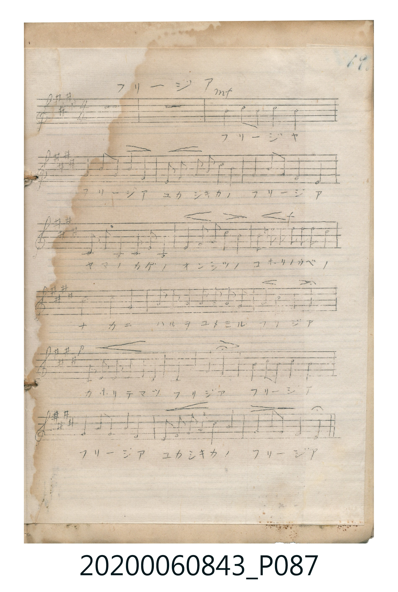

# フリージア

> Re:Shōka 使用 AI 協助辨識與重建樂譜，可能會有錯誤。歡迎回報。

- **鋼琴伴奏版**：<br><audio controls src="furijia.mp3"></audio>

- 曲：不詳

## 說明

フリージア (Furījia)
Source: 唱歌帖 (Shōkachō, NMTH 2020.006.0843) — P087.jpg (Notebook 2, p.19)
Notation: Handwritten 5-line staff (4 sharps = E major, 4/4 time, 20 bars)


## 歌詞

```text
（TMD 檔案未包含歌詞註解）
```

## ABC

<div class="abc-score" data-abc-src="furijia.abc" aria-label="五線譜載入中"></div>

[下載 ABC 原始檔](furijia.abc)

## TMD 檔案連結

- [主旋律 TMD 檔案](furijia.tmd) [[在 TMD Studio 編輯](https://tmdlang.github.io/Tmd-TS/#tmd=s7IKdvYPcrWy4qpTUCpJTLdSSM7PyUlNLsnMz7MqzsjPTkzOyFeCS5bl55TmploBqXgDI4RwcX5pUXJqfEFieqpVgIGFOboM3KT4vPyS1KT8_GyEioKi_LLUvMQ8oKrcxLzS4uSizIKS-OT8gkqEmtSyzJRUkIrUlMyS_KLMxBwkJ6UWFYMdC3FDSVFiHsQMoCBCVUlGKtDdBTmJeSUIQaBJ6Zl5VqV5INNLMtMyU1OQJUsy8tOLEgsyKq0yMotB1iYn5sRnJ-YlKnFpaSk8bp76uHnV4-Y9j5t2PG5apKClxaVoq2BpxmVvq-DKZWOib2IHMuvZ7E3v98x6sqP3xcrNSlxc-loKttQCXAoKGK7QcCstOrI6KzNREyQbDAl9hadTNj5b2_N0xzQFjeCMo72gqDjaq6Pg5xvioWBkYGSgZ2BgpmdgYWKsqfCoYYoCKAr1sgrSFTT8oNGlYKSjUKBnaAk2FSiYCE4fCh6JeSnlRZklJal5Cqa6OZl5qQrFJYlpaQoaJgrFGYlFBcUKwMBQyE3Myi_SUQAGiUJJZm6qDtBOhaTEomKwaZSHAxQoaOlzcQG9nwn0fbxnXklRvlVAZmJevkONQU01yCYFG0MtOzCjRsEAgrlqEVocMZWbQdUDYw0Yfi9WzrMCWQIVQQn65iUK-hiR8bh52eOm1Y-btj9uWgtiNPdhphok45Y8bp4HVAPWsgmsuAmocjNIf3MLhL_5cfNssH6wquaZIFFkI7rAwt1AVv_jZiBrE9gNzQsfN88H8mG2Y1gN0gQxtw3shhZUlfgcTa6PaxSqc9NqFYwVdMHQFEqj82vgIrhgjYIRlGUCxCA2jG8eD1diCBUGGQZSBqJhfOyGgHSAIIyugXnZISwfWA5YgfwFxKuAeA8wAHeA4g_CRheHBAsokIF4OxCvhbDBasHhg6EeHkZmIC-A_QFzB1gEQZiCCIj_QBDZj8gYEoygQDWD4mpg4MPYMIzFjyA_zYO4E-x-UIICuRnkVpCbN0P8BE4xUHEYbgLKNc-G-g2qv3kmXB3cj7CohkFYnMBiBOI7EIYHBMybsIiqQcQ1TBd6gsLity6om8DZBYhBbJD_QO4HxlfzQiCeD-WD8w7EL-hxVF0ADElklyEnMHjygShBSZbIkQZRQ60sgeFXsD9hcdEGjVOQv8A5HcVf2NMvUnwNkuxGXrYClve6dgootYQCkoAjiKPMBQA)]
- [鋼琴伴奏 TMD 檔案](furijia_piano.tmd) [[在 TMD Studio 編輯](https://tmdlang.github.io/Tmd-TS/#tmd=s7IKdvYPcrWy4qpTUCpJTLdSyC8qychPL0osyKi0ysgsLskvykxOzInPTsxLVIIrKs4vLUpOjS9ITE-1CjCwMEfIlGSk5qZapaaUJieWZObnKXFpaSk8bp76uHnV4-Y9j5t2PG5apKDxuHkKkH7c3Pdkz5anS_uf7J6hqaClxaVoq2BpxmVvq-DKZWOib2IHMvTZ7E3v98x6sqP3xcrNSlxc-loKttQCXAoKmE5zKy06sjorM1FT4VHDFIWAzMS8fAXH5OT83ILEvMzc1LwSkK5gsPetFJ5O2fhsbc_THdMUNIIzjvZmJyYDSR0FP98QDwUjAyMDPQMDMz0DCxNjqGnAkNLLKkhX0PDLL0lNys_PVjDSUSjQM7TUBJlKuY-gQEFLn4sL6JFMoD_iPfNKivKtwB5xqDGoqQbZpGBjqGUHZtQoGEAwVy1WLUEeyJrM4LqqcwtqFUzjtQ21jRV0wRDI0jaFsnFK1ICkzOO1jRAKgTwTbNoMYFpwuMwH2WUmcIcZAk0BEsbxYLuACMiLR_egI2Z4IHstrVYB5gqYw9H5NXARXLBGAeZJkPdAbBjfPB6uxBAqDDIMpAxEw_jYDQHpAIcqPHhArgZmC4ewfGA-tYKkaSBeBcR7FIDJGkgvgbDRxYHp_XHzMiC9Goi3A_FaCBustg-remDKgoSSGcgTYJ_AXAIWQRDAwIf5EASRfYmMIQEJClYzKK4GBj-MDcMQXwJjFC2QYeEECyWIfSAMdxrMYljg1SDCH54K0UyD2VYNTONgv8DMQY4ieARAlKBELLKnIWqolaigLqNT0sLMMjjLA_KLA4QUkRyChQi6HIptOIxH1UOsZcbx2khmovJgcQUUhacQMBtZPbIMOMdA7ERVh-IgkDjcfhQOWmgCJbRBeQcEwckPWQCZDXMocszgjD7U0EAPUnhYY4Yosg4cykBM7LYi50gTlLABMo2wVyBosQHRh92pKD5A8hwltRzpyRpWxg2NxI1ZNuCvkYEElA2sm4FVMrh6NgLV0OBKGiQHlAArRa65QSqxVXGgKm0epJoCV1-boFUWqKoCVVmbIVVacwtCHIabgHLNs6FVG1R_80y4OuQqDugiIAlyEZgyiQchkFMhLBAHm-O6oIZ2A3E_EIPYIAeCHACsb5sXAvF8KB8kB61n0etYjJBDhA4k4IAcLNaDrYb5rw0aTiCrQGGBahX2JgFSGAB9CLQK2p4CctAchCVaiWiPUNLuID7RABOorp0CSstRAUnAEcRR5gIA)]

## 分析

```text
================================================================================
📊 TMD Song Profile: [ フリージア ]
================================================================================
⏱  Duration:       0:50 (50.0s), 20 measures total
🎼 Key & Tempo:    首調基準 E, != 96.0 BPM, <4/4>
   - 分析範圍：      由實際發聲的音符與和弦推測調性；播放脈絡另行呈現
🎤 人聲音域:    B3 (MIDI 59) – C#5 (MIDI 73) [跨度: 14 個半音 / 1.2 個八度, 難度: moderate]
   - 最低音:  B3 in [Furijia_A #1 @ m.8, 0:19]
   - 最高音: C#5 in [Furijia_A #1 @ m.10, 0:23]
   - 適合: soprano, mezzo-soprano, contralto, tenor, baritone, bass
🏛  結構:      Furijia_Intro (5.0s) -> Furijia_A (45.0s)
⚡ 編曲密度:        Peak 1 軌道同時演奏
🗝  調性診斷：       G# 調性不明確（流行色彩大調，未偵測到可信轉調）
   - 風格氣質:    流行大調（略帶和弦色彩音與裝飾副屬和弦）
   - 轉調歷程:    全曲維持單一推測調性（未偵測到可信轉調）
   - 核心骨幹音:  G#, F#, E, B, C#
   - 調性數值:    G# 調性不明確 [相關度: 0.69, 穩定度: Ambiguous, 自然音純度: 92.4%]
   - 候選調性 (K-S): G# 小調 (0.69), E 大調 (0.67), B 大調 (0.59)
   - 五度圈歷程:   +4 -> -4
   - 各段落調性細節:
     • [Furijia_Intro #1]: ? 音樂資料不足 (r: 0.00, 自然音純度: 100.0%)
     • [Furijia_A #1]: G# 調性不明確 (r: 0.69, 自然音純度: 92.4%, 調外音: A)

  [ 五度圈游移軌跡 ]
               C  
         F            G  
      Bb               D  
      Eb               A  
        [Ab]*         [E ]*
            Db       B  
               F# 
     (* = active key center)

  [ 十二半音累積音高分佈 ]
     C  :                            0.0%
     C# : ████████                   9.0%
     D  :                            0.0%
     D# : ██████                     6.9%
     E  : ██████████████            16.0%
     F  :                            0.0%
     F# : ███████████████████       21.5%
     G  :                            0.0%
     G# : ████████████████████████  27.8%
     A  : ███████                    7.6%
     A# :                            0.0%
     B  : ██████████                11.1%
--------------------------------------------------------------------------------
Assignment 軌道音域：
  - Piano         : B3 – C#5 (14 個半音 / 1.2 個八度, 92 個音符)
================================================================================
```


## 原書掃描頁




