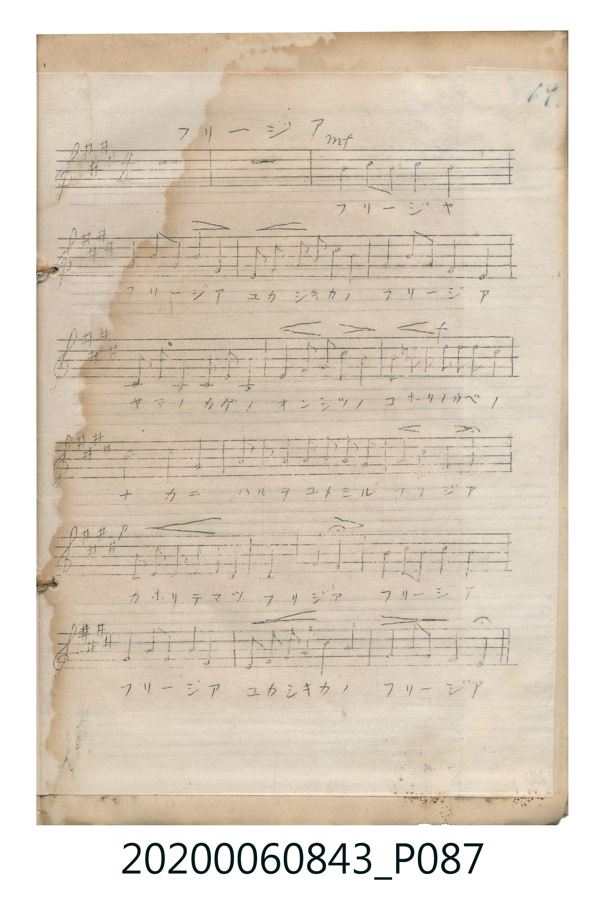

# フリージア

<audio controls src="furijia.mp3"></audio>

- 曲：不詳

## 說明

フリージア (Furījia)
Source: 唱歌帖 (Shōkachō, NMTH 2020.006.0843) — P087.jpg (Notebook 2, p.19)
Notation: Handwritten 5-line staff (4 sharps = E major, 4/4 time, 20 bars)

## 歌詞

```text
（TMD 檔案未包含歌詞註解）
```

## ABC

```abc
X:1
T:フリージア
C:曲：不詳
M:4/4
L:1/16
Q:1/4=96
K:E
V:V1 name="Vocal" snm="Voc"
[V:V1]
z16 | z16 | !mf! G4 B4 G4 B4 | G16 |
F4 A2 F2 F4 D4 | E2 F2 G2 A2 G2 F2 G4 | F4 A2 F2 E4 E4 | C2 D2 E4 C2 C2 C2 B,2 |
E4 F2 G2 A2 A2 A2 A2 | !f! G2 B2 c2 c2 c2 c2 c2 c2 | B8 G4 F4 | E2 E2 D2 E2 F2 G2 F2 E2 |
D4 F4 B4 G4 | !p! C2 E2 F2 A2 G2 F2 E4 | C4 D4 E4 F4 | !mf! G4 B4 G4 B4 |
G16 | F4 A2 F2 F4 D4 | E2 F2 G2 A2 G2 F2 G4 | F4 A2 F2 E4 E4 |
```

## TMD 檔案連結

- [主旋律 TMD 檔案](furijia.tmd) [[在 TMD Studio 編輯](https://tmdlang.github.io/Tmd-TS/#tmd=s7IKdvYPcrWy4tLSUnjcPPVx86rHzXseN-143LRIQUuLS9FWwdKMy95WwZXLxkTfxI6rTkHp2exN7_fMerKj98XKzUpcXPpaCrbUAlwKChiu0HArLTqyOiszURMkG5xfWpScaqXwdMrGZ2t7nu6YpqARnHG0NzsxGUjqKPj5hngoGBkYGegZGJjpGViYGGsqPGqYohBgYGGul1WQrqDhl1-SmpSfn61gpKNQoGdoCTYVKJhYkpmfZ6XgkZiXUl6UWVKSmqdgqpuTmZeqUFySmJamoGGiUJyRWFRQrAAMDIXcxKz8Ih0FYJAolGTmpuoA7VRISiwqBptGeThAgYKWPhcX0PuZQN_He-aVFOVbheUnJ-Y41BjUKFSDrFKwMTTTsgOzahQMFHTxQiJUcNUiLHTEYxkw0oHB_2LlPCuQG6EiKDHXvERBHyMuHzcve9y0-nHT9sdNa0GM5j7MRIdk3JLHzfOAasBaNoEVNwFVbgbpb26B8Dc_bp4N1g9W1TwTJIpsRBdYuBvI6n_cDGRtAruheeHj5vlAPsx2DKtBmiDmtoHd0IKqEp-jyfUxMJBz02oVjKFRYQql0fk1cBHc0WwEZZkAMYgN45vHw5UYQoVBhoGUgWgYH7shIB0gCKNrYF52ACcTK5C_gHgVEO8BBuAOUPxB2OjikGABBTIQbwfitRA2WC04fDDUw8PIDOQFsD9g7gCLIAhTEAHxHwgi-xEZQ4IRFKhmUFwNDHwYG4ax-BHkp3kQd4LdD0pQIDeD3Apy82aIn8ApBioOw01AuebZUL9B9TfPhKuD-xEW1TAIixNYjEB8B8LwgIB5ExZRNYi4hulCT1BY_NYFdRM4uwAxiA3yH8j9wPhqXgjE86F8cN6B-AU9jqoLgCGJ7DLkBAZPPhAlKMkSOdIgaqiVJTD8CvYnLC7aoHEK8hc4p6P4C3v6RYqvQZLdyMtWwAJf104BpZJRQBJwBHGUuQA)]
- [鋼琴伴奏 TMD 檔案](furijia_piano.tmd) [[在 TMD Studio 編輯](https://tmdlang.github.io/Tmd-TS/#tmd=s7IKdvYPcrWy4tLSUnjcPPVx86rHzXseN-143LRIQeNx8xQg_bi578meLU-X9j_ZPUNTQUuLS9FWwdKMy95WwZXLxkTfxI6rTkHp2exN7_fMerKj98XKzUpcXPpaCrbUAlwKCphOcystOrI6KzNRU-FRwxSFgMzEvHwFx-Tk_NyCxLzM3NS8EpCu4PzSouRUK4WnUzY-W9vzdMc0BY3gjKO92YnJQFJHwc83xEPByMDIQM_AwEzPwMLEGGqagYW5XlZBuoKGX35JalJ-fraCkY5CgZ6hpSbIVMp9BAUKWvpcXECPZAL9Ee-ZV1KUbxWWn5yY41BjUKNQDbJKwcbQTMsOzKpRMFDQxQuJUMFVi24hOOSCPHBYWZ1bUKtgGq9tqG0MNQLI0jaFsnFK1ICkzOO1jRAKgTwTbNpgTsblNB9cTjOEmwZzAJQ2hgmAXAFXBFcFY2C12BFvBFTnptUqwBwO8ys6vwYugjMWFGDhAgoREBvGN0c4HeQbkDDIMJAyEA3jYzcE5n8YXQN2NTAjOoD9ZAXJRUC8Coj3KAAzEpBeAmGjiwNz2OPmZUB6NRBvB-K1EDZYbR9W9cC0DAklM5AnwD6BuQQsgiDAsYKIQGRfImNIQIKC1QyKq4HBD2PDMMSXwKhGC2RYOMFCCWIfCMOdBrMYFng1iPCHJ1w002C2VQOzBdgvMHOQowgeARAlKBGL7GmIGmolKqjL6JS0UPIMgTKE_CIEIUUkh2DBgy6HYhsO41H1EGuZcbw2kpmoPFhkAUXhSQTMRlaPLAMvyKB6sLsVJA63H4WDFppACW1Q5gFBcPpDFkBmwxyKHDM4ow81NNCDFB7WmCGKrAOHMhATu63IWdIEJWyATCPslQ5abED0YXcqig-QPEdJzUh6soYVckMjcWMWDqTX4kgpHkMIXsPDK3Okqt4IEXlwBqZZcCMwLMbfakDYiK12BdWm8yA1JLjm3AStLUG1JKi23AypTZtbEOIw3ASUa54NrVWh-ptnwtWh1q4oPoCLYKl3YEImMAE4AxEUmHIIRdg82QV1XDcQ9wMxiA3yKMgjwCZD80Igng_lg-SgTQX0ZgJZMY8vtjAjHl9LCOwFWHi3QeMN5GRQ3KA6GXvrCClO4OEFdwKWtihcEUkeJjM7ENH0o6SJR__MBixSdO0UUPoHCkgCjiCOMhcA)]

## 分析

```text
================================================================================
📊 TMD Song Profile: [ フリージア ]
================================================================================
⏱  Duration:       0:50 (50.0s), 20 measures total
🎼 Key & Tempo:    首調基準 E, != 96.0 BPM, <4/4>
   - 分析範圍：      由實際發聲的音符與和弦推測調性；播放脈絡另行呈現
🎤 人聲音域:    B3 (MIDI 59) – C#5 (MIDI 73) [跨度: 14 個半音 / 1.2 個八度, 難度: moderate]
   - 最低音:  B3 in [Furijia_A #1 @ m.8, 0:19]
   - 最高音: C#5 in [Furijia_A #1 @ m.10, 0:23]
   - 適合: soprano, mezzo-soprano, contralto, tenor, baritone, bass
🏛  結構:      Furijia_Intro (5.0s) -> Furijia_A (45.0s)
⚡ 編曲密度:        Peak 1 軌道同時演奏
🗝  調性診斷：       G# 調性不明確（流行色彩大調，未偵測到可信轉調）
   - 風格氣質:    流行大調（略帶和弦色彩音與裝飾副屬和弦）
   - 轉調歷程:    全曲維持單一推測調性（未偵測到可信轉調）
   - 核心骨幹音:  G#, F#, E, B, C#
   - 調性數值:    G# 調性不明確 [相關度: 0.69, 穩定度: Ambiguous, 自然音純度: 92.4%]
   - 候選調性 (K-S): G# 小調 (0.69), E 大調 (0.67), B 大調 (0.59)
   - 五度圈歷程:   +4 -> -4
   - 各段落調性細節:
     • [Furijia_Intro #1]: ? 音樂資料不足 (r: 0.00, 自然音純度: 100.0%)
     • [Furijia_A #1]: G# 調性不明確 (r: 0.69, 自然音純度: 92.4%, 調外音: A)

  [ 五度圈游移軌跡 ]
               C  
         F            G  
      Bb               D  
      Eb               A  
        [Ab]*         [E ]*
            Db       B  
               F# 
     (* = active key center)

  [ 十二半音累積音高分佈 ]
     C  :                            0.0%
     C# : ████████                   9.0%
     D  :                            0.0%
     D# : ██████                     6.9%
     E  : ██████████████            16.0%
     F  :                            0.0%
     F# : ███████████████████       21.5%
     G  :                            0.0%
     G# : ████████████████████████  27.8%
     A  : ███████                    7.6%
     A# :                            0.0%
     B  : ██████████                11.1%
--------------------------------------------------------------------------------
Assignment 軌道音域：
  - Vocal         : B3 – C#5 (14 個半音 / 1.2 個八度, 92 個音符)
================================================================================
```


## 原書掃描頁




