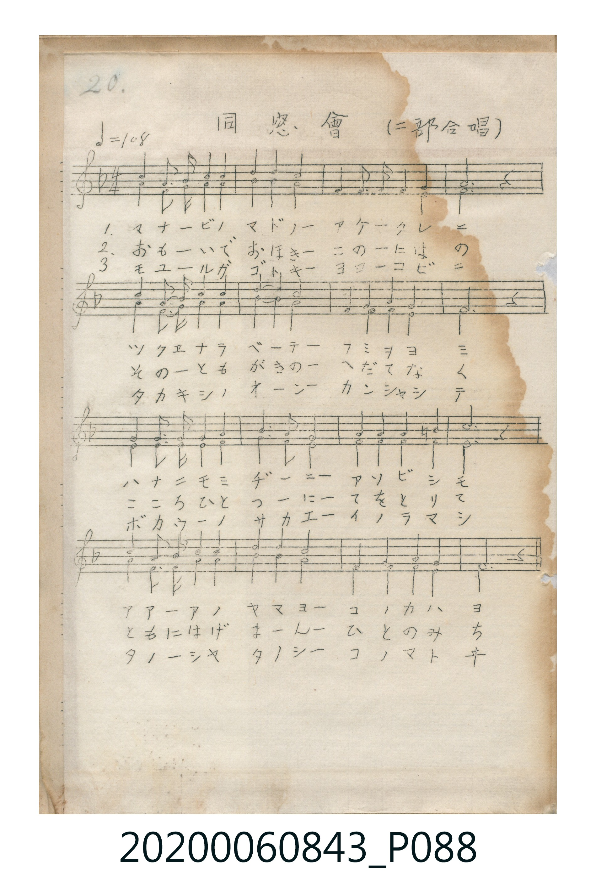

# 同窓會（二部合唱）

> Re:Shōka 使用 AI 協助辨識與重建樂譜，可能會有錯誤。歡迎回報。

- **鋼琴伴奏版**：<br><audio controls src="dosokai.mp3"></audio>

- 曲：不詳

## 說明

同窓會（二部合唱） (Dōsōkai — Two-Part Chorus)
Source: 唱歌帖 (Shōkachō, NMTH 2020.006.0843) — P088.jpg (Notebook 2, p.20)
Notation: Handwritten 5-line staff (1 flat = F major, 4/4 time, 16 bars, 2-part chorus)


## 歌詞

```text
（TMD 檔案未包含歌詞註解）
```

## ABC

```abc
X:1
T:同窓會（二部合唱）
C:曲：不詳
M:4/4
L:1/16
Q:1/4=108
K:F
V:V1 name="Vocal1" snm="Voc"
V:V2 name="Vocal2" snm="Voc"
[V:V1]
!mf! A4 A3 B c4 c4 | d4 d4 c8 | G4 G3 A B4 G4 | A12 z4 |
c4 A3 B c4 c4 | d4 d4 c8 | G4 A4 B4 A4 | G12 z4 |
G4 G3 A B4 G4 | A4 B4 c8 | d4 d4 c4 =B4 | c12 z4 |
!f! d4 d3 d c4 A4 | B4 B4 A8 | G4 G4 A4 G4 | F12 z4 |
[V:V2]
!mf! F4 F3 G A4 A4 | B4 B4 A8 | C4 C3 C C4 C4 | F12 z4 |
F4 F3 G A4 A4 | B4 G4 F8 | C4 F4 E4 F4 | C12 z4 |
E4 E3 F G4 E4 | F4 G4 A8 | F4 F4 G4 G4 | E12 z4 |
!f! F4 F3 F F4 F4 | G4 E4 F8 | D4 D4 C4 C4 | F12 z4 |
```

## TMD 檔案連結

- [主旋律 TMD 檔案](dosokai.tmd) [[在 TMD Studio 編輯](https://tmdlang.github.io/Tmd-TS/#tmd=s7IKdvYPcrWy4qpTUCpJTLdSSM7PyUlNLsnMz7MqzsjPTkzOyFeCS5bl55TmploBqXgDI4RwcX5pUXJqfEFieqpVgIGFBboM3KT4vPyS1KT8_GyEioKi_LLUvMQ8oKrcxLzS4uSizIKS-OT8gkqEmtSyzJRUkIrUlMyS_KLMxBwkJ6UWFYMdC3FDSVFiHsQMoCBCVUlGKtDdxUAnAJ2ek5mWii6VVpSZmpdSnJFZgJAB2pSemWeVm5-XVAr0AYZEeWpxSWpRXnxuak5-CtC5WloKTyf0PF81-dmc5vd7Op7s6nnZvOLphI6nUza-39OpoKXFpWirYGhgwWVvq-DGZWOib2IHMvLZ7E3v98x6sqP3xcrNSlxc-loKttQCXAoKeJ2k4XK0t_hob3ZipsKjhikKIeX5ugGJRSUKzhn5RaXFmiDtwZAYVADqeLa25-mOaQoawRkgLclAUkfBzzfEQ8HIwMhAz8DATM_AwsRYE2wUKBnoZRWkK2j4QaNcwUhHoUDPyABsKlAwEZzGFDwS81LKizJLSlLzFEx1czLzUhWKSxLT0hQ0DBXSchJLFIBhpZCbmJVfpKMADDGFkszcVB0FQzOFpMSiYh0FI90CkIOBEQtzMOWhBgUKWvpcXC75xcCkm2kVlp-cmGPoUGNQo1ANskXBxtBMyw7MAkYYMGRerJxnBdIBFTHUU3jcPO9xc9fj5j2Pmyc_bu6D8DuBLKCQwuOmRY-bNoIkm9Y_bl4DlOxW0AeSLSB-0wqwxpVA_kyw_jawluapj5vnP27e9Lh5BZAzH8m2x839YB3dj5sXgWQeNzeB9QH5UKv2ghzRtB0oswhkD0gIqBJoO5AEOW0J2HVAe0HqN4Mc2bQaaCpQZgWSPUZAXzV2PW4Cm97Y8rhxOZjfuPtxYy9Ya-Pkx43rwJKrHzeuB_LXgWxrnAsTXQHUC-T3gNSDhYCcHY8bFzxuXPa4cRWQ04_sK5BpQFcDlW4CagXyga4EGw3Wt-xx0ySwiV0gDtgekPEQqx83TgLy94G9CAx9kHqQGSBLG_cDOQuR7DEGxRUwHJaBw2z14yZgdDRtedzc8bhpLSTggeECYoFDZjIsrpr2g8IIqKRpOzgMm1aB9QOVgMIQ6MjNYJnFkGBvQ4muOWCtEAtBWreC-dDgB_oSmEZWAmMEyNkOtQqcbMAGLoHxQRx4dIGirwNo8gaYPcCEmptWq2CsoAuGENpEwRTKh9E1CmZQFoyGycBgjYIRlAWhjYGmIPNBKmC2oEMDmAqY1x0gGckKlBuAGJQ9gBQoTMEZBIg7IeymRUC8EYiBqQiaPxABiDClERj54OQIZLYAMThBAvFuIO4FpSBwGgSmCSCGpEdspgAzBST6gRRQJSQBANnAAG1aC84DwAQACmmoW-FuqYGHFjXCFxaKsPCF8REq8IcvKTEFk8F0DS73mqjDlaBrwuWcamACRDXODC3AQKbBnILubYSTUL2FUIHwliFBF9WiFeZGWAtzaK6BGQehjdByEXGONo2HMqEMIIUuRJzLUZKrEVWyDsgUyrMO2C3kZh3UDAh0AMi5TSDlQEdA6j5wsQms9sC1HbDigxqHXPMhlQRzoe4FKoFUMlB_gMR2APECcDWBWc0gjGgC1gxNIE-AHAwqtMGlOpAGOh4kDqZBRTpUGl6mI2KRcIKBpVn0eEdKMDApc3QBJDWkJBfKAhecVigLXJARZAcuakIBNUlAfuiGJj1wYwfCB6f7vZB0Bm3qYE0ooIQNUgJyP9DbkJYFNKED_dAEajmA_AlpV2B1xRyoX4DKIfU3lA_SBjQKnCNBoQypweGpBB6hUIYhPDXAZRBJCb2wQyQU1MSGUIkoDuHGkZJMKAtacDKhLGjBriAraFGzMcixoNYthAlp30J0gJI4uCgCmQxKdOgtXKRkAk7qkOIRVgSC25RAYZA3Yd4D5QD0FiVqkQJr8YPCDdx4g9oP5MPcAnYbevMNox4yxIh5RNWIUVYgkosZTArOoFI9RHlAgxMNxQENK15IDmhgm0DXTgHaLFAAMpW5AA)]
- [鋼琴伴奏 TMD 檔案](dosokai_piano.tmd) [[在 TMD Studio 編輯](https://tmdlang.github.io/Tmd-TS/#tmd=s7IKdvYPcrWy4tLSUng6oef5qsnP5jS_39PxZFfPy-YVTyd0PJ2y8XHz7sfNUx43LXrc3Pdkz5anS_uf7J7xfk-ngpYWl6KtgqGBBZe9rYIbl42JvokdV52C0rPZm97vmfVkR--LlZuVuLj0tRRsqQW4FBRwuhPkJA2Xo73FR3uzEzMVHjVMUQgpz9cNSCwqUXDOyC8qLdYECwZkJublKzgmJ-fnFiTmZeam5pWAjA3OLy1KTrVSAJr0bG3P0x3TFDSCM0BGJQNJHQU_3xAPBSMDIwM9AwMzPQMLE2OoaQYWFnpZBekKGn75JalJ-fnZCkY6CgV6RgaaIFMp9zIUKGjpc3G55BfnA_1mFZafnJhj6FBjUFMNskTBxtBMyw7MqlGozk2rVTBW0AVDCG2iYArlw-gaBTMoC0bDZGCwRsEIyoLQxkBTkPkgFTBb0KEBTAXYScD4d4A42EpB4XHzPCDuety8B0hNBuI-qFAnhN20CIg3AvF6IH8NEHeDPI5pTGMXUE0T2JjGFiBeDhFq3A3EvUAMNLpxHRCvBmKgUUA2VmOagdY1L4O4Bqi0CWhj0xYguwNIrwXSK4AYSDdthroW7poaeIBRI4hhAQkLYhgfoQJ_EJMSWTAZTNfgcq-JOlwJuiZczqkGpkFU48zQAgxkGswp6N5GOAnVWwgVCG8ZEnRRLVq-McKTb2CmQWgjtHxEnJtN46FMKANIoQsR53CU5GpEncwDNobyzANxDfmZh_hwhsU0enAhhTNMyhxdAEkN_lCuQeiFMgzhFsNlEK5GT40IN6H6C6ESkV7hxhFyESgLoRpniGE8IoNg-B3hJjOYFJxBXnJEykfgKjTIA1dGKqgFmqxtqA0LHxQOkKUNKwqQ2UAnaJtowwoNVDYuHUCDzeO1YWGAjQcv7VDkwDpxuA-Fgx4pyNaT4SszoBOQnYTDViweQ1GJ6i-8-nDy0H1GpaAEycBV4gsUY5TohbHB2mHKIKGFqHxQJHFzsGYkIpIWWlCixxWuQEfTZhKvDdIJ5aPysMQjUv0crw2Sh_Lx8XBnSR_kLGkCz5GGoIxuCDQF7D4QAouAi0cjcO1kGg_iQtTFAy3A2nIDVhWgmqUJVK4Dq4vmlUA8E4jbgHgqEM8H4k3Qcn8-jmbbXGjVAlTT1ASke6BVDkhsBxAvAOJlQLwKiPuxm9G0H4hB9Q2obtkOrfmA6puB9QxIHExvf9y8GCrdhqP2osw7kIqUMu-AzSDbOxjxCoxKKAcsDCYQcYwzWvuh_u-G1uggfwP9AuKDGxR7IdU32PJFOKIV1GIAqQH5HRhmoPBoXAJtQQD93zQJGkagVsYyHE3xOdBwAKoHh8FWKB-kD2gWuLEDiiNggwfoFuxxSplfIHFKmV8g7iDLLzjyIyRKgZU3EAFlgYhwpII9C-ywA5tmICbYPpC9oMYiyA2gJhnIXaD0BQqzFTjiFZyuIQ1FWGMQ5P19QGFQMMGCB5Tcgcm4cSHuHNvcB3ENKOSBLoEIQfgw14BdB2w8Nm_AkVMo9hQkgin2FDzfkuUpRBkMjlhIhKOUzlgLZGBZr2unAC3uFYBMZS4A)]

## 分析

```text
================================================================================
📊 TMD Song Profile: [ 同窓會（二部合唱） ]
================================================================================
⏱  Duration:       0:35 (35.6s), 16 measures total
🎼 Key & Tempo:    首調基準 F, != 108.0 BPM, <4/4>
   - 分析範圍：      由實際發聲的音符與和弦推測調性；播放脈絡另行呈現
🎤 人聲音域:    F4 (MIDI 65) – D5 (MIDI 74) [跨度: 9 個半音 / 0.8 個八度, 難度: easy]
   - 最低音:  F4 in [Dosokai #1 @ m.16, 0:33]
   - 最高音: D5 in [Dosokai #1 @ m.2, 0:02]
   - 適合: soprano, mezzo-soprano, contralto, tenor, baritone, bass
🏛  結構:      Dosokai (35.6s)
⚡ 編曲密度:        Peak 2 軌道同時演奏
🗝  調性診斷：       F 大調（純淨自然大調，未偵測到可信轉調）
   - 風格氣質:    純淨自然大調（陽光明朗、易唱易記，無明顯調外色彩）
   - 轉調歷程:    全曲維持單一推測調性（未偵測到可信轉調）
   - 核心骨幹音:  C, F, A, G, D
   - 調性數值:    F 大調 [相關度: 0.92, 穩定度: High, 自然音純度: 99.2%]
   - 候選調性 (K-S): F 大調 (0.92), C 大調 (0.80), A 小調 (0.69)
   - 五度圈歷程:   -1
   - 各段落調性細節:
     • [Dosokai #1]: F 大調 (r: 0.92, 自然音純度: 99.2%, 調外音: B)

  [ 五度圈游移軌跡 ]
               C  
        [F ]*          G  
      Bb               D  
      Eb               A  
         Ab           E  
            Db       B  
               F# 
     (* = active key center)

  [ 十二半音累積音高分佈 ]
     C  : ████████████████████████  21.7%
     C# :                            0.0%
     D  : █████████                  8.3%
     D# :                            0.0%
     E  : ███████                    6.5%
     F  : ████████████████████████  21.5%
     F# :                            0.0%
     G  : ██████████████████        15.8%
     G# :                            0.0%
     A  : ███████████████████       17.5%
     A# : █████████                  7.9%
     B  : █                          0.8%
--------------------------------------------------------------------------------
Assignment 軌道音域：
  - Vocal1        : F4 – D5 (9 個半音 / 0.8 個八度, 53 個音符)
  - Vocal2        : C4 – A#4 (10 個半音 / 0.8 個八度, 53 個音符)
================================================================================
```


## 原書掃描頁




