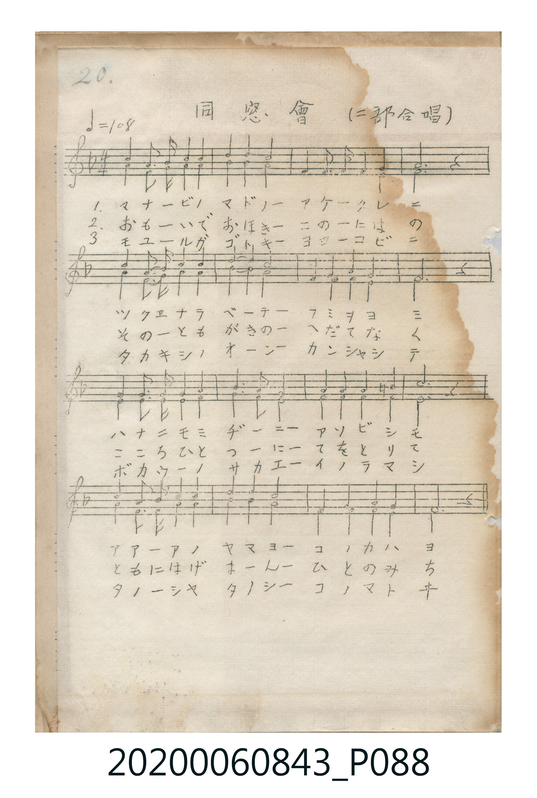

# 同窓會（二部合唱）

<audio controls src="dosokai.mp3"></audio>

- 曲：不詳

## 說明

同窓會（二部合唱） (Dōsōkai — Two-Part Chorus)
Source: 唱歌帖 (Shōkachō, NMTH 2020.006.0843) — P088.jpg (Notebook 2, p.20)
Notation: Handwritten 5-line staff (1 flat = F major, 4/4 time, 16 bars, 2-part chorus)

## 跨冊／重複收錄參照

> 同名異曲（各冊收錄之不同詞曲版本）

- **[同名異曲]** 《新定兒童唱歌》高等科男子用（2020.006.0848）：[**〈同窓會〉**](../../../shintei_jido_shoka/koto_boys_2020.006.0848/2_2_09_dosokai/index.md)（`F` / `4/4` — [原始 TMD](../../../shintei_jido_shoka/koto_boys_2020.006.0848/2_2_09_dosokai/dosokai.tmd)）
- 總表：[跨冊重複與同名歌曲總索引](../../../duplicate_songs.md)

## 歌詞

```text
（TMD 檔案未包含歌詞註解）
```

## ABC

```abc
X:1
T:同窓會（二部合唱）
C:曲：不詳
M:4/4
L:1/16
Q:1/4=108
K:F
V:V1 name="Vocal1" snm="Voc"
V:V2 name="Vocal2" snm="Voc"
[V:V1]
!mf! A4 A3 B c4 c4 | d4 d4 c8 | G4 G3 A B4 G4 | A12 z4 |
c4 A3 B c4 c4 | d4 d4 c8 | G4 A4 B4 A4 | G12 z4 |
G4 G3 A B4 G4 | A4 B4 c8 | d4 d4 c4 =B4 | c12 z4 |
!f! d4 d3 d c4 A4 | B4 B4 A8 | G4 G4 A4 G4 | F12 z4 |
[V:V2]
!mf! F4 F3 G A4 A4 | B4 B4 A8 | C4 C3 C C4 C4 | F12 z4 |
F4 F3 G A4 A4 | B4 G4 F8 | C4 F4 E4 F4 | C12 z4 |
E4 E3 F G4 E4 | F4 G4 A8 | F4 F4 G4 G4 | E12 z4 |
!f! F4 F3 F F4 F4 | G4 E4 F8 | D4 D4 C4 C4 | F12 z4 |
```

## TMD 檔案連結

- [主旋律 TMD 檔案](dosokai.tmd) [[在 TMD Studio 編輯](https://tmdlang.github.io/Tmd-TS/#tmd=s7IKdvYPcrWy4tLSUng6oef5qsnP5jS_39PxZFfPy-YVTyd0PJ2y8f2eTgUtLS5FWwVDAwsue1sFNy4bE30TO646BaVnsze93zPryY7eFys3K3Fx6Wsp2FILcCko4HWShsvR3uKjvdmJmQqPGqYohJTn6wYkFpUoOGfkF5UWa4K0B-eXFiWnWikAdTxb2_N0xzQFjeAMkJZkIKmj4Ocb4qFgZGBkoGdgYKZnYGFirAk2KsDAwkIvqyBdQcMvvyQ1KT8_W8FIR6FAz8gAbCpQMLEkMz_PSsEjMS-lvCizpCQ1T8FUNyczL1WhuCQxLU1Bw1AhLSexRAEYVgq5iVn5RToKwBBTKMnMTdVRMDRTSEosKtZRMNItADk4GeFgykMNChS09Lm4XPKL84HBYxWWn5yYY-hQY1CjUA2yRcHG0EzLDswCRhgwZF6snGcF0gEVMdRTeNw873Fz1-PmPY-bJz9u7oPwO4EsoJDC46ZFj5s2giSb1j9uXgOU7FbQB5ItIH7TCrDGlUD-TLD-NrCW5qmPm-c_bt70uHkFkDMfybbHzf1gHd2PmxeBZB43N4H1AflQq_aCHNG0HSizCGQPSAioEmg7kAQ5bQnYdUB7Qeo3gxzZtBpoKlBmBZI9RkBfNXY9bgKb3tjyuHE5mN-4-3FjL1hr4-THjevAkqsfN64H8teBbGucCxNdAdQL5PeA1IOFgJwdjxsXPG5c9rhxFZDTj-wrkGlAVwOVbgJqBfKBrgQbDda37HHTJLCJXSAO2B6Q8RCrHzdOAvL3gb0IDH2QepAZIEsb9wM5C5HsMQbFFTAcloHDbPXjJmB0NG153NzxuGktJOCB4QJigUNmMiyumvaDwgiopGk7OAybVoH1A5WAwhDoyM1gmcWQYG9Dia45YK0QC0Fat4L50OAH-hKYRlYCYwTI2Q61CpxswAYugfFBHHh0gaKvA2jyBpg9wISam1arYKygC4YQ2kTBFMqH0TUKZlAWjIbJwGCNghGUBaGNgaYg80EqYLagQwOYCpjXHSAZyQqUG4AYlD2AFChMwRkEiDsh7KZFQLwRiIGpCJo_EAGIMKURGPng5AhktgAxOEEC8W4g7gWlIHAaBKYJIIakR2ymADMFJPqBFFAlJAEA2cAAbVoLzgPABAAKaahb4W6pgYcWNcIXFoqw8IXxESrwhy8pMQWTwXQNLveaqMOVoGvC5ZxqYAJENc4MLcBApsGcgu5thJNQvYVQgfCWIUEX1aIV5kZYC3NoroEZB6GN0HIRcY42jYcyoQwghS5EnMtRkqsRVbIOyBTKsw7YLeRmHdQMCHQAyLlNIOVAR0DqPnCxCaz2wLUdsOKDGodc8yGVBHOh7gUqgVQyUH-AxHYA8QJwNYFZzSCMaALWDE0gT4AcDCq0waU6kAY6HiQOpkFFOlQaXqYjYpFwgoGlWfR4R0owMClzdAEkNaQkF8oCF5xWKAtckBFkBy5qQgE1SUB-6IYmPXBjB8IHp_u9kHQGbepgTSighA1SAnI_0NuQlgU0oQP90ARqOYD8CWlXYHXFHKhfgMoh9TeUD9IGNAqcI0GhDKnB4akEHqFQhiE8NcBlEEkJvbBDJBTUxIZQiSgO4caRkkwoC1pwMqEsaMGuICtoUbMxyLGg1i2ECWnfQnSAkji4KAKZDEp06C1cpGQCTuqQ4hFWBILblEBhkDdh3gPlAPQWJWqRAmvxg8IN3HiD2g_kw9wCdht68w2jHjLEiHlE1YhRViCSixlMCs6gUj1EeUCDEw3FAQ0rXkgOaGCbQNdOAdosUAAylbkA)]
- [鋼琴伴奏 TMD 檔案](dosokai_piano.tmd) [[在 TMD Studio 編輯](https://tmdlang.github.io/Tmd-TS/#tmd=s7IKdvYPcrWy4tLSUng6oef5qsnP5jS_39PxZFfPy-YVTyd0PJ2y8XHz7sfNUx43LXrc3Pdkz5anS_uf7J7xfk-ngpYWl6KtgqGBBZe9rYIbl42JvokdV52C0rPZm97vmfVkR--LlZuVuLj0tRRsqQW4FBRwuhPkJA2Xo73FR3uzEzMVHjVMUQgpz9cNSCwqUXDOyC8qLdYECwZkJublKzgmJ-fnFiTmZeam5pWAjA3OLy1KTrVSAJr0bG3P0x3TFDSCM0BGJQNJHQU_3xAPBSMDIwM9AwMzPQMLE2OoaQYWFnpZBekKGn75JalJ-fnZCkY6CgV6RgaaIFMp9zIUKGjpc3G55BfnA_1mFZafnJhj6FBjUKNQDbJFwcbQTMsOzAKK5KbVKhgr6IIhhDZRMIXyYXSNghmUBaNhMjBYo2AEZUFoY6ApyHyQCpgt6NAApgLsJGACcIC42EpB4XHzPCDuety8B0hNBuI-qFAnhN20CIg3AvF6IH8NEHeDfI5pTGMXUE0T2JjGFiBeDhFq3A3EvUAMNLpxHRCvBmKgUUA2VmOagdY1L4O4Bqi0CWhj0xYguwNIrwXSK4AYSDdthroW7poaeIBRI4hhAQkLYhgfoQJ_EJMSWTAZTNfgcq-JOlwJuiZczqkGpkFU48zQAgxkGswp6N5GOAnVWwgVCG8ZEnRRLVrGMcKXcWDGQWgjtIxEnKNN46FMKANIoQsR53KU9GpEndwDNoby3ANxDfm5h_hwhkU1enAhhTNMyhxdAEkN_lCuQeiFMgzhFsNlEK5GT44IN6H6C6ESkWDhxhFyESgPoRpniGE8Iodg-B3hJjOYFJxBXnJEykjgSjTIA2dOKqgFGq1tqA0LIBQOkKUNKwyQ2UA3aJtow4oNVDYuHUCDzeO1YYGAjQcv71DkwDpxuA-Fgx4ryNaT4SszoBOQnYTDViweQ1GJ6i-8-nDy0H1GpaAEycBV4gsUY5TohbHB2mHKIKGFqH5QJHFzsOYkIpIWWlCixxWuQEfTZhKvDdIJ5aPysMQjUg0drw2Sh_Lx8XDnSR9ceRKmFaPQNEYUASYwJpyBoQupRDXCUppgFicI-2AMvK1DYG0EqryaQFUHsEZqXgnEM4G4DYinAvF8IN4ErVrm42gazoXWXkA1TU1Augdaq4HEdgDxAiBeBsSrgLgfuxlN-4EYVKWBqq_t0MoVqL4ZWJWBxMH09sfNi6HSbTgqSMq8A6mrKfMO2AyyvUNiuoEnCSyKMAzAEMCetohKNv3Q8O2GNkpA4QoMKxAf3CbaC2mBgD23CEeyATV6QGpAYQuME1B4Ny6BNoKA4ds0CRoHoIbSMhzdiTnQcAaqB4fxVigfpA9oFri9BkoDwDYb0C3Y0wxlfoGkGcr8AnEHWX6hoHzATDKYDRe4mXAG-YkGHJjAUQ1g6xXEBPsH5C9QexrkR1CrFeRvUP4AxckKHOkGnC8hbWlYexkUvPuAwqBogAU_KLsCs2HjQtwlTnMfxDWgmAW6BCIE4cNcA3YdsH3dvAFHTqfYU5AERLGn4OUOWZ7CVxchJRDMJEZUrUZ2hQWsbXXtFKAVrgKQqcwFAA)]

## 分析

```text
================================================================================
📊 TMD Song Profile: [ 同窓會（二部合唱） ]
================================================================================
⏱  Duration:       0:35 (35.6s), 16 measures total
🎼 Key & Tempo:    首調基準 F, != 108.0 BPM, <4/4>
   - 分析範圍：      由實際發聲的音符與和弦推測調性；播放脈絡另行呈現
🎤 人聲音域:    F4 (MIDI 65) – D5 (MIDI 74) [跨度: 9 個半音 / 0.8 個八度, 難度: easy]
   - 最低音:  F4 in [Dosokai #1 @ m.16, 0:33]
   - 最高音: D5 in [Dosokai #1 @ m.2, 0:02]
   - 適合: soprano, mezzo-soprano, contralto, tenor, baritone, bass
🏛  結構:      Dosokai (35.6s)
⚡ 編曲密度:        Peak 2 軌道同時演奏
🗝  調性診斷：       F 大調（純淨自然大調，未偵測到可信轉調）
   - 風格氣質:    純淨自然大調（陽光明朗、易唱易記，無明顯調外色彩）
   - 轉調歷程:    全曲維持單一推測調性（未偵測到可信轉調）
   - 核心骨幹音:  C, F, A, G, D
   - 調性數值:    F 大調 [相關度: 0.92, 穩定度: High, 自然音純度: 99.2%]
   - 候選調性 (K-S): F 大調 (0.92), C 大調 (0.80), A 小調 (0.69)
   - 五度圈歷程:   -1
   - 各段落調性細節:
     • [Dosokai #1]: F 大調 (r: 0.92, 自然音純度: 99.2%, 調外音: B)

  [ 五度圈游移軌跡 ]
               C  
        [F ]*          G  
      Bb               D  
      Eb               A  
         Ab           E  
            Db       B  
               F# 
     (* = active key center)

  [ 十二半音累積音高分佈 ]
     C  : ████████████████████████  21.7%
     C# :                            0.0%
     D  : █████████                  8.3%
     D# :                            0.0%
     E  : ███████                    6.5%
     F  : ████████████████████████  21.5%
     F# :                            0.0%
     G  : ██████████████████        15.8%
     G# :                            0.0%
     A  : ███████████████████       17.5%
     A# : █████████                  7.9%
     B  : █                          0.8%
--------------------------------------------------------------------------------
Assignment 軌道音域：
  - Vocal1        : F4 – D5 (9 個半音 / 0.8 個八度, 53 個音符)
  - Vocal2        : C4 – A#4 (10 個半音 / 0.8 個八度, 53 個音符)
================================================================================
```


## 原書掃描頁




