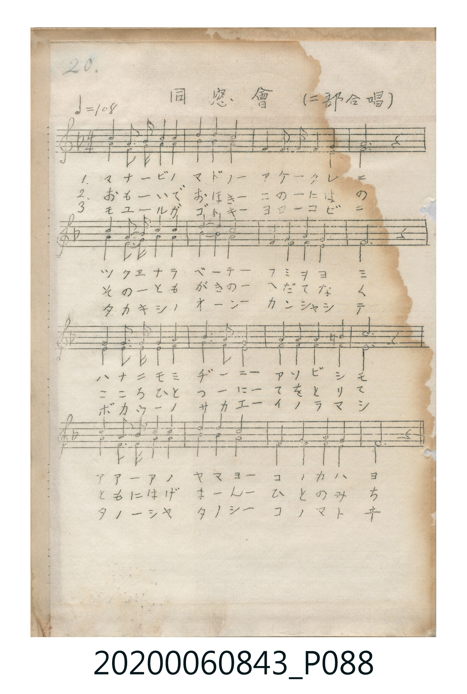

# 同窓會（二部合唱）

> Re:Shōka 使用 AI 協助辨識與重建樂譜，可能會有錯誤。歡迎[回報](https://github.com/TMDLang/reshoka/issues)。

- **鋼琴伴奏版**：<br><audio controls src="dosokai.mp3"></audio>

- 文部省《尋常小學唱歌 第六學年用》（大正 3 年）
- 出處：《唱歌帖》（2020.006.0843）第 2 冊 P088.jpg（頁頂標「20.」）

## 說明

> [!NOTE]
> **原件資訊與抄本考證**（對應《唱歌帖》第 2 冊 `P088.jpg`，頁頂編號 `20.`，互校 1923 年《新編 小學校・公學校 唱歌教材集》高等科一・二學年用 `P388.jpg`）：
> - **曲名**：同窓會（二部合唱）
> - **調性與拍號**：ヘ長調四分之四拍子（F 大調 4/4 拍，1 個降記號 `?= F`，同譜表上下雙符桿二部合唱），速度 `♩ = 108`
> - **校勘備註（依 Editorial Policy A 校訂）**：
>   1. **第 15 小節第 3 節濁點漏標**：原抄於第 15–16 小節第 3 節「コノマドヰ」（此の團欒）漏標濁點作「コ ノ マ ト | ヰ」，依 Policy A 復原為「コ ノ マ ド | ヰ」。
>   2. **原抄二部與配詞特徵**：
>      - 第 5 小節第 1 拍下聲部（`Vocal2`）原抄明確繪有下符桿 `3`（A4，與第 1、13 小節首拍大三度配置一致；1923 年《唱歌教材集》`P388.jpg` 該拍則印為同度 `5`），從原抄。
>      - 第 11 小節第 4 拍上聲部明確標註本位記號 `♮`（`4'` = B♮4），第 12 小節解決至上聲部 `5`（C5）與下聲部 `7_`（E4）之大六度半終止。
>      - 第 1 小節第 2 節首詞原抄作「お も ー い で」（以「い」代歷史假名「ひ」）；第 5–6 小節第 2 節配詞原抄作「そ の ー と も | が き の ー」（將「がき」分置於第 6 小節兩個不連音之四分音符 `6 6` 下）；第 9–10 小節第 3 節配詞原抄作「ボ カ ウ ー ノ | サ カ エ ー」（將「サ カ」配於第 10 小節 `4. 3_`）。以上原抄配詞對位均忠實錄入。
>
> **1.**
> マナービノ　マドノー　アケークレニ
> ツクヱナラ　ベーテー　フミヲヨミ
> ハナニモミ　ヂーニー　アソビシモ
> アアーアノ　ヤマヨー　コノカハヨ
>
> **2.**
> おもーいで　おほきー　このーにはの
> そのーとも　がきのー　へだてなく
> こころひと　つーにー　てをとりて
> ともにはげ　まーんー　ひとのみち
>
> **3.**
> モユールガ　ゴトキー　ヨローコビニ
> タカキシノ　オーンー　カンシャシテ
> ボカウーノ　サカエー　イノラマシ
> タノーシヤ　タノシー　コノマドヰ


## 歌詞

```text
（TMD 檔案未包含歌詞註解）
```

## ABC

<div class="abc-score" data-abc-src="dosokai.abc" aria-label="五線譜載入中"></div>

[下載 ABC 原始檔](dosokai.abc)

## TMD 檔案連結

- [主旋律 TMD 檔案](dosokai.tmd) [[在 TMD Studio 編輯](https://tmdlang.github.io/Tmd-TS/#tmd=s7IKdvYPcrWy4qpTUCpJTLdSSM7PyUlNLsnMz7MqzsjPTkzOyFeCS5bl55TmploBqXgDI4RwcX5pUXJqfEFieqpVgIGFBboM3KT4vPyS1KT8_GyEioKi_LLUvMQ8oKrcxLzS4uSizIKS-OT8gkqEmtSyzJRUkIri5MS8-LLUosy0zNQUJGelFhWDHQxxR0lRYh7EHKAgQlV-UUlGfnpRYkFGpVVGZnFJflFmcmJOfHZiXiJCUUlGKtCDxUC3Av2Yk5mWii6VVpSZmpdSnJFZgGxyZnpmnlVufl5SKdCrGBLlqcUlqUV58bmpOfkpQH9paSk8ndDzfNXkZ3Oa3-_peLKr52XziqcTOp5O2fh-T6eClhaXoq2CoYEFl72tghuXjYm-iR3IyGfT2oHqns9pfNzQ9XRD99MdO55u6H-6dgdQ27O1PQrP16x52roWxN-55fmUFY8buoFmP12y_NnaxQrGCkBBoNlgpz1t3_Vi5tT3e2aBzAHrfbpjGkS5kYGRgZ6BgZmegYWJMVA90EwFI4WnbV0KoHjVyypIByp6uaDx5YKmZytmPm7oASp_3NALNplLX0vBllqAS0FBwU4hWtHPP8Q1FsLR0nraN__J7m0vNre_WNH1oqP9WVfLszlrXjQ0v1jbqaUF8uyG3mftnWi-QnghAeaHhPd7eiCeeL59xYuZ8xUSgN4ACT7ZNenZgoUKhpZG4AADmvRs2gagGgVIQAPlHjfvftq6BsJWgFjzbOrMZ3MnvJzdBrTs5eoZz9d2Pl8-8cmOBqBSYMzC4wNovTHc-k5g6EN8pQv017PZm55O6AV5YRaedIFQ_2LV_mcNy0Eh0N0LdD5Y4-PmGS-nbgfKPJ09-2lH25Od3UAGUP7p2glAo9wUgAkBKKkATEsKQFGgXw0VngLdO7P3xYoZ4CAApTVQGABd8GLtnBcLVzzZ0fVkR_fL2TOfr1n2bOF-NNeAgrBh_tNdyxQSHs1cqQBOrwlIXlqw8Gn3jKdNM1-s2A3yyr65Cq4pmaA8l5ijEJCfk5lcqeCoAFT1YkUT0DSwFyC6FRQM9YAGgKLN0BQU8M_XN4A4xgpAxrP9jS93z3u2px-Y-iDh1TcflAym7YGof9Qw2dAMXRMwmT5u2vy4ue9x87zHzZ2PmzeAk2zHs7VLHjeuezpnxrM1k4BugJgKseHJ3jkQXQpAbUA8D4g7FGqAJERvD8hDcG883bcS6I7nTbsw9HTC9TxuaIL5zwjkP4jDIYEKjMmXrb0vVs573rnz6b6tKIEBBLqgrK2AHBaGoDgERs6Lxk1A7UCvJITlA8syI1DKgobIjL7ni3Y937nq2ZxOoEJIFCokGANVdDiaAD0AtBNs0uOGRkNgYgcb_XLZNFCKWbL8yY5OYMwC3fR87zpgSn7RDiw7ZiPlCsyEj0jcCi9WbgKZ0tn-tHcDMEyA6QmcSkwhyb7n6b55ECcihQjck4bAVAn3JTilAlMhxJcQHwFjCJiigNn-yV54yn00cx3IWwkm6gnAdOgE5AI9CLIKbCIw74NNfLF88bONu160b4abCHFTh7MpUDUwOODhqZBgHg-ScAUZA8pIS5aDCtZdy572dj3f2vRs7SKsTkdyuREo2QFDExil0HiGpKfGLoXHTU3AFLFH4XFjCxAvh6TEJ7uXgqWBYdL7ZPfiZ2u3P-3f9LSxHVgqgMU3QcpYYCSAUwIwlSMncoht4ASEattcoA3roLatANsMTI2NPUDcC5OB2P90QztYAxABLewFlh_AiIdmKphNT1tXAguMJzt6XzYsfjl_M6SAAaoEsoGpSyHBTMEsQQEYhgh3WoJyowF6bsTi0OY5QMetBuJlEMcCsw_QoU1boaJAp6M5FCIFFAIaBsv7MIsUEkz0FIxBEQisCZqAIQuMb4htUJs39ALTztO57U_3L3i6ftnLnpanrcDQh0QorKYx1ANWwmA2uMzoAjmgeTKoCGkAluuQUgRYnABd1fC4adHjpo0gdtP6x81rHjd3wzS2gEWAUkDtK8EaZ4LNaYNqbJ76uHn-4-ZNj5tXABkwXf1g9d2PmxeBZEHKmsC6gCJw6_aCHNO0HagGqgskCFQPdAOQhDhyCdidQJMhusDlHzDMQOavQPGrEcKvjV3ARALSAUyJoLTZABJp3A1KFRBjGicD0w1YwerHjeuBbJjGuTDxFSATQCrBaQkiCOLueNy44HHjsseNqx439sN0AU0D-gOobBNII0gZ0NVgw6G6lj1umgQ2E-iMZTBdYCugDpgEVrYP7HVg_EB0gU0DWt24_3HjQhS_GiPFKzCkloFDdvXjpjXgMNoCLOQfN62FRQ8w7MBsUNgBzYbFa9N-UDgClYEiABzWTavA5gCVQcIa6PzNYNnFYLINZuMcsEaIpRCNW8Ei8EgC-h6YqlaCYq5pO8I6SFIDGbUErAwsAuIiRS2sagPporz5BQUKWvpcXC75xcDWe6YVuIoxdKgxqKkGWaJgY2imBQ5YBWwNP1CZCKo6FvYACwVYgathAs2kOvD2pCYWrUBbQcbWAOs8XTA0BpMmcD6MrgGWThAWjIbJwGANsFyGsCC0IZxvBFcBMR0TGsBUgF3jYwiqyudBxYCZFM6aDGf1wc1EVtmJIY9wHTDDwmSbNsJZ6-E61iCZ2E2cO41AhTzcdcBCH8oCVjgw1nKEqQiVjbvhrF5MdzbCfQmsOGCs1XAWzMUglTB5Au40BvkJ7vvmZXAW3NQmJN83bYHLd8Dl12K6E5jKYOpgsqAmGUwM5gviwhN_6t7VM3hSNyw1w9IyInXDVOD2JSJ1w1MINAUCay-UlL4SbiqwLkMzD1jOYbgOWMXBZefDWZvgLFhcgVTC5Am4E5y658JMQEqL8HiHp3hIYwcm34uhB8mdjTvgsgvgLHiKbFyFpLKfOHeCUnfTfribIGkalGKBBTdMFLm8aILZAYPAOgTTnVBzkGUhFQ2Cg1CMESGYTiVQfHdSlsBhiRBCG2Ek0hpgoke4CiQKU4HwMkwtOm2iDleCniswvYlI4bDYg6VqUCmAXArBUiFILSwdwSBmiYFafu-Fq4OXlSjRAVNJwJ3gFI4obSEsYCsJyIbnHHhqB6ldgu5OeLmM5E5Eam6ahGEKsH2FRSUBd4LL7zlwE2ApHKEbNX1vRXYhWDWoZY_hziaYbxC6EeUOolYFqYSFLW534k3ewO7LMCu_kdIiFhZK6wQRyoh2CrbYQNSc8NhAKoNguQm53iXgTnDqRi-rQSkW0YYAtuoR5jbuQzMP2M7HdCeWnIFcN8DKYZDKhcS5E7X8RvI9ovSGhSEhlUjuxBaeWFqK4EEjgu6sRWubG5HVNocNepCa-mEpFZI-jTAKaEThDqPR29m42-bm8RhKcAfDaON8tHGOmbxhjfPBk7wRNJnJe7R1Pto6Ry7Aoa1zclM4PBVCGUAKLgRLlog2PEwUrgThb1zJHGEIhiZMv4420Ueb6BhpHN5EHz6l-GgbfaS10XXtFKDN9Ggfw1gFZK4RKtcYzFXmAgA)]
- [鋼琴伴奏 TMD 檔案](dosokai_piano.tmd) [[在 TMD Studio 編輯](https://tmdlang.github.io/Tmd-TS/#tmd=s7IKdvYPcrWy4qpTUCpJTLdSyC8qychPL0osyKi0ysgsLskvykxOzInPTsxLVIIrKs4vLUpOjS9ITE-1CjCwsEDIlGSk5qZapaaUJieWZObnKXFpaSk8ndDzfNXkZ3Oa3-_peLKr52XziqcTOp5O2fi4effL7j3PJ2x5smfL06X9zzs73u_pVNDS4lK0VTA0sOCyt1Vw47Ix0TexAxn_bFo7UOfzOY2PG7qebuh-umPH0w39T9fuABr0bG2PwvM1a562rgXxd255PmXF44ZuoG1Plyx_tnaxgrECUBBoNtiZT9t3vZg59f2eWSBzwHqf7pgGUW5kYGSgZ2BgpmdgYWIMVA80U8FI4WlblwLIk3pZBelARS8XNL5c0PRsxczHDT1A5Y8besEmc7nkF-dnJ2ZaheUDw8vQocagpppLAQhsDM207MCsGgVTBV0wNAaTJnA-jK5RMIOyYDRMBgZrFAyhLAhtCOcbwVVATMeEBjAVYNf4GNYoPG6eBxV73NwFZ02Gs_rgZiKr7MSQR7jucdMimGzTRjhrPVzHGiQTu4lzpxFQbSPcdU1NMFZjC5y1HGEqQmXjbjirF9OdjXBfNq6Ds1bDWTAXg1TC5Am40xjkJ7jvm5fBWXBTm5B837QFLt8Bl1-L6c7mFXB1MNnHTZvhYjBfEBeeNEiGsGQHS3SIZAhTgds5iGQIj0poUnncvBElSa6Em_q4eSaaeY-b2zBc97h5Klx2Ppy1Cc6CBSpIJUyegDvByXAuzASkRAOPIHjSBKnsgcv3YuhBcmfjDrjsAjgLnnQaVyGp7CfOnaBk2LQf7iZI4gMlrcdN22GiyBm7CWYHDD5uhiUvJHdCzUGWBZr3uHkxgoNQjBEhmE6FpkRYaoHQRhipqQaYOhHaQaIwFQi3wdSi0ybqcCXoyRfTPYikCAtmWPID5SvkfA1LLiC1sAiHQcw8iFoi7oWrg5c-KOEGU0nAneCkiCi_IKzHTb1ANjyJw5MlSO0SdHfCSzokdyKSXdMkDFMeN8EyI7JKAu4El4hz4CbAkiJCN2pC3IrsQrDqx00w-5Hc2QTzDUI3ooBA1FMglbCwxe3OwVoiIiUaLCyUihkRHIgqGluwISoNeLAh5WpYskeucgi4E5wM0Us_UNJCVJ-PG2FJCaR2H5p5j5tgiRjJnViSMHJpCyvZQCoXEudO1BIRyfeI8hAWhoRUIrkTW3hiaSSBwnMDQXfWorUfjbC3H2FJCpKQjDCKPERxCaPR24K424_m8RhKcLt3tAE5ohuQ1E-HCJrMdDjaghyZLUh4coEygBRcCJZ-EO1MmChcCcKBuNIjwhAMTZiOGm1Gjuhm5OArF0fbkSO1HRmQmZiXH-SBvSFZnVtQq2CsDevEGGpD0qGRtgmSKIIFTLfasI4PgoWQR3gHd-tSG6kfBLUOn0-gGYqWToS7COEeVGcS6UgkTXAmmIEkgbACWBkBvYAwDSKDpBTJpXBN2FlIIxxA_cQNcgz6MEVPwj7ISdgEmoL1tRSe7Vr9bNa0p32znq5f9mRnN_LEwrPObcD5hKfblz3r7H6yt-_l_M0vOtqfTup5umeZgpY-NBgM46Eo2jAW5NN4IMskPhaLCJhhCmSANYEkDYEiBvAAJc4k03hziBAek0yBPBgGKqhRsLHQslMwApX8QAIoApLQhRgBCk1QeCiYgUw3i8-NhbCMQPZAjAKrAzKo7VhgFOnaKUBjKdoHKIPMNULlGoO5ylwA)]

## 分析

```text
================================================================================
📊 TMD Song Profile: [ 同窓會（二部合唱） ]
================================================================================
⏱  Duration:       1:46 (106.7s), 48 measures total
🎼 Key & Tempo:    首調基準 F, != 108.0 BPM, <4/4>
   - 分析範圍：      由實際發聲的音符與和弦推測調性；播放脈絡另行呈現
🎤 人聲音域:    F4 (MIDI 65) – D5 (MIDI 74) [跨度: 9 個半音 / 0.8 個八度, 難度: easy]
   - 最低音:  F4 in [Dosokai[L1] #1 @ m.3, 0:04]
   - 最高音: D5 in [Dosokai[L1] #1 @ m.2, 0:02]
   - 適合: soprano, mezzo-soprano, contralto, tenor, baritone, bass
🏛  結構:      Dosokai[L1] (35.6s) -> Dosokai[L2] (35.6s) -> Dosokai[L3] (35.6s)
⚡ 編曲密度:        Peak 2 軌道同時演奏
🗝  調性診斷：       F 大調（純淨自然大調，未偵測到可信轉調）
   - 風格氣質:    純淨自然大調（陽光明朗、易唱易記，無明顯調外色彩）
   - 轉調歷程:    全曲維持單一推測調性（未偵測到可信轉調）
   - 核心骨幹音:  F, A, C, G, E
   - 調性數值:    F 大調 [相關度: 0.92, 穩定度: High, 自然音純度: 99.2%]
   - 候選調性 (K-S): F 大調 (0.92), A 小調 (0.68), D 小調 (0.60)
   - 五度圈歷程:   -1 -> -1 -> -1
   - 各段落調性細節:
     • [Dosokai[L1] #1]: F 大調 (r: 0.92, 自然音純度: 99.2%, 調外音: B)
     • [Dosokai[L2] #1]: F 大調 (r: 0.92, 自然音純度: 99.2%, 調外音: B)
     • [Dosokai[L3] #1]: F 大調 (r: 0.92, 自然音純度: 99.2%, 調外音: B)

  [ 五度圈游移軌跡 ]
               C  
        [F ]*          G  
      Bb               D  
      Eb               A  
         Ab           E  
            Db       B  
               F# 
     (* = active key center)

  [ 十二半音累積音高分佈 ]
     C  : ████████████              15.0%
     C# :                            0.0%
     D  : ████                       5.0%
     D# :                            0.0%
     E  : ███████                    9.2%
     F  : ████████████████████████  30.6%
     F# :                            0.0%
     G  : ████████                  10.2%
     G# :                            0.0%
     A  : █████████████████         22.3%
     A# : █████                      6.9%
     B  : █                          0.8%
--------------------------------------------------------------------------------
Assignment 軌道音域：
  - Vocal1        : F4 – D5 (9 個半音 / 0.8 個八度, 159 個音符)
  - Vocal2        : E4 – A#4 (6 個半音 / 0.5 個八度, 159 個音符)
================================================================================
```


## 原書掃描頁




