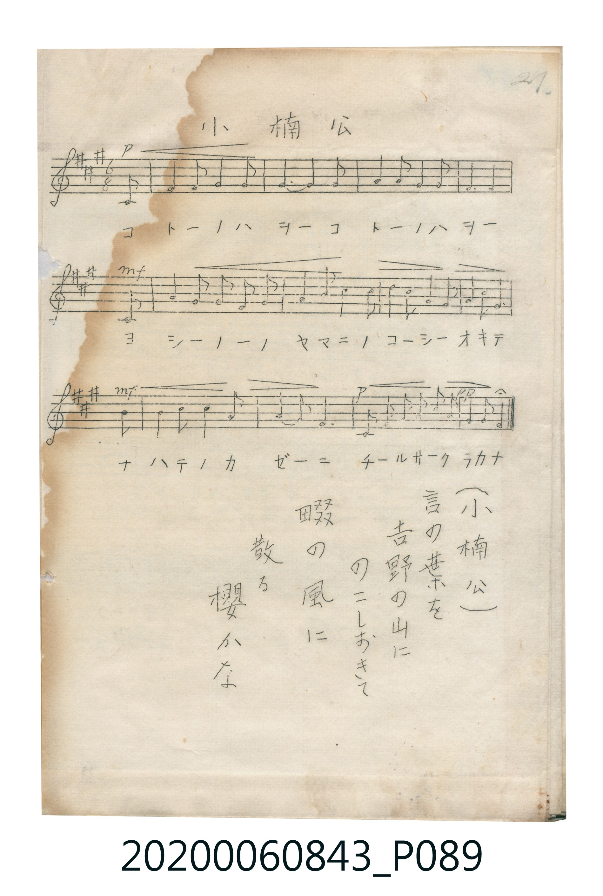

# 小楠公

> Re:Shōka 使用 AI 協助辨識與重建樂譜，可能會有錯誤。歡迎回報。

- **鋼琴伴奏版**：<br><audio controls src="sho_nanko.mp3"></audio>

- 唱歌帳（2020.006.0843）P089.jpg（第 21 頁）

## 說明

原書資訊與歌詞全文（對應 P089.jpg，手抄五線譜第 21 頁）：
調性與拍號：イ調八分之六拍子（A 大調 6/8 拍）
力度記號：p → mf → pp


## 歌詞

```text
譜下片假名歌詞：
コトーノハヲー　コトーノハヲー
ヨシーノーノヤマニ　ノコーシーオキテ
ナハテノカゼーニ　チールサークラカナ

頁底漢字歌詞：
（小楠公）
言の葉を　吉野の山に　のこしおきて
畷の風に　散る櫻かな
```

## ABC

<div class="abc-score" data-abc-src="sho_nanko.abc" aria-label="五線譜載入中"></div>

[下載 ABC 原始檔](sho_nanko.abc)

## TMD 檔案連結

- [主旋律 TMD 檔案](sho_nanko.tmd) [[在 TMD Studio 編輯](https://tmdlang.github.io/Tmd-TS/#tmd=s7IKdvYPcrWy4qpTUCpJTLdSSM7PyUlNLsnMz7MqzsjPTkzOyFeCS5bl55TmploBqXgDI4RwcX5pUXJqfEFieqpVgIGFJboM3KT4vPyS1KT8_GyEioKi_LLUvMQ8oKrcxLzS4uSizIKS-OT8gkqEmtSyzJRUkIrUlMyS_KLMxBwkJ6UWFYMdC3FDSVFiHsQMoCBCFVBTemaeVW5-XlIp0DGYEqmZWZnxJakVJRDXaWkpPN3Q_2zpgqetaxS0tLgUbRXMjbjsbRUcuWzM9C3sQPqfTtn4bG3P0x2b3-_pMDIwMtAzMDDTM7AwMX6_pxMUCnpZBelAqedr1igYGSq8XNAIFFfi4tLXUrClFuBSUFB42jf_2ewdLza3v1jR9aKjHeikFyvnPW1d8WxaO9D2pxt6n7V3KiDc0_Oss_tZV8uTXVOeb5_1Yu0cFOe93zMLZOSLVfufNSwHGdbd-2LmfKDo46YlQMGnraufdrQ92dn9tHUtUOrp2glAGxwVni5ZDpRUAIaLAlAUaAzYWV2zn-5a9mLFDIgBBQqP2iYp5KaBqYICLrA1a-c82dH9vLP9aWP70wm9EJdDnfC4afPj5o7HzXseN_c9bu5_3LwJxG5owCoO1tC84nHTdpgEhFzyuHne4-ZukDYgF6RzD1RN06rHTWsfN7dBdHaBTWoDK1r9uAmoGYgg2hrBbKDgVrC29Y-bV4LUNHeBfQAMtae7pj7bs-jp2ukozgeHPDT9QAPkxYqGx43rXkzsfNw0CWj00wmdL9v7gCJPN2583LgaZFnjuseNkx83Tn_c2PW4sfdx4zKQtudTtwMlXi5aAVH0bOrix03dz1bvftzY_bhxFUgF5ckIChS09Lm4gjPy_RLzsvOtwvKTE3McagxqqkGWKNhYaNmBGdjSrwIwFT3Z0fBiYY-Chgko5zxf36ADT3SaWDQArQIZVqNgHK9gCIRGYFgDxLoKxkDSACRRo2AChsZgCJHUhUuCYwC3c3b1kOMcMwVTIARZaQLkmYItNAZaaAbkGcYpmIMVmIFdg5A0IOiYHZ3kOAYSKCAHgaw3BvvdEGwrONxMoE4BhRtEGOQUkGNqubh07RRgUakAZCtzAQA)]
- [鋼琴伴奏 TMD 檔案](sho_nanko_piano.tmd) [[在 TMD Studio 編輯](https://tmdlang.github.io/Tmd-TS/#tmd=s7IKdvYPcrWy4tLSUni6of_Z0gVPW9e839PxsnvP8wlbnuzZ8nRp__POjvd7OhW0tLgUbRXMjbjsbRUcuWzM9C3suOoUlJ5O2fhsbc_THZuBuowMjAz0DAzM9AwsTIyBegIMLCz1sgrSgVLP16xRMDJUeLmgESiuxMUVnJHvl5iXnW8Vlp-cmONQY1BTzaUABDYWWnZgRo2CcbyCIRAagWENEOsqGANJA5BEjYIJGBqDIURSFy4JNcBMwRQIQYpMgDxTsBJjoBIzIM8wTsEcrMAMrB8haQDXDrEYZARIgzHYfEOwOrDbTKCaQW6DCIM0g7TXInkvIDMxLz_IY5h70Ae7Bw3jQeaYglC8ghGYBXQJnA1igQ1EEoNrwaoQaq5JvIIZKOyQjYVrBDIghsJUYTUSpgpqIqpd2MyEGYHdbm2MANK1U4CFkQKQrcwFAA)]

## 分析

```text
================================================================================
📊 TMD Song Profile: [ 小楠公 ]
================================================================================
⏱  Duration:       0:30 (30.0s), 12 measures total
🎼 Key & Tempo:    首調基準 A, != 72.0 BPM, <6/8>
   - 分析範圍：      由實際發聲的音符與和弦推測調性；播放脈絡另行呈現
🎤 人聲音域:    C#4 (MIDI 61) – A5 (MIDI 81) [跨度: 20 個半音 / 1.7 個八度, 難度: challenging]
   - 最低音:  C#4 in [ShoNanko #1 @ m.1, 0:00]
   - 最高音: A5 in [ShoNanko #1 @ m.7, 0:15]
   - 適合: soprano, mezzo-soprano, tenor, baritone
🏛  結構:      ShoNanko (30.0s)
⚡ 編曲密度:        Peak 1 軌道同時演奏
🗝  調性診斷：       A 調性不明確（純淨自然大調，未偵測到可信轉調）
   - 風格氣質:    純淨自然大調（陽光明朗、易唱易記，無明顯調外色彩）
   - 轉調歷程:    全曲維持單一推測調性（未偵測到可信轉調）
   - 核心骨幹音:  C#, B, E, A, D
   - 調性數值:    A 調性不明確 [相關度: 0.72, 穩定度: Ambiguous, 自然音純度: 100.0%]
   - 候選調性 (K-S): A 大調 (0.72), E 大調 (0.70), C# 小調 (0.62)
   - 五度圈歷程:   +3
   - 各段落調性細節:
     • [ShoNanko #1]: A 調性不明確 (r: 0.72, 自然音純度: 100.0%)

  [ 五度圈游移軌跡 ]
               C  
         F            G  
      Bb               D  
      Eb              [A ]*
         Ab           E  
            Db       B  
               F# 
     (* = active key center)

  [ 十二半音累積音高分佈 ]
     C  :                            0.0%
     C# : ████████████████████████  23.4%
     D  : ██████████                 9.4%
     D# :                            0.0%
     E  : ███████████████████       18.7%
     F  :                            0.0%
     F# : ██████████                 9.4%
     G  :                            0.0%
     G# : ██                         1.6%
     A  : ██████████████            14.1%
     A# :                            0.0%
     B  : ████████████████████████  23.4%
--------------------------------------------------------------------------------
Assignment 軌道音域：
  - Vocal         : C#4 – A5 (20 個半音 / 1.7 個八度, 52 個音符)
================================================================================
```


## 原書掃描頁




