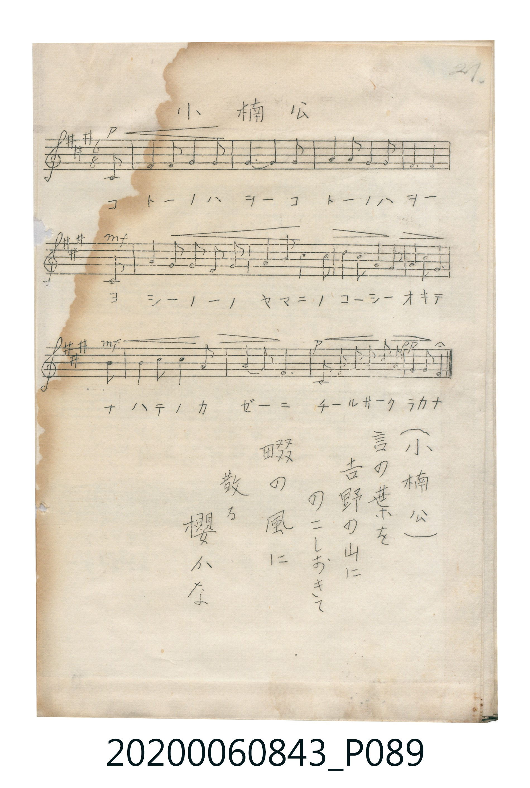

# 小楠公

> Re:Shoka 使用 AI 辨識樂譜，可能會有錯誤。歡迎回報。

<audio controls src="sho_nanko.mp3"></audio>

- 唱歌帳（2020.006.0843）P089.jpg（第 21 頁）

## 說明

原書資訊與歌詞全文（對應 P089.jpg，手抄五線譜第 21 頁）：
調性與拍號：イ調八分之六拍子（A 大調 6/8 拍）
力度記號：p → mf → pp

## 跨冊／重複收錄參照

> 同曲（〈小楠公〉；收錄於《新定兒童唱歌》六年級與《唱歌帖》P089）

- **[同曲]** 《新定兒童唱歌》尋常科第六學年用（2020.006.0847.0006）：[**〈小楠公〉**](../../../shintei_jido_shoka/grade_6_2020.006.0847.0006/1_07_sho_nanko/index.md)（`A` / `6/8` — [原始 TMD](../../../shintei_jido_shoka/grade_6_2020.006.0847.0006/1_07_sho_nanko/sho_nanko.tmd)）
- 總表：[跨冊重複與同名歌曲總索引](../../../duplicate_songs.md)

## 歌詞

```text
譜下片假名歌詞：
コトーノハヲー　コトーノハヲー
ヨシーノーノヤマニ　ノコーシーオキテ
ナハテノカゼーニ　チールサークラカナ

頁底漢字歌詞：
（小楠公）
言の葉を　吉野の山に　のこしおきて
畷の風に　散る櫻かな
```

## ABC

```abc
X:1
T:小楠公
M:6/8
L:1/16
Q:3/8=48
K:A
V:V1 name="Vocal" snm="Voc"
[V:V1]
C2 A2 A2 B2 B2 B2 | B4 c2 B2 z2 C2 | d2 d2 d2 c2 c2 c2 | B6 B2 z2 C2 |
f2 e2 e2 d2 c2 d2 | e6 c2 z2 f2 | a2 g2 f2 e2 f2 c2 | e6 c2 z2 z2 |
B2 B2 B2 e2 e2 f2 | c4 B2 A6 | C2 d2 e2 f2 c2 B2 | A6 z2 z2 z2 |
```

## TMD 檔案連結

- [主旋律 TMD 檔案](sho_nanko.tmd) [[在 TMD Studio 編輯](https://tmdlang.github.io/Tmd-TS/#tmd=s7IKdvYPcrWy4qpTUCpJTLdSSM7PyUlNLsnMz7MqzsjPTkzOyFeCS5bl55TmploBqXgDI4RwcX5pUXJqfEFieqpVgIGFJboM3KT4vPyS1KT8_GyEioKi_LLUvMQ8oKrcxLzS4uSizIKS-OT8gkqEmtSyzJRUkIrUlMyS_KLMxBwkJ6UWFYMdC3FDSVFiHsQMoKASl5aWwtMN_c-WLnjaukZBS4tL0VbB3IjL3lbBkcvGTN_CDmTM0ykbn63tebpj8_s9HUYGRgZ6BgZmegYWJsbv93SCfKOXVZAOlHq-Zo2CkaHCywWNQHElLi59LQVbagEuBQWFp33zn83e8WJz-4sVXS862oFOerFy3tPWFc-mtQNtf7qh91l7pwLCPT3POrufdbU82TXl-fZZL9bOQXHe-z2zQEa-WLX_WcNykGHdvS9mzgeKPm5aAhR82rr6aUfbk53dT1vXAqWerp0AtMFR4emS5UBJBWC4KABFgcaAndU1--muZS9WzIAYUKDwqG2SQm4amCoo4AJbs3bOkx3dzzvbnza2P53QC3E51AmPmzY_bu543LzncXPf4-b-x82bQOyGBqziYA3NKx43bYdJQMglj5vnPW7uBmkDckE690DVNK163LT2cXMbRGcX2KQ2sKLVj5uAmoEIoq0RzAYKbgVrW_-4eSVITXMX2AfAUHu6a-qzPYuerp2O4nxwyEPTDzRAXqxoeNy47sXEzsdNk4BGP53Q-bK9DyjydOPGx42rQZY1rnvcOPlx4_THjV2PG3sfNy4DaXs-dTtQ4uWiFRBFz6YuftzU_Wz17seN3Y8bV4FUUJ6MoEBBS5-LKzgj3y8xLzvfKiw_OTHHocagRqEaZIuCjYWWHZiBLQErAJPRkx0NLxb2KGiYgLLO8_UNOvBUp4lFA9AukGE1CsbxCoZAaASGNUCsq2AMJA1AEjUKJmBoDIYQSV24JDgKcDtnVw85zjFTMAVCkJUmQJ4p2EJjoIVmQJ5hnII5WIEZ2DUISQOCjtnRSY5jIIECchDIemOw3w3BtoLDzQTqFFC4QYRBTgE5ppaLS9dOARaXCkC2MhcA)]
- [鋼琴伴奏 TMD 檔案](sho_nanko_piano.tmd) [[在 TMD Studio 編輯](https://tmdlang.github.io/Tmd-TS/#tmd=s7IKdvYPcrWy4tLSUni6of_Z0gVPW9e839PxsnvP8wlbnuzZ8nRp__POjvd7OhW0tLgUbRXMjbjsbRUcuWzM9C3suOoUlJ5O2fhsbc_THZuBuowMjAz0DAzM9AwsTIyBegIMLCz1sgrSgVLP16xRMDJUeLmgESiuxMUVnJHvl5iXnW8Vlp-cmONQY1CjUM2lAAQ2Flp2YEaNgnG8giEQGoFhDRDrKhgDSQOQRI2CCRgagyFEUhcuCTXATMEUCEGKTIA8U7ASY6ASMyDPME7BHKzADKwfIWkA1w6xGGQESIMx2HxDsDqw20ygmkFugwiDNIO01yL5LyAzMS8_yGO4-9AHhw8N40EGmYJQvIIRmAV0CpwNYoFNRBKDa8GqEGquSbyCGSjwkI2FawQyIIbCVGE1EqYKaiKqXdjMhBmB3W5tjBDStVOABZICkK3MBQA)]

## 分析

```text
================================================================================
📊 TMD Song Profile: [ 小楠公 ]
================================================================================
⏱  Duration:       0:30 (30.0s), 12 measures total
🎼 Key & Tempo:    首調基準 A, != 72.0 BPM, <6/8>
   - 分析範圍：      由實際發聲的音符與和弦推測調性；播放脈絡另行呈現
🎤 人聲音域:    C#4 (MIDI 61) – A5 (MIDI 81) [跨度: 20 個半音 / 1.7 個八度, 難度: challenging]
   - 最低音:  C#4 in [ShoNanko #1 @ m.1, 0:00]
   - 最高音: A5 in [ShoNanko #1 @ m.7, 0:15]
   - 適合: soprano, mezzo-soprano, tenor, baritone
🏛  結構:      ShoNanko (30.0s)
⚡ 編曲密度:        Peak 1 軌道同時演奏
🗝  調性診斷：       A 調性不明確（純淨自然大調，未偵測到可信轉調）
   - 風格氣質:    純淨自然大調（陽光明朗、易唱易記，無明顯調外色彩）
   - 轉調歷程:    全曲維持單一推測調性（未偵測到可信轉調）
   - 核心骨幹音:  C#, B, E, A, D
   - 調性數值:    A 調性不明確 [相關度: 0.72, 穩定度: Ambiguous, 自然音純度: 100.0%]
   - 候選調性 (K-S): A 大調 (0.72), E 大調 (0.70), C# 小調 (0.62)
   - 五度圈歷程:   +3
   - 各段落調性細節:
     • [ShoNanko #1]: A 調性不明確 (r: 0.72, 自然音純度: 100.0%)

  [ 五度圈游移軌跡 ]
               C  
         F            G  
      Bb               D  
      Eb              [A ]*
         Ab           E  
            Db       B  
               F# 
     (* = active key center)

  [ 十二半音累積音高分佈 ]
     C  :                            0.0%
     C# : ████████████████████████  23.4%
     D  : ██████████                 9.4%
     D# :                            0.0%
     E  : ███████████████████       18.7%
     F  :                            0.0%
     F# : ██████████                 9.4%
     G  :                            0.0%
     G# : ██                         1.6%
     A  : ██████████████            14.1%
     A# :                            0.0%
     B  : ████████████████████████  23.4%
--------------------------------------------------------------------------------
Assignment 軌道音域：
  - Vocal         : C#4 – A5 (20 個半音 / 1.7 個八度, 52 個音符)
================================================================================
```


## 原書掃描頁




