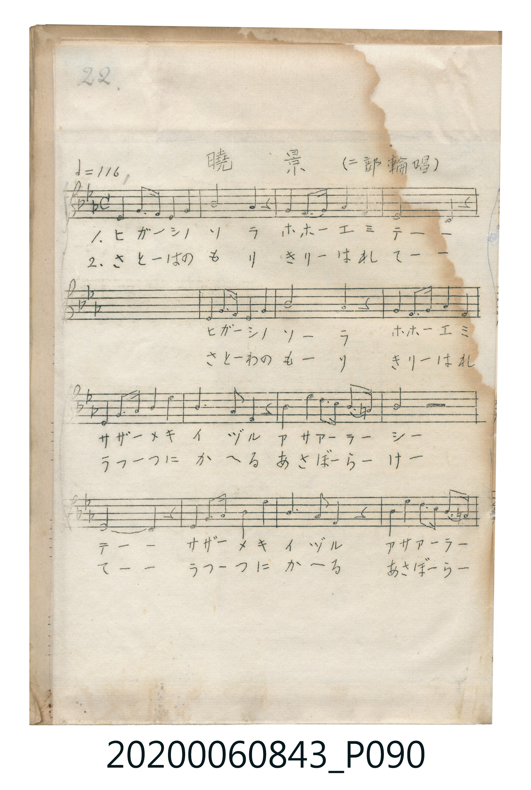
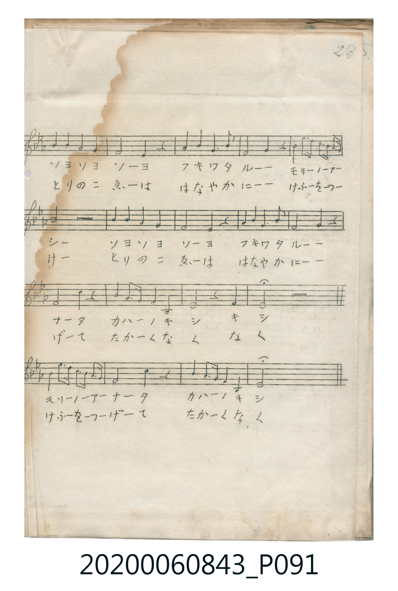

# 曉景（二部輪唱）

> Re:Shōka 使用 AI 協助辨識與重建樂譜，可能會有錯誤。歡迎回報。

- **鋼琴伴奏版**：<br><audio controls src="gyokei.mp3"></audio>

- 唱歌帳（2020.006.0843）第 2 冊 P090.jpg–P091.jpg（頁頂標「22.」「23.」）

## 說明

> [!NOTE]
> **原件資訊與抄本考證**（對應《唱歌帖》第 2 冊 `P090.jpg`–`P091.jpg`，頁頂標 `22.`–`23.`，互校 1923 年一條慎三郎編《新編 小學校・公學校 唱歌教材集》高等科一・二學年用第 24 首〈曉景〉`P395.jpg`–`P398.jpg`）：
> - **曲名**：曉景（二部輪唱）
> - **調性與拍號**：變ホ長調四分之四拍子（E♭ 大調 4/4 拍，3 個降記號 `?= E,`，記號 `C`），速度 `♩ = 116`
> - **二部輪唱結構**：原抄每頁 4 行五線譜，兩兩配對為上下二部總譜（共 4 組雙行譜表、全 17 小節）。下聲部（`Vocal2`）於第 1 小節全休止（晚 1 小節／4 拍進入），自第 2 小節起嚴格模仿上聲部旋律，第 7 小節末（上聲部）與第 8 小節末（下聲部）均明確標註本位記號 `♮`（`4'` = A♮4），至第 16 小節上聲部多唱一次疊尾「キ シ／な く」而與下聲部於第 17 小節首拍同度延長記號（`𝄐`）齊終。
> - **校勘備註（依 Editorial Policy A 校訂）**：
>   1. **上下聲部第 2 節首句異寫統一**：`P090.jpg` 第一組上聲部第 1 小節第 2 節「里わの森」原抄類推誤作「さ と ー は の」，而同組下聲部第 2 小節則正寫作「さ と ー わ の」（1923 年《唱歌教材集》亦作「里（さと）わ」），依 Policy A 統一復原為「さ と ー わ の」。
>   2. **原抄假名保留**：第 3 小節（下聲部第 4 小節）第 1 節「ほほゑみ」原抄上下兩部均作片假名「ホ ホ ー エ ミ」；第 6 小節（下聲部第 7 小節）第 1 節保留「イ ヅ ル」；第 10 小節（下聲部第 11 小節）第 2 節保留歷史假名遣「こ ゑ ー は」。
>
> **1.**
> ヒガーシノ　ソラ　ホホーエミテーー
> サザーメキ　イヅル　アサアーラーシー
> ソヨソヨ　ソーヨ　フキワタルーー
> モリーノーアーナータ　カハーノキシ　キシ
>
> **2.**
> さとーわの　もり　きりーはれてーー
> うつーつに　かへる　あさぼーらーけー
> とりのこゑーは　はなやかにーー
> けふーをつーげーて　たかーくなく　なく


## 歌詞

```text
（TMD 檔案未包含歌詞註解）
```

## ABC

<div class="abc-score" data-abc-src="gyokei.abc" aria-label="五線譜載入中"></div>

[下載 ABC 原始檔](gyokei.abc)

## TMD 檔案連結

- [主旋律 TMD 檔案](gyokei.tmd) [[在 TMD Studio 編輯](https://tmdlang.github.io/Tmd-TS/#tmd=s7IKdvYPcrWy4qpTUCpJTLdSSM7PyUlNLsnMz7MqzsjPTkzOyFeCS5bl55TmploBqXgDI4RwcX5pUXJqfEFieqpVgIGlAboM3KT4vPyS1KT8_GyEioKi_LLUvMQ8oKrcxLzS4uSizIKS-OT8gkqEmtSyzJRUkIri5MS8-LLUosy0zNQUJGelFhWDHQxxR0lRYh7EHKAgQlV-UUlGfnpRYkFGpVVGZnFJflFmcmJOfHZiXiJCUUlGKtCDeYklpUWp6KIlmbmp8flp8SmJSG4DmpKemWdVkpgJ9GQ8EJcnxucmZublJOYBXailpfBsduezmevf7-l4sqvnZfOKF3tWPZ2y8f2eTgUtLS5FWwVDQzMue1sFVx0uGxN9EzuQuUD5Z2t7nu7YDNRkZGBkoGdgYKZnYGFiDNT1fM0aBSOFp21dCqCA1ssqSH_UMBnINAQxgepfLmh8uaDp2YqZjxt6jIz0Hjf0ghjGIAZQtxIXl76Wgi21AJeCgoKdQrSin3-IayyEo6X1tG_-k93bXmxuf7Gi60VH-7Oulmdz1rxoaH6xtlNLC-jCpxt6n7V3Pm7ognlz2uOGboS3EmD-SgB6DMQB-yzh_Z4euNcUEoA-A0sDPQaSebJr0rMFCxUMLY2MFZ7u3PJkR8OzRXOftfY92dH5srnv-fYVQNueTdsAZCg83dD_dO0OoOrHzbuftq6BsBUgTnk2deazuRNezm4DOujl6hnP13Y-Xz4RaBhQKTDugEqBZj-fsgLsVhOFl8uADu-AxO7jhs6EAGNLU4S7jS0toO7ufL9nFiRsdIGh82z2pqcTekEBMQtXwkAofrFq_7OG5aBA7O59MXM-WNeLdV2Pm2e_nLodKPl09uynHW1PdnYDGUAlT9dOAJrm-mjmWoWnS5YD5RWAKUoBKAEMImDAAD01s_fFihlAkxQSwEkOFHYwAWeIU3teNsx_umuZQsKjmSsVwKkzAeEeZIc-3zrh2fJusJOAMQ6K5fX9wBhSMFF4sRAYIVOeb5_1Yu0coIFPW1cC0cvWXmDEP2_a9WRH15Md3RCTnu_YC1bT8bR1I1Dj860tL2fPBGoHCr5YCIy0xqetKxQMzUGR9nx9A9B9jxuagJpfNG4CagZqSwjLB-ZgI5DLn03bA4oXQ6haoMYneyY-W7sIqOrZzFlw8fd7-sEh8rJh09PWpRAfv2hfBU1-YCUvtm5_OmvLswV7nq1Y-GT3fqB7IfY9m979dF83UD1IMcxNz-asBkUgTA3QQGBsgRRYoCmAO7rz6dz2ZzP6ni_aBUzJL1bsBmaOJ3vh0fJo5jqgbzoSTNQTgKHvCOSawBy5Gew_M6i5cCufLpkFjA1Qkl-z8Pm0rqcb9gEz_OOmtQqPm7YDffu4cZXC48Z-YPZ_0dADdBvcJbAAg_kEmJxBSWhCDzD2n-7eBkpgYDeBXPNhbssEUCC_3Nv1fGsTMBKQ0vOChU-7ZzxtAnkF5NF9cxVcUzJBZWtijkJAfk5mcqWCowJQ1YsVTUATwOkFoltBwVAPlKbA6QHiJkg0QBzztH_p86kbnq5f_XwryHdgjYiyQQGoFCgKTDHwgECOfrhBwLB42Q4MDmA4rHu2eB0wGCCJ9eXCec_6VrxYteTJ3jmg8GqcCgylFQqPm_cA6fVADFIKCvaGHmCQgK1BcSM0lXW2P1u7GOhGLKY09cNN6YAVTPBCD7mkebJrGUQ70KFAtUBDgGaA0jrQ0eBCG1TAAYMVHpiQAHm6byXQK8AMhdNieDwpKBiBQhri86eN7cAC6Mn-uc-nzgQHKshDQNdBswciqYLETRBZDxK8kCB93LgbhJomPm7cDw9SSESCsjowUc5tB_rpeWc7xDaQlubZQOeBMMiJIKfOB_tuNshcWKJGtx4p58Oth7gcnMaXAE1pBeLVCJMMDXAYZYgoAaB1KNysZ2u3P-3fBHHpy8bFYP9NBjpyIiw5IIUlrJIz1APW3mD24-ZJj5vWAFUC89vj5r7HDQ2Pm_Y-bl4JYjTPBiOg1AqQf5vbQOzmPVCNTVsfN20DiywE5lewxiVAD4H9A2QvAitYBFawEmY-XC_QihVQEmojUBmY3TwVZFrz-sdN-0FGIdvYDDRtFVikD2wgxHBgfQJkAyMSaA5QfT9UAdAQoI0gQRADxfdGCN-DUyvYAFAWAytvetzUBWI09oIYQClgCDYBw3QZilsa2x43Ar0LlF3yuBHs48bux407Hjd1g9lNYJNB6h83dYKVTUTSC_R6F8i6xsmgRAixAqRrPbC4e9zUAjYK1etA7Y1bwaZNgtk7CUwuA2ucD9IC4oIKTHB5CRQEMUDaKW8oQYGClj4Xl3tlfnZqphW46jJ0qDGoqQbZoWBjaKYFDmAFbC00aHn3fu88YM2JXOopaMBqGh14i1ATi36gzSCza4CZSBcMjcGkERpfF6jCFMqCQRMobQBXAVNrBNUJUwHhg1TATIVB83h0Q8DO8TGsAWUgqBgwH8FZ22Gs5j64ocBkjmYsMGdgOA5UysBk4SxgiQMTm4-ksg3NPBhEc6URUC2wiIWaACxoYab2w8XWIbmyCd2VTV2YrmzsxZAF1TwwsR4klcsIuhJr3JrAY9IwDm4acuSCog0WZQiXYWgyB5NmUAkTdSxJBKYbS-w2bYWKAQs7GKt5IVxsLdxeUHmOMBFUsoPI1RjuAxZbcN0Is-Fi8BQBUglLRQTcCY5fWFoAFg9YWDB3gFR2I7uzcQfYfpgYcgzD0gFy2tkDd3EnksqJBN1JoGToRC0TTJHLBHAHCm-ZAItOGA3Lz4gyAZZMYBCW0hDehemBmQHTCxPDNAOmAmfSMwcmOoh2iOHGKOkKVhYAqz0YC4sY9lIDJotcasDjCJ4mgZUosq6m_VCVsLSADpFNQ6THVXAWrCRDpFbk9IfwBaI8gJUqoAYJwj_oqQVRbiCnPnhZAuwBwExuQdEFSrMglUT4B55CgbUo3DR4uQ3PJwTSKbCbippOYe1LItMpegqCJA9sKQiWYGA6TGH1D2bVBNOMu_LCU7o1w-IKHqrgVIIWek2wEAa2ruAsRGpYi6QSV4lFnCps5RosluAuhNcnyPELqxURpRuw8QNnwVIQSCVMFMOFRKlCuLAWtSlkRH5TCNrMJ7kpBHMLLkinxhI8NRF2z4C1leDpiQg3DlRLCb0VBIOYbU-6NZSQCgqCTc2BbCohFRcEG5sD2VQirhkELw_IbAahexkzyge4oYTUCiJYEwzulhJSwiPYBh7cbSTiWj7wpEliy4dwy5i2jSNsTR8im7h0bCThS1YEGq50bCihNIF07RQgraBoH8NYBSSeEZinzAUA)]
- [鋼琴伴奏 TMD 檔案](gyokei_piano.tmd) [[在 TMD Studio 編輯](https://tmdlang.github.io/Tmd-TS/#tmd=s7IKdvYPcrWy4qpTUCpJTLdSyC8qychPL0osyKi0ysgsLskvykxOzInPTsxLVIIrKs4vLUpOjS9ITE-1CjCwNNAFEoYI6ZKM1NxUq9SU0uTEksz8PCUuLS2FZ7M7n81c_35Px5NdPS-bV7zYs-rplI2Pm3e_7N7zfMKWJ3u2PF3a_7yz4_2eTgUtLS5FWwVDQzMue1sFVx0uGxN9EzuQ4UAdz9b2PN2xGWiMkYGRgZ6BgZmegYWJMVDX8zVrFIwUnrZ1KYAcpJdVkP6oYTLIWSAmUP3LBY0vFzQ9WzHzcUOPkZHe44ZeEMMYxADqVuLicq_Mz07NtArLB3rX0KHGoKaaSwEIbAzNtOzArBoFQwVdMDQGk0ZofF2gClMoCwZNoLQBXAVMrRFUJ0wFhA9SATMVBs3j0Q0BO8fHsEbhcfMkqNjjpjVw1nYYq7kPbujjpr1oxj5uXonhuMfNs-GycFbTCrjYfCSVbWjmwSCaK42AahunwkxohJvV1A8XW4fkyiZ0VzZ1YbqysRdD9nHjerhYD5LKZQRdiTVuTeAxaRgHNw05ckHRBosyhMswNJmDSTOohIk6liQC040ldpu2QsUeN22DsZoXwsXWwu193LQEycTHza1gcjWG-x43LYLrRpgNF4OnCJBKWCoi4E5w_MLSwuNGmDuQWTB3gFR2I7uzcQfYfpgYcgzD0gFy2tkDd3EnksqJBN0JjWFYwMNoWM5D5F5YhMIgLE0gHAbTAzMDphcmhmkGTAXORGIOTB4Q7RDDjVFSACzXPm5G5BxMMez5GyaLnL_hoQlPPY-bYTkHIr4fqhIWa-gQ2TREylkFZ8HKHES6Qk4pCF8gci4s_z9unIzkH_R4ReRw5HQCz_WNcBc0taDoAqUukEoi_ANPS48bEbkDXsLCUzQ8RaHHNSQiscU1LGphOkxhZTpmcQ_TjLtCwFNiNMNCFe5_cHyi-bMJFhaPm-GlMFK8rUVSiasUIE4VtrICFp5wF8LLaOSYgNU0iBLjcSOixoDFNUglTBTDhUSpQriwFrUJYIS9CQBTjwvSqZEAj3HC7hmwNgI8zolw40C1ENBrfxjEbHPRrYGAlJkJNrEGsomAlKUJNrIGsomAXv2jOw4zcga4gYBU-xMsVwd3CwEpiRBspQ3utgF6IsLddqNtowBblU9kI4yOjQN8CYBA04qODQRsVX9AZmJefpAH9rq_Oreglojq3VAbnvnhLENtzMIEIWsEZWEdDdBGbQyA6ia4YajtAaLqKEzXmcDtRxRbSIWhNlyzkTae7iyhGo2o4hUjRLCHnBEiAJDUYSlqsajDpgojVxtrY--ToToR4lOgR6CqEV5CVgfP5XBVyPkcUxlckTYpPQC0JOyDnIRNoClYHzgKN6Pv2Zzpz3a0PtvX8WRnN_JYHPJA3Ps9PU9b97xcuPzJjq4nO6DKnm7ofbK39-mknheNmxS09GFJLh6Kog1j4VyTeDAF5poC2SA-iIYLGEH56IbANEGVgbk2Flp2IBYwfkAEsnlAY8DKcUhBTQcFAMyFcJeB1MDUgwWgToI5Ao0LdgRIAGwViGEGxMYI_ch2IZsNwijaoRqMwByIENQPUBmIGEwG2fGg6AZHta6dAiS2o32Awkg8IzBPmQsA)]

## 分析

```text
================================================================================
📊 TMD Song Profile: [ 曉景（二部輪唱） ]
================================================================================
⏱  Duration:       1:10 (70.3s), 34 measures total
🎼 Key & Tempo:    首調基準 E,, != 116.0 BPM, <4/4>
   - 分析範圍：      由實際發聲的音符與和弦推測調性；播放脈絡另行呈現
🎤 人聲音域:    A#3 (MIDI 58) – D#5 (MIDI 75) [跨度: 17 個半音 / 1.4 個八度, 難度: challenging]
   - 最低音:  A#3 in [Gyokei[L1] #1 @ m.15, 0:30]
   - 最高音: D#5 in [Gyokei[L1] #1 @ m.5, 0:09]
   - 適合: soprano, mezzo-soprano, contralto, tenor, baritone, bass
🏛  結構:      Gyokei[L1] (35.2s) -> Gyokei[L2] (35.2s)
⚡ 編曲密度:        Peak 2 軌道同時演奏
🗝  調性診斷：       D# 大調（純淨自然大調，未偵測到可信轉調）
   - 風格氣質:    純淨自然大調（陽光明朗、易唱易記，無明顯調外色彩）
   - 轉調歷程:    全曲維持單一推測調性（未偵測到可信轉調）
   - 核心骨幹音:  A#, D#, F, G, G#
   - 調性數值:    D# 大調 [相關度: 0.88, 穩定度: Moderate, 自然音純度: 99.5%]
   - 候選調性 (K-S): D# 大調 (0.88), A# 大調 (0.81), G 小調 (0.55)
   - 五度圈歷程:   -3 -> -3
   - 各段落調性細節:
     • [Gyokei[L1] #1]: D# 大調 (r: 0.88, 自然音純度: 99.5%, 調外音: A)
     • [Gyokei[L2] #1]: D# 大調 (r: 0.88, 自然音純度: 99.5%, 調外音: A)

  [ 五度圈游移軌跡 ]
               C  
         F            G  
      Bb               D  
     [Eb]*              A  
         Ab           E  
            Db       B  
               F# 
     (* = active key center)

  [ 十二半音累積音高分佈 ]
     C  : ███                        3.6%
     C# :                            0.0%
     D  : ███                        3.6%
     D# : ███████████████████       21.2%
     E  :                            0.0%
     F  : █████████████████         18.9%
     F# :                            0.0%
     G  : ████████████              14.0%
     G# : ██████████                11.3%
     A  :                            0.5%
     A# : ████████████████████████  27.0%
     B  :                            0.0%
--------------------------------------------------------------------------------
Assignment 軌道音域：
  - Vocal1        : A#3 – D#5 (17 個半音 / 1.4 個八度, 116 個音符)
  - Vocal2        : A#3 – D#5 (17 個半音 / 1.4 個八度, 112 個音符)
================================================================================
```


## 原書掃描頁






