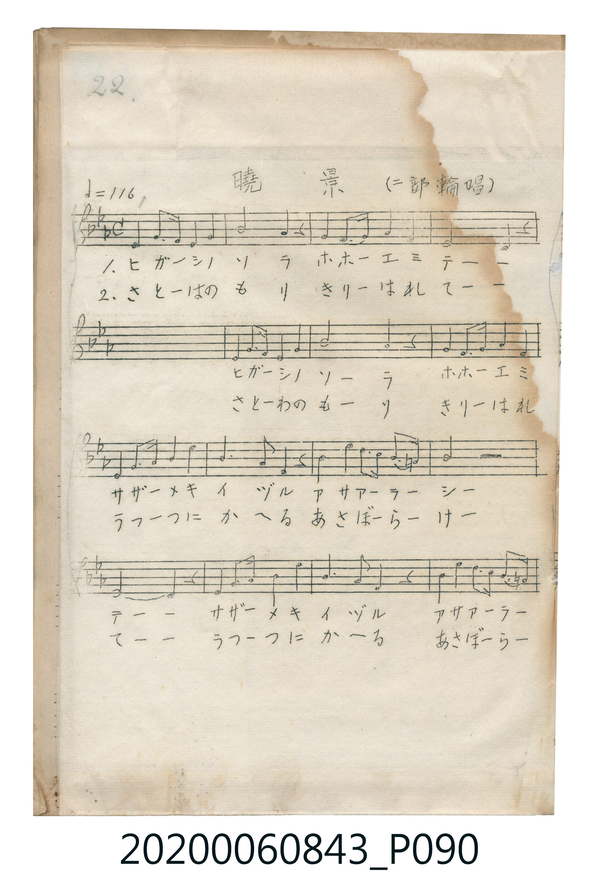
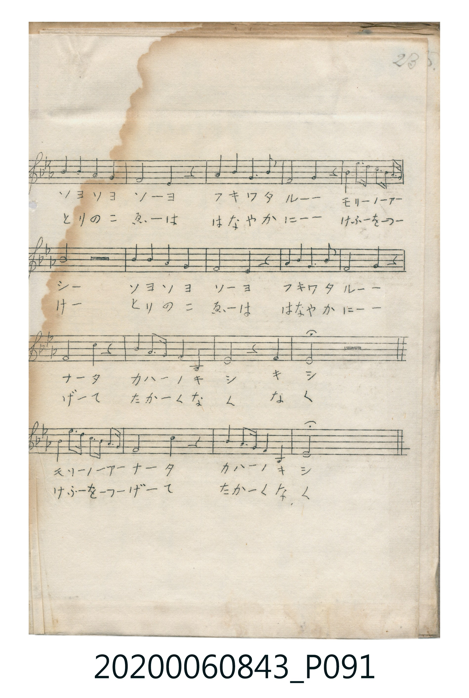

# 曉景（二部輪唱）

> Re:Shoka 使用 AI 辨識樂譜，可能會有錯誤。歡迎回報。

<audio controls src="gyokei.mp3"></audio>

- 唱歌帳（2020.006.0843）P090.jpg–P091.jpg（第 22–23 頁）

## 說明

原書資訊與歌詞全文（對應 P090.jpg–P091.jpg，手抄五線譜第 22–23 頁）：
調性與拍號：變ホ調四分之四拍子（Eb 大調 4/4 拍），速度 ♩=116
曲式：二部輪唱（第二部延遲一小節進入）

## 跨冊／重複收錄參照

> 同曲（〈曉景〉；收錄於《新定兒童唱歌》六年級與《唱歌帖》P090）

- **[同曲]** 《新定兒童唱歌》尋常科第六學年用（2020.006.0847.0006）：[**〈曉景〉**](../../../shintei_jido_shoka/grade_6_2020.006.0847.0006/4_08_gyokei/index.md)（`B,` / `4/4` — [原始 TMD](../../../shintei_jido_shoka/grade_6_2020.006.0847.0006/4_08_gyokei/gyokei.tmd)）
- 總表：[跨冊重複與同名歌曲總索引](../../../duplicate_songs.md)

## 歌詞

```text
第一節（片假名）：
ヒガーシノソラ　ホホーエミテーー
サザーメキイヅル　アサアーラーシー
ソヨソヨソーヨ　フキワタルーー
モリーノアーナータ　カハーノキシ　キシ

第二節（平假名）：
さとーはのもり　きりーはれてーー
うつつにかへる　あさぼーらーけー
とりのこゑーは　はなやかにーー
けふーをつーげーて　たかーくなく　なく
```

## ABC

```abc
X:1
T:曉景（二部輪唱）
M:4/4
L:1/16
Q:1/4=116
K:Eb
V:V1 name="Voice1" snm="Voi"
V:V2 name="Voice2" snm="Voi"
[V:V1]
E4 F2 E2 D4 E4 | F8 E4 z4 | G4 F2 G2 A4 F4 | E8 D4 z4 |
G4 A2 B2 c4 d4 | e6 B2 B4 z4 | c4 e2 c2 B4 G2 A2 | B8 z8 |
B4 A4 G4 F4 | E8 E4 z4 | A4 A4 G4 A2 G2 | F8 F4 z2 B2 |
e6 d2 c6 B2 | B8 c4 z4 | B4 A2 F2 E4 D4 | E8 z4 E4 |
E8 z8 |
[V:V2]
z16 | E4 F2 E2 D4 E4 | F8 E4 z4 | G4 F2 G2 A4 F4 |
E8 D4 z4 | G4 A2 B2 c4 d4 | e6 B2 B4 z4 | c4 e2 c2 B4 G2 A2 |
B8 z8 | B4 A4 G4 F4 | E8 E4 z4 | A4 A4 G4 A2 G2 |
F8 F4 z2 B2 | e6 d2 c6 B2 | B8 c4 z4 | B4 A2 F2 E4 D4 |
E8 z8 |
```

## TMD 檔案連結

- [主旋律 TMD 檔案](gyokei.tmd) [[在 TMD Studio 編輯](https://tmdlang.github.io/Tmd-TS/#tmd=s7IKdvYPcrWy4qpTUCpJTLdSSM7PyUlNLsnMz7MqzsjPTkzOyFeCS5bl55TmploBqXgDI4RwcX5pUXJqfEFieqpVgIGlAboM3KT4vPyS1KT8_GyEioKi_LLUvMQ8oKrcxLzS4uSizIKS-OT8gkqEmtSyzJRUkIrUlMyS_KLMxBwkJ6UWFYMdC3FDSVFiHsQMoKASl5aWwrPZnc9mrn-_p-PJrp6XzSte7Fn1dMrG93s6FbS0uBRtFQwNzbjsbRVcdbhsTPRN7EDmAuWfre15umMzUJORgZGBnoGBmZ6BhYkxUBfIe3pZBemPGiYDmYYgJlDV8zVrFIyMgGJGxgovFzQC1SlxcelrKdhSC3ApKCg87Zv_bPaOF5vbX6zoetHRDnTii5XznraueDatHeiEpxt6n7V3KmB1X8-zzu5nXS1Pdk15vn3Wi7VzMJ37fs8skBUvVu1_1rAcZHh374uZ84GiL9Z1PW6eDRR_Onv20462Jzu7gQyg7NO1E4CWuiYpPF2yHCirAAw7BaAw2Kielw3zn-5apvBo5kpbUPACDX42e9PTPf1A81AjARRwEJGnu7e9bNz0ZEfD0w39z9c3vGzY9LR1KdA0LpBukKodDUBhkI7O9qeN7U8nQKwCu_px86THTWseN-953LT9cXPf46a9j5tXPm5oADocjIDiKx43z3_c3AZiN-8B62na-rhpG5i_8HHT2sdNSx43tz5uXg3S1rQILLsILLsSZi5UG9DsFUgkUMUKsFVTQaY0r3_ctB9kCsKeZqAxq8B8oMMgRgJDFGjkfrBVQKX9MFmgK7aDBUEMuMd39UA8_nTnZgyPN0593Aj02p7HjesfN6573NT0uKkLZEJjL4gBEW_qedy4DMlBjW2PG5eA0erHjd2PG3c8buoG62kCGwdS97ipE6x5IlwP0LNdIBsaJz9uAomCDAbpAVq76nFTC9ggZF8DtTZuBZs0CWQVSMMkMLkMrG0-SAOI2w_SDyRBgiAGSDPluQUKFLT0ubjcK_OzUzOtwvIzk1MNHWoMahSqQZYo2Fho2YEZ2LIpPBtB87YhMK9YKECSJqjowGoVyLAaBUMFXQUjIGkeD2SAODVAri4YgngGYBFjsCJjBRMwDRIByYEgWBtYEdQ8kFITBVMFM5AkRGkcWKUpEMLMA0kChc3AQiBja8AsEAQpAMEacILC6VvkkswS6FtDc-K8C7IG5AuIj5B9gvAtSB6mxgRIIkIERBsAzYB5Fuo1c7CHQF5E-AMkAjEOYiUojKHBhbATpAAc5kiRgRoItagpwsihRtsQI0kM5lgcrMEOD15dOwVICCsAWcpcAA)]
- [鋼琴伴奏 TMD 檔案](gyokei_piano.tmd) [[在 TMD Studio 編輯](https://tmdlang.github.io/Tmd-TS/#tmd=s7IKdvYPcrWy4tLSUng2u_PZzPXv93Q82dXzsnnFiz2rnk7Z-Lh598vuPc8nbHmyZ8vTpf3POzve7-lU0NLiUrRVMDQ047K3VXDV4bIx0Tex46pTUALqeLa25-mOzUBjjAyMDPQMDMz0DCxMjIG6AgwsDfSyCtIfNUwGMg1BTKCq52vWKBgZAcWMjBVeLmgEqlPi4nKvzM9OzbQKy89MTjV0qDGoUajmUgACGwstOzCjRsFQQVfBCEiaxwMZIE4NkKsLhiCeAVjEGKzIWMEETINEQHIgCNYGVgQ1D6TURMFUwQwkCVEaB1ZpCoQw80CSQGEzsBDI2BowCwRBCkAQZh5IHGQtxAnIViOcB5KHqTEBkggvgGgDoBkw06BuMQe7AOQmhMUgEYhxECtBgQL1H8JOkAJwICGFHqqra1FD3cihRttwNNipEOzowRuQmZiXH-RBdKo21EYOYPN4MBckDAtlQ22kcAaLQkIarBA5rCGSoNA20QY531QbEuLG2vAwN9FGhDpEETjcjcHCkJA3ArNBECKKHPoQESOwgyC2obkX7A0wC2IHRClCOSQ6oJpQvIGIFLhzzaFOhEQMwjUQUWhShLsII4KwORMlpPDGoA9KDBohYjBewTQ-HpQsgCSQAxYxgQmApRAqweJwHUAeWANMJ7qJQAaKPD4TUW2Em4FQaADxkq6dAsRXCkCWMhcA)]

## 分析

```text
================================================================================
📊 TMD Song Profile: [ 曉景（二部輪唱） ]
================================================================================
⏱  Duration:       0:35 (35.2s), 17 measures total
🎼 Key & Tempo:    首調基準 E,, != 116.0 BPM, <4/4>
   - 分析範圍：      由實際發聲的音符與和弦推測調性；播放脈絡另行呈現
🎤 人聲音域:    D4 (MIDI 62) – D#5 (MIDI 75) [跨度: 13 個半音 / 1.1 個八度, 難度: moderate]
   - 最低音:  D4 in [Gyokei #1 @ m.1, 0:01]
   - 最高音: D#5 in [Gyokei #1 @ m.6, 0:10]
   - 適合: soprano, mezzo-soprano, contralto, tenor, baritone, bass
🏛  結構:      Gyokei (35.2s)
⚡ 編曲密度:        Peak 2 軌道同時演奏
🗝  調性診斷：       D# 大調（純淨自然大調，未偵測到可信轉調）
   - 風格氣質:    純淨自然大調（陽光明朗、易唱易記，無明顯調外色彩）
   - 轉調歷程:    全曲維持單一推測調性（未偵測到可信轉調）
   - 核心骨幹音:  D#, A#, F, G#, G
   - 調性數值:    D# 大調 [相關度: 0.95, 穩定度: High, 自然音純度: 100.0%]
   - 候選調性 (K-S): D# 大調 (0.95), A# 大調 (0.68), C 小調 (0.61)
   - 五度圈歷程:   -3
   - 各段落調性細節:
     • [Gyokei #1]: D# 大調 (r: 0.95, 自然音純度: 100.0%)

  [ 五度圈游移軌跡 ]
               C  
         F            G  
      Bb               D  
     [Eb]*              A  
         Ab           E  
            Db       B  
               F# 
     (* = active key center)

  [ 十二半音累積音高分佈 ]
     C  : ███████                    8.9%
     C# :                            0.0%
     D  : ███████                    8.0%
     D# : ████████████████████████  29.5%
     E  :                            0.0%
     F  : ████████████              15.2%
     F# :                            0.0%
     G  : ████████                   9.8%
     G# : █████████                 10.7%
     A  :                            0.0%
     A# : ███████████████           17.9%
     B  :                            0.0%
--------------------------------------------------------------------------------
Assignment 軌道音域：
  - Voice1        : D4 – D#5 (13 個半音 / 1.1 個八度, 57 個音符)
  - Voice2        : D4 – D#5 (13 個半音 / 1.1 個八度, 55 個音符)
================================================================================
```


## 原書掃描頁






