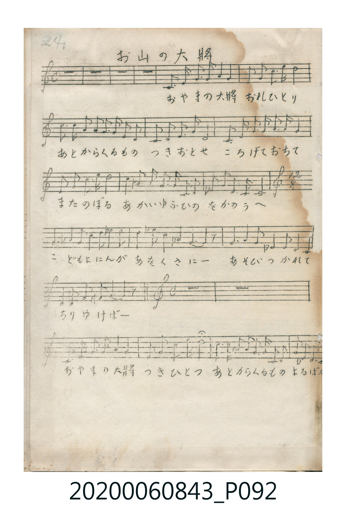

# お山の大將

> Re:Shōka 使用 AI 協助辨識與重建樂譜，可能會有錯誤。歡迎回報。

- **鋼琴伴奏版**：<br><audio controls src="oyama_no_taisho.mp3"></audio>

- 詞：西條八十
- 曲：本居長世
- 唱歌帳（2020.006.0843）P092.jpg（第 24 頁，結尾小節補於 P093.jpg 左下）

## 說明

原書資訊與歌詞全文（對應 P092.jpg，手抄五線譜第 24 頁，末小節見 P093.jpg 左下角）：
調性與拍號：ハ調四分之四拍子（C 大調 4/4 拍），中段轉 12/8 拍後回 4/4 拍


## 歌詞

```text
おやまの大將　おれひとり
あとからくるもの　つきおとせ
ころげておちて　またのぼる
あかいゆふひの　をかのうへ

こどもよにんが　あをくさにー
あそびつかれて　ちりゆけばー

おやまの大將　つきひとつ
あとからくるもの　まるばかり
```

## ABC

<div class="abc-score" data-abc-src="oyama_no_taisho.abc" aria-label="五線譜載入中"></div>

[下載 ABC 原始檔](oyama_no_taisho.abc)

## TMD 檔案連結

- [主旋律 TMD 檔案](oyama_no_taisho.tmd) [[在 TMD Studio 編輯](https://tmdlang.github.io/Tmd-TS/#tmd=s7IKdvYPcrWy4qpTUCpJTLdSSM7PyUlNLsnMz7MqzsjPTkzOyFeCS5bl55TmploBqXgDI4RwcX5pUXJqfEFieqpVgIElhgzcpPi8_JLUpPz8bISKgqL8stS8xDygqtzEvNLi5KLMgpL45PyCSoSa1LLMlFSQitSUzJL8oszEHCQnpRYVgx0LcUNJUWIexAygIEIVUFN6Zp5VSWIm0CnxQFyeGJ-bmJmXk5iXosSlpaXwuLHr6caNjxvXPV2y_OmGdgUtLS5FWwVDAwsue1sFZy4bE30TO5BpL1bOe79n1oul-58tmvu0dfXT3kawJc9mbwIKP5uz5unG1pdTtz_ZMQ0s_HTKxmdre57u2Px-T4eRgZGBnoGBmZ6BhYnx-z2doIDSyypIB0o9X7NGwchE4eWCxvd7ep5vnfB0w76nG_qfr294sXjOs2l7FIBKjUFKFZ5uX_ZkRzdQsxIXl76Wgi21AJeCgsLTvvnPZu94sbn9xYquFx3tQHcD_fq0dcWzae1AJz7d0PusvRPkEqije551dj_ranmya8rz7bNerJ2D4odnc1ZDPbCsG931L5ZPAnoAGFogS1-s2v-sYTnIuu7eFzPnA0UfN_cDBZ_Onv20o-3Jzm4gAyj1dO0EoBucFYCRA5RUAEaGAlAUbEzPkx1rn63b-mJvp4Khkb4FSPzpvp6ns-fBVHGB7AFG7-OmlseN--Ax_LihASzY87hx0-PGFY-buiDqmkCcxu7HTZ2PG_sfNwEZQJF1YNVLHjf2gvSAFMyGqJ78uAkoNOlx4zKwxEIQA6QUaM98kLbGPUAj4AZ3P25sedzU9rhxK9hSsKlNQM1AcaBSoPgOqGMnP25cCbK4qeNx4-rHTUBuD9hYoAhQef_jxqkg8eY9cJPnPm7cDHYg0L1AH0EcsRDoKbB1Ex83bgCpxhMSEL-BQ6JxCcGQ2AfiAs0EyYLDjfIkCAUKWvpcXP6VibmJfvkh4NxqFZafnJjjUGNQo1ANskrBxtBMyw7MwpYFFJ529j5d2q-gYaIASYI68ESriUU10DqQSTUKBgq6eCERKqhoEm7vOSoAU7uChgVpvjMEm2scr2AaD2aZwVm6UDmQu4CiEC5UzlDBGIcfjYBsEDYFi5qCaRAGqQcZgFABwmADYdagG4XLaWCCHLdBxE0VzKA0jA9yCcRtcLNAQmAOPDDADFD84IsDJ3AcwIobEpOajQU09dYoaICcZqypqqGrq6mgAQ5DGAfkeHMdZB5MCqoNoVIdmWekA_IGjAfyowFMH8xScKzAVKAYZa4D8r1ZPNxFIK4xjAvUagISMIHLQ8IRRTXcakhAwu3GHZgvp00G5ldgFaDgqA4OV2i5DfI1erA-apgMq03whTC8gKBmtiYnC4EYlGchSLTAki8MQhJpLReXrp0CSoGpABRQ5gIA)]
- [鋼琴伴奏 TMD 檔案](oyama_no_taisho_piano.tmd) [[在 TMD Studio 編輯](https://tmdlang.github.io/Tmd-TS/#tmd=s7IKdvYPcrWy4tLSUnjc2PV048bHjeueLln-dEP7-z0dL7v3PJ-w5cmeLU-X9j_v7Hi_p1NBS4tL0VbB0MCCy95WwZnLxkTfxI6rTkHpxcp57_fMerF0_7NFc5-2rn7a26gEEn42exNQ-NmcNU83tr6cuv3Jjmlg4adTNj5b2_N0x2agJUYGRgZ6BgZmegYWJsZAKwIMLI30sgrSgVLP16xRMDJReLmg8f2enudbJzzdsO_phv7n6xteLJ7zbNoeBaBSY5BShafblz3Z0Q3UrMTF5V-ZmJvolx-SmFmckW8Vlp-cmONQY1CjUM2lAAQ2hmZadmBWjYKBgi5eSIQKqptkCOYZxyuYxoNZZnCWLlQOZBpQFMKFyhkqGOMwzwjIBmFTsKgpmAZhkHqQAQgVIAw2EGYNsU4DE-S4DSJuqmAGpWF8kEsgboObBRICc-CBAWaAQhVimo0FPFo1QOYYa6pq6OpqKmiAPQzjgGwy10HmwaSg2hAq1ZF5RjogO2E8kIMMYPpgloKDEKYCxShzHZBTzeLhLgJxjWFcoFYTkIAJXB7iaRTVcKshvkaxmzYpmpx0CGJQng4hwQVLAzAIiela9OwdkJmYlx_kgSODD7LMhEito_l8NJ9Tks-pkTspTY0Dldt9UHK7CSJM4oEe0AalaxijBhjYQEdrGyIJQRWbxscrmMfHaxuhKEcVNUAED7WNRtVBkvFwAZgKYFiCONrgOENzNRABlQERjAdSAaSQ3QrCQBOACGwrEGEYg8911A8lHZgwUB_IdGAy0LVTQEkJCkABZS4A)]

## 分析

```text
================================================================================
📊 TMD Song Profile: [ お山の大將 ]
================================================================================
⏱  Duration:       0:48 (48.9s), 22 measures total
🎼 Key & Tempo:    首調基準 C, != 108.0 BPM, <4/4>
   - 分析範圍：      由實際發聲的音符與和弦推測調性；播放脈絡另行呈現
🎤 人聲音域:    E3 (MIDI 52) – A#4 (MIDI 70) [跨度: 18 個半音 / 1.5 個八度, 難度: challenging]
   - 最低音:  E3 in [OyamaNoTaisho #1 @ m.5, 0:09]
   - 最高音: A#4 in [OyamaNoTaisho #1 @ m.13, 0:28]
   - 適合: contralto, tenor, bass
🏛  結構:      OyamaNoTaisho (48.9s)
⚡ 編曲密度:        Peak 1 軌道同時演奏
🗝  調性診斷：       C 大調（流行色彩大調，未偵測到可信轉調）
   - 風格氣質:    流行大調（略帶和弦色彩音與裝飾副屬和弦）
   - 轉調歷程:    全曲維持單一推測調性（未偵測到可信轉調）
   - 核心骨幹音:  G, C, E, D, A
   - 調性數值:    C 大調 [相關度: 0.86, 穩定度: Moderate, 自然音純度: 94.9%]
   - 候選調性 (K-S): C 大調 (0.86), G 大調 (0.76), E 小調 (0.67)
   - 五度圈歷程:   +0
   - 各段落調性細節:
     • [OyamaNoTaisho #1]: C 大調 (r: 0.86, 自然音純度: 94.9%, 調外音: C#, A#)

  [ 五度圈游移軌跡 ]
              [C ]*
         F            G  
      Bb               D  
      Eb               A  
         Ab           E  
            Db       B  
               F# 
     (* = active key center)

  [ 十二半音累積音高分佈 ]
     C  : ███████████████████       22.9%
     C# : █                          1.6%
     D  : █████████                 11.6%
     D# :                            0.0%
     E  : ████████████████          19.1%
     F  : █                          1.6%
     F# :                            0.0%
     G  : ████████████████████████  29.5%
     G# :                            0.0%
     A  : ████████                  10.2%
     A# : ███                        3.5%
     B  :                            0.0%
--------------------------------------------------------------------------------
Assignment 軌道音域：
  - Vocal         : E3 – A#4 (18 個半音 / 1.5 個八度, 102 個音符)
================================================================================
```


## 原書掃描頁




