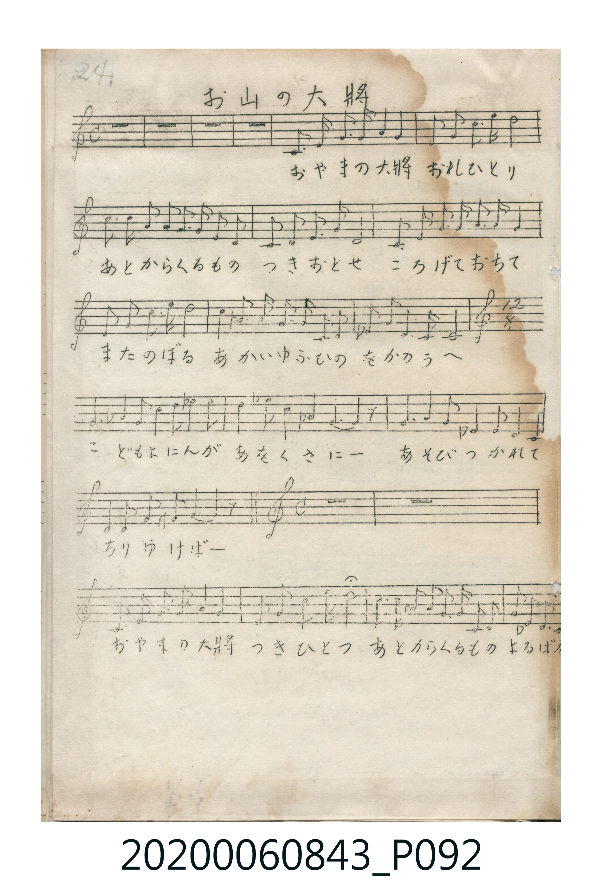

# お山の大將

> Re:Shōka 使用 AI 協助辨識與重建樂譜，可能會有錯誤。歡迎回報。

- **鋼琴伴奏版**：<br><audio controls src="oyama_no_taisho.mp3"></audio>

- 詞：西條八十
- 曲：本居長世
- 唱歌帳（2020.006.0843）P092.jpg（第 24 頁，結尾小節補於 P093.jpg 左下）

## 說明

原書資訊與歌詞全文（對應 P092.jpg，手抄五線譜第 24 頁，末小節見 P093.jpg 左下角）：
調性與拍號：ハ調四分之四拍子（C 大調 4/4 拍），中段轉 12/8 拍後回 4/4 拍


## 歌詞

```text
おやまの大將　おれひとり
あとからくるもの　つきおとせ
ころげておちて　またのぼる
あかいゆふひの　をかのうへ

こどもよにんが　あをくさにー
あそびつかれて　ちりゆけばー

おやまの大將　つきひとつ
あとからくるもの　まるばかり
```

## ABC

<div class="abc-score" data-abc-src="oyama_no_taisho.abc" aria-label="五線譜載入中"></div>

[下載 ABC 原始檔](oyama_no_taisho.abc)

## TMD 檔案連結

- [主旋律 TMD 檔案](oyama_no_taisho.tmd) [[在 TMD Studio 編輯](https://tmdlang.github.io/Tmd-TS/#tmd=s7IKdvYPcrWy4qpTUCpJTLdSSM7PyUlNLsnMz7MqzsjPTkzOyFeCS5bl55TmploBqXgDI4RwcX5pUXJqfEFieqpVgIElhgzcpPi8_JLUpPz8bISKgqL8stS8xDygqtzEvNLi5KLMgpL45PyCSoSa1LLMlFSQitSUzJL8oszEHCQnpRYVgx0LcUNJUWIexAygIEIVUFN6Zp5VSWIm0CnxQFyeGJ-bmJmXk5iXgqyqJCM_vSixIKPSKiOzGGRVcmJOfHZiXiJCUUlGKjAIUlNKkxMhdmhpKTxu7Hq6cePjxnVPlyx_uqFdQUuLS9FWwdDAgsveVsGZy8ZE38QOZMCLlfPe75n1Yun-Z4vmPm1d_bS3EWzus9mbgMLP5qx5urH15dTtT3ZMAws_nbLx2dqepzs2v9_TYWRgZKBnYGCmZ2BhYvx-TycomPWyCtKBUs_XrFEwMlF4uaDx_Z6e51snPN2w7-mG_ufrG14snvNs2h4FoFJjkFKFp9uXPdnRDdSsxMWlr6VgSy3ApaCg8LRv_rPZO15sbn-xoutFRzvQ3UC_Pm1d8WxaO9CJTzf0PmvvBLkE6uieZ53dz7panuya8nz7rBdr56D44dmc1VAPLOtGd_2L5ZOAHgCGFsjSF6v2P2tYDrKuu_fFzPlA0cfN_UDBp7NnP-1oe7KzG8gASj1dOwHoBmcFYOQAJRWAkaEAFAUb0_Nkx9pn67a-2NupYGikbwESf7qv5-nseTBVXCB7gNH7uKnlceM-eAw_bmgAC_Y8btz0uHHF46YuiLomEKex-3FT5-PG_sdNQAZQZB1Y9ZLHjb0gPSAFsyGqJz9uAgpNety4DCyxEMQAKQXaMx-krXEP0Ai4wd2PG1seN7U9btwKthRsahNQM1AcqBQovgPq2MmPG1eCLG7qeNy4-nETkNsDNhYoAlTe_7hxKki8eQ_c5LmPGzeDHQh0L9BHEEcsBHoKbN3Ex40bQKrxhATEb-CQaFxCMCT2gbhAM0Gy4HCjPAlCgYKWPheXf2VibqJffgg4r1uF5QOzsEONQU01yCYFG0MzLTswC1sOUHja2ft0ab-ChokCJAXqwNOsJhbVQNtAJtUoGCjo4oVEqKCiSbi956gATOwKGhak-c4QbK5xvIJpPJhlBmfpQuVA7gKKQrhQOUMFYxx-NAKyQdgULGoKpkEYpB5kAEIFCIMNhFmDbhQup4EJctwGETdVMIPSMD7IJRC3wc0CCYE58MAAM0Dxgy8OnMBxACttSExqNhbQ1FujoAFymrGmqoaurqaCBjgMYRyQ4811kHkwKag2hEp1ZJ6RDsgbMB7IjwYwfTBLwbECU4FilLkOyPdm8XAXgbjGMC5QqwlIwAQuDwlHFNVwqyEBCbcbd2C-nDYZmF-BNYCCozo4XKHFNsjX6MH6qGEyrDLBF8LwAoKa2ZqcLARiUJ6FINECS74wCEmktVxcunYKKOWlAlBAmQsA)]
- [鋼琴伴奏 TMD 檔案](oyama_no_taisho_piano.tmd) [[在 TMD Studio 編輯](https://tmdlang.github.io/Tmd-TS/#tmd=s7IKdvYPcrWy4qpTUCpJTLdSyC8qychPL0osyKi0ysgsLskvykxOzInPTsxLVIIrKs4vLUpOjS9ITE-1CjCwNELIlGSk5qZapaaUJieWZObnKXFpaSk8bux6unHj48Z1T5csf7qh_f2ejpfde55P2PJkz5anS_ufd3a839OpoKXFpWirYGhgwWVvq-DMZWOib2IHMvXFynnv98x6sXT_s0Vzn7auftrbCLbs2exNQOFnc9Y83dj6cur2JzumgYWfTtn4bG3P0x2bgZYYGRgZ6BkYmOkZWJgYA60AOVQvqyAdKPV8zRoFIxOFlwsa3-_peb51wtMN-55u6H--vuHF4jnPpu1RACo1BilVeLp92ZMd3UDNSlxc_pWJuYl--SGJmcUZ-VZh-cBgcagxqKnmUgACG0MzLTswq0bBQEEXLyRCBdVNMgTzjOMVTOPBLDM4SxcqBzINKArhQuUMFYxxmGcEZIOwKVjUFEyDMEg9yACEChAGGwizhlingQly3AYRN1Uwg9IwPsglELfBzQIJgTnwwAAzQKEKMc3GAh6tGiBzjDVVNXR1NRU0wB6GcUA2mesg82BSUG0IlerIPCMdkJ0wHshBBjB9MEvBQQhTgWKUuQ7IqWbxcBeBuMYwLlCrCUjABC4P8TSKarjVEF-j2E2bFE1OOgQxKE-HkOCCpQEYhMR0LXruDshMzMsP8sCevwdZXkIk1tFsPprNKcnm1MiclKbGgcrsPsiZ3QQRJPFA92uDkjWMUQMMa6CbtQ2RhKCKTePjFczj47WNUJSjihogQofaRqPqIMl4uABMBTAoQRxtcJShuRqIgMqACMYDqQBSyG4FYaAJQAS2FYgwjMHnOuqHkg5MGKgPZDowFejaKaAkBAWggDIXAA)]

## 分析

```text
================================================================================
📊 TMD Song Profile: [ お山の大將 ]
================================================================================
⏱  Duration:       0:48 (48.9s), 22 measures total
🎼 Key & Tempo:    首調基準 C, != 108.0 BPM, <4/4>
   - 分析範圍：      由實際發聲的音符與和弦推測調性；播放脈絡另行呈現
🎤 人聲音域:    E3 (MIDI 52) – A#4 (MIDI 70) [跨度: 18 個半音 / 1.5 個八度, 難度: challenging]
   - 最低音:  E3 in [OyamaNoTaisho #1 @ m.5, 0:09]
   - 最高音: A#4 in [OyamaNoTaisho #1 @ m.13, 0:28]
   - 適合: contralto, tenor, bass
🏛  結構:      OyamaNoTaisho (48.9s)
⚡ 編曲密度:        Peak 1 軌道同時演奏
🗝  調性診斷：       C 大調（流行色彩大調，未偵測到可信轉調）
   - 風格氣質:    流行大調（略帶和弦色彩音與裝飾副屬和弦）
   - 轉調歷程:    全曲維持單一推測調性（未偵測到可信轉調）
   - 核心骨幹音:  G, C, E, D, A
   - 調性數值:    C 大調 [相關度: 0.86, 穩定度: Moderate, 自然音純度: 94.9%]
   - 候選調性 (K-S): C 大調 (0.86), G 大調 (0.76), E 小調 (0.67)
   - 五度圈歷程:   +0
   - 各段落調性細節:
     • [OyamaNoTaisho #1]: C 大調 (r: 0.86, 自然音純度: 94.9%, 調外音: C#, A#)

  [ 五度圈游移軌跡 ]
              [C ]*
         F            G  
      Bb               D  
      Eb               A  
         Ab           E  
            Db       B  
               F# 
     (* = active key center)

  [ 十二半音累積音高分佈 ]
     C  : ███████████████████       22.9%
     C# : █                          1.6%
     D  : █████████                 11.6%
     D# :                            0.0%
     E  : ████████████████          19.1%
     F  : █                          1.6%
     F# :                            0.0%
     G  : ████████████████████████  29.5%
     G# :                            0.0%
     A  : ████████                  10.2%
     A# : ███                        3.5%
     B  :                            0.0%
--------------------------------------------------------------------------------
Assignment 軌道音域：
  - Vocal         : E3 – A#4 (18 個半音 / 1.5 個八度, 102 個音符)
================================================================================
```


## 原書掃描頁




