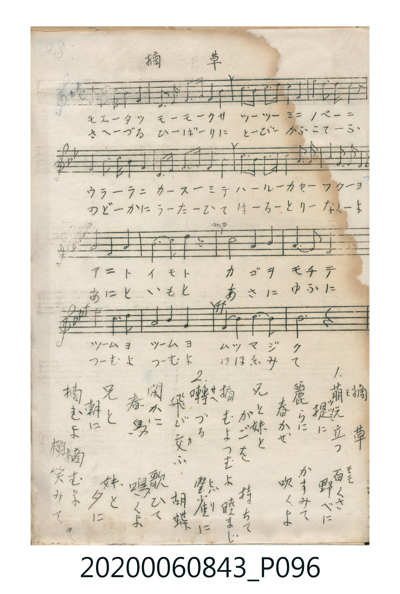

# 摘草

> Re:Shōka 使用 AI 協助辨識與重建樂譜，可能會有錯誤。歡迎回報。

- **鋼琴伴奏版**：<br><audio controls src="tsumikusa.mp3"></audio>

- 唱歌帳（2020.006.0843）P096.jpg（第 28 頁）

## 說明

原書資訊與歌詞全文（對應 P096.jpg，手抄五線譜第 28 頁）：
調性與拍號：ヘ調四分之四拍子（F 大調 4/4 拍）
力度記號：p → mp → mf


## 歌詞

```text
1. 萌エ立ツ百（モモ）くさ　堤（ツツミ）に野べに
麗らにかすみて　春かぜ吹くよ
兄と妹と　かごを持ちて
摘むよつむよ　睦まじく

2. 囀づる雲雀（ヒバリ）に　飛び交（カ）ふ胡蝶
閑かに歌ひて　春鳥鳴くよ
兄と妹と　朝に夕に
摘むよ摘むよ　頬笑みて
```

## ABC

<div class="abc-score" data-abc-src="tsumikusa.abc" aria-label="五線譜載入中"></div>

[下載 ABC 原始檔](tsumikusa.abc)

## TMD 檔案連結

- [主旋律 TMD 檔案](tsumikusa.tmd) [[在 TMD Studio 編輯](https://tmdlang.github.io/Tmd-TS/#tmd=s7IKdvYPcrWy4qpTUCpJTLdSSM7PyUlNLsnMz7MqzsjPTkzOyFeCS5bl55TmploBqXgDI4RwcX5pUXJqfEFieqpVgIGlGboM3KT4vPyS1KT8_GyEioKi_LLUvMQ8oKrcxLzS4uSizIKS-OT8gkqEmtSyzJRUkIrUlMyS_KLMxBwkJ6UWFYMdC3FDSVFiHsQMoCBCFVBTemaeVWkeyKCSzLTM1BRkyZKM_PSixIKMSquMzGKQDcmJOfHZiXmJCEUlGalAn6emlCYnQozW0lJ4NnHGi95OBS0tLkVbBUMDAy57WwU3LhsTfRM7kL6nUzY-W9vzdMfm93s6jAyMDPQMDMz0DCxMjN_v6QQFk15WQTpQ6vmaNQpGFgovFzQCxZW4uPS1FGypBbgUFBSe9s1_NnvHi83tL1Z0vehoBzrpxcp5T1tXPJvWDrT96YbeZ-2dCgj39Dzr7H7W1fJk15Tn22e9WDsHxXnv98wCGfli1f5nDctBhnX3vpg5Hyj6uHkGUPDp7NlPO9qe7OwGMoBST9dOANrgpvB0yXKgpAIwXBSAokBjwM7qmv1017IXK2ZADChQeNQ2SSEXSqVxgZQY6im8mNDzuGnF89Xdj5tbns_cBzTucfMiIAIa8rix_3Hj1McNDU8XLAGLt4AR0DCg1OqX7X2PG3cCGSCDgODlrumPm0ASjxu7HzfOfNy4_3HjMqDmZzOWgkXmPJ0AVN3_uKkDquFpa8vjxhVPlwFFVwDVgRVNedw06VlP4-PGhUDNUHXARPC4qQGo73HjEiijoeH53GWPG_c9bpwBNBLsFSM9haezgYYsfdzU_XL2ppezG8BOnvS4ecLj5lUQJwP1vVw8-3Hj5ie7wB5qWg0W3_qieeGLudtg_pg2EeyU1cB4fNy4Ce6Jl5uBaAs-HzybMxeo7emSqYhAgbsd4QmgGxaseb4GaAkogEDqKE-FUKCgpc_FFVJcmpuZXVqcaBWWD8xlDjUGNdVg19gYmmnZgVnYMoACMBk-2dHwYmGPgoaJwtMN_c_XN-jAU60mFg1Ay0CG1SgYKuiCIYQ2UjBG4esCVZjFQwWMwLQxXMoUIgFUAzULotcYShvBFUI0gsyCmQ4RgRkJgQZgk_D7cVfPQPvRDMwzUzBFUYgwswZuBMyPMKOI9eOOTnL8iBySILcg81HDHgRNoKpgbkL2IcRnqKaBgwLNh3jswu9DYPFHVizGQY2HRAHCQZhehMkgBz2yF2EmoJuEiER0nbBAQphUy8Wla6cAz7AKQI4yFwA)]
- [鋼琴伴奏 TMD 檔案](tsumikusa_piano.tmd) [[在 TMD Studio 編輯](https://tmdlang.github.io/Tmd-TS/#tmd=s7IKdvYPcrWy4qpTUCpJTLdSyC8qychPL0osyKi0ysgsLskvykxOzInPTsxLVIIrKs4vLUpOjS9ITE-1CjCwNEPIlGSk5qZapaaUJieWZObnKXFpaSk8mzjjRW_n-z0dL7v3PJ-w5cmeLU-X9j_v7Hi_p1NBS4tL0VbB0MCAy95WwY3LxkTfxA5k2NMpG5-t7Xm6YzNQm5GBkYGegYGZnoGFiTFQE8hGvayCdKDU8zVrFIwsFF4uaASKK3FxhRSX5mZmlxYnWoXlA53tUGNQU82lAAQ2hmZadmBWjYKhgi4YQmgjBWMUvi5QhVk8VMAITBvDpUwhEkA1ULMgeo2htBFcIUQjyCyY6RARmJEQaIBkEjVdZQbmmSmYoihEmFkDNwLmKphR6K5Cdi1INzIf1X8gaAJVBTMF2U0Qt6CaBnY8mpvw2AULqTioAMSbCCMwHQWTQfYeslEwE9BNQgQUuk6YtxAm1SInu4DMxLz8IA_sCc8sXhs9lg21KYlnmG586Q9hAyyuzeO1cSVCqrvQRBuWFo210VMjwuQahJsQSRLJLejORPMByBg0IXS_gyAodSJE0NMnzH0IiFCLkCPabrip8NQKCwpk47A5FSGLK9UiTMJmJnKwooUhsr8RhmImYB_kBGyCKDjjEQjoinhgdMO5KEqAUkYgJRAeSJUBmgq8hgAFkZSA5KFqEKbABGEYyVxcVmFoQaiCW4imB-EeiAqYTeBAhSRIYODp2inAw08BnaPMBQA)]

## 分析

```text
================================================================================
📊 TMD Song Profile: [ 摘草 ]
================================================================================
⏱  Duration:       0:38 (38.4s), 16 measures total
🎼 Key & Tempo:    首調基準 F, != 100.0 BPM, <4/4>
   - 分析範圍：      由實際發聲的音符與和弦推測調性；播放脈絡另行呈現
🎤 人聲音域:    C4 (MIDI 60) – F5 (MIDI 77) [跨度: 17 個半音 / 1.4 個八度, 難度: challenging]
   - 最低音:  C4 in [Tsumikusa #1 @ m.2, 0:04]
   - 最高音: F5 in [Tsumikusa #1 @ m.13, 0:28]
   - 適合: soprano, mezzo-soprano, contralto, tenor, baritone, bass
🏛  結構:      Tsumikusa (38.4s)
⚡ 編曲密度:        Peak 1 軌道同時演奏
🗝  調性診斷：       F 大調（純淨自然大調，未偵測到可信轉調）
   - 風格氣質:    純淨自然大調（陽光明朗、易唱易記，無明顯調外色彩）
   - 轉調歷程:    全曲維持單一推測調性（未偵測到可信轉調）
   - 核心骨幹音:  F, G, A, C, D
   - 調性數值:    F 大調 [相關度: 0.81, 穩定度: High, 自然音純度: 100.0%]
   - 候選調性 (K-S): F 大調 (0.81), C 大調 (0.67), D 小調 (0.57)
   - 五度圈歷程:   -1
   - 各段落調性細節:
     • [Tsumikusa #1]: F 大調 (r: 0.81, 自然音純度: 100.0%)

  [ 五度圈游移軌跡 ]
               C  
        [F ]*          G  
      Bb               D  
      Eb               A  
         Ab           E  
            Db       B  
               F# 
     (* = active key center)

  [ 十二半音累積音高分佈 ]
     C  : ██████████████            16.2%
     C# :                            0.0%
     D  : ████████                   9.2%
     D# :                            0.0%
     E  :                            0.0%
     F  : ████████████████████████  27.9%
     F# :                            0.0%
     G  : ████████████████████      23.7%
     G# :                            0.0%
     A  : ███████████████████       22.1%
     A# : █                          0.8%
     B  :                            0.0%
--------------------------------------------------------------------------------
Assignment 軌道音域：
  - Vocal         : C4 – F5 (17 個半音 / 1.4 個八度, 67 個音符)
================================================================================
```


## 原書掃描頁




