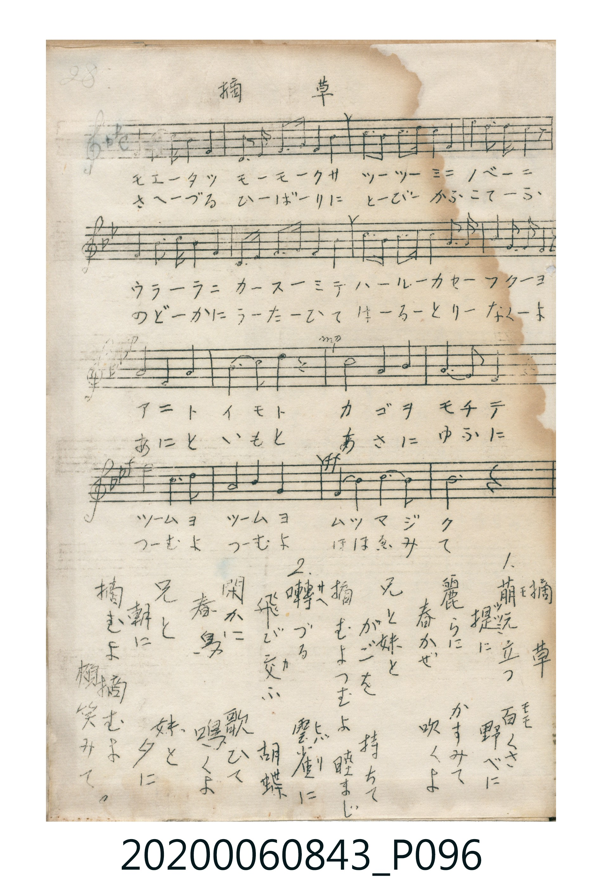

# 摘草

> Re:Shoka 使用 AI 辨識樂譜，可能會有錯誤。歡迎回報。

<audio controls src="tsumikusa.mp3"></audio>

- 唱歌帳（2020.006.0843）P096.jpg（第 28 頁）

## 說明

原書資訊與歌詞全文（對應 P096.jpg，手抄五線譜第 28 頁）：
調性與拍號：ヘ調四分之四拍子（F 大調 4/4 拍）
力度記號：p → mp → mf

## 歌詞

```text
1. 萌エ立ツ百（モモ）くさ　堤（ツツミ）に野べに
麗らにかすみて　春かぜ吹くよ
兄と妹と　かごを持ちて
摘むよつむよ　睦まじく

2. 囀づる雲雀（ヒバリ）に　飛び交（カ）ふ胡蝶
閑かに歌ひて　春鳥鳴くよ
兄と妹と　朝に夕に
摘むよ摘むよ　頬笑みて
```

## ABC

```abc
X:1
T:摘草
M:4/4
L:1/16
Q:1/4=100
K:F
V:V1 name="Vocal" snm="Voc"
[V:V1]
F4 F3 G A4 F4 | D3 F G3 A F4 C4 | A3 A A3 G F4 G4 | A4 G3 F G6 z2 |
F4 F3 G A4 F4 | D3 F G3 A F4 C4 | d3 d c3 A F3 G A4 | G3 A G3 F F6 z2 |
G6 A2 G8 | A6 B2 A4 z4 | c8 A4 c4 | G6 A2 G8 |
f4 d4 c8 | A4 c4 F8 | d4 d4 c4 A4 | F8 z8 |
F4 F3 G A4 F4 | D3 F G3 A F4 C4 | A3 A A3 G F4 G4 | A4 G3 F G6 z2 |
F4 F3 G A4 F4 | D3 F G3 A F4 C4 | d3 d c3 A F3 G A4 | G3 A G3 F F6 z2 |
G6 A2 G8 | A6 B2 A4 z4 | c8 A4 c4 | G6 A2 G8 |
f4 d4 c8 | A4 c4 F8 | d4 d4 c4 A4 | F8 z8 |
```

## TMD 檔案連結

- [主旋律 TMD 檔案](tsumikusa.tmd) [[在 TMD Studio 編輯](https://tmdlang.github.io/Tmd-TS/#tmd=s7IKdvYPcrWy4qpTUCpJTLdSSM7PyUlNLsnMz7MqzsjPTkzOyFeCS5bl55TmploBqXgDI4RwcX5pUXJqfEFieqpVgIGlGboM3KT4vPyS1KT8_GyEioKi_LLUvMQ8oKrcxLzS4uSizIKS-OT8gkqEmtSyzJRUkIrUlMyS_KLMxBwkJ6UWFYMdC3FDSVFiHsQMoKASl5aWwrOJM170dipoaXEp2ioYGhhw2dsquHHZmOib2IEMeTpl47O1PU93bH6_p8PIwMhAz8DATM_AwsT4_Z5OkF_0sgrSgVLP16xRMLJQeLmgESiuxMWlr6VgSy3ApaCg8LRv_rPZO15sbn-xoutFRzvQSS9WznvauuLZtHag7U839D5r71RAuKfnWWf3s66WJ7umPN8-68XaOSjOe79nFsjIF6v2P2tYDjKsu_fFzPlA0cfNM4CCT2fPftrR9mRnN5ABlHq6dgLQBjeFp0uWAyUVgOGiABQFGgN2Vtfsp7uWvVgxA2JAgcKjtkkKuVAqjQukxFBP4cWEnsdNK56v7n7c3PJ85j6gcY-bFwER0JDHjf2PG6c-bmh4umAJWLwFjICGAaVWv2zve9y4E8gAGQQEL3dNf9wEknjc2P24cebjxv2PG5cBNT-bsRQsMufpBKDq_sdNHVANT1tbHjeueLoMKLoCqA6saMrjpknPehofNy4EaoaqAyaCx00NQH2PG5dAGQ0Nz-cue9y473HjDKCRYK8Y6Sk8nQ00ZOnjpu6Xsze9nN0AdvKkx80THjevgjgZqO_l4tmPGzc_2QX2UNNqsPjWF80LX8zdBvPHtIlgp6wGxuPjxk1wT7zcDERb8Png2Zy5QG1Pl0xFBArc7QhPAN2wYM3zNUBLQAEEUkd5KoQCBS19Lq6Q4tLczOzS4kSrsPzkxByHGoMahWqwc2wMzbTswCxsOUABmA6f7Gh4sbBHQcNE4emG_ufrG3TgyVYTiwagbSDDahQMFXTBEEIbKRij8HWBKszioQJGYNoYLmUKkQCqgZoF0WsMpY3gCiEaQWbBTIeIwIyEQAOwSfj9uKtnoP1oBuaZKZiiKESYWQM3AuZHmFHE-nFHJzl-RA5JkFuQ-ahhD4ImUFUwNyH7EOIzVNPAQYHmQzx24fchsPwjKxbjoMZDogDhIEwvwmSQgx7ZizAT0E1CRCK6TlggIUyq5eLStVOA51gFdI4yFwA)]
- [鋼琴伴奏 TMD 檔案](tsumikusa_piano.tmd) [[在 TMD Studio 編輯](https://tmdlang.github.io/Tmd-TS/#tmd=s7IKdvYPcrWy4tLSUng2ccaL3s73ezpedu95PmHLkz1bni7tf97Z8X5Pp4KWFpeirYKhgQGXva2CG5eNib6JHVedgtLTKRufre15umMzUJuRgZGBnoGBmZ6BhYkxUFOAgaWZXlZBOlDq-Zo1CkYWCi8XNALFlbi4QopLczOzS4sTrcLykxNzHGoMahSquRSAwMbQTMsOzKpRMFTQBUMIbaRgjMLXBaowi4cKGIFpY7iUKUQCqAZqFkSvMZQ2giuEaASZBTMdIgIzEgINkEyipqvMwDwzBVMUhQgza-BGwFwFMwrdVciuBelG5qP6DwRNoKpgpiC7CeIWVNPAjkdzEx67YCEVBxWAeBNhBKajYDLI3kM2CmYCukmIgELXCfMWwqRa5HQXkJmYlx_kgSPlmcVro0ezoTYlEQ3TjS8BImyARbZ5vDauVEh1F5powxKjsTZ6ckSYXINwEyJNIrkF3ZloPgAZgyaE7ncQBCVPhAh6AoW5DwERahFyRNsNNxWeXGFBgWwcNqciZHElW4RJ2MxEDla0MET2N8JQzBTsg5KCTRBFZzwCAZ0RD4xvOBdFCVDKCKQEwgOpMkBTgdcQoCCSEpA8VA3CFJggDCOZi8sqDC0IVXAL0fQg3ANRAbMJHKqQFAkMPV07BXgAKqBzlLkA)]

## 分析

```text
================================================================================
📊 TMD Song Profile: [ 摘草 ]
================================================================================
⏱  Duration:       1:16 (76.8s), 32 measures total
🎼 Key & Tempo:    首調基準 F, != 100.0 BPM, <4/4>
   - 分析範圍：      由實際發聲的音符與和弦推測調性；播放脈絡另行呈現
🎤 人聲音域:    C4 (MIDI 60) – F5 (MIDI 77) [跨度: 17 個半音 / 1.4 個八度, 難度: challenging]
   - 最低音:  C4 in [Tsumikusa #1 @ m.2, 0:04]
   - 最高音: F5 in [Tsumikusa #1 @ m.13, 0:28]
   - 適合: soprano, mezzo-soprano, contralto, tenor, baritone, bass
🏛  結構:      Tsumikusa (38.4s) -> Tsumikusa (38.4s)
⚡ 編曲密度:        Peak 1 軌道同時演奏
🗝  調性診斷：       F 大調（純淨自然大調，未偵測到可信轉調）
   - 風格氣質:    純淨自然大調（陽光明朗、易唱易記，無明顯調外色彩）
   - 轉調歷程:    全曲維持單一推測調性（未偵測到可信轉調）
   - 核心骨幹音:  F, G, A, C, D
   - 調性數值:    F 大調 [相關度: 0.81, 穩定度: High, 自然音純度: 100.0%]
   - 候選調性 (K-S): F 大調 (0.81), C 大調 (0.67), D 小調 (0.57)
   - 五度圈歷程:   -1 -> -1
   - 各段落調性細節:
     • [Tsumikusa #1]: F 大調 (r: 0.81, 自然音純度: 100.0%)
     • [Tsumikusa #2]: F 大調 (r: 0.81, 自然音純度: 100.0%)

  [ 五度圈游移軌跡 ]
               C  
        [F ]*          G  
      Bb               D  
      Eb               A  
         Ab           E  
            Db       B  
               F# 
     (* = active key center)

  [ 十二半音累積音高分佈 ]
     C  : ██████████████            16.2%
     C# :                            0.0%
     D  : ████████                   9.2%
     D# :                            0.0%
     E  :                            0.0%
     F  : ████████████████████████  27.9%
     F# :                            0.0%
     G  : ████████████████████      23.7%
     G# :                            0.0%
     A  : ███████████████████       22.1%
     A# : █                          0.8%
     B  :                            0.0%
--------------------------------------------------------------------------------
Assignment 軌道音域：
  - Vocal         : C4 – F5 (17 個半音 / 1.4 個八度, 134 個音符)
================================================================================
```


## 原書掃描頁




