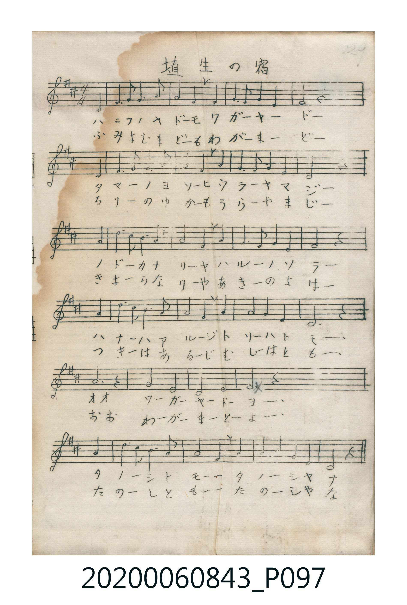

# 埴生の宿

> Re:Shōka 使用 AI 協助辨識與重建樂譜，可能會有錯誤。歡迎回報。

- **鋼琴伴奏版**：<br><audio controls src="hanyu_no_yado.mp3"></audio>

- 詞：里見義
- 曲：Henry Rowley Bishop（Home! Sweet Home!）
- 唱歌帳（2020.006.0843）P097.jpg（第 29 頁）

## 說明

> [!NOTE]
> **原頁資訊與校勘記**（對應 `P097.jpg`，手抄五線譜第 29 頁）：
> - **調性與拍號**：高音譜號標示 **2 個升記號**（D 大調，`?= D`）、拍號 `4/4`（`<4/4>`），弱起 1 拍（`1` = `D4`），共 6 行譜表（弱起 + 24 小節）。
> - **詞曲版本特徵**：里見義譯詞〈埴生の宿〉（原載明治二十二年《中等唱歌集》），末句保留早期傳唱本之「タノーシトモー　タノーシヤナ／たのーしともー　たのーしやな」（後期國定／總督府課本多改作「たのもしや」）。第 2、6、10、14、22 小節第 3 拍後標有換氣記號 `v`。
> - **手抄筆誤與塗改校勘（依 Policy A 校訂）**：
>   1. **第五行末（第 20 小節「ヨー／よー」）附點塗銷記號 `×`**：楊金土原將二分音符 `3`（`F#4`）誤加附點寫成 `3.` 並接四分休止符，旋即發現第六行首有 1 拍弱起音 `5`（`A4`，「タ／た」），遂以鉛筆在附點上明確畫 **`×`** 將附點塗銷，使該小節還原為「二分音符 `3`（2 拍）＋四分休止符（1 拍）＋次行弱起 `5`（1 拍）＝4 拍」。
>   2. **第一行末（第 4 小節「ドー／どー」）漏銷附點**：第一行末二分音符 `3` 旁亦誤點一附點（`3.`）並接四分休止符，加上第二行首弱起 `1`（「タ／る」）將成 5 拍；比照第二、三行末及第五行末自校之 `×` 例，依 Policy A 還原為二分音符 `3`（`| 3 - - - 0 - 1 - |`）。
>   3. **第 9、13、21 小節下向符桿漏標附點與符尾**：各該小節首二音 `1^`（`D5`）、`7`（`C#5`）因符桿朝下，原抄漏繪 `1^` 之附點與 `7` 之八分符尾（僅於後半小節 `6. 5` 標出附點與上向符尾），依原曲旋律及 Policy A 校訂為 `| 1^ - - 7 6 - - 5 |`。
>   4. **第六行末（第 24 小節「ナ／な」）不完全小節**：原抄作二分音符 `1` 加一拍四分休止符（共 3 拍，與曲首 1 拍弱起互補為 4 拍），TMD 依整小節規格補齊末拍休止符 `| 1 - - - 0 - 0 - |`。
>
> **第一節（片假名）**
> ハニフノヤドーモ　ワガーヤードー
> タマーノヨソーヒ　ウラーヤマジー
> ノドーカナリーヤ　ハルーノソラー
> ハナーハアルージ　トリーハトモー、
> オオ　ワーガーヤードーヨー、
> タノーシトモー　タノーシヤナ
>
> **第二節（平假名）**
> ふみよむまどーも　わがーまーどー
> るりーのゆかーも　うらーやまじー
> きよーらなりーや　あきーのよはー
> つきーはあるーじ　むしーはともー、
> おお　わーがーまーどーよー、
> たのーしともー　たのーしやな


## 歌詞

```text
（TMD 檔案未包含歌詞註解）
```

## ABC

<div class="abc-score" data-abc-src="hanyu_no_yado.abc" aria-label="五線譜載入中"></div>

[下載 ABC 原始檔](hanyu_no_yado.abc)

## TMD 檔案連結

- [主旋律 TMD 檔案](hanyu_no_yado.tmd) [[在 TMD Studio 編輯](https://tmdlang.github.io/Tmd-TS/#tmd=s7IKdvYPcrWy4qpTUCpJTLdSSM7PyUlNLsnMz7MqzsjPTkzOyFeCS5bl55TmploBqXgDI4RwcX5pUXJqfEFieqpVgIGlOboM3KT4vPyS1KT8_GyEioKi_LLUvMQ8oKrcxLzS4uSizIKS-OT8gkqEmtSyzJRUkIri5MS8-LLUosy0zNQUJGelFhWDHQxxR0lRYh7EHKAgQlV-UUlGfnpRYkFGpVVGZnFJflFmcmJOfHZiXiJCUUlGKtCDaYm5mTlIDgAqTc_Ms8pNzczKjC9JrShB9QNUujy1uCS1KC8-NzUnPwWoW0tL4en8Lc-nzH_cuO7puv0KWlpcirYKFiZc9rYKLlw2JvomdiAjXqyc937PrJftPS-WdT_ftxJs7LPZm4BiHql5RZUKQfnlOamVCk6ZwFAseL-nwyM_N1VRIbg8NbVEAcx-v6cTrOnplI3P1vY83bEZqMjIwMhAz8DATM_AwsQYqAAULXpZBelAqedr1igYWSq8XNAI1silr6VgSy3ApaCgYKcQrejnH-IaC-FoaT3tmw-07MXm9hcrul50tD9bsPBp94wXK2ZoaQFd83RD77P2ToUEmAMT3u_pedbZ_ayr5cmuKc-3z3qxdg6Kg4HBAjFXF2jyi1X7nzUsB5nZ3fti5nyQgbNerp7xcv5moDagwLMVM58v2QVUaKTwtKH7aS_QBTOg6jpcFJ4uWQ40AGhfAihCgBZ3Pm5ohJikkACMHaBIRwI4mkByQHVP92x8sXW7gqECUBFIzjBBwVYhwQWkECzdulHBTOHFwh6Q5QtXgDwH0aCtYGSi8HRD__P1DWBLmpB8sHIeMK6fd3Y8m7PmeefOp_u2QjwBSw0v1q4HKnnc0IGckh43AK3rAAbriz2dz2b0Pdu0-8munqe9jSBy55bHDV1Pdqx9vrYTkh5ezm573NANceGzOauf9i99sn_u86kzn01f-WzO_KdNm0HK5qx5srP7cUPP46b9j5v7Hjfvedy0_XFzx-PmRSB2QwOq-JLHzV3v9_Q_bgS5ByTYOP1x44rHTU1QxcjiTS2PG1c9bgCF19N9QAfMfzqn--m6WUDtz3fsfT538dNdc16s2gR0wNMls55N2flk7xyQMyAmAA2EmADSDgo3cEoARpIZEBsagAgTIGEEjF1w4IKkjUGRA7Jpxcxnczqf9c9-tmExJNYVEsoSUMIeksyer217sWoJMA09XTgd6ABI6gS69sm-uQoB-TmZyZUKjgpA0RcrmoCOAMcOxAgFBUM9oClAS4EpFRjrwMCF5S4DqINAXmleAQwJUGg1AYMTGDwgr7yc2fJy9zyghS-7tsMcd3h6AtjwZ0u7XrZPfAoMqL75Tze0g-K0ow2Yop-vWaaQYAxOk27K4CQHdPbTrgVQs9avftYxAahAL0HhyY5lz_qWPp09G6jxyZ6Jz9YuAuoFxf50YBbY_Hzmnuf9-4DOfNq6Fujql8umAcMJkqYhyRVol0KCKdgiR5A9PZB0AY1wsPuBgi8bm57sXvqyczYw_J7OWQFxxZMdXcD0-HzRrudTVwODBuInYFi0I3sYqPnJ3v0vVm6ChNHLphagT5837QJag8WzRpDMBrSyG8NHHdCcCJJ8tmYh0DfQDAdxPkJ2rgmICXQ7PP4VFIxgkbejASXyYDkVHHed0LhrXAmPu2d7-oGegHgIHGHIZqB7QOHZdGCuXAaMKXDoNEC0gYIWGFFAw3BFFTBegWEJTlo9kEiC-cwQ5DNEjDQBcy3IVcAwBsW_KcTLs5-tn_K8dTlEPzCHPNnRCXHf036IodD0-qJ9FTBlA7M-OPkpPNkHLCd6UBI-PHawpcMaYG7TBUMDIDYE4hpIKQoPZGNoICtYgjKrMSizGkLD98mO7qcTJgJNe7ZwPzBMgfkVEjjAnAgUfLphHzhwn05oQaSUZdOArgAnT8M4sANcQPEMKrUTzMF8Z2WwwNPZC6DmzpkLtAYUnn3zgVkdaM3znavAuhWAnobbpwDUDhJ42roa6EeI7aDyqrn12bQ9wLLkaW8XxAUKCWZ6CqbAWF0x82n7Lrh-YFRBvALWB8odwDAEWTl7EyjP7esGBjt6WQIMUgVgABrGgcPPHFhxgGhTYAgiBZ8JNPggWRWpgEFJpJCyGFLIAlNU79N1wKpoBUQBJBDBvgcWraiRCKy-wOmsAZT1MfIWqDYDF6ZA74Bq2NmbgOGPXE482TXpxeI5IH-AcxfE4yG-LsBkNPfZ1C0Q-18s63-2YA9Q3cu9XUD3A9XB7QB7Hyn9gDDC97DGAyR3gWvOjued7U8b259OANkFbEyBVTxu7n_c3P24eSq4fgLWTKAsC6q3gPVQ8_rHTWvAXKA4kARJQXWB6rN5YEGgLmDVtRfMngSu6pY9bgZnd5CueY-bdiB0gRSDzW9aDQz2x82roMpAdgGdARQEGwgyDWQCkguBioFSwPwKrFDByoDGgnQB6wSIIUA18Oq2EebIVSAE8QhIC7pfIHULknpiK2-MEN7VAwnhpzs3Y4Zw49bHjftB1VcTsGrfBy0LgXUzyGRgwgOmQGBNvw9MIvkaWDI1gX0NqsjbHjcC4wimq7HtcRMkGIGNA6CBMxC6Gnuh9SRQATBJQ0wAtQCAuoCtgV6YgR2PG0FhAtO1BCa1HqQMaDWIPQPsQqDG6TApeBsFFmKNXSAE8QhIDbpfYJU2XD2xLR6Qesqb01CgoKXPxeWRmFdZ6pcfmZiSbxWWD-y5ONToGtZUgyxSsLHQAkenQnVuWi2Yga1RrwCvqRQ04C1TUHFi-KhhMqxE0VGAtcQ1sZgAdAjI9Bp4hoUX_NCqwAQIoQUZEEMyN0gGhGugcsZg2ghJF5I5YPN9DGsU4oE8GAZmD7BqYE4HqwZmd1BmhLKXgGU6oSYBkz2YXA_R0bQGLr4EykJWDTa9aT_CZiM0mxu3QnQ0gtSA1HYAcQOE3bgPLLMSZkNTE5iEurWxByYOVAe3Ga4aYjPIPzVc-KMM3ARQ0ADFlCkwpixIiyn88QJiY4sX5IIZrAYeL8AyER6isBhYAQ7pvXDxSWC_LYOGNTx8wDEA0Q9SvwM5JMBmIeIAmPPhobcOGrpt4PCDpAB4aDe2QU2Dx39TCzzMQepnINvS2EtEeIMbS5DwtgSGtyGse0FkgGNW6USFOHJOQA9xhN9WQ0OyCxyyq9BCFpZLIKpgoQqJGeSYQMpTSCHeAbcFYh-wGAOHLDwmoCELCndQyILCEhFDEP0gcVDOQ4Q4yGUEQhzY-ICHuKExKMjNaBDkMBHMRA4LduQgh3saHEwg7y1CDVpw8gVWs9CgRUQFSD1CHFQYwSAoQJACHCkAIUEGClpQgMOTODjxQoobkPrpKOqBFRBEHJwRUO0gUKCAmv_Q4DYHBje8v0pkcMNCEh5u0OQMCVcQRIQtQgRPAgc3dNA9AS3DIYENK8VBorByHJEvQKKgwICnOrQSHVLPY1oALqohIQorrEGKYcU1orBGzh6QZD0fbAH-ZA1utUPC2QhUx8Kb7dRO1iB57GU3erKGlNigENoODcMOjGQKDT0M1ZCQR84csFoSOaQhpTUoiCDJFZRM0RMpNPgwVENKGJA4LDUgbKjl4tK1U0BqBUX7GMYqoAsZgYWUuQA)]
- [鋼琴伴奏 TMD 檔案](hanyu_no_yado_piano.tmd) [[在 TMD Studio 編輯](https://tmdlang.github.io/Tmd-TS/#tmd=s7IKdvYPcrWy4qpTUCpJTLdSSM7PyUlNLsnMz7MqzsjPTkzOyFeCS5bl55TmploBqXgDI4RwcX5pUXJqfEFieqpVgIGlOboM3KT4vPyS1KT8_GyEioKi_LLUvMQ8oKrcxLzS4uSizIKS-OT8gkqEmtSyzJRUkIri5MS8-LLUosy0zNQUJGelFhWDHQxxR0lRYh7EHKAgQlV-UUlGfnpRYkFGpVVGZnFJflFmcmJOfHZiXiJCUWIRUHN6am5qXolVQWZiXn58YnJyfm5BYl4mSAyhsCQDqMgqNaU0ORFijZaWwtP5W55Pmf-4cd3Tdfvf7-l42b3n-YQtT_Zsebq0_3lnx_s9nQpaWlyKtgoWJlz2tgouXDYm-iZ2IBNfrJz3fs-sl-09L5Z1P9-3EmzLs9mbgGIeqXlFlQpB-eU5qZUKTpnAgCwAmuyRn5uqqBBcnppaogBmA80Ga3o6ZeOztT1Pd2wGKjIyMDLQMzAw0zOwMDEGKgDFjF5WQTpQ6vmaNQpGlgovFzSCNXJ5JOZVlvrlRyam5FuF5QNDxaFG17CmmksBCGwstOzAjOrctFowo0bBQEEXjg2BuEbBGEjqKpgAIYg2BYqYglm6YBkQroHKGYNpIyRdSOaAzfcxrFGIB_Jg-HFzP1j14-ZusOrHzVOBuA_KXgKW6YSa9Lh5EZhcD9HRtAYuvgTKQlYNNr1pP8JmIzSbG7dCdDSC1IDUdgBxA4TduA8ssxJmQ1MTmIS6tbEHJg5UB7cZrhpiM8g_NVzQQMUfhCA2tiAEBRssCMFq4EH4uHke3POwwFoBDpS9cPFJYGcsgwYL3CvgwILoB6nfgexosFmI4Hrc1AX36DpoQLSBvQqJLHjANLZBTYNHVVMLPHhA6mcg29LYixw0hnFgGXMFM5LCBjl5oYcNwhWroX7uAofBKrQwgCU9iCqY_yFhiBxmSAkVKWw64LZA7HvcuAocBvAwg4YBKIRAYQDyNSIsIfpB4qDkjAgbkMtICxuYCGa6gYUPctjAXQf2D8gdi1DDAJwiHjdDXYcUZiD1CHFQVoRBkMuRQgbJpxC_gcIAFDLwVANOD5DMBlI_HUX948YVEHFw2kK1AxouMC_DPQhNIJAAAEFEICBE8CSZplVAhG4btKiBhAqssAGJwoobREoDiYJcDY9HtILncWMXEGFaAC5RIF6HlSkgxbBSBVGmICc4SEKZD7aA1IQCksdewKAnFEixAvLKdqhnOzAiHupNDNWQIEJObrBSFzlIIEUKyC-QBACKePRoh_oTQzUkc4HEYdGGsKEWtdILAFX1QR7Yq70C3NWeoTYkwRhpmyiYx2uDKHB4aoNCF0RC7IUog5A1yApBQnAuiIFiKnrFSKJ9ED4x9iHZBtUEq5O0oanGVNtcwUQbknIotQ3FdxTbB-TBZTAtM43Xxl7SQR2KWUoguR_ojHhtqFEgiGIcuhSNvGWoDVGP12uIvIktXfugpGsTWLpGStYQCLQ0HoRM4yEYzAcxIMIgGxGS6AqA2mFplEqGgMRMoJpoYAZuZyJMAAkYQcRBwYPVWmyGGICtINYZQBksJoBcAYxNXTsFpAiN9jGMVUAXMgILKXMBAA)]

## 分析

```text
================================================================================
📊 TMD Song Profile: [ 埴生の宿 ]
================================================================================
⏱  Duration:       2:17 (137.1s), 48 measures total
🎼 Key & Tempo:    首調基準 D, != 84.0 BPM, <4/4>
   - 分析範圍：      由實際發聲的音符與和弦推測調性；播放脈絡另行呈現
🎤 人聲音域:    D4 (MIDI 62) – D5 (MIDI 74) [跨度: 12 個半音 / 1.0 個八度, 難度: easy]
   - 最低音:  D4 in [HanyuNoYado[L1] #1 @ m.1, 0:02]
   - 最高音: D5 in [HanyuNoYado[L1] #1 @ m.10, 0:25]
   - 適合: soprano, mezzo-soprano, contralto, tenor, baritone, bass
🏛  結構:      HanyuNoYado[L1] (68.6s) -> HanyuNoYado[L2] (68.6s)
⚡ 編曲密度:        Peak 1 軌道同時演奏
🗝  調性診斷：       D 大調（純淨自然大調，未偵測到可信轉調）
   - 風格氣質:    純淨自然大調（陽光明朗、易唱易記，無明顯調外色彩）
   - 轉調歷程:    全曲維持單一推測調性（未偵測到可信轉調）
   - 核心骨幹音:  A, F#, D, G, E
   - 調性數值:    D 大調 [相關度: 0.88, 穩定度: High, 自然音純度: 100.0%]
   - 候選調性 (K-S): D 大調 (0.88), A 大調 (0.65), F# 小調 (0.61)
   - 五度圈歷程:   +2 -> +2
   - 各段落調性細節:
     • [HanyuNoYado[L1] #1]: D 大調 (r: 0.85, 自然音純度: 100.0%)
     • [HanyuNoYado[L2] #1]: D 大調 (r: 0.88, 自然音純度: 100.0%)

  [ 五度圈游移軌跡 ]
               C  
         F            G  
      Bb              [D ]*
      Eb               A  
         Ab           E  
            Db       B  
               F# 
     (* = active key center)

  [ 十二半音累積音高分佈 ]
     C  :                            0.0%
     C# : █                          1.7%
     D  : ███████████████           17.4%
     D# :                            0.0%
     E  : ████████                  10.1%
     F  :                            0.0%
     F# : ████████████████          18.5%
     G  : ███████████████           17.4%
     G# :                            0.0%
     A  : ████████████████████████  28.7%
     A# :                            0.0%
     B  : █████                      6.2%
--------------------------------------------------------------------------------
Assignment 軌道音域：
  - Vocal         : D4 – D5 (12 個半音 / 1.0 個八度, 140 個音符)
================================================================================
```


## 原書掃描頁




