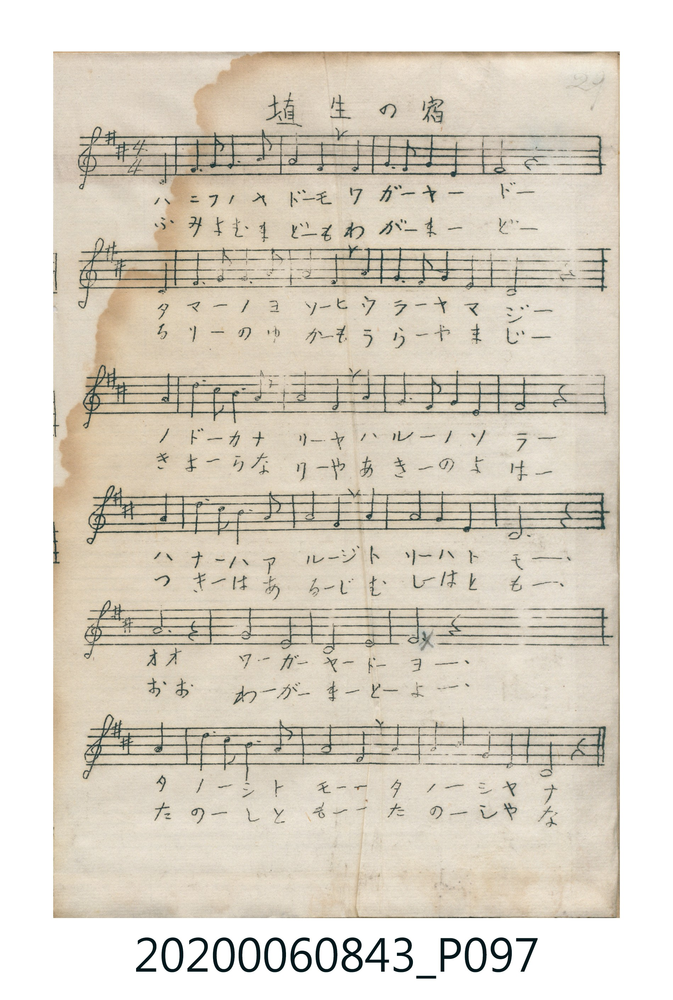

# 埴生の宿

<audio controls src="hanyu_no_yado.mp3"></audio>

- 詞：里見義
- 曲：Henry Rowley Bishop（Home! Sweet Home!）
- 唱歌帳（2020.006.0843）P097.jpg（第 29 頁）

## 說明

原書資訊與歌詞全文（對應 P097.jpg，手抄五線譜第 29 頁）：
調性與拍號：ニ調四分之四拍子（D 大調 4/4 拍，弱起拍）

## 跨冊／重複收錄參照

> 同曲（英國名曲 *Home! Sweet Home!*〈埴生の宿〉；收錄於《新定兒童唱歌》六年級、高等科女子用與《唱歌帖》P097）

- **[同曲]** 《新定兒童唱歌》尋常科第六學年用（2020.006.0847.0006）：[**〈埴生の宿〉**](../../../shintei_jido_shoka/grade_6_2020.006.0847.0006/4_11_hanyu_no_yado/index.md)（`E,` / `4/4` — [原始 TMD](../../../shintei_jido_shoka/grade_6_2020.006.0847.0006/4_11_hanyu_no_yado/hanyu_no_yado.tmd)）
- **[同曲]** 《新定兒童唱歌》高等科女子用（2020.006.0849）：[**〈埴生の宿〉**](../../../shintei_jido_shoka/koto_girls_2020.006.0849/2_4_05_hanyu_no_yado/index.md)（`E,` / `4/4` — [原始 TMD](../../../shintei_jido_shoka/koto_girls_2020.006.0849/2_4_05_hanyu_no_yado/hanyu_no_yado.tmd)）
- 總表：[跨冊重複與同名歌曲總索引](../../../duplicate_songs.md)

## 歌詞

```text
第一節（片假名）：
ハニフノヤドーモ　ワガーヤードー
タマーノヨソーヒ　ウラーヤマジー
ノドーカナリーヤ　ハルーノソラー
ハナーハアルージ　トリーハトモー
オオ　ワーガーヤードーヨー
タノーシトモー　タノーシヤナ

第二節（平假名）：
ふみよむまどーも　わがーまーどー
るりーのゆかーも　うらーやまじー
きよーらなりーや　あきーのよはー
つきーはあるーじ　むしーはともー
おお　わーがーまーどーよー
たのーしともー　たのーしやな
```

## ABC

```abc
X:1
T:埴生の宿
C:曲：Henry Rowley Bishop（Home! Sweet Home!）
M:4/4
L:1/16
Q:1/4=84
K:D
V:V1 name="Vocal" snm="Voc"
[V:V1]
z4 z4 z4 D4 | E3 F F3 A G4 F2 G2 | F3 E F2 E2 D4 z2 D2 | E3 F F3 A G4 F2 G2 |
F3 E F2 E2 D4 z2 A2 | d3 c B3 A A4 F2 A2 | G3 F G2 E2 F4 z2 A2 | d3 c B3 A A4 F2 A2 |
G3 F G2 E2 D4 z4 | A8 z4 z4 | d4 A4 G4 E4 | F8 z4 A4 |
d3 c B3 A A4 F2 A2 | G3 F G2 E2 D4 z4 |
```

## TMD 檔案連結

- [主旋律 TMD 檔案](hanyu_no_yado.tmd) [[在 TMD Studio 編輯](https://tmdlang.github.io/Tmd-TS/#tmd=s7IKdvYPcrWy4qpTUCpJTLdSSM7PyUlNLsnMz7MqzsjPTkzOyFeCS5bl55TmploBqXgDI4RwcX5pUXJqfEFieqpVgIGlOboM3KT4vPyS1KT8_GyEioKi_LLUvMQ8oKrcxLzS4uSizIKS-OT8gkqEmtSyzJRUkIrUlMyS_KLMxBwkJ6UWFYMdC3FDSVFiHsQMoKASl5aWwtP5W55Pmf-4cd3TdfsVtLS4FG0VLEy47G0VXLhsTPRN7EAmvVg57_2eWS_be14s636-byXY9GezNwHFPFLziioVgvLLc1IrFZwygR4peL-nwyM_N1VRIbg8NbVEAcx-v6cTrOnplI3P1vY83bEZqMjIwMhAz8DATM_AwsQYqAAUMnpZBelAqedr1igYWSq8XNAI1silr6VgSy3ApaCg8LRv_rPZO15sbn-xoutFRzvQSUAfPm1d8WxaO9D2pxt6n7V3KiDc0_Oss_tZV8uTXVOeb5_1Yu0cFOcBAwFk5ItV-581LAcZ1t37YuZ8oOjj5m6g4NPZs592tD3Z2Q1kAKWerp0AtMFF4emS5UBJBWAAKwBFgVY83bPxxdbtYHYnF8hAoCVPdjQ8X98ACo_O9qeN7U8ngCSh9j1u7gda8Lh56uPmvsfNSx43dz5u3vO4edHjhobHzesfN60Bc4HiQBIkBdbTtP9x8zywEFDPisdNe8HsSSA9TcseN6-E6Zn3uGkHTA9IKdjsptWPm7seN6-CKgLZA3QCUBBsHMgskH6424BKgRL9j5sWQRUBjQTp6YAZAVQDZANloW5bBUIQ14NUo3sA5GAkbwBdBVS0HW4G2A_I4kCdXfCA3NUDCcinOzdjBGTj1seN-x83dTxuanjcuO9xIzgUmprABvY_buwBcYHiIBLuwabux01gDzaue9zU9rgRGBEwPY1tj5sg4dUCNm4GTE9jL8gSkETn40agZ8H6gYpAeppAslDjOh43gkIAomcJTGI9SBHQWhB7BthtQG3TYVLAuGyC6-kCIYjrQdLoHoC4AqIUlO_BEtPhZoDdgyQO8sYqkGrKsx4UKGjpc3F5JOZVlvrlRyam5FuF5Scn5jjUGNQoVIMsUrAxNNOyA7OwZXwFSFYBZjVIFnnc0AiM3xcLexQ0LBWebugHxrQOPPNqYtEPtB5kdo2CgYIuGKLThlC6BqrOCMwzBkIQbapgApUH8UHsGqiMEZgGqYaZADIRxKaOSaZgk3AHDDg8OoHhASxrwOFhQVp4GMaBrTJXMIM6D2QhzHlgy6EONgbTIOdBnIvsPLKNQvYpJPTx-3TXFJBPW9eS41OYa2AQPQXAPQBxLAjCogoShQifwkIA3SiYPmLCAmoU4RCp5eLStVNAyjsKQK4yFwA)]
- [鋼琴伴奏 TMD 檔案](hanyu_no_yado_piano.tmd) [[在 TMD Studio 編輯](https://tmdlang.github.io/Tmd-TS/#tmd=s7IKdvYPcrWy4tLSUng6f8vzKfMfN657um7_-z0dL7v3PJ-w5cmeLU-X9j_v7Hi_p1NBS4tL0VbBwoTL3lbBhcvGRN_EjqtOQenFynnv98x62d7zYln3830rlUBiz2ZvAop5pOYVVSoE5ZfnpFYqOGUWZ-QXAE32yM9NVVQILk9NLVEAs4FmgzU9nbLx2dqepzs2AxUZGRgZ6BkYmOkZWJgYAxUEGFia62UVpAOlnq9Zo2BkqfByQSNYI5dHYl5lqV9-ZGJKvlVYfnJijkONQY1CNZcCENgYmmnZgVk1CgYKumCIThtC6RqoOiMwzxgIQbSpgglUHsQHsWugMkZgGqQaZgLIRBCbOiaZIplkGAcWNlcwgxoFkoQZBVYINdwYTIOMghhNFaOQXYUcUjCdMIgesnDLIAaDICwIIEGDMArmWnSjYPqIcTfUKMKur0VNNAGZiXn5QR5USjaG2rDoNtKG-RYiBuEDfQJVYQRlmcdrE5OKqGIwckAZa8PD1EQbFqrG2pjpAWafMZQFNhRqFxWNhTkXxWSUIIYbAoMgLXBBRLKDOwFoOFwaEWpQi5CNRlgKg5gpkFiPwV1LtPewJUgflARpgpQeIRDu8ngQMgGTwCwZHw_GQA6pSiDyFCmBCYIwUBSqGCaCZBBCJ6qxaOYYxmsbgo0HBpCunQJSGCkAucpcAA)]

## 分析

```text
================================================================================
📊 TMD Song Profile: [ 埴生の宿 ]
================================================================================
⏱  Duration:       0:40 (40.0s), 14 measures total
🎼 Key & Tempo:    首調基準 D, != 84.0 BPM, <4/4>
   - 分析範圍：      由實際發聲的音符與和弦推測調性；播放脈絡另行呈現
🎤 人聲音域:    D4 (MIDI 62) – D5 (MIDI 74) [跨度: 12 個半音 / 1.0 個八度, 難度: easy]
   - 最低音:  D4 in [HanyuNoYado #1 @ m.1, 0:02]
   - 最高音: D5 in [HanyuNoYado #1 @ m.6, 0:14]
   - 適合: soprano, mezzo-soprano, contralto, tenor, baritone, bass
🏛  結構:      HanyuNoYado (40.0s)
⚡ 編曲密度:        Peak 1 軌道同時演奏
🗝  調性診斷：       D 大調（純淨自然大調，未偵測到可信轉調）
   - 風格氣質:    純淨自然大調（陽光明朗、易唱易記，無明顯調外色彩）
   - 轉調歷程:    全曲維持單一推測調性（未偵測到可信轉調）
   - 核心骨幹音:  F#, A, D, G, E
   - 調性數值:    D 大調 [相關度: 0.88, 穩定度: High, 自然音純度: 100.0%]
   - 候選調性 (K-S): D 大調 (0.88), F# 小調 (0.65), A 大調 (0.59)
   - 五度圈歷程:   +2
   - 各段落調性細節:
     • [HanyuNoYado #1]: D 大調 (r: 0.88, 自然音純度: 100.0%)

  [ 五度圈游移軌跡 ]
               C  
         F            G  
      Bb              [D ]*
      Eb               A  
         Ab           E  
            Db       B  
               F# 
     (* = active key center)

  [ 十二半音累積音高分佈 ]
     C  :                            0.0%
     C# : ██                         1.6%
     D  : ████████████████████      18.8%
     D# :                            0.0%
     E  : ████████████              11.8%
     F  :                            0.0%
     F# : ████████████████████████  23.1%
     G  : █████████████████         16.7%
     G# :                            0.0%
     A  : ████████████████████████  23.1%
     A# :                            0.0%
     B  : █████                      4.8%
--------------------------------------------------------------------------------
Assignment 軌道音域：
  - Vocal         : D4 – D5 (12 個半音 / 1.0 個八度, 71 個音符)
================================================================================
```


## 原書掃描頁




