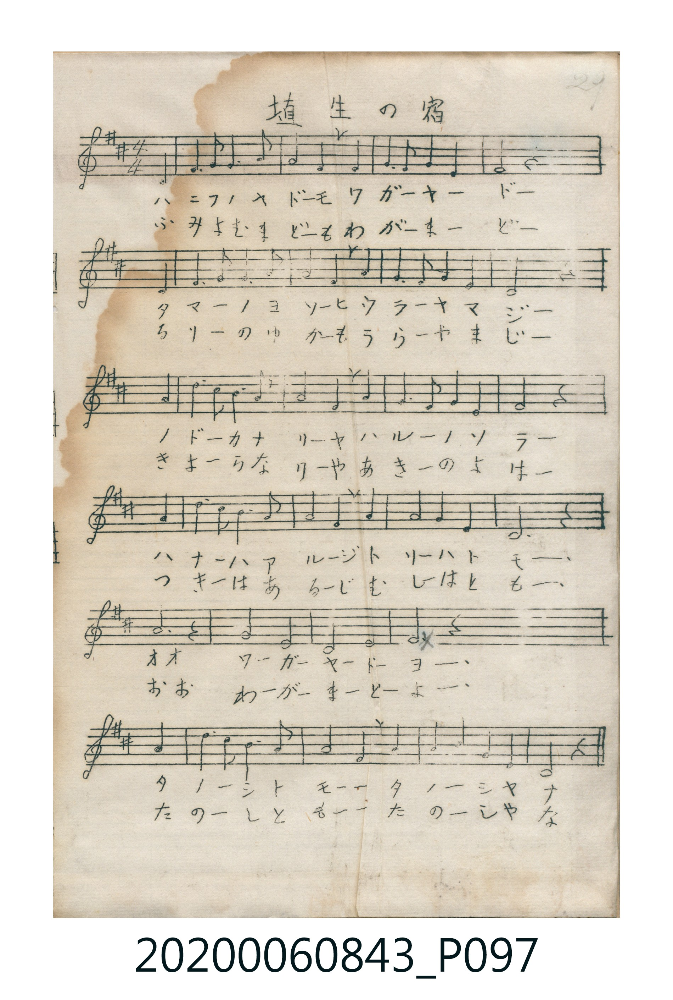

# 埴生の宿

> Re:Shōka 使用 AI 協助辨識與重建樂譜，可能會有錯誤。歡迎回報。

- **鋼琴伴奏版**：<br><audio controls src="hanyu_no_yado.mp3"></audio>

- 詞：里見義
- 曲：Henry Rowley Bishop（Home! Sweet Home!）
- 唱歌帳（2020.006.0843）P097.jpg（第 29 頁）

## 說明

原書資訊與歌詞全文（對應 P097.jpg，手抄五線譜第 29 頁）：
調性與拍號：ニ調四分之四拍子（D 大調 4/4 拍，弱起拍）


## 歌詞

```text
第一節（片假名）：
ハニフノヤドーモ　ワガーヤードー
タマーノヨソーヒ　ウラーヤマジー
ノドーカナリーヤ　ハルーノソラー
ハナーハアルージ　トリーハトモー
オオ　ワーガーヤードーヨー
タノーシトモー　タノーシヤナ

第二節（平假名）：
ふみよむまどーも　わがーまーどー
るりーのゆかーも　うらーやまじー
きよーらなりーや　あきーのよはー
つきーはあるーじ　むしーはともー
おお　わーがーまーどーよー
たのーしともー　たのーしやな
```

## ABC

<div class="abc-score" data-abc-src="hanyu_no_yado.abc" aria-label="五線譜載入中"></div>

[下載 ABC 原始檔](hanyu_no_yado.abc)

## TMD 檔案連結

- [主旋律 TMD 檔案](hanyu_no_yado.tmd) [[在 TMD Studio 編輯](https://tmdlang.github.io/Tmd-TS/#tmd=s7IKdvYPcrWy4qpTUCpJTLdSSM7PyUlNLsnMz7MqzsjPTkzOyFeCS5bl55TmploBqXgDI4RwcX5pUXJqfEFieqpVgIGlOboM3KT4vPyS1KT8_GyEioKi_LLUvMQ8oKrcxLzS4uSizIKS-OT8gkqEmtSyzJRUkIrUlMyS_KLMxBwkJ6UWFYMdC3FDSVFiHsQMoCBCFVBTemaeVW5qZlZmfElqRQmqI6DS5anFJalFefG5qTn5KUD7tbQUns7f8nzK_MeN656u26-gpcWlaKtgYcJlb6vgwmVjom9iBzLixcp57_fMetne82JZ9_N9K8HGPpu9CSjmkZpXVKkQlF-ek1qp4JQJDIaC93s6PPJzUxUVgstTU0sUwOz3ezrBmp5O2fhsbc_THZuBiowMjAz0DAzM9AwsTIyBCkDhqpdVkA6Uer5mjYKRpcLLBY1gjVz6Wgq21AJcCgoKT_vmP5u948Xm9hcrul50tAOdBPTh09YVz6a1A21_uqH3WXunAsI9Pc86u591tTzZNeX59lkv1s5BcR4wEEBGvli1_1nDcpBh3b0vZs4Hij5u7gYKPp09-2lH25Od3UAGUOrp2glAG1wUni5ZDpRUAAawAlAUaMXTPRtfbN0OZndygQwEWvJkR8Pz9Q2g8Ohsf9rY_nQCSBJq3-PmfqAFj5unPm7ue9y85HFz5-PmPY-bFz1uaHjcvP5x0xowFygOJEFSYD1N-x83zwMLAfWseNy0F8yeBNLTtOxx80qYnnmPm3bA9ICUgs1uWv24uetx8yqoIpA9QCcABcHGgcwC6Ye7DagUKNH_uGkRVBHQSJCeDpgRQDVANlAW6rZVIARxPUg1ugdADkbyBtBVQEXb4WaA_YAsDtTZBQ_IXT2QgHy6czNGQDZufdy4_3FTx-OmhseN-x43gkOhqQlsYP_jxh4QFygOIuEebOp-3AT2YOO6x01tjxuBEQHT09j2uAkSXi1g42bA9DT2giwBSXQ-bgR6FqwfqAikpwkkCzWu43EjKAQgepbAJNaDFAGtBbFngN0G1DYdJgWMyya4ni4QgrgeJI3uAYgrIEpB-R4sMR1uBtg9SOIgb6wCqaY860GBgpY-F5dHYl5lqV9-ZGJKvlVYfnJijkONQY1CNcgiBRtDMy07MAtbxleAZBVgVoNkkccNjcD4fbGwR0HDUuHphn5gTOvAM68mFv1A60Fm1ygYKOiCITptCKVroOqMwDxjIATRpgomUHkQH8SugcoYgWmQapgJIBNBbOqYZAo2CXfAgMOjExgewLIGHB4WpIWHYRzYKnMFM6jzQBbCnAe2HOpgYzANch7EucjOI9soZJ9CQh-_T3dNAfm0dS05PoW5BgbRUwDcAxDHgiAsqiBRiPApLATQjYLpIyYsoEYRDpFaLi5dOwWkvKMA5CpzAQA)]
- [鋼琴伴奏 TMD 檔案](hanyu_no_yado_piano.tmd) [[在 TMD Studio 編輯](https://tmdlang.github.io/Tmd-TS/#tmd=s7IKdvYPcrWy4tLSUng6f8vzKfMfN657um7_-z0dL7v3PJ-w5cmeLU-X9j_v7Hi_p1NBS4tL0VbBwoTL3lbBhcvGRN_EjqtOQenFynnv98x62d7zYln3830rlUBiz2ZvAop5pOYVVSoE5ZfnpFYqOGUWZ-QXAE32yM9NVVQILk9NLVEAs4FmgzU9nbLx2dqepzs2AxUZGRgZ6BkYmOkZWJgYAxUEGFia62UVpAOlnq9Zo2BkqfByQSNYI5dHYl5lqV9-ZGJKvlVYfnJijkONQY1CNZcCENgYmmnZgVk1CgYKumCIThtC6RqoOiMwzxgIQbSpgglUHsQHsWugMkZgGqQaZgLIRBCbOiaZIplkGAcWNlcwgxoFkoQZBVYINdwYTIOMghhNFaOQXYUcUjCdMIgesnDLIAaDICwIIEGDMArmWnSjYPqIcTfUKMKur0VNNAGZiXn5QR5USjaG2rDoNtKG-RYiBuEDfQJVYQRlmcdrE5OKqGIwckAZa8PD1EQbFqrG2pjpAWafMZQFNhRqFxWNhTkXxWSUIIYbAoMgLXBBRLKDOwFoOFwaEWpQi5CNRlgKg5gpkFiPwV1LtPewJUgflARpgpQeIRDu8ngQMgGTwCwZHw_GQA6pSiDyFCmBCYIwUBSqGCaCZBBCJ6qxaOYYxmsbgo0HBpCunQJSGCkAucpcAA)]

## 分析

```text
================================================================================
📊 TMD Song Profile: [ 埴生の宿 ]
================================================================================
⏱  Duration:       0:40 (40.0s), 14 measures total
🎼 Key & Tempo:    首調基準 D, != 84.0 BPM, <4/4>
   - 分析範圍：      由實際發聲的音符與和弦推測調性；播放脈絡另行呈現
🎤 人聲音域:    D4 (MIDI 62) – D5 (MIDI 74) [跨度: 12 個半音 / 1.0 個八度, 難度: easy]
   - 最低音:  D4 in [HanyuNoYado #1 @ m.1, 0:02]
   - 最高音: D5 in [HanyuNoYado #1 @ m.6, 0:14]
   - 適合: soprano, mezzo-soprano, contralto, tenor, baritone, bass
🏛  結構:      HanyuNoYado (40.0s)
⚡ 編曲密度:        Peak 1 軌道同時演奏
🗝  調性診斷：       D 大調（純淨自然大調，未偵測到可信轉調）
   - 風格氣質:    純淨自然大調（陽光明朗、易唱易記，無明顯調外色彩）
   - 轉調歷程:    全曲維持單一推測調性（未偵測到可信轉調）
   - 核心骨幹音:  F#, A, D, G, E
   - 調性數值:    D 大調 [相關度: 0.88, 穩定度: High, 自然音純度: 100.0%]
   - 候選調性 (K-S): D 大調 (0.88), F# 小調 (0.65), A 大調 (0.59)
   - 五度圈歷程:   +2
   - 各段落調性細節:
     • [HanyuNoYado #1]: D 大調 (r: 0.88, 自然音純度: 100.0%)

  [ 五度圈游移軌跡 ]
               C  
         F            G  
      Bb              [D ]*
      Eb               A  
         Ab           E  
            Db       B  
               F# 
     (* = active key center)

  [ 十二半音累積音高分佈 ]
     C  :                            0.0%
     C# : ██                         1.6%
     D  : ████████████████████      18.8%
     D# :                            0.0%
     E  : ████████████              11.8%
     F  :                            0.0%
     F# : ████████████████████████  23.1%
     G  : █████████████████         16.7%
     G# :                            0.0%
     A  : ████████████████████████  23.1%
     A# :                            0.0%
     B  : █████                      4.8%
--------------------------------------------------------------------------------
Assignment 軌道音域：
  - Vocal         : D4 – D5 (12 個半音 / 1.0 個八度, 71 個音符)
================================================================================
```


## 原書掃描頁




