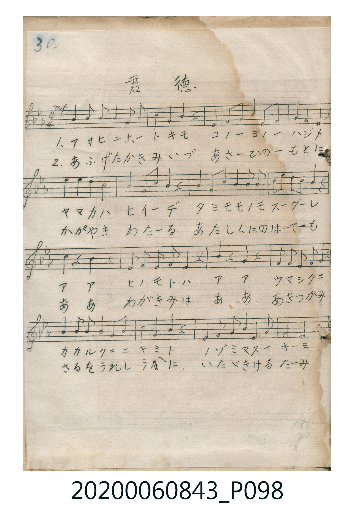
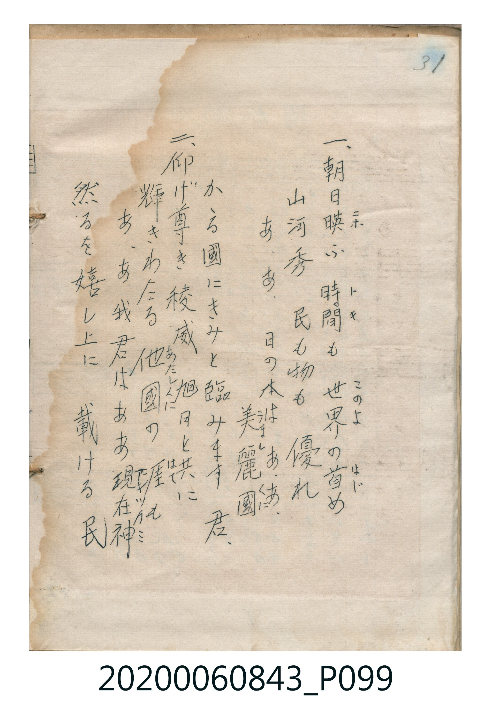

# 君德

> Re:Shōka 使用 AI 協助辨識與重建樂譜，可能會有錯誤。歡迎回報。

- **鋼琴伴奏版**：<br><audio controls src="kuntoku.mp3"></audio>

- 唱歌帳（2020.006.0843）P098.jpg–P099.jpg（第 30–31 頁）

## 說明

原書資訊與歌詞全文（對應 P098.jpg 樂譜與 P099.jpg 歌詞，第 30–31 頁）：
調性與拍號：變ホ調四分之四拍子（Eb 大調 4/4 拍），力度記號 mf


## 歌詞

```text
1. 朝日ニホートキモ　此ノ世ノ初メ
山川秀デ　民百物モ勝レ
アア日本ハ　アア美シ國
カカル國ニ君ト　臨ミマス君

2. 仰ゲ高キ御稜威　朝日ノ本ニ
輝キ渡ル　アタシ國ノ果モ
アア我ガ君ハ　アア現ツ神
サルヲ嬉シ上ニ　戴キケル民
```

## ABC

<div class="abc-score" data-abc-src="kuntoku.abc" aria-label="五線譜載入中"></div>

[下載 ABC 原始檔](kuntoku.abc)

## TMD 檔案連結

- [主旋律 TMD 檔案](kuntoku.tmd) [[在 TMD Studio 編輯](https://tmdlang.github.io/Tmd-TS/#tmd=s7IKdvYPcrWy4qpTUCpJTLdSSM7PyUlNLsnMz7MqzsjPTkzOyFeCS5bl55TmploBqXgDI4RwcX5pUXJqfEFieqpVgIGlBboM3KT4vPyS1KT8_GyEioKi_LLUvMQ8oKrcxLzS4uSizIKS-OT8gkqEmtSyzJRUkIrUlMyS_KLMxBwkJ6UWFYMdC3FDSVFiHsQMoCBCVUlGKtDdmbkFqai6gYalZ-ZZleaBLCjJTMtMTVHi0tJSeDph9tN92xW0tLgUbRUszbjsbRVcdbhsTPRN7EB6n07Z-Gxtz9Mdm9_v6TAyMDLQMzAw0zOwMDF-v6cTFAB6WQXpjxomA5mWICZQ1fM1axSMDYBixoYKLxc0AtUpcXHpaynYUgtwKSgoPO2b_2z2jheb21-s6HrR0Q504ouV8562rng2rR3ohKcbep-1dyrA3KfwbEXTi7VzgOpAQmB3KkB0vN_Tg-nc93tmgax4sWr_s4blIMO7e1_MnA8UfbGu63HzbKD409mzn3a0PdnZDWQAZZ-unQC01DVJ4emS5UBZBWDYKQCFwUb1PO2a_XTXshcrZgDNUMhN4wIZbain8GzO3GfTlz5u7gaa-Lh5z-PmjsdNax83L3rc0PBs7ZLHzX1PdkwDkk875j5uXgjSA_L0xo1Pt899vrzhcXM7SN2Gic9n7nveuRKo7Wk3UN0aqLrHTYuACGj8szlrHjf3A5VCRJ7v63vctP3pnG64utUg1LwaKAR0CTAlgJzR0PCifcXj5vmPm-c9btoJFAQ72UhP4cnuDY-bNr1cPQPo0qf7Fj5fMefpikaQO6Be6QNbBzP8xZ65QHXPdiwEmg9zwX6I9SCl8-YAXY3q3o6Jj5vWgB2B5OT-fY-bW54vnQdXuhVkXvOmp2s6gYY92QGMkW6QGzq2gMKvaSNQFhguINWUJzQoUNDS5-LyLs0ryc8utQrLT07McagxqFGoBjvJxtBMyw7MwpbEFYCp68mOhhcLexQ0TBSebuh_vr5BB54uNbFoANoFMqxGwVBBFwwhtJGCMZRvBBWrUTCFisBoMyhtAKVroCaZxiMZBdKObBRYIdwyM5hSuB4YrAGnAtye3NVDjidhLkGnMV0GczdMBt2TuNQhggvsNxATzAB7EO5LhGkEorKTEl_CbEHn10BdawylDRHxgBGXaOLofKA3wbQZVMZMwTAOKkVkTAKLNMpjEuYTWDwYIzkdlkwxnI4lJkE64fogYWKEpMQcOWWj-rGWi0vXTgGaaxWATGUuAA)]
- [鋼琴伴奏 TMD 檔案](kuntoku_piano.tmd) [[在 TMD Studio 編輯](https://tmdlang.github.io/Tmd-TS/#tmd=s7IKdvYPcrWy4tLSUng6YfbTfdvf7-l42b3n-YQtT_Zsebq0_3lnx_s9nQpaWlyKtgqWZlz2tgquOlw2Jvomdlx1CkpPp2x8trbn6Y7NQG1GBkYGegYGZnoGFibGQE0BBpYWelkF6Y8aJgOZliAmUNXzNWsUjA2AYsaGCi8XNALVKXFxeZfmleRnl1qF5Scn5jjUGNQoVHMpAIGNoZmWHZhVo2CooAuGENpIwRjKN4KK1SiYQkVgtBmUNoDSNVCTTOORjAJpRzYKrBBumRlMKVwPDMIMg-lFpzHNgtkEk0F3Fi51CA-CXQNighlgJ8HdhW4azB0wcXR-DdR8YyhtiPArRnihiaPzgQ4D02ZQGTMFwzioFP7QgtkN86sxkmWwyMOwDEtogXTC9UF8YYSkxBw5vlFdVYtIewGZiXn5QR5Epj5Dbcz0Z6wNcwSCZaJNdCpEGGker01OUkQYgI2F1VBYWkOSpG2yRLgHJoMpQkLSRAQ0PJ1jiNTAI8EMLgti4UykCBfBkilS8CBSKrZIxmI7jvSKUImcYrHFFkIQ4VD0dOuDkm5NEMk2HoFgPJN4oOPgzoLJmsZDVZgAGSAOWACnKigb3SC4RrgxQEEURQZQEbhSkELsKoAOhZoAcj0OeyAeQrcFqg8og7DIMF4bnF5BgadrpwANPwVUpjIXAA)]

## 分析

```text
================================================================================
📊 TMD Song Profile: [ 君德 ]
================================================================================
⏱  Duration:       0:40 (40.0s), 16 measures total
🎼 Key & Tempo:    首調基準 E,, != 96.0 BPM, <4/4>
   - 分析範圍：      由實際發聲的音符與和弦推測調性；播放脈絡另行呈現
🎤 人聲音域:    A#3 (MIDI 58) – D#5 (MIDI 75) [跨度: 17 個半音 / 1.4 個八度, 難度: challenging]
   - 最低音:  A#3 in [Kuntoku #1 @ m.3, 0:05]
   - 最高音: D#5 in [Kuntoku #1 @ m.12, 0:28]
   - 適合: soprano, mezzo-soprano, contralto, tenor, baritone, bass
🏛  結構:      Kuntoku (40.0s)
⚡ 編曲密度:        Peak 1 軌道同時演奏
🗝  調性診斷：       D# 大調（純淨自然大調，未偵測到可信轉調）
   - 風格氣質:    純淨自然大調（陽光明朗、易唱易記，無明顯調外色彩）
   - 轉調歷程:    全曲維持單一推測調性（未偵測到可信轉調）
   - 核心骨幹音:  D#, A#, F, G, C
   - 調性數值:    D# 大調 [相關度: 0.83, 穩定度: Moderate, 自然音純度: 100.0%]
   - 候選調性 (K-S): D# 大調 (0.83), A# 大調 (0.79), G 小調 (0.64)
   - 五度圈歷程:   -3
   - 各段落調性細節:
     • [Kuntoku #1]: D# 大調 (r: 0.83, 自然音純度: 100.0%)

  [ 五度圈游移軌跡 ]
               C  
         F            G  
      Bb               D  
     [Eb]*              A  
         Ab           E  
            Db       B  
               F# 
     (* = active key center)

  [ 十二半音累積音高分佈 ]
     C  : █████████████             12.7%
     C# :                            0.0%
     D  : ██                         1.8%
     D# : ████████████████████████  23.6%
     E  :                            0.0%
     F  : ████████████████████      20.0%
     F# :                            0.0%
     G  : ████████████████████      19.5%
     G# :                            0.0%
     A  :                            0.0%
     A# : ███████████████████████   22.3%
     B  :                            0.0%
--------------------------------------------------------------------------------
Assignment 軌道音域：
  - Vocal         : A#3 – D#5 (17 個半音 / 1.4 個八度, 68 個音符)
================================================================================
```


## 原書掃描頁






