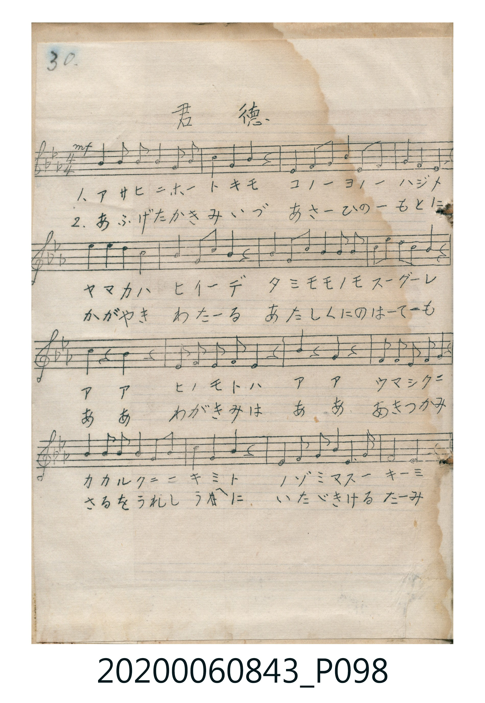
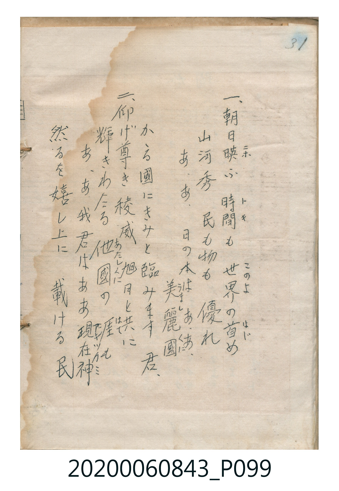

# 君德

> Re:Shōka 使用 AI 協助辨識與重建樂譜，可能會有錯誤。歡迎回報。

- **鋼琴伴奏版**：<br><audio controls src="kuntoku.mp3"></audio>

- 唱歌帳（2020.006.0843）P098.jpg–P099.jpg（第 30–31 頁）

## 說明

原書資訊與歌詞全文（對應 P098.jpg 樂譜與 P099.jpg 歌詞，第 30–31 頁）：
調性與拍號：變ホ調四分之四拍子（Eb 大調 4/4 拍），力度記號 mf


## 歌詞

```text
1. 朝日ニホートキモ　此ノ世ノ初メ
山川秀デ　民百物モ勝レ
アア日本ハ　アア美シ國
カカル國ニ君ト　臨ミマス君

2. 仰ゲ高キ御稜威　朝日ノ本ニ
輝キ渡ル　アタシ國ノ果モ
アア我ガ君ハ　アア現ツ神
サルヲ嬉シ上ニ　戴キケル民
```

## ABC

<div class="abc-score" data-abc-src="kuntoku.abc" aria-label="五線譜載入中"></div>

[下載 ABC 原始檔](kuntoku.abc)

## TMD 檔案連結

- [主旋律 TMD 檔案](kuntoku.tmd) [[在 TMD Studio 編輯](https://tmdlang.github.io/Tmd-TS/#tmd=s7IKdvYPcrWy4qpTUCpJTLdSSM7PyUlNLsnMz7MqzsjPTkzOyFeCS5bl55TmploBqXgDI4RwcX5pUXJqfEFieqpVgIGlBboM3KT4vPyS1KT8_GyEioKi_LLUvMQ8oKrcxLzS4uSizIKS-OT8gkqEmtSyzJRUkIrUlMyS_KLMxBwkJ6UWFYMdC3FDSVFiHsQMoCBCVUlGKtDdmbkFqai6gYalZ-ZZleaBLCjJTMtMTUGWLMnITy9KLMiotMrILAbZnJyYE5-dmJeoxKWlpfB0wuyn-7YraGlxKdoqWJpx2dsquOpw2Zjom9iBzHg6ZeOztT1Pd2x-v6fDyMDIQM_AwEzPwMLE-P2eTlAo6WUVpD9qmAxkWoKYQFXP16xRMDYAihkbKrxc0AhUp8TFpa-lYEstwKWgoPC0b_6z2TtebG5_saLrRUc70IkvVs572rri2bR2oBOebuh91t6pAHOfwrMVTS_WzgGqAwmB3akA0fF-Tw-mc9_vmQWy4sWq_c8aloMM7-59MXM-UPTFuq7HzbOB4k9nz37a0fZkZzeQAZR9unYC0FLXJIWnS5YDZRWAYacAFAYb1fO0a_bTXcterJgBNEMhN40LZLShnsKzOXOfTV_6uLkbaOLj5j2PmzseN6193LzocUPDs7VLHjf3PdkxDUg-7Zj7uHkhSA_I0xs3Pt0-9_nyhsfN7SB1GyY-n7nveedKoLan3UB1a6DqHjctAiKg8c_mrHnc3A9UChF5vq_vcdP2p3O64epWg1DzaqAQ0CXAlAByRkPDi_YVj5vnP26e97hpJ1AQ7GQjPYUnuzc8btr0cvUMoEuf7lv4fMWcpysaQe6AeqUPbB3M8Bd75gLVPduxEGg-zAX7IdaDlM6bA3Q1qns7Jj5uWgN2BJKT-_c9bm55vnQeXOlWkHnNm56u6QQa9mQHMEa6QW7o2AIKv6aNQFlguIBUU57QoEBBS5-Ly7s0ryQ_u9QqLB-YexxqDGqqwS6yMTTTsgOzsKVwBWDierKj4cXCHgUNE4WnG_qfr2_QgSdLTSwagFaBDKtRMFTQBUMIbaRgDOUbQcVqFEyhIjDaDEobQOkaqEmm8UhGgbQjGwVWCLfMDKYUrgcGa8CJALcnd_WQ40mYS9BpTJfB3A2TQfckLnWI4AL7DcQEM8AehPsSYRqBqOykxJcwW9D5NVDXGkNpQ0Q8YMQlmjg6H-hNMG0GlTFTMIyDShEZk8ASjfKYhPkEFg_GSE6HJVMMp2OJSZBOuD5ImBghKTFHTtmofqzl4tK1U4BmWgUgU5kLAA)]
- [鋼琴伴奏 TMD 檔案](kuntoku_piano.tmd) [[在 TMD Studio 編輯](https://tmdlang.github.io/Tmd-TS/#tmd=s7IKdvYPcrWy4qpTUCpJTLdSyC8qychPL0osyKi0ysgsLskvykxOzInPTsxLVIIrKs4vLUpOjS9ITE-1CjCwtNAFEpYI6ZKM1NxUq9SU0uTEksz8PCUuLS2FpxNmP923_f2ejpfde55P2PJkz5anS_ufd3a839OpoKXFpWirYGnGZW-r4KrDZWOib2IHMuzplI3P1vY83bEZqM3IwMhAz8DATM_AwsQYqAlkrV5WQfqjhskgy0FMoKrna9YoGBsAxYwNFV4uaASqU-Li8i7NK8nPLrUKywf6xKHGoKaaSwEIbAzNtOzArBoFQwVdMITQRgrGUL4RVKxGwRQqAqPNoLQBlK6BmmQaj2QUSDuyUWCFcMvMYErhemAQZhhMLzqNaRbMJpgMurNwqUN4EOwaEBPMADsJ7i5002DugImj82ug5htDaUOEXzHCC00cnQ90GJg2g8qYKRjGQaXwhxbMbphfjZEsg0UehmVYQgukE64P4gsjJCXmyPGN6qpaRNILyEzMyw_yIC7xGWpjJj9jbZgbECwTbaITIcJI83htclIiwgBsLKyGwpIakiRtUyXCPTAZTBESUiYioOHJHEOkBh4JZnBZEAtnGkW4CJZKkYIHkVCxRTIW23EkV4RK5ASLLbYQggiHoidbH-Rka4JItfEIBOOZxAPdBncVTNY0HqrCBMgAccACOFVB2egGwTXCjQEKoigygIrAlYIUYlcBdCjUBJDrcdgD8RC6LVB9QBmERYbx2uDkCgo7XTsFaPApoDKVuQA)]

## 分析

```text
================================================================================
📊 TMD Song Profile: [ 君德 ]
================================================================================
⏱  Duration:       0:40 (40.0s), 16 measures total
🎼 Key & Tempo:    首調基準 E,, != 96.0 BPM, <4/4>
   - 分析範圍：      由實際發聲的音符與和弦推測調性；播放脈絡另行呈現
🎤 人聲音域:    A#3 (MIDI 58) – D#5 (MIDI 75) [跨度: 17 個半音 / 1.4 個八度, 難度: challenging]
   - 最低音:  A#3 in [Kuntoku #1 @ m.3, 0:05]
   - 最高音: D#5 in [Kuntoku #1 @ m.12, 0:28]
   - 適合: soprano, mezzo-soprano, contralto, tenor, baritone, bass
🏛  結構:      Kuntoku (40.0s)
⚡ 編曲密度:        Peak 1 軌道同時演奏
🗝  調性診斷：       D# 大調（純淨自然大調，未偵測到可信轉調）
   - 風格氣質:    純淨自然大調（陽光明朗、易唱易記，無明顯調外色彩）
   - 轉調歷程:    全曲維持單一推測調性（未偵測到可信轉調）
   - 核心骨幹音:  D#, A#, F, G, C
   - 調性數值:    D# 大調 [相關度: 0.83, 穩定度: Moderate, 自然音純度: 100.0%]
   - 候選調性 (K-S): D# 大調 (0.83), A# 大調 (0.79), G 小調 (0.64)
   - 五度圈歷程:   -3
   - 各段落調性細節:
     • [Kuntoku #1]: D# 大調 (r: 0.83, 自然音純度: 100.0%)

  [ 五度圈游移軌跡 ]
               C  
         F            G  
      Bb               D  
     [Eb]*              A  
         Ab           E  
            Db       B  
               F# 
     (* = active key center)

  [ 十二半音累積音高分佈 ]
     C  : █████████████             12.7%
     C# :                            0.0%
     D  : ██                         1.8%
     D# : ████████████████████████  23.6%
     E  :                            0.0%
     F  : ████████████████████      20.0%
     F# :                            0.0%
     G  : ████████████████████      19.5%
     G# :                            0.0%
     A  :                            0.0%
     A# : ███████████████████████   22.3%
     B  :                            0.0%
--------------------------------------------------------------------------------
Assignment 軌道音域：
  - Vocal         : A#3 – D#5 (17 個半音 / 1.4 個八度, 68 個音符)
================================================================================
```


## 原書掃描頁






