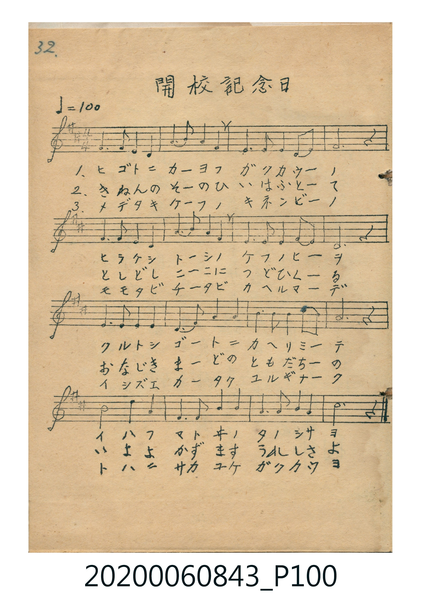
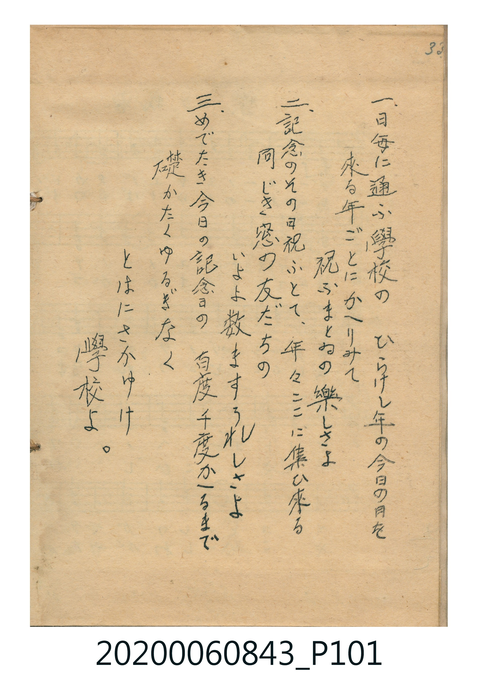

# 開校記念日

<audio controls src="kaiko_kinenbi.mp3"></audio>

- 唱歌帳（2020.006.0843）P100.jpg–P101.jpg（第 32–33 頁）

## 說明

原書資訊與歌詞全文（對應 P100.jpg 樂譜與 P101.jpg 歌詞，第 32–33 頁）：
調性與拍號：ニ調四分之四拍子（D 大調 4/4 拍），速度 ♩=100

## 歌詞

```text
1. 日毎に通ふ　學校の
開けし年の　けふの日を
來る年毎に　かへりみて
祝ふまとゐの　楽しさよ

2. 記念のその日　祝ふとて
年々ここに　集ひ來る
同じき窓の　友だちの
いよよ數ます　うれしさよ

3. めでたきけふの　記念日の
百たび千たび　かへるまで
いしずゑかたく　ゆるぎなく
とわに榮ゆけ　學校よ
```

## ABC

```abc
X:1
T:開校記念日
M:4/4
L:1/16
Q:1/4=100
K:D
V:V1 name="Vocal" snm="Voc"
[V:V1]
A6 A2 F4 D4 | B4 d4 A4 F4 | E6 F2 E4 D2 E2 | F12 z4 |
A6 A2 F4 D4 | B4 d4 A4 F4 | E6 A2 F4 E4 | D12 z4 |
E6 F2 E4 F4 | D4 E4 F4 A4 | B4 B4 A4 B2 A2 | F12 z4 |
B4 B4 A4 F4 | E6 E2 F4 A4 | B6 d2 A4 F4 | d12 z4 |
```

## TMD 檔案連結

- [主旋律 TMD 檔案](kaiko_kinenbi.tmd) [[在 TMD Studio 編輯](https://tmdlang.github.io/Tmd-TS/#tmd=s7IKdvYPcrWy4tLSUng5rfvZgoUvVsx4un_rs-lLFbS0uBRtFQwNDLjsbRVcuGxM9E3suOoUlJ5O2fhsbc_THZvf7-kwMjAy0DMwMNMzsDAxfr-nMwCoXC-rIP1Rw2Qg0xDEBKp6vmaNgrERUMzYWOHlgkagOiUuLn0tBVtqAS4FBYWnffOfzd7xYnP7ixVdLzragU58sXLe09YVz6a1A53wdEPvs_ZOBZj7FJ6taHqxdg5QHUgI7E4FiI73e3ownft-zyyQFS9W7X_WsBxkeHfvi5nzgaKPm7uBgk9nz37a0fZkZzeQAZR6unYC0EYXhadLlgMlFYDhpgAUBRvT87Jh_tNdyxQezVxpCwpZkKmGegrA4H62vu9x4-qXDbMeN2593NDwdO0OYGQ8blwHUgEEwMh53DjxceP0pzu3AEWBKsDcrUA2UPPjpklQdU_2tT1u6gYqgpgHVgfUueNxU9fjxv2PG5dB1T1fOhese9_jxhWPmyZAjHy2dC_QhseNUx83dYCdZqSnAEkPIPlGoA6wZQ0NMN0rEAaC3NXQ-rhxMhiBLH45u-1x4yaIg2CKJvQ8bpzxuLH3-SqgIpCVT_uBrlvwuBHJq48bW4D2A9GzqTvADpwJ9gXQGKBmZNcZ6yk8bmp83Lj8ceN8oJnwAAEqh6dihLHPZwKNAqrb_LS3GcJAChwgCZRdjuQCkE2zHjcBjQTKAVX3g1Q3gfzyuBEYsquAInDVwBDsB_r52bJ1IBVAZ8DjD-hSoArKEzgUKGjpc3F5J2Zm53tn5qXmJWVaheUnJ-Y41BjUKFSDnWNjoWUHZmDLXgrAlP1kR8OLhT0KGiYKTzf0P1_foAPPE5pYNADtAxlWo2CqoAuEpgrGQNIQiGsUzECsOLCgLli4RsEIrMgYTBsCyRqwOAwagNSAIw6343b10NhxEEUgdg1YKSmO29FJjuOQAwXiEpC9MB7IfRDngjCIZwYkSQ44YMFDjtuQ7UUOJSM0t4EDE6EIHLKorqvl4tK1U0BOmgpAvjIXAA)]
- [鋼琴伴奏 TMD 檔案](kaiko_kinenbi_piano.tmd) [[在 TMD Studio 編輯](https://tmdlang.github.io/Tmd-TS/#tmd=s7IKdvYPcrWy4tLSUng5rfvZgoUvVsx4un_rs-lL3-_peNm95_mELU_2bHm6tP95Z8f7PZ0KWlpcirYKhgYGXPa2Ci5cNib6JnZcdQpKT6dsfLa25-mOzUBtRgZGBnoGBmZ6BhYmxkBNAUDlelkF6Y8aJgOZhiAmUNXzNWsUjI2AYsbGCi8XNALVKXFxeSdmZud7Z-al5iVlWoXlJyfmONQY1ChUcykAgY2Flh2YUaNgqqALhKYKxkDSEIhrFMxArDiwoC5YuEbBCKzIGEwbAskasDgMGoDUkG4cRBGIXQNWis04ZIshekEqYTyQiRALQBjEMwOSuB2HrBLZJUZopoEdjFAEdj2qebVoARyQmZiXH-SBPYiNtWGhYqiNCBcTbZBVJtpg0yFKINI1Cubx2jCPQ5mQQIfIY_MZ-VbAdEAF8FmC6SzUKIHohNiDsBxEQsQgkYPbfEwdGK41wmoJOL5QdRhDPE1ErPmgxJoJPNYM4xEIaFE8CMF4pvHxKBisGsQAUgZw_1BuAj5VWAzFZgR2azH0w0zXBkUmPLR07RSQA0wByFfmAgA)]

## 分析

```text
================================================================================
📊 TMD Song Profile: [ 開校記念日 ]
================================================================================
⏱  Duration:       0:38 (38.4s), 16 measures total
🎼 Key & Tempo:    首調基準 D, != 100.0 BPM, <4/4>
   - 分析範圍：      由實際發聲的音符與和弦推測調性；播放脈絡另行呈現
🎤 人聲音域:    D4 (MIDI 62) – D5 (MIDI 74) [跨度: 12 個半音 / 1.0 個八度, 難度: easy]
   - 最低音:  D4 in [KaikoKinenbi #1 @ m.1, 0:01]
   - 最高音: D5 in [KaikoKinenbi #1 @ m.2, 0:03]
   - 適合: soprano, mezzo-soprano, contralto, tenor, baritone, bass
🏛  結構:      KaikoKinenbi (38.4s)
⚡ 編曲密度:        Peak 1 軌道同時演奏
🗝  調性診斷：       D 大調（純淨自然大調，未偵測到可信轉調）
   - 風格氣質:    純淨自然大調（陽光明朗、易唱易記，無明顯調外色彩）
   - 轉調歷程:    全曲維持單一推測調性（未偵測到可信轉調）
   - 核心骨幹音:  F#, D, A, E, B
   - 調性數值:    D 大調 [相關度: 0.76, 穩定度: Moderate, 自然音純度: 100.0%]
   - 候選調性 (K-S): D 大調 (0.76), F# 小調 (0.73), A 大調 (0.67)
   - 五度圈歷程:   +2
   - 各段落調性細節:
     • [KaikoKinenbi #1]: D 大調 (r: 0.76, 自然音純度: 100.0%)

  [ 五度圈游移軌跡 ]
               C  
         F            G  
      Bb              [D ]*
      Eb               A  
         Ab           E  
            Db       B  
               F# 
     (* = active key center)

  [ 十二半音累積音高分佈 ]
     C  :                            0.0%
     C# :                            0.0%
     D  : █████████████████         20.0%
     D# :                            0.0%
     E  : ████████████████          18.3%
     F  :                            0.0%
     F# : ████████████████████████  28.3%
     G  :                            0.0%
     G# :                            0.0%
     A  : █████████████████         20.0%
     A# :                            0.0%
     B  : ███████████               13.3%
--------------------------------------------------------------------------------
Assignment 軌道音域：
  - Vocal         : D4 – D5 (12 個半音 / 1.0 個八度, 54 個音符)
================================================================================
```


## 原書掃描頁






