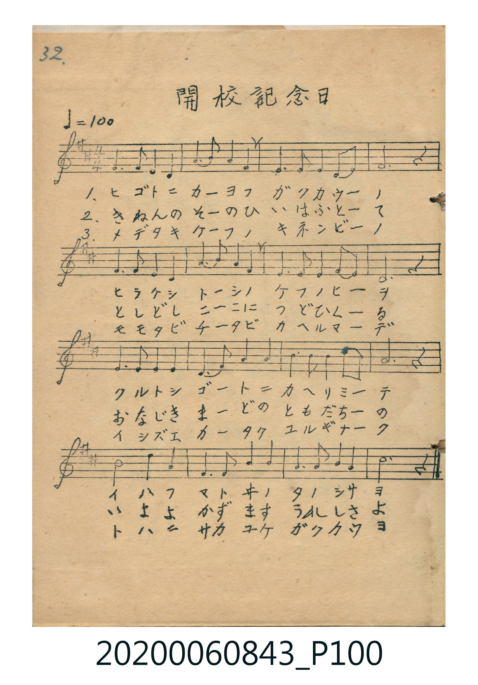
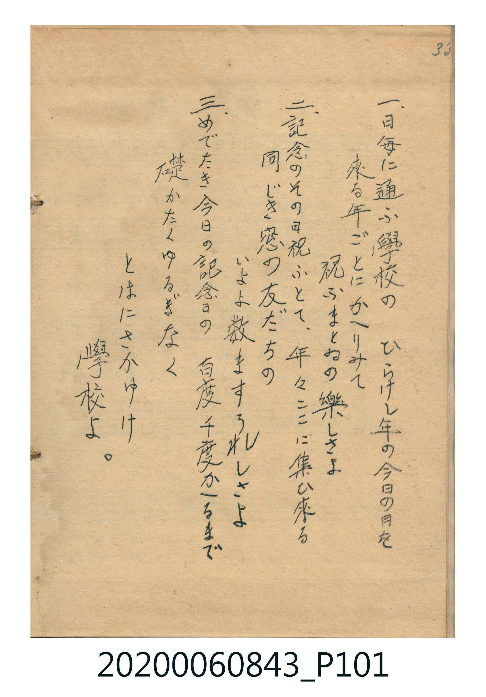

# 開校記念日

> Re:Shōka 使用 AI 協助辨識與重建樂譜，可能會有錯誤。歡迎回報。

- **鋼琴伴奏版**：<br><audio controls src="kaiko_kinenbi.mp3"></audio>

- 唱歌帳（2020.006.0843）P100.jpg–P101.jpg（第 32–33 頁）

## 說明

原書資訊與歌詞全文（對應 P100.jpg 樂譜與 P101.jpg 歌詞，第 32–33 頁）：
調性與拍號：ニ調四分之四拍子（D 大調 4/4 拍），速度 ♩=100


## 歌詞

```text
1. 日毎に通ふ　學校の
開けし年の　けふの日を
來る年毎に　かへりみて
祝ふまとゐの　楽しさよ

2. 記念のその日　祝ふとて
年々ここに　集ひ來る
同じき窓の　友だちの
いよよ數ます　うれしさよ

3. めでたきけふの　記念日の
百たび千たび　かへるまで
いしずゑかたく　ゆるぎなく
とわに榮ゆけ　學校よ
```

## ABC

<div class="abc-score" data-abc-src="kaiko_kinenbi.abc" aria-label="五線譜載入中"></div>

[下載 ABC 原始檔](kaiko_kinenbi.abc)

## TMD 檔案連結

- [主旋律 TMD 檔案](kaiko_kinenbi.tmd) [[在 TMD Studio 編輯](https://tmdlang.github.io/Tmd-TS/#tmd=s7IKdvYPcrWy4qpTUCpJTLdSSM7PyUlNLsnMz7MqzsjPTkzOyFeCS5bl55TmploBqXgDI4RwcX5pUXJqfEFieqpVgKGBAboM3KT4vPyS1KT8_GyEioKi_LLUvMQ8oKrcxLzS4uSizIKS-OT8gkqEmtSyzJRUkIrUlMyS_KLMxBwkJ6UWFYMdC3FDSVFiHsQMoCBCVUlGKtDdxUAnAJ2ek5mWii5Vnl-E5CiIWFpqcUlmGbJlQLvTM_OsSvNA7inJTMtMTVHi0tJSeDmt-9mChS9WzHi6f-uz6UsVtLS4FG0VgCHBZW-r4MJlY6JvYgcy5OmUjc_W9jzdsfn9ng4jAyMDPQMDMz0DCxPj93s6QQGnl1WQ_qhhMpBpCGICVT1fs0bB2AgoZmys8HJBI1CdEheXvpaCLbUAl4KCwtO--c9m73ixuf3Fiq4XHe1AJ75YOe9p64pn09qBTni6ofdZe6cCzH0Kz1Y0vVg7B6gOJAR2pwJEx_s9PZjOfb9nFsiKF6v2P2tYDjK8u_fFzPlA0cfN3UDBp7NnP-1oe7KzG8gASj1dOwFoo4vC0yXLgZIKwHBTAIqCjel52TD_6a5lCo9mrrQFhSzIVEM9BWBwP1vf97hx9cuGWY8btz5uaHi6dgcwMh43rgOpAAJg5DxunPi4cfrTnVuAokAVYO5WIBuo-XHTJKi6J_vaHjd1AxVBzAOrA-rc8bip63Hj_seNy6Dqni-dC9a973HjisdNEyBGPlu6F2jD48apj5s6wE4z0lOApAeQfCNQB9iyhgaY7hUIA0Huamh93DgZjEAWv5zd9rhxE8RBMEUTeh43znjc2Pt8FVARyMqn_UDXLXjciOTVx40tQPuB6NnUHWAHzgT7AmgMUDOy64z1FB43NT5uXP64cT7QTHiAAJXDUzHC2OczgUYB1W1-2tsMYSAFDpAEyi5HcgHIplmPm4BGAuWAqvtBqptAfnncCAzZVUARuGpgCPYD_fxs2TqQCqAz4PEHdClQBeUJHAoUtPS5uLwTM7PzvTPzUvOSMq3C8pMTcxxqDGqqwa6xsdCyAzOw5S4FYMJ-sqPhxcIeBQ0Thacb-p-vb9CBZwlNLBqA1oEMq1EwVdAFQlMFYyBpCMQ1CmYgVhxYUBcsXKNgBFZkDKYNgWQNWBwGDUBqwPGG23G7emjsOIgiELsGrJQUx-3oJMdxyIECcQnIXhgP5D6Ic0EYxDMDkiQHHLDcIcdtyPYih5IRmtvAgYlQBA5ZVNfVcnHp2ikgp0wFIF-ZCwA)]
- [鋼琴伴奏 TMD 檔案](kaiko_kinenbi_piano.tmd) [[在 TMD Studio 編輯](https://tmdlang.github.io/Tmd-TS/#tmd=s7IKdvYPcrWy4tLSUng5rfvZgoUvVsx4un_rs-lL3-_peNm95_mELU_2bHm6tP95Z8f7PZ0KWlpcirYKhgYGXPa2Ci5cNib6JnZcdQpKT6dsfLa25-mOzUBtRgZGBnoGBmZ6BhYmxkBNAUDlelkF6Y8aJgOZhiAmUNXzNWsUjI2AYsbGCi8XNALVKXFxeSdmZud7Z-al5iVlWoXlJyfmONQY1FRzKQCBjYWWHZhRo2CqoAuEpgrGQNIQiGsUzECsOLCgLli4RsEIrMgYTBsCyRqwOAwagNSQbhxEEYhdA1aKzThkiyF6QSphPJCJEAtAGMQzA5K4HYesEtklRmimgR2MUAR2Pap5tWjhG5CZmJcf5IE1hI21YYFiqI0IFhNtkE0m2mDDIUog0jUK5vHaMH9DmZAwh8hj8xj5VsB0QAXwWYLpLNQYgeiE2IOwHERCxCBxg9t8TB0YrjXCagk4ulB1GEM8TUSk-SBHmgk80gzjEQhoTzwIwXim8fEoGKwaxABSBnDvUG4CPlVYDMVmBHZrMfTDTNcGxSU8sHTtFJDDS4EIvjIXAA)]

## 分析

```text
================================================================================
📊 TMD Song Profile: [ 開校記念日 ]
================================================================================
⏱  Duration:       0:38 (38.4s), 16 measures total
🎼 Key & Tempo:    首調基準 D, != 100.0 BPM, <4/4>
   - 分析範圍：      由實際發聲的音符與和弦推測調性；播放脈絡另行呈現
🎤 人聲音域:    D4 (MIDI 62) – D5 (MIDI 74) [跨度: 12 個半音 / 1.0 個八度, 難度: easy]
   - 最低音:  D4 in [KaikoKinenbi #1 @ m.1, 0:01]
   - 最高音: D5 in [KaikoKinenbi #1 @ m.2, 0:03]
   - 適合: soprano, mezzo-soprano, contralto, tenor, baritone, bass
🏛  結構:      KaikoKinenbi (38.4s)
⚡ 編曲密度:        Peak 1 軌道同時演奏
🗝  調性診斷：       D 大調（純淨自然大調，未偵測到可信轉調）
   - 風格氣質:    純淨自然大調（陽光明朗、易唱易記，無明顯調外色彩）
   - 轉調歷程:    全曲維持單一推測調性（未偵測到可信轉調）
   - 核心骨幹音:  F#, D, A, E, B
   - 調性數值:    D 大調 [相關度: 0.76, 穩定度: Moderate, 自然音純度: 100.0%]
   - 候選調性 (K-S): D 大調 (0.76), F# 小調 (0.73), A 大調 (0.67)
   - 五度圈歷程:   +2
   - 各段落調性細節:
     • [KaikoKinenbi #1]: D 大調 (r: 0.76, 自然音純度: 100.0%)

  [ 五度圈游移軌跡 ]
               C  
         F            G  
      Bb              [D ]*
      Eb               A  
         Ab           E  
            Db       B  
               F# 
     (* = active key center)

  [ 十二半音累積音高分佈 ]
     C  :                            0.0%
     C# :                            0.0%
     D  : █████████████████         20.0%
     D# :                            0.0%
     E  : ████████████████          18.3%
     F  :                            0.0%
     F# : ████████████████████████  28.3%
     G  :                            0.0%
     G# :                            0.0%
     A  : █████████████████         20.0%
     A# :                            0.0%
     B  : ███████████               13.3%
--------------------------------------------------------------------------------
Assignment 軌道音域：
  - Vocal         : D4 – D5 (12 個半音 / 1.0 個八度, 54 個音符)
================================================================================
```


## 原書掃描頁






