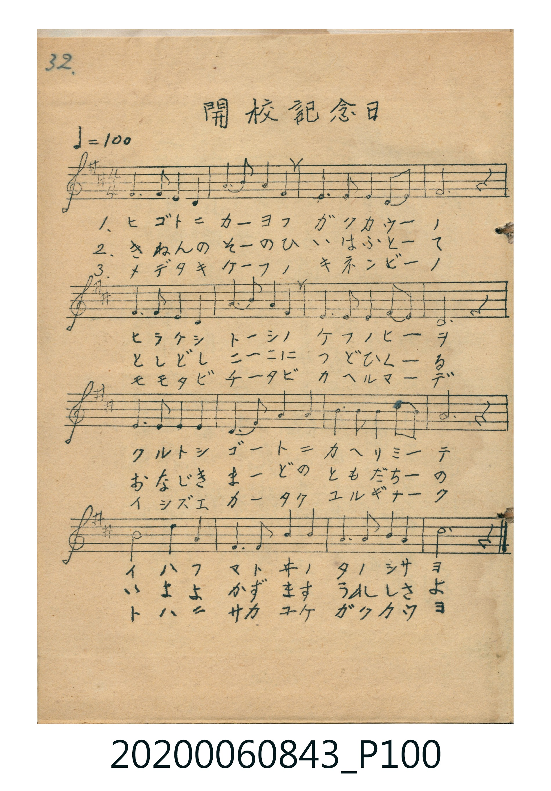
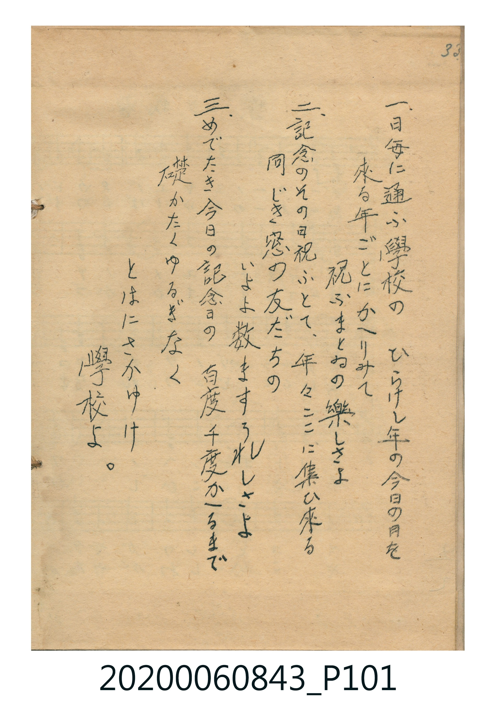

# 開校記念日

> Re:Shōka 使用 AI 協助辨識與重建樂譜，可能會有錯誤。歡迎回報。

- **鋼琴伴奏版**：<br><audio controls src="kaiko_kinenbi.mp3"></audio>

- 唱歌帳（2020.006.0843）P100.jpg–P101.jpg（第 32–33 頁）

## 說明

原書資訊與歌詞全文（對應 P100.jpg 樂譜與 P101.jpg 歌詞，第 32–33 頁）：
調性與拍號：ニ調四分之四拍子（D 大調 4/4 拍），速度 ♩=100


## 歌詞

```text
1. 日毎に通ふ　學校の
開けし年の　けふの日を
來る年毎に　かへりみて
祝ふまとゐの　楽しさよ

2. 記念のその日　祝ふとて
年々ここに　集ひ來る
同じき窓の　友だちの
いよよ數ます　うれしさよ

3. めでたきけふの　記念日の
百たび千たび　かへるまで
いしずゑかたく　ゆるぎなく
とわに榮ゆけ　學校よ
```

## ABC

<div class="abc-score" data-abc-src="kaiko_kinenbi.abc" aria-label="五線譜載入中"></div>

[下載 ABC 原始檔](kaiko_kinenbi.abc)

## TMD 檔案連結

- [主旋律 TMD 檔案](kaiko_kinenbi.tmd) [[在 TMD Studio 編輯](https://tmdlang.github.io/Tmd-TS/#tmd=s7IKdvYPcrWy4qpTUCpJTLdSSM7PyUlNLsnMz7MqzsjPTkzOyFeCS5bl55TmploBqXgDI4RwcX5pUXJqfEFieqpVgKGBAboM3KT4vPyS1KT8_GyEioKi_LLUvMQ8oKrcxLzS4uSizIKS-OT8gkqEmtSyzJRUkIrUlMyS_KLMxBwkJ6UWFYMdC3FDSVFiHsQMoCBCVUlGKtDdxUAnAJ2ek5mWii5Vnl-E5CiIWFpqcUlmGbJlQLvTM_OscvPzkkqBfkKWKMnITy9KLMiotMrILAY5MjkxJz47MS9RiUtLS-HltO5nCxa-WDHj6f6tz6YvVdDS4lK0VQAGFZe9rYILl42JvokdyLCnUzY-W9vzdMfm93s6jAyMDPQMDMz0DCxMjN_v6QSFrF5WQfqjhslApiGICVT1fM0aBWMjoJixscLLBY1AdUpcXPpaCrbUAlwKCgpP--Y_m73jxeb2Fyu6XnS0A534YuW8p60rnk1rBzrh6YbeZ-2dCjD3KTxb0fRi7RygOpAQ2J0KEB3v9_RgOvf9nlkgK16s2v-sYTnI8O7eFzPnA0UfN3cDBZ_Onv20o-3Jzm4gAyj1dO0EoI0uCk-XLAdKKgDDTQEoCjam52XD_Ke7lik8mrnSFhSyIFMN9RSAwf1sfd_jxtUvG2Y9btz6uKHh6dodwMh43LgOpAIIgJHzuHHi48bpT3duAYoCVYC5W4FsoObHTZOg6p7sa3vc1A1UBDEPrA6oc8fjpq7HjfsfNy6Dqnu-dC5Y977HjSseN02AGPls6V6gDY8bpz5u6gA7zUhPAZIeQPKNQB1gyxoaYLpXIAwEuauh9XHjZDACWfxydtvjxk0QB8EUTeh53DjjcWPv81VARSArn_YDXbfgcSOSVx83tgDtB6JnU3eAHTgT7AugMUDNyK4z1lN43NT4uHH548b5QDPhAQJUDk_FCGOfzwQaBVS3-WlvM4SBFDhAEii7HMkFIJtmPW4CGgmUA6ruB6luAvnlcSMwZFcBReCqgSHYD_Tzs2XrQCqAzoDHH9ClQBWUJ3AoUNDS5-LyTszMzvfOzEvNS8q0CssH5mGHGoOaarBrbCy07MAMbLlLAZiwn-xoeLGwR0HDROHphv7n6xt0FAKMzC1B6V8TiwagdSDDahSMFXSB0FjBCEgaAnGNgilYxAxMg2RrwHK6QBKixgiuCwINQGrApvkY1ig8bp4EFn3ctAXI7gCxmrvBpjxuWg3V8bh5BZicChVfA9WxHqrmcdMyiExzH5I98Qh7jIByjb0QXY1rgeong1nrILoa58LsAYsAkypUvAUqCrSncSuYBXIHSAZkHxZ7jEFuWAh1czvQnv1g162Funsj3D8gn0BcCxIHyYP4vUC8GcwCuQ-7f_DH6a4eesQpSGUNWCWBOG1eCfX146btUB-BYhgSeyARRBhAwgYUMhAxiBkgHaDYwBWnoPgAxct0IF4JZUFiCBSCEDlIXIPSCUh8CVQU6DJwPANzL9QFoFSHK04XQV23CBan8BhqhPsHRRyadh83zwBicBptngfV0Y5hD4F82klOnCLHFwjD4ssYHKcgXAOMX0gsg2hzIAmLd6xxCsxtEB-thuVTWJwCcy4sXWPLv5AwWAVmzYeGQRv2sAbHaRdEV-MqIJ4BZvVCdDXug9kDjWtY_oWmgqYmIHsBWAaUB0EyIBU44rQJmhKAvnjctAvMguZuRLkDzb8gn4NcDcn14BBoApcUzSC3IsKG6DgFtg7IiVNIfAHzaByQgEQhLOuCpEAYFoWmYB5EDVg5rliFhALIL6B8AC9jwakVxO8E4g1gFiyngsIEwofm4SZQ2QjSA4kH7LEKKUtBqiFpB0SCxCG5DljDQuMXWMlDZSBpBFjXQ3M1sL6HugBWhmDLqfDyBeofWFoEuRFkGij1guIRUuLgr00w_VPLxaVrp4Bc7yoA-cpcAA)]
- [鋼琴伴奏 TMD 檔案](kaiko_kinenbi_piano.tmd) [[在 TMD Studio 編輯](https://tmdlang.github.io/Tmd-TS/#tmd=s7IKdvYPcrWy4qpTUCpJTLdSyC8qychPL0osyKi0ysgsLskvykxOzInPTsxLVIIrKs4vLUpOjS9ITE-1CjA0MNAFEoYI6ZKM1NxUq9SU0uTEksz8PCUuLS2Fl9O6ny1Y-GLFjKf7tz6bvvT9no6X3XueT9jyZM-Wp0v7n3d2vN_TqaClxaVoqwA0kMveVsGFy8ZE38QOZOrTKRufre15umMzUJuRgZGBnoGBmZ6BhYkxUBPIfr2sgvRHDZNBrgAxgaqer1mjYGwEFDM2Vni5oBGoTomLyzsxMzvfOzMvNS8p0yogMzEv36HGoKaaSwEIbCy07MAMfS0FW3SgADTuyY6GFwt7FDRMFJ5u6H--vkFHIcDI3BJknSYWDVr6YMNqFIwVdIHQWMEISBoCcY2CKVjEDEyDZGvAcrpAEqLGCK4LAg1AasCm-RjWKDxungQWfdy0BcjuALGau8GmPG5aDdXxuHkFmJwKFV8D1bEequZx0zKITHMfkj3xCHuMgHKNvRBdjWuB6ieDWesguhrnwuwBizxu3AQVb4GKAu1p3ApmgdwBkgHZh8UeY5AbFkLd3A60Zz_YdWuh7t4I9w_IJxDXgsRB8iB-LxBvBrNA7sPuH_xxuquHHnEKUlkDVkkgTptXQn39uGk71EegGIbEHkgEEQaQsAGFDEQMYgZIByg2cMUpKD5A8TIdiFdCWZAYAoUgRA4S16B0AhJfAhUFugwcz48b-6EuAKU6XHG6COq6RbA4hcdQI9w_KOLQtPu4eQYQg9No8zyojnYMewjk005y4hQ5vkAYFl_G4DgF4Rpg_EJiGUSbA0lYvGONU2Bug_hoNSyfwuIUmHNh6Rpb_oWEwSowaz40DNqwhzU4TrsguhpXAfEMMKsXoqtxH8weaFzD8i80FTQ1AdkLwDKgPAiSAanAEadN0JQA9MXjpl1gFjR3I8odaP4F-RzkakiuB4dAE7ikaAa5FRE2RMfp09mzyYlTSHwB82gckIBEISzrgqRAGBaFpmAeRA1YOa5YhYQCyC-gfAAvY8GpFcTvBOINYBYsp4LCBMKH5uEmUNkI0gOJB-yxCilLQaohaQdEgsQhue5x4yxo_D5unAmVgaSRx0090Fz9uBFW_sPKEGw5FV6-QP0DS4sgN4JMA6VeUDxCShz8tQmmf2qxVbpBHliqXWDUaMOiwlAbFE2QktVEGxQxJtrgSIEogUjXKJjHa0NyrTGMCak8IfKYEUiJFTAdUAF8lmA6C2IWyDKwI8E6IfYgLAeREDFQLYLPfEwdGK41wmoJOCOg6jCGeBrVGqyR5oMcaSbwSDOMRyCgPfEgBOOZxsejYLBqEANIGcC9Q7kJ-FRhMRSbEditxdAPM10bFJfwwNK1U0AOL7CRRIiB-MpcAA)]

## 分析

```text
================================================================================
📊 TMD Song Profile: [ 開校記念日 ]
================================================================================
⏱  Duration:       0:38 (38.4s), 16 measures total
🎼 Key & Tempo:    首調基準 D, != 100.0 BPM, <4/4>
   - 分析範圍：      由實際發聲的音符與和弦推測調性；播放脈絡另行呈現
🎤 人聲音域:    D4 (MIDI 62) – D5 (MIDI 74) [跨度: 12 個半音 / 1.0 個八度, 難度: easy]
   - 最低音:  D4 in [KaikoKinenbi #1 @ m.1, 0:01]
   - 最高音: D5 in [KaikoKinenbi #1 @ m.13, 0:30]
   - 適合: soprano, mezzo-soprano, contralto, tenor, baritone, bass
🏛  結構:      KaikoKinenbi (38.4s)
⚡ 編曲密度:        Peak 1 軌道同時演奏
🗝  調性診斷：       A 大調（純淨自然大調，未偵測到可信轉調）
   - 風格氣質:    純淨自然大調（陽光明朗、易唱易記，無明顯調外色彩）
   - 轉調歷程:    全曲維持單一推測調性（未偵測到可信轉調）
   - 核心骨幹音:  A, E, F#, D, B
   - 調性數值:    A 大調 [相關度: 0.80, 穩定度: Moderate, 自然音純度: 100.0%]
   - 候選調性 (K-S): A 大調 (0.80), D 大調 (0.75), F# 小調 (0.63)
   - 五度圈歷程:   +3
   - 各段落調性細節:
     • [KaikoKinenbi #1]: A 大調 (r: 0.80, 自然音純度: 100.0%)

  [ 五度圈游移軌跡 ]
               C  
         F            G  
      Bb               D  
      Eb              [A ]*
         Ab           E  
            Db       B  
               F# 
     (* = active key center)

  [ 十二半音累積音高分佈 ]
     C  :                            0.0%
     C# : █                          0.8%
     D  : ███████████████████       18.3%
     D# :                            0.0%
     E  : ██████████████████████    21.7%
     F  :                            0.0%
     F# : █████████████████████     20.0%
     G  :                            0.0%
     G# :                            0.0%
     A  : ████████████████████████  23.3%
     A# :                            0.0%
     B  : ████████████████          15.8%
--------------------------------------------------------------------------------
Assignment 軌道音域：
  - Vocal         : D4 – D5 (12 個半音 / 1.0 個八度, 54 個音符)
================================================================================
```


## 原書掃描頁






