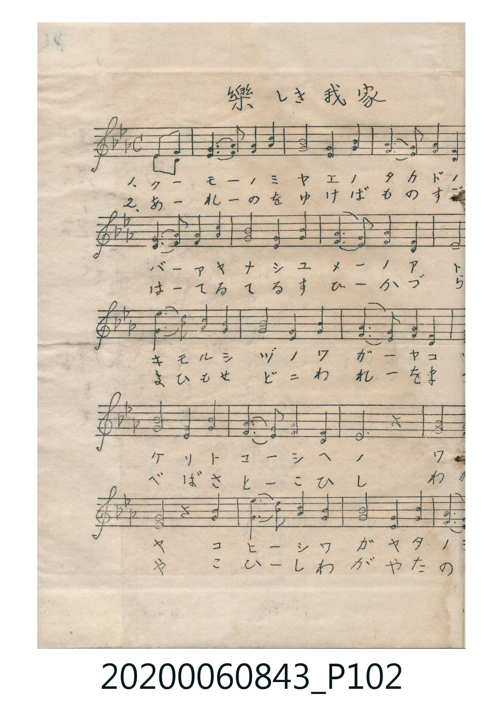
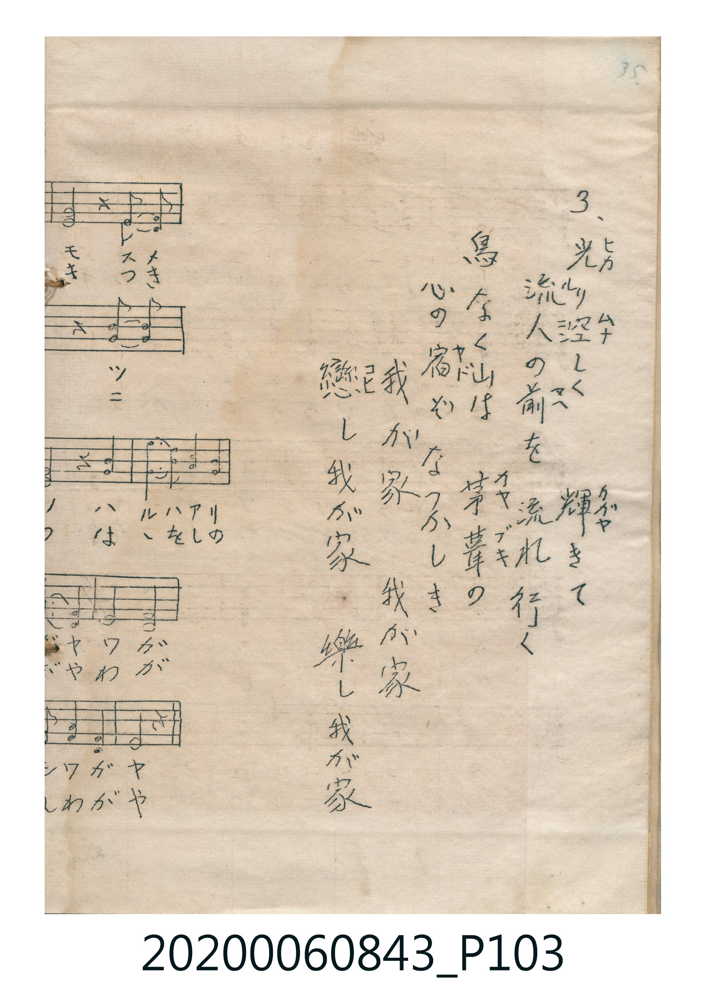

# 樂しき我家（快樂的我家）

> Re:Shōka 使用 AI 協助辨識與重建樂譜，可能會有錯誤。歡迎回報。

- **鋼琴伴奏版**：<br><audio controls src="tanoshiki_wagaya.mp3"></audio>
- **NEUTRINO 歌聲合成版**：<br><audio controls src="tanoshiki_wagaya_neutrino.mp3"></audio>

- 作詞：大和田建樹／作曲：Henry Rowley Bishop（Home! Sweet Home! 二部合唱）
- 日治時期公學校《唱歌帳》第二冊（2020.006.0843）P102.jpg–P103.jpg（原冊第 34–35 頁）

## 說明

> [!NOTE]
> **原頁資訊與歌詞全文**（對應 `P102.jpg` 左頁跨至 `P103.jpg` 右頁之對開手抄五線譜，原冊頁碼 `34`–`35`）：
> - **調性與拍號**：五線譜調號清楚標示 **3 個降記號**（降 E 大調，`?= E,`）與拍號 `C`（`<4/4>`），為二部合唱五線譜（高聲部音域 Eb4–Eb5，低聲部三度／六度平行和聲）。先前版本誤標為 `?= B,` 且僅轉錄至第 13 小節，今依 `P102.jpg` 與 `P103.jpg` 完整對開五段譜表修復全曲（弱起 + 22 小節）。
> - **詞曲考證**：採用英國作曲家 Henry Rowley Bishop 名曲〈Home! Sweet Home!〉旋律，配大和田建樹譯詞〈楽しき我家〉（「雲の宮居の高殿も…」；同冊 `p097_hanyu_no_yado` 則為同曲配里見義譯詞〈埴生の宿〉）。
> - **跨頁裝訂細節**：
>   1. 第 13 小節第二段首拍於 `P103.jpg` 第三段譜表作長音符號「ー」，承接第 12 小節末拍「は（葉）」字唱「はーをしのべば」。
>   2. 第 17–19 小節副歌首句跨裝訂中縫（`P102.jpg` 第四段右端 → `P103.jpg` 第三段左端下譜 → `P102.jpg` 第五段左端），歌詞對應「ワ ガ ヤ｜ワ ガ｜ヤ」（`P103.jpg` 第 18 小節首二分音符為同度 `2`、次二分音符為 `7_+2`）。
>   3. `P103.jpg` 右半頁另以毛筆／鋼筆直書第三段漢字歌詞並附片假名振假名。
>
> **1.**
> クーモーノミヤエノ　タカドノモ
> スメバアヤナシ　ユメーノアト
> ツキモルシヅノ　ワガーヤコソ
> ハルハアリケリ　トコーシヘノ
> ワガヤ　ワガヤ
> コヒーシワガヤ　タノシワガヤ
>
> **2.**
> あーれーのをゆけば　ものすごき
> つきはてるてる　すひーかづら
> こよひもせどこ　われーをまつ
> はーをしのべば　さとーこひし
> わがや　わがや
> こひーしわがや　たのしわがや
>
> **3.（`P103.jpg` 右半頁漢字與振假名歌詞）**
> 光（ヒカ）り空（ムナ）しく　輝（カガヤ）きて
> 流（ナガ）人の前（マヘ）を　流れ行く
> 鳥なく山は　茅葺（カヤブキ）の
> 心の宿（ヤド）ぞ　なつかしき
> 我が家　我が家
> 戀し我が家　樂し我が家


## 歌詞

```text
（TMD 檔案未包含歌詞註解）
```

## ABC

<div class="abc-score" data-abc-src="tanoshiki_wagaya.abc" aria-label="五線譜載入中"></div>

[下載 ABC 原始檔](tanoshiki_wagaya.abc)

## TMD 檔案連結

- [主旋律 TMD 檔案](tanoshiki_wagaya.tmd) [[在 TMD Studio 編輯](https://tmdlang.github.io/Tmd-TS/#tmd=s7IKdvYPcrWy4qpTUCpJTLdSSM7PyUlNLsnMz7MqzsjPTkzOyFeCS5bl55TmploBqXgDI4RwcX5pUXJqfEFieqpVgCGmDNyk-Lz8ktSk_PxshIqCovyy1LzEPKCq3MS80uLkosyCkvjk_IJKhJrUssyUVJCK4uTEvPiy1KLMtMzUFCRnpRYVgx0McUdJUWIexBygIEJVflFJRn56UWJBRqVVRmZxSX5RZnJiTnx2Yl4iQlFJRirQg2mJuZk5SA4AKk3PzLPKTc3MyowvSa0oQfUDVLo8tbgktSgvPjc1Jz8FqFtLS-HZiqbHjdMfN_Y-65j4dN2293s6nu5fDRR8PqsFJtKpoKXFpWirYGHCZW-r4KrDZWOib2IHMvvJ3jkvVs57v2fW0yXLn07qeT5lw9Pdu56t2Pl-Tz9Q6tnsTUApj9S8okqFoPzynNRKBadMYEAXAC3xyM9NVVQILk9NLVGAsJ_s6nnZvOLphI6nUzYC7QS7_dn0pc827X42s-nZnPlPW9c8Xbvj2YKFjxu6gEqere15umPz44bu52vWALU-besCmmpkYGSgZ2BgpmdgYWIMNAQU1XpZBemPGiYDmcYgJsiDffOByoH6FIxNgDLGpgovFzSCreTS11KwpRbgUlBQsFOIVvTzD3GNhXC0tIB2Ay17sbn9xYquFx3tQF8AA_Bp64pn09q1tEBu29D7rL1TIQHm8gSFp9uXgXRsX_GifTNYHOwNoHj_ZqD4k53dQC0vp3U_6-x-1tXyZNeU59tnvVg75_2eHog3gWqeL9qjkGBskgD0a4KxaQLQp8BogThIF-ikF6v2P2tYDnJMd--LmfNBzpgFNwcoCRR7tqP12dJZz1bMfL5kF1CHscLThu6XM3tfrJgB1dAB5Cm4KgCTAVAD0O4EcEIBWQU3VyHBGcjvSAAnHogjep437UKOdiTXd7xcPeNF4yag1Mv5m5_On6_gmgSKK9ckU6C2J3v7IHJPdnQ-3bUMmNqetq4FMp7u3PxiYQ8wIQJlgRY8bmh62trxtLP3eWfHszlrXqxaAvJB0y4FkOucdBIUnuyY8rS59cXezpc9LcDQBaUIQ6DfNvQ_X98AsmZ315N9c5HjAugZlChY1_Ns6hZI-APd_mzdVlCILVzxZP-6p_tWgmIVlAM6nu7Z-GLrdgVtBSMjuOEgxyFFwcp5QKUvGppfrO0Eh_-zvoXPp6x40b3x6ZxuSE4C5kQFLFlJ4emEXqDs4wbMHPW4ofPZ9O6n-7qBXnnZ2ouWRV-sXQ-0Fajv2dK9yAUAUBfQyY8bel4CTW1c93TduqcbW4EMYHw8W7f_cVPTo4Zljxt63--Z_XQCKNcpJBQYWJrHZyTmVZYCC8_4ysSUfGDIdLYDAxqoAug2oN0v23teLOt-vm8l3Nan87c8nzIfbMF-sJVoAbJ9BSjRL577AlgSbdkADDJwsEAUKCgY6imgRBakDACG_8tl04Cp7dk0YIJHRBNIdkcnInb2znk5dTswWT1fswyYLoFefdy8B-ylnmed-5_1LQUbDYuqZ3NWA00EKWpcDwyYFxMhbu19unY6MMVCxEH6myaBQ3Hd48adjxs3ABXA_aOgYAR1rjkwBRtaQg1-2rkemPuBDn7avxSUu8F-fbJj7fMdq0HZBJHogFqfzp4NdD4wxz9fvV7hUdskrL4DFhRA6Sc7uoHehCtCmAFJoBBFkNwHLXzAJQ44FNYrPG5ao_C4ecn7vXOgPDBrCTh0wG5CWKpgaAH1CdAPoBK4ow0SppCIB2ZHhQSjhMcNjc_WLESTVkgwj9c2ApUBSIFkrIdWuj3tBRVeT_uXPdm99Nn62c_XtgEz-svuPUDG89lbns3eAff5sz2LgNEB8c6THctezmx53tn-tLEdlDd61kMYMJtgBbGhHrBSA7MfN4EjsHkRmOx73Dwf5OOmFSB2Q8PjJmCiX_24uRMstQimZefj5oWPmyc8bgLqWvK4uetx03aQ4uZlYHGwOSCpDqj65pbHTWvBVqwGqWxuhRrevB4YxmD1QBs3P27aC1PfD1IJJEGGrHrctBFEgtR3gJSBkhvQkBlAQ2DqIeYAIwpu5hKYU4HqJ8G0ICkD-gvkSIQgSvAYIYKnsQmsG5xLgOkbmNCb2h43TgSncqAxwOYDMNHPfNw4BViGwLQsAbJBGaNx2eOmbigJVAxStglsDlBw6eOmTpj6yY-bOkBSINNmP25cCRIBGQ4MALC9oNy1D2gsTD3WLAc0f-rjRmC8Ac2fDDKtcTosDPofN_Y8bmqBmglmI6yGOmk6irJGUOGELIgSPMZ6qPkBnlwhSRFU6cESHiRZAtM6LECftoJLWGCkNAFzeufjpq7nK3eBRRYAExJIBOSrfqAjXuyZCxIHJj9wBIGlgMG6DGLOs63ARgtQFzDtrQFKPdm1C1ScdoJy6uPmecDkATZ8EtAcoEpgOAKrRqCxEL0vNy993LgKyH26cSMoNIF29bS-mAh2Bii1A5P0NGCKBdu4Durs_c2Q4hpsPlABuCBsBBbmwMACGgWMcmCkgioSqPM6gEmkB1yjNMDZMCmglukoCsCtUBRllDfAoEBBS5-LKyQxL784IzM7MzwxPbEy0So4vwDYBs93qNE1rKkGWadgY6EFjl6F6ty0WjADW2MQUtw2wCsTBQ147Q4uE4ElvAm0WNRRAJW_0KanJhajgO4CWVOjYACs82DYUMEIKGIMZOkqmAChroIpENeASRAEyUBEQHIgPog2AotAdCGZAzbfx7BGIR4oAsPA8g6sGlgcQdUDCwIwOR8qvgQm3rQCLgsUb9oPFV0NFOtEloGbBDF_J1BkIcx2IzTbG5ugpvXAbGlcB9Y1CSreBhefCCY3QMVB-iCqgeUImDUFItPYi2x74xKwSA0X_jgENxdgcQiKOlNgTMFqNOKjjryIMkSKKFMgREQUsE6BBz4oUCGRARLvgotvB4svg4ovhIlDIhGsCyTegRwozS0gUXiEALM8PJBB5gCLZ2hQgngQW0AikIAGiW-Cq4eIL4VGCigZIIJ-MtgWApkH0RKDBLwlqFUEa8kRH_KGcWCLzRXMSAp65DwCUYNpECI2mtZCw3YREK-Ghz4ofFtRwx3YXIKEyBq4OCjmgNUvVHwvSnz0Q00BmQnhw-J7FcIFoJhqgsQjKAYgWQBYQULjZCU8TkDhDqyooDbBMxY4SwErTqh6WLaGxBXEvQiVwPIXLA7KjATiENIcRY5DQ1DnDN4gJD4SSckssFhD6ILGHDD_gJWCIIxGjsON8BgBhS0kZ4DEQTGDnKNmQOMEFJ8wCAorkBg8v0DjFxS72MRRc9lOmCy4EAM2TyCmNYKKVaSYA-cukDgoBtBsBscqRC0kXoFNEazihHMeUg8VGmugrAfvlJJa6OHPQySXg-CoRSoHUVIrLBc1g1I0cpzhynWgqgoRlyDVELUQlejmg8MaKc-BSku43ZBSDaUMBOcUWH6Dhz9EH7DlCBUH5SSIaohaiEp08yF212I2URxzSnC0Twog7RP0hoN5PDxIjcABDAp6RGyBZCAikEwCaiEAowySzpBjAmLSaNuBKoFpDITDsHqHhYQpODeTHTYIbUgGjVa_qGFMZIjCQhWhDUID0x-8WgRrAcERXD8SlQZJT8wjvv7StVNAq8KifQxjFbAJG4GFlbkA)]
- [鋼琴伴奏 TMD 檔案](tanoshiki_wagaya_piano.tmd) [[在 TMD Studio 編輯](https://tmdlang.github.io/Tmd-TS/#tmd=s7IKdvYPcrWy4qpTUCpJTLdSSM7PyUlNLsnMz7MqzsjPTkzOyFeCS5bl55TmploBqXgDI4RwcX5pUXJqfEFieqpVgCGmDNyk-Lz8ktSk_PxshIqCovyy1LzEPKCq3MS80uLkosyCkvjk_IJKhJrUssyUVJCK4uTEvPiy1KLMtMzUFCRnpRYVgx0McUdJUWIexBygIEJVYhFQPD01NzWvxKogMzEvPz4xOTk_tyAxLxMkhlCYX1SSkZ9elFiQUWmVkVlckl-UmZyYE5-dmJeIUFSSATTJKjWlNDkRYo2WlsKzFU2PG6c_bux91jHx6bpt7_d0PN2_Gij4fFYLRORx8-6X3XueT9jyZM-Wp0v7n3d2vN_TqaClxaVoq2BhwmVvq-Cqw2Vjom9iB7Lnyd45L1bOe79n1tMly59O6nk-ZcPT3buerdj5fk8_UOrZ7E1AKY_UvKJKhaD88pzUSgWnTGBAFwCt9cjPTVVUCC5PTS1RgLCf7Op52bzi6YSOp1M2Au0E--PZ9KXPNu1-NrPp2Zz5T1vXPF2749mChY8buoBKnq3tebpj8-OG7udr1gC1Pm3rAppqZGBkoGdgYKZnYGFiDDQEFNV6WQXpjxomA5nGICbIy33zgcqB-hSMTYAyxqYKLxc0gq3kCgEGenFGZnZmeGJ6YmWiVQAoFhxqdA1rqrkUgMDGQssOzKjOTasFM2oUDBR04dhQwQgoYgxk6SqYAKGugikQ14BJEATJQERAciA-iDYCi0B0IZkDNt_HsEYhHigCw4-b1oNVP25eBFX_uLkPTM6Hii-BiTetgMsCxZv2Q0VXA8U6kWXgJkHM3wkUWQiz3QjN9sYmqGk9MFsa14F1TYKKt8HFJ4LJDVBxkD6I6seNM8GsKRCZxl5k2xuXgEVquKCBS15QGiIFpSkQIoLycfMEePCAvA0JLpB4F1x8O1h8GVR8IUwcEsxgXSDxDmRnN7eAROFB9rgRFEkQD4PMedzUDfUsiAexBSQCCQqQ-Ca4eoj4UmiwgSIKETiTwbZAg8YwDixjrmBGUtggJzOIGkyDEMHVtBbq-UVAvBoePKAAaEUNmGZoumxaAxcHBe3jps1Q8b0oAdYPNQVkJoQPi5BVCBeAgrIJEtCgIIKkoseNs6GBthIeaKCAedwENRORNsGp8nHjPqh6WM6ABCbEvQiVwIIRLA5Kz_BAJiW1wUIVoQsassAECFYKgjAaOYw3wkMM5HdI0gKJg0IOOUnOgIYZKLxhEOQXkBg8wUHDHxT62MRRk-lOmCw4nz5unAoxrRFUciCFLDh5gsRBIYRmMzjUIWoh4f64qQWrOFKoEpMGSc7o4KBHyugosQ1Lhc2gFIEcprhSLai0RIQ1SDVELUQluvngsEBKs6DiAG43JNuiZHJwSoOlV3j4QPQ9boSW5OCUCFENUQtRiW4-xO5aHJVXkAdJ1Zd5vDaoBjPUhkQRiKttAqOAYa8NiQkIDU7iYJUwcbhCiAScCzYWHGFQg1Htg5VoNLMVyU6QJhCGWWqsDcul2uYKJtqg9EdlXyKMw2UT3CkU-g9mI7JRcFvBnoaXP1C9kGyJGvzEupp895rGa2PmXFwp2AclBZvAU3ABIgVDINAH8SBkGg-mwFwoG8wFsZExXAFYMywQyDUCJI8wwzhewYQsI1A1IwwkygggBQ0GdOVGSKpRDcVmLYkhB4w5XTsFtMiL9jGMVcAmbAQWVuYCAA)]

## 分析

```text
================================================================================
📊 TMD Song Profile: [ 樂しき我家（快樂的我家） ]
================================================================================
⏱  Duration:       2:11 (131.4s), 46 measures total
🎼 Key & Tempo:    首調基準 E,, != 84.0 BPM, <4/4>
   - 分析範圍：      由實際發聲的音符與和弦推測調性；播放脈絡另行呈現
🎤 人聲音域:    D4 (MIDI 62) – A#4 (MIDI 70) [跨度: 8 個半音 / 0.7 個八度, 難度: easy]
   - 最低音:  D4 in [TanoshikiWagaya[L1] #1 @ m.1, 0:02]
   - 最高音: A#4 in [TanoshikiWagaya[L1] #1 @ m.10, 0:26]
   - 適合: soprano, mezzo-soprano, contralto, tenor, baritone, bass
🏛  結構:      TanoshikiWagaya[L1] (65.7s) -> TanoshikiWagaya[L2] (65.7s)
⚡ 編曲密度:        Peak 2 軌道同時演奏
🗝  調性診斷：       D# 大調（純淨自然大調，未偵測到可信轉調）
   - 風格氣質:    純淨自然大調（陽光明朗、易唱易記，無明顯調外色彩）
   - 轉調歷程:    全曲維持單一推測調性（未偵測到可信轉調）
   - 核心骨幹音:  G, D#, F, A#, G#
   - 調性數值:    D# 大調 [相關度: 0.82, 穩定度: Moderate, 自然音純度: 100.0%]
   - 候選調性 (K-S): D# 大調 (0.82), G 小調 (0.71), A# 大調 (0.57)
   - 五度圈歷程:   -3 -> -3
   - 各段落調性細節:
     • [TanoshikiWagaya[L1] #1]: D# 大調 (r: 0.80, 自然音純度: 100.0%)
     • [TanoshikiWagaya[L2] #1]: D# 大調 (r: 0.82, 自然音純度: 100.0%)

  [ 五度圈游移軌跡 ]
               C  
         F            G  
      Bb               D  
     [Eb]*              A  
         Ab           E  
            Db       B  
               F# 
     (* = active key center)

  [ 十二半音累積音高分佈 ]
     C  : ██                         1.7%
     C# :                            0.0%
     D  : █████                      5.5%
     D# : ███████████████████       22.4%
     E  :                            0.0%
     F  : ██████████████            16.0%
     F# :                            0.0%
     G  : ████████████████████████  27.9%
     G# : █████████                 10.8%
     A  :                            0.0%
     A# : ██████████████            15.7%
     B  :                            0.0%
--------------------------------------------------------------------------------
Assignment 軌道音域：
  - Alto          : D4 – A#4 (8 個半音 / 0.7 個八度, 148 個音符)
  - Soprano       : D#4 – D#5 (12 個半音 / 1.0 個八度, 148 個音符)
================================================================================
```


## 原書掃描頁






