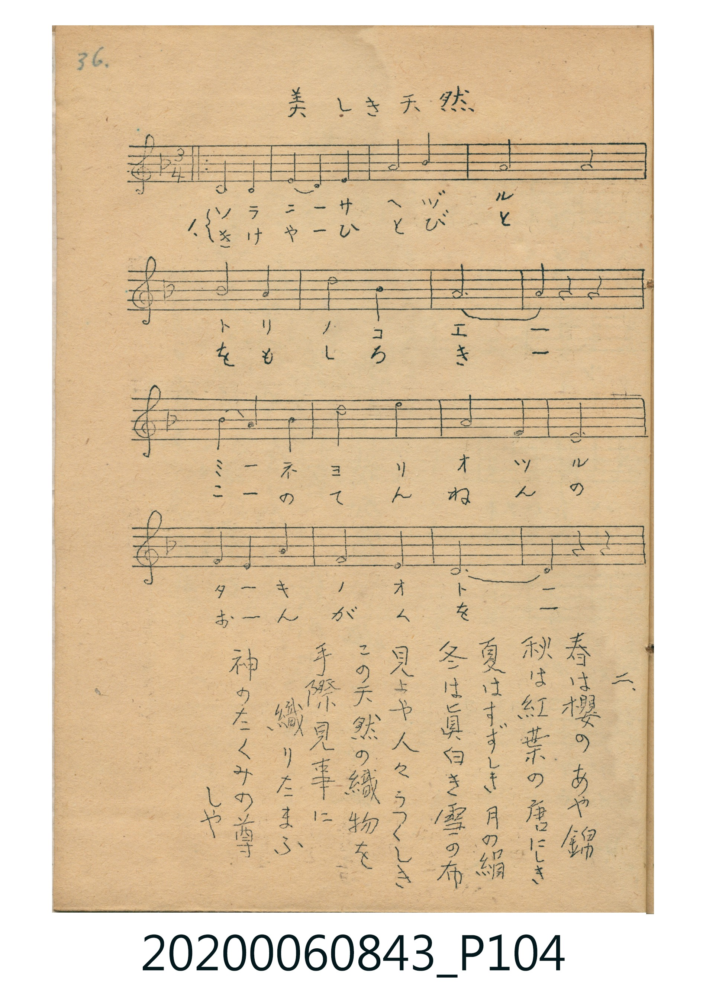
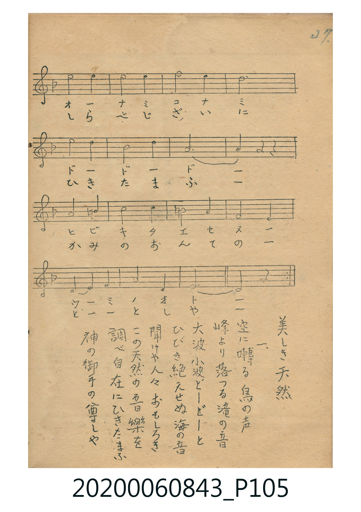

# 美しき天然

<audio controls src="utsukushiki_tennen.mp3"></audio>

- 詞：武島羽衣
- 曲：田中穗積
- 唱歌帳（2020.006.0843）P104.jpg–P105.jpg（第 36–37 頁）

## 說明

原書資訊與歌詞全文（對應 P104.jpg–P105.jpg，手抄五線譜第 36–37 頁）：
調性與拍號：ヘ調四分之三拍子（關係小調 D 小調 3/4 拍）

## 跨冊／重複收錄參照

> 同曲（武島羽衣作詞、田中穗積作曲〈美しき天然／天然の美〉；《唱歌帖》P104 與 P131）

- **[同曲]** 楊金土手抄《唱歌帖》第 1 冊（2020.006.0843）：[**〈天然の美〉**](../../vol_01/p131_tennen_no_bi/index.md)（`F` / `3/4` — [原始 TMD](../../vol_01/p131_tennen_no_bi/tennen_no_bi.tmd)）
- 總表：[跨冊重複與同名歌曲總索引](../../../duplicate_songs.md)

## 歌詞

```text
一、
空に囀る鳥の声　峰より落つる滝の音
大波小波どーどーと　ひびき絶えせぬ海の音
聞けや人々おもしろき　この天然の音樂を
調べ自在にひきたまふ　神の御手の尊しや

二、
春は櫻のあや錦　秋は紅葉の唐にしき
夏はすずしき月の絹　冬は眞白き雪の布
見よや人々うつくしき　この天然の織物を
手際見事に織りたまふ　神のたくみの尊しや
```

## ABC

```abc
X:1
T:美しき天然
C:曲：田中穗積
M:3/4
L:1/16
Q:1/4=96
K:Dm
V:V1 name="Vocal" snm="Voc"
[V:V1]
D8 D4 | E4 D4 E4 | A8 B4 | A12 |
B8 A4 | d8 B4 | A12 | A4 z4 z4 |
B4 A4 B4 | d8 e4 | A8 F4 | E12 |
F4 E4 A4 | F8 E4 | D12 | D4 z4 z4 |
e8 e4 | e8 e4 | f8 e4 | d12 |
e8 d4 | B8 d4 | A12 | A4 z4 z4 |
A8 =B4 | c8 c4 | =B8 A4 | F8 E4 |
D4 E4 F4 | A8 E4 | D12 | D8 z4 |
D8 D4 | E4 D4 E4 | A8 B4 | A12 |
B8 A4 | d8 B4 | A12 | A4 z4 z4 |
B4 A4 B4 | d8 e4 | A8 F4 | E12 |
F4 E4 A4 | F8 E4 | D12 | D4 z4 z4 |
e8 e4 | e8 e4 | f8 e4 | d12 |
e8 d4 | B8 d4 | A12 | A4 z4 z4 |
A8 =B4 | c8 c4 | =B8 A4 | F8 E4 |
D4 E4 F4 | A8 E4 | D12 | D8 z4 |
```

## TMD 檔案連結

- [主旋律 TMD 檔案](utsukushiki_tennen.tmd) [[在 TMD Studio 編輯](https://tmdlang.github.io/Tmd-TS/#tmd=s7IKdvYPcrWy4qpTUCpJTLdSSM7PyUlNLsnMz7MqzsjPTkzOyFeCS5bl55TmploBqXgDI4RwcX5pUXJqfEFieqpVgKGBCboM3KT4vPyS1KT8_GyEioKi_LLUvMQ8oKrcxLzS4uSizIKS-OT8gkqEmtSyzJRUkIrUlMyS_KLMxBwkJ6UWFYMdC3FDSVFiHsQMoCBCVUlGKtDdeYklpUWpSlxaWgrP9_U9bpz-uLH36ZKVz1u2KWhpcSnaKliacdnbKrhxZadW2iq45HLZGOub2IEMebFy3vs9s56tXfZ087bn-_a-WLgYbPaz2ZuAws-nbHiyY-3zldOfr-wFCz-dsvHZ2p6nOza_39NhZGBkoGdgYKZnYGFi_H5PJyh89LIK0h81TAYyTUFMoKrna9YoGJsBxYzNFV4uaASqU-Li0tdSsKUW4FJQUHjaN__Z7B0vNre_WNH1oqMd6ESgt562rng2rR3ohKcbep-1dypgdV_Ps87uZ10tT3ZNeb591ou1czCdCwwGkBUvVu1_1rAcZHh374uZ84Gij5tnAAWfzp79tKPtyc7uJzs6gVJP104A2vhy-pwn-5uebugHKlBwUYAygEGuAFQCNJMLZOKTHQ2PGxpBrOcrdz1uXP10dsPjpu6Xm5c-blz3dPGGxw0NTzdveNzU8bip68WEvY8blwBln-2eC5R9OX8z2NdLlj_bvAhoOJB83LjycfMeGLkCqPlx46bHjZuB6eD51m2PGzseN85-3Ljm2dbtCP0vGuc9bpz4uAno-12PG1ofN3Y9bmoCpZ2mXqA2sBGTQW4BpyOItmcrmh43TYKGx-PGnS_aVz2dswLoeLBtQG3zHzfue9y4Faj5-VKg6eue7lsIDGEQY0MX2OgWiN939UD9_mwG0L_rn63eDVTzuBFoesvLnmUg7cuButY_39L6YmInSPuUCWBbQAkb4vd-oPTjxpmPG2dBRJ_NAfpx3fOtO0EB17YGpHnOvOczgQHX-3L2KpARO5rBDl_WDQ5UuK_bQEHbCDQOZAqmr5_vnPK8cyXU10C_vJw1G2jEk11A560GygFjB9PXYBGgicAgQvI4UD_lyR0KFLT0ubhCS4pLs0uLMzKzM0NS8_JS86zC8pMTcxxqDGoUqkHWKdiYaNmBGdhyHDxHKABTPSQ1AuPlxcIeBQ0LUJp9vr5BE4suoM0gE2sUzOIVdEFEjYJ5PIgGkjUKxkAxEyitC6RNgKQxSDGauLGCARDWgFMDMa7rBLoOmNeId50J0AqQhSCLzaEWG0LcCnGBIYgJcpohSAXI7WAPgaSADCJcBy5CyAw7c6irYLRhHJQBci7ICSAJM2j4gWiSwg3JZSSHGzgC1YEMUyDDFOQCdWgUIocTkAYFJkgxRtDpgh1Yy8Wla6eAkUQVcAkqcwEA)]
- [鋼琴伴奏 TMD 檔案](utsukushiki_tennen_piano.tmd) [[在 TMD Studio 編輯](https://tmdlang.github.io/Tmd-TS/#tmd=s7IKdvYPcrWy4tLSUni-r-9x4_THjb1Pl6x83rLt_Z6Ol917nk_Y8mTPlqdL-593drzf06mgpcWlaKtgacZlb6vgxpWdWmmr4JLLZWOsb2LHVaeg9GLlvPd7Zj1bu-zp5m3P9-19sXCxEkj42exNQOHnUzY82bH2-crpz1f2goWfTtn4bG3P0x2bgXYZGRgZ6BkYmOkZWJgYA20KMDQw0csqSH_UMBnINAUxgaqer1mjYGwGFDM2V3i5oBGoTomLK7SkuDS7tDgjMzszJDUvLzXPKiw_OTHHocagRqGaSwEIbEy07MCMGgWzeAVdEFGjYB4PooFkjYIxUMwESusCaRMgaQxSjCZurGAAhDVQo0yAfJAsSJU5VJUhxGCIckMQE2SOIUgFyCKw7SApIAPZKHOoETDaMA7KAJkNUg-SMIO6DERjdxHYH-pAhimQYQpSrg71CbILgDTImSDFGI7SBZtWiy1QAzIT8_KDPEgIVkNtkB1G2qBAgrBBtoD4wIAC8oHu0wZ5EF0FiIUtoCGqweEDVktmYJuqa4OCE0yh88y0wUEP5RmDLQQZAVUFEoD5AOQafK6GR4axNig6QCThCDFVj9eGJMl4bbj7YWz8UeODM2qAxsdrG8NIkHnxMIvg9mGqwhQxilcwATsFQmIRwG4KcqiQYwZx7iXeVyixhEUXueGDTR-R3kN2EqYKQ2DKjtc2hZHA5AhUYh4frw00HUoRFV_Eewye2HTtFDDSmwIuQWUuAA)]

## 分析

```text
================================================================================
📊 TMD Song Profile: [ 美しき天然 ]
================================================================================
⏱  Duration:       2:00 (120.0s), 64 measures total
🎼 Key & Tempo:    首調基準 F, != 96.0 BPM, <3/4>
   - 分析範圍：      由實際發聲的音符與和弦推測調性；播放脈絡另行呈現
🎤 人聲音域:    D4 (MIDI 62) – F5 (MIDI 77) [跨度: 15 個半音 / 1.2 個八度, 難度: moderate]
   - 最低音:  D4 in [UtsukushikiTennen #1 @ m.1, 0:00]
   - 最高音: F5 in [UtsukushikiTennen #1 @ m.19, 0:33]
   - 適合: soprano, mezzo-soprano, contralto, tenor, baritone, bass
🏛  結構:      UtsukushikiTennen (60.0s) -> UtsukushikiTennen (60.0s)
⚡ 編曲密度:        Peak 1 軌道同時演奏
🗝  調性診斷：       D 小調（純淨自然小調，未偵測到可信轉調）
   - 風格氣質:    純淨自然小調（陰鬱抒情、旋律集中，無明顯調外色彩）
   - 轉調歷程:    全曲維持單一推測調性（未偵測到可信轉調）
   - 核心骨幹音:  D, A, E, F, A#
   - 調性數值:    D 小調 [相關度: 0.75, 穩定度: Moderate, 自然音純度: 96.6%]
   - 候選調性 (K-S): D 小調 (0.75), A 大調 (0.67), D 大調 (0.61)
   - 五度圈歷程:   +2 -> +2
   - 各段落調性細節:
     • [UtsukushikiTennen #1]: D 小調 (r: 0.75, 自然音純度: 96.6%, 調外音: B)
     • [UtsukushikiTennen #2]: D 小調 (r: 0.75, 自然音純度: 96.6%, 調外音: B)

  [ 五度圈游移軌跡 ]
               C  
         F            G  
      Bb              [D ]*
      Eb               A  
         Ab           E  
            Db       B  
               F# 
     (* = active key center)

  [ 十二半音累積音高分佈 ]
     C  : ███                        3.4%
     C# :                            0.0%
     D  : ████████████████████████  25.8%
     D# :                            0.0%
     E  : █████████████████████     22.5%
     F  : █████████                 10.1%
     F# :                            0.0%
     G  :                            0.0%
     G# :                            0.0%
     A  : ████████████████████████  25.8%
     A# : ████████                   9.0%
     B  : ███                        3.4%
--------------------------------------------------------------------------------
Assignment 軌道音域：
  - Vocal         : D4 – F5 (15 個半音 / 1.2 個八度, 114 個音符)
================================================================================
```


## 原書掃描頁






