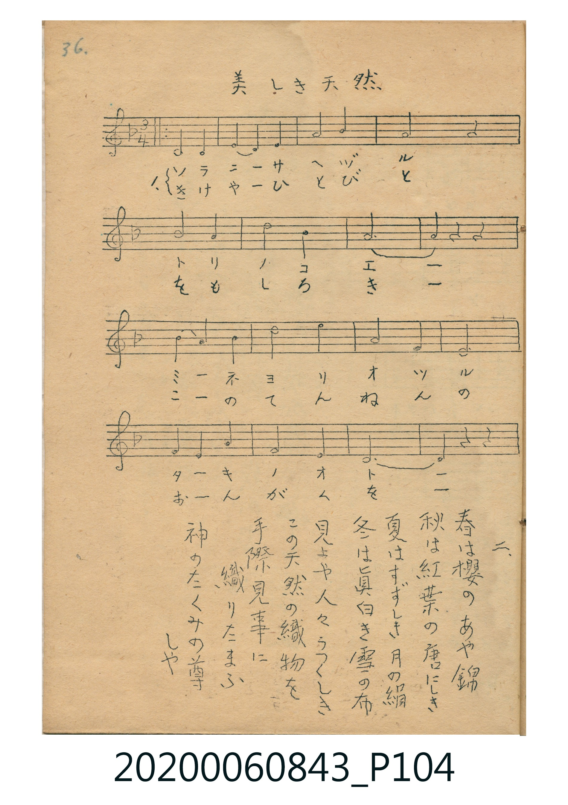
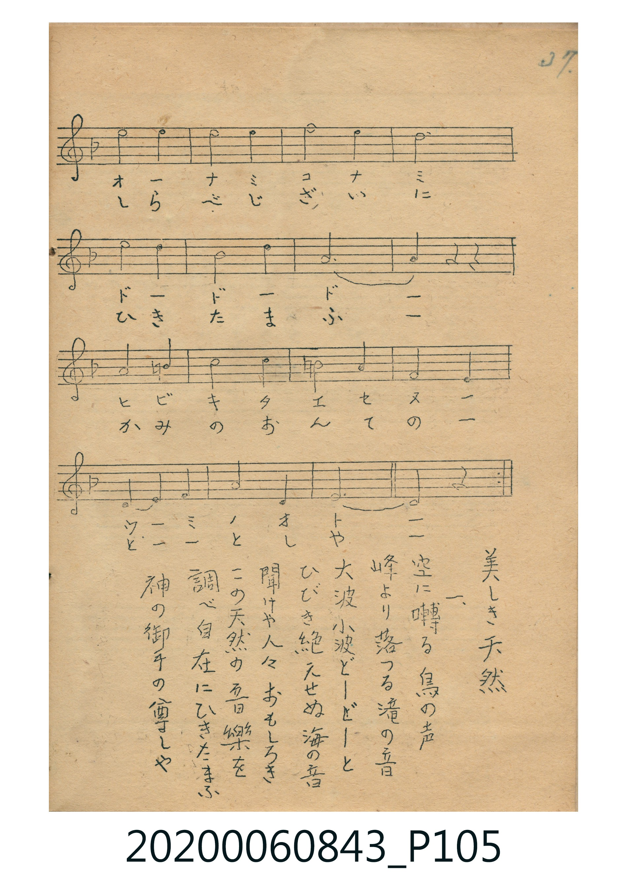

# 美しき天然

> Re:Shōka 使用 AI 協助辨識與重建樂譜，可能會有錯誤。歡迎回報。

- **鋼琴伴奏版**：<br><audio controls src="utsukushiki_tennen.mp3"></audio>

- 詞：武島羽衣
- 曲：田中穗積
- 唱歌帳（2020.006.0843）P104.jpg–P105.jpg（第 36–37 頁）

## 說明

原書資訊與歌詞全文（對應 P104.jpg–P105.jpg，手抄五線譜第 36–37 頁）：
調性與拍號：ヘ調四分之三拍子（關係小調 D 小調 3/4 拍）


## 歌詞

```text
一、
空に囀る鳥の声　峰より落つる滝の音
大波小波どーどーと　ひびき絶えせぬ海の音
聞けや人々おもしろき　この天然の音樂を
調べ自在にひきたまふ　神の御手の尊しや

二、
春は櫻のあや錦　秋は紅葉の唐にしき
夏はすずしき月の絹　冬は眞白き雪の布
見よや人々うつくしき　この天然の織物を
手際見事に織りたまふ　神のたくみの尊しや
```

## ABC

<div class="abc-score" data-abc-src="utsukushiki_tennen.abc" aria-label="五線譜載入中"></div>

[下載 ABC 原始檔](utsukushiki_tennen.abc)

## TMD 檔案連結

- [主旋律 TMD 檔案](utsukushiki_tennen.tmd) [[在 TMD Studio 編輯](https://tmdlang.github.io/Tmd-TS/#tmd=s7IKdvYPcrWy4qpTUCpJTLdSSM7PyUlNLsnMz7MqzsjPTkzOyFeCS5bl55TmploBqXgDI4RwcX5pUXJqfEFieqpVgKGBCboM3KT4vPyS1KT8_GyEioKi_LLUvMQ8oKrcxLzS4uSizIKS-OT8gkqEmtSyzJRUkIrUlMyS_KLMxBwkJ6UWFYMdC3FDSVFiHsQMoCBCVUlGKtDdeYklpUWpCFGgUemZeVa5qZlZmfElqRUlEKdpaSk839f3uHH648bep0tWPm_ZpqClxaVoq2BpxmVvq-DGlZ1aaavgkstlY6xvYgcy7cXKee_3zHq2dtnTzdue79v7YuFisCXPZm8CCj-fsuHJjrXPV05_vrIXLPx0ysZna3ue7tj8fk-HkYGRgZ6BgZmegYWJ8fs9naDg08sqSH_UMBnINAUxgaqer1mjYGwGFDM2V3i5oBGoTomLS19LwZZagEtBQeFp3_xns3e82Nz-YkXXi452oBOB3nrauuLZtHagE55u6H3W3qmA1X09zzq7n3W1PNk15fn2WS_WzsF0LjAYQFa8WLX_WcNykOHdvS9mzgeKPm6eARR8Onv20462Jzu7n-zoBEo9XTsBaOPL6XOe7G96uqEfqEDBRQHKAAa5AlAJ0EwukIlPdjQ8bmgEsZ6v3PW4cfXT2Q2Pm7pfbl76uHHd08UbHjc0PN284XFTx-OmrhcT9j5uXAKUfbZ7LlD25fzNYF8vWf5s8yKg4UDycePKx817YOQKoObHjZseN24GpoPnW7c9bux43Dj7ceOaZ1u3I_S_aJz3uHHi4yag73c9bmh93Nj1uKkJlHaaeoHawEZMBrkFnI4g2p6taHrcNAkaHo8bd75oX_V0zgqg48G2AbXNf9y473HjVqDm50uBpq97um8hMIRBjA1dYKNbIH7f1QP1-7MZQP-uf7Z6N1DN40ag6S0ve5aBtC8H6lr_fEvri4mdIO1TJoBtASVsiN_7gdKPG2c-bpwFEX02B-jHdc-37gQFXNsakOY5857PBAZc78vZq0BG7GgGO3xZNzhQ4b5uAwVtI9A4kCmYvn6-c8rzzpVQXwP98nLWbKART3YBnbcaKAeMHUxfg0WAJgKDCMnjQP2UJ3coUNDS5-IKLSkuzS4tzsjMzgxJzctLzbMKy09OzHGoMaipBtmmYGOiZQdmYMtw8AyhAEz0kMQIjJYXC3sUNCxASfb5-gZNLLqAFoNMrFEwi1fQBRE1CubxIBpI1igYA8VMoLQukDYBksYgxWjixgoGQFgDTgzEuK4T6DpgViPedSZAK0AWgiw2h1psCHErxAWGICbIaYYgFSC3gz0EkgIyiHAduAQhM-zMoa6C0YZxUAbIuSAngCTMoOEHokkKNySXkRxu4AhUBzJMgQxTkAvUoVGIHE5AGhSYIMUYQacLdmAtF5eunQJGClUACipzAQA)]
- [鋼琴伴奏 TMD 檔案](utsukushiki_tennen_piano.tmd) [[在 TMD Studio 編輯](https://tmdlang.github.io/Tmd-TS/#tmd=s7IKdvYPcrWy4tLSUni-r-9x4_THjb1Pl6x83rLt_Z6Ol917nk_Y8mTPlqdL-593drzf06mgpcWlaKtgacZlb6vgxpWdWmmr4JLLZWOsb2LHVaeg9GLlvPd7Zj1bu-zp5m3P9-19sXCxEkj42exNQOHnUzY82bH2-crpz1f2goWfTtn4bG3P0x2bgXYZGRgZ6BkYmOkZWJgYA20KMDQw0csqSH_UMBnINAUxgaqer1mjYGwGFDM2V3i5oBGoTomLK7SkuDS7tDgjMzszJDUvLzXPKiw_OTHHocagpppLAQhsTLTswIwaBbN4BV0QUaNgHg-igWSNgjFQzARK6wJpEyBpDFKMJm6sYACENVCjTIB8kCxIlTlUlSHEYIhyQxATZI4hSAXIIrDtICkgA9koc6gRMNowDsoAmQ1SD5Iwg7oMRGN3Edgf6kCGKZBhClKuDvUJsguANMiZIMUYjtIFm1aLLUwDMhPz8oM8iA9VQ22QFUbaoDCCsEGWgPjAcALygc7TBvkPXQWIhS2cIarBwQNWS2ZYm6prg0ITTKHzzLTBIQ_lGYMtBBkBVQUSgPkA5Bp8robHhbE2KDZAJOH4MFWP14akyHhtuPthbPwx44MrZoCmx2sbw0iQcfEwe-DWYarCFDGKVzABuwRCYhHAbgpyoJBjBnHuJd5XKJGERRe54YNNH5HeQ3YSpgpDYMKO1zaFkcDUCFRiHh-vDTQdShEVX8R7DJ7WdO0UMJKbAi5BZS4A)]

## 分析

```text
================================================================================
📊 TMD Song Profile: [ 美しき天然 ]
================================================================================
⏱  Duration:       1:00 (60.0s), 32 measures total
🎼 Key & Tempo:    首調基準 F, != 96.0 BPM, <3/4>
   - 分析範圍：      由實際發聲的音符與和弦推測調性；播放脈絡另行呈現
🎤 人聲音域:    D4 (MIDI 62) – F5 (MIDI 77) [跨度: 15 個半音 / 1.2 個八度, 難度: moderate]
   - 最低音:  D4 in [UtsukushikiTennen #1 @ m.1, 0:00]
   - 最高音: F5 in [UtsukushikiTennen #1 @ m.19, 0:33]
   - 適合: soprano, mezzo-soprano, contralto, tenor, baritone, bass
🏛  結構:      UtsukushikiTennen (60.0s)
⚡ 編曲密度:        Peak 1 軌道同時演奏
🗝  調性診斷：       D 小調（純淨自然小調，未偵測到可信轉調）
   - 風格氣質:    純淨自然小調（陰鬱抒情、旋律集中，無明顯調外色彩）
   - 轉調歷程:    全曲維持單一推測調性（未偵測到可信轉調）
   - 核心骨幹音:  D, A, E, F, A#
   - 調性數值:    D 小調 [相關度: 0.75, 穩定度: Moderate, 自然音純度: 96.6%]
   - 候選調性 (K-S): D 小調 (0.75), A 大調 (0.67), D 大調 (0.61)
   - 五度圈歷程:   +2
   - 各段落調性細節:
     • [UtsukushikiTennen #1]: D 小調 (r: 0.75, 自然音純度: 96.6%, 調外音: B)

  [ 五度圈游移軌跡 ]
               C  
         F            G  
      Bb              [D ]*
      Eb               A  
         Ab           E  
            Db       B  
               F# 
     (* = active key center)

  [ 十二半音累積音高分佈 ]
     C  : ███                        3.4%
     C# :                            0.0%
     D  : ████████████████████████  25.8%
     D# :                            0.0%
     E  : █████████████████████     22.5%
     F  : █████████                 10.1%
     F# :                            0.0%
     G  :                            0.0%
     G# :                            0.0%
     A  : ████████████████████████  25.8%
     A# : ████████                   9.0%
     B  : ███                        3.4%
--------------------------------------------------------------------------------
Assignment 軌道音域：
  - Vocal         : D4 – F5 (15 個半音 / 1.2 個八度, 57 個音符)
================================================================================
```


## 原書掃描頁






