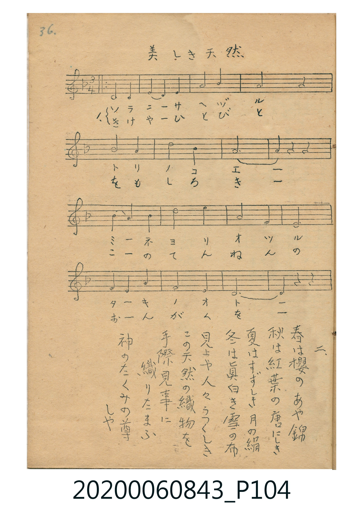
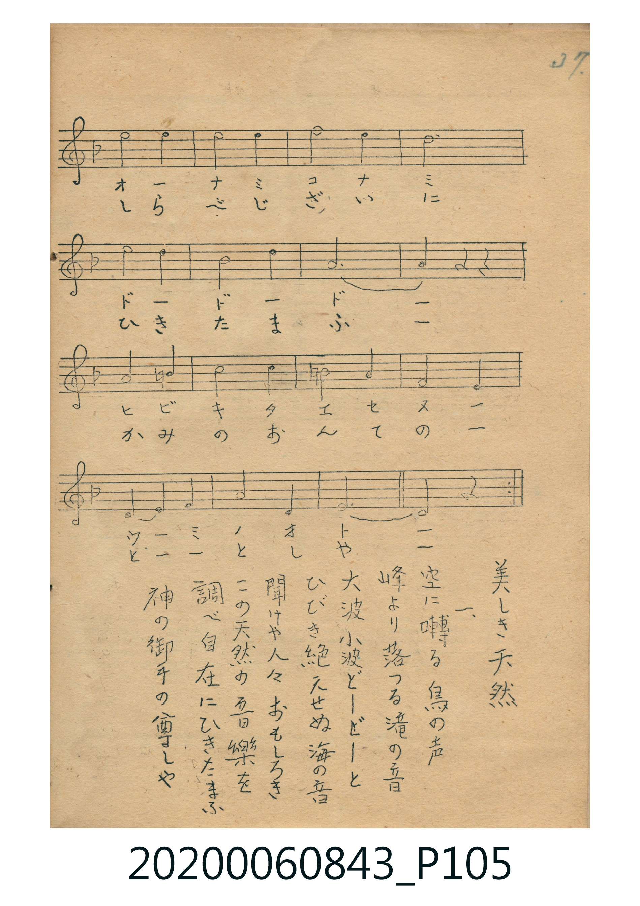

# 美しき天然

> Re:Shōka 使用 AI 協助辨識與重建樂譜，可能會有錯誤。歡迎回報。

- **鋼琴伴奏版**：<br><audio controls src="utsukushiki_tennen.mp3"></audio>

- 詞：武島羽衣
- 曲：田中穗積
- 唱歌帳（2020.006.0843）P104.jpg–P105.jpg（第 36–37 頁）

## 說明

> [!NOTE]
> **原書資訊與校勘註記**（對應 `P104.jpg`–`P105.jpg`，手抄五線譜第 36–37 頁）：
> - **曲名**：美しき天然
> - **調性與拍號**：1 降記號ニ短調（關係小調 D 小調，`?= F`、`key= Dm`），3/4 拍，全曲前後標示反覆記號 `|:` … `:|`（一段上下半闕以雙層歌詞反覆演唱；底欄另抄錄第一、二節漢字混寫全文）。
> - **旋律版本特徵**：`P105.jpg` 第 27–29 小節（「えせぬ海の」／「んての尊」）採明治民間流傳之旋律型 `| 4' - 3 | 1 - 7_ | 6_ 7_ 1 |`（B♮4–A4｜F4–E4｜D4–E4–F4），與昭和十一年總督府《公學校高等科唱歌》所載 `| 4 - 3 | 2 - - | 1 7_ 1 |` 形成珍貴之時代異文對照。
> - **楊金土手抄筆誤實錄（依 Policy A 校補譜面並詳列原貌）**：
>   1. **`P104.jpg` 第 4 小節（「ル／と」）拍數筆誤**：原抄誤畫兩顆空心二分音符 `A4`（合計 4 拍，且第 2 顆音頭下無歌詞），依 3/4 拍律校還為附點二分音符 `| 3 - - |`（3 拍）。
>   2. **`P104.jpg` 第 12 小節（「ル／の」）漏點**：原抄僅畫空心二分音符 `E4`（2 拍），漏標附點，依 3/4 拍律校補為 `| 7_ - - |`（3 拍）。
>   3. **譜下配詞假名與濁點筆誤**：
>      - `P104.jpg` 第 5 小節二段目誤作「**を**もしろき」（`P105.jpg` 底欄全文則正作「おもしろき」），校還為「お」。
>      - `P105.jpg` 第 23 小節一段目「どーどーと」之「と」誤加濁點作「**ド**」（同頁底欄全文正作「どーどーと」），校還為「ト」。
>      - `P105.jpg` 第 29 小節二段目「尊しや」（表音唱法「とーとしや」）首字誤加濁點作「**ど**ーーとしや」，校還為清音「とーーとしや」。
>
> **一、（`P105.jpg` 底欄全文）**
> 空に囀る鳥の声　峰より落つる滝の音
> 大波小波どーどーと　ひびき絶えせぬ海の音
> 聞けや人々おもしろき　この天然の音樂を
> 調べ自在にひきたまふ　神の御手の尊しや
>
> **二、（`P104.jpg` 底欄全文）**
> 春は櫻のあや錦　秋は紅葉の唐にしき
> 夏はすずしき月の絹　冬は眞白き雪の布
> 見よや人々うつくしき　この天然の織物を
> 手際見事に織りたまふ　神のたくみの尊しや


## 歌詞

```text
（TMD 檔案未包含歌詞註解）
```

## ABC

<div class="abc-score" data-abc-src="utsukushiki_tennen.abc" aria-label="五線譜載入中"></div>

[下載 ABC 原始檔](utsukushiki_tennen.abc)

## TMD 檔案連結

- [主旋律 TMD 檔案](utsukushiki_tennen.tmd) [[在 TMD Studio 編輯](https://tmdlang.github.io/Tmd-TS/#tmd=s7IKdvYPcrWy4qpTUCpJTLdSSM7PyUlNLsnMz7MqzsjPTkzOyFeCS5bl55TmploBqXgDI4RwcX5pUXJqfEFieqpVgKGBCU4ZU3QZuB3xefklqUn5-dkIFQVF-WWpeYl5QFW5iXmlxclFmQUl8cn5BZUINallmSmpIBXFyYl58WWpRZlpmakpSA5OLSoGewXijpKixDyIOUBBhKr8opKM_PSixIKMSquMzOKS_KLM5MSc-OzEvESEopKMVKDX8xJLSotSkbVmpmfmWeWmZmZlxpekVpRA_KClpfB8X9_jxumPG3ufLln5vGWbgpYWl6KtgqUZl72tghtXdmqlrYJLLpeNsb6JHci0Fyvnvd8z69naZU83b3u-b--LhYvBljybvQko_HzKhic71j5fOf35yl6w8NMpG5-t7Xm6Y_P7PR1GBkYGegYGZnoGFibG7_d0gmJAL6sg_VHDZFCQg5hAVc_XrFEwNgOKGZsrvFzQCFSnxMWlr6VgSy3ApaCgYKcQrejnH-IaC-FoaT3tm_9s9o4Xm9tfrOh60dH-bMHCp90zXqzY_WLFDC0toKuebuh91t6pkABzcwLQgSAO2NUJ7_f0POvsftbV8mTXlOfbZ71YOwfTF8DQgVimC7QOGFpPJ_SCTJ6FFvwINS9W7X_WsBzkmO7eFzPngxUbKryc2Qt0E5D_uLn7-fy1QEVA172cPufJ_qanG_qBXAUXBQgD6KgEUBQmPG5oTIBGI9ClQIf0AONSAWgqkPW0dQXILZ29T_f1PFsx8_mSXU_7e18sa4PYoZBQY5Wg8KhhmUKCVQ1Qb8eTHQ3P1m19sqPryY7up71dL6dPfbJ76cvZM59uXAKMZmDSgOh-tmcKMOLf75n9dNfUZ2tanvYvA4bNy54WYKgATQC658munufrG57tWfR07fRn27c_Xb8a5JBp7UDnPW5oQgqn6d1P93U_7-x4NmfN886dT_dtBQcDIuQVQAFtZA4MaCNLkL-BpgKd-bih53Fjx-PG2Y8b1zzbuv1x47rHDUDf9oPEmyY_blwGFHm6oQss2Pmsb-GzGX3PNu1-tmHiy2mTn21tfNq0-cnObojdT-d1A0NBwUQd6B5jhRoFQyBtHg9kmMWDaEMFcLg4PZq5zgToCEeT93vnuIFYriCWC4QFJNxMICEPis4Za59O6nna2wgMiqc7tzzfsff53MVPd8153ND1tHXN07U7gInv5eoZz9d2Pl8-EZJ_Hjd0P-tseLEHmACBToG6xAhI64JdBHWHwtO9i551THgOjIJNW0AemNn0ZPfi51M3AAMWmH6fty5HDdulXS_bJz6dMx-SdJ-vbXuxasnT9cuA8QSK6X1zFQLyczKTKxUcFYAuerF4DjBZv5y76MmOZS9Wbn7aMR2YZV5s6gF6CxwlEHMVFAz1gEYjsgk4fkxQY6Z5NSgqGldAg7-799nUHRDbwSaBsmJXC5D3fCowVax8ubDt-cpdT_c3A9PM0462l_M3P18DTI-OJqBwfzqh48WKDqAFkNT8ZMcUcHpQAGoCKny5YC0wnT5vWQhJm5AYAHkMmv6B0QsK66aW5027Xs5sebl7HqodNcBwBocxyCpjiB2I9KmgYITFr4ZGWD0LSYCdz_b0A21B8ubT5lagN7F50BXsQSOoraASZk8_MIdC3InNH8AYAvoD5GpgesDnbGOQs4GRCQybl629oEzb2A4sjUBJc38j0HCkuIBpAQJdpMIP7FNTqEeBzgaWCc9nrwNqerIXmIx7tLQeN00CEU2gkq2pF1i4gb3fgZRvoSUDONc_7Wx_tnYxRO_jxi4MfWDfwyIKqqYBKAX3Edx5yIWCMcx94DIL6D6wzpWPm_fASFAKBOYTsDiIDUr_XQsggQD3STMwfUNc_3RCD7AoR3Y4kqvRzcXi6mZggiDoalgpBg9VoE5QUQUKkBaIO14sXAFMJKCSYfNUqNshtiLUdL5cNg1YtGL1UONKkK_2YOhBOPbZjlagBQijUVXCfACrOiElOu7YBZcQEMXAdP64cfXT2Q2Pm7pfbl4KKoUXb3jc0PB084bHTR2Pm7peTNj7uHEJUPbZ7rlAWaArIBqfLln-bPMiYMgASYywbnjcuOlx42Zganm-dRtauQ834UXjvMeNE4E-eLILGBmtGMkMaAiwYlgHqYQhGp-taAKmY6j2VfsfN-580b7q6RxgSKwG2wjUOP9x477HjVuB2p8vBZq_7um-hcDSFFq7gAMMNah2AYtyWFBBsxKOoHo2Axg865-t3g0qOxqBDgHWn8tA9iwHGr_--ZbWFxM7QfZMmQB2DqgBAQsqYHGz_nHjzMeNsyDiz-YAg2Td8607QSHdtgakfc685zOBId37cvYqkCE7mqG-XNYNjgd4ILWBYqMRaCDIHMxAer5zyvPOlfBAAnr95azZQEOe7AI6cjVQFhilmIEEFgGaCQxR1HCivG0HBQpa-lxcoSXFpdmlxRmZ2ZkhqXl5qXlWAZmJefkONQY11SDbFGxMtMAxo4CtdakAiyFQtoQ3Wl4s7FHQsIBmUU0suoAWg0wENw90QQS4NIa0FSDViQmUBlXdsKrcDE1cV8EACGvARvkY1ig8btoLFHvcvBIoB2z3AfEeoNhWMG8GWKYVzF4N1Q8sasCiq8DsPhC7aTOI3bQCbkM8EEJtMALKNPaCVDVOBKtqgdjQuAnEawTpAeYvOBtsQ2MX2NQmMHs6mN0LZoPMwbDBGCSzHqyqG6xqPdSGqWBeP1imE8xeB7ehCSzaAmaDfAayB6cNJiCZ_WAdHUT7oQ0sugThBhw2EJtKgLVs49PZs4lPJSbAKAdFPCgBmEMTALApB6_BIY079HYnjkTSPB_i5WZwRDSDvQxJAk2rwGxwUCISSdN-aEJai5RMIEkGlHywJ5PJ0GBdBw6oZWA9k8HstUhsRCR2Qe2AiPeAA7kfbPsknAmlCWoHJEFBkg0koYEjuHERmh2wDAFJQMQlFRL9AXQtxI4uMA-cNCF6MfyBN7GA60cyixRzaCKB0YZxUAYo9YBcAJIwA6cqCI27OIGkhz3guAZnZGDaAYlvBrPBfgSKwAqTTiTVyGzcqQRSIEDiYyc4rGaA2dPAbESWhsTfJrAoJLZBtgLrCzB7K84UAnY_NOOC00fjTDB7Fpa4B6lDmA-KURh7Dc7UAU4PjX1I5u8Hs6eA2StQ3Q9OAdCUgdf9xKYMkosRcL2iDmSYAhmmoBSAu7sKVoxekoBSCHJJAvZRMzgPAEsHkO_A_gdXH4-bdoNjH5yXISmhaRm05AGnIhwlCSgUkNNIN1K4QmIFkrcmg9nLEOIQO4ChDrEDxoPHNLCox2IHOJ2AYuBxUxtSPEJiBr3CgvmjDaXkgbhqDZyNYQc4rWD6AxwK0AoFSZxkf9RycenaKWC0Y6J9DGMVsEsY4ZIwxiVhApZQ5gIA)]
- [鋼琴伴奏 TMD 檔案](utsukushiki_tennen_piano.tmd) [[在 TMD Studio 編輯](https://tmdlang.github.io/Tmd-TS/#tmd=s7IKdvYPcrWy4qpTUCpJTLdSSM7PyUlNLsnMz7MqzsjPTkzOyFeCS5bl55TmploBqXgDI4RwcX5pUXJqfEFieqpVgKGBCU4ZU3QZuB3xefklqUn5-dkIFQVF-WWpeYl5QFW5iXmlxclFmQUl8cn5BZUINallmSmpIBXFyYl58WWpRZlpmakpSA5OLSoGewXijpKixDyIOUBBhKr8opKM_PSixIKMSquMzOKS_KLM5MSc-OzEvESEosQioOb01NzUvBKrgszEvPz4xOTk_NyCxLxMkBhCYUkGUJFVXmJJaVEqsh2Z6Zl5VrmpmVmZ8SWpFSUQz2ppKTzf1_e4cfrjxt6nS1Y-b9n2fk_Hy-49zydsebJny9Ol_c87O97v6VTQ0uJStFWwNOOyt1Vw48pOrbRVcMnlsjHWN7EDWfFi5bz3e2Y9W7vs6eZtz_ftfbFwMdjmZ7M3AYWfT9nwZMfa5yunP1_ZCxZ-OmXjs7U9T3dsBtplZGBkoGdgYKZnYGFiDLQJFH96WQXpjxomgyIMxASqer5mjYKxGVDM2Fzh5YJGoDolLq7QkuLS7NLijMzszJDUvLzUPKsAULg41BjUVHMpAIGNiZYdmFGjYBavoAsiahTM40E0kKxRMAaKmUBpXSBtAiSNQYrRxHUVDICwBmyUj2GNwuOmvUCxx80rgXKPm7uBeA9QbCuYNwMs0wpmr4bqf9zcARZdBWb3gdhNm0HsphVwG-KBEGqDEVCmsRekqnEiWFULxIbGTSBeI0jP40awfjAbbENjF9jUJjB7OpjdC2aDzMGwwRgksx6sqhusaj3UhqlgXj9YphPMXge3oQks2gJmg3wGsgenDSYgmf1gHR1E-6ENLLoE4QYcNkDj1AQYQaBoAkWXOTS6DCExDFFvCGKCItQQpAIU4-BkgDVKm-dDHNgMDrZmsAMhEda0CswGexwRpU37odG-FilSIREMimzskToZGgjrwN5aBtYzGcxei8RGBHkX1A6IeA84SPrBtk_CGa1NUDsg0Q-JZEiyAEdH4yI0O2DJFxLdxEUsif4AuhZiRxeYB05IEL0Y_oBGrTk0SmG0YRyUAYprkHqQhBk4DUBo3FkVEnt7wDEDziTAmAaJbwazwS4CisAyaieSamQ27jiFZDZI6O0E-2wGmD0NzEZkF0hobwKLQuIGZOvjxn1g9lac8Ql2PzRTgGOzcSaYPQtLTIHUIcwHhT-MvQZnXIJjr7EPyfz9YPYUMHsFqvvB8QWNR7zuh8YjuIRVBzJMgQxTUHypAxnoWRJIg_ItSDF6LgXFJ3IuBdvfDE5fwJwHcgvYteCC9HHTbnBcgfMJJN6alkFzNTjOceRSkJuRY7QbKRQgYQhJt5PB7GUIcYgdwDCC2AHjweMFWOhhsQMcq6DwetzUhhTqkHBEL7ph_mhDydUQV62BszHsAMcspj_AoQAtWpHESfZHLc7KN8gDS_VbnVtQC00QhvHa4NiF0MB0oR6vDamRoSygEm1QQjDSBhXtEDbIahAfqA3IByYibVAxAFEB0oYt80N0gNRD1EH0mKprg4sTsBazeG1QsoNaDDECLAYVgVgGFgHphDkP6gNMC8GGw-1A5Zlpg4swKM8Y7BiQCVBVINfB_Ahh4_YXPHxA-cpIG5SzQCRYOyh3YXc2IoSRvA0yCIfHIBkPd0T7EIhos3hgAAJtgJFATwNFQKIgGlneKF7bBFUEpsMoXsEE7CgMAQgJMRPqAbg_QGIo6QDdIrgpxvHaQF04HYtuMMzxIBpZD7qHYGaARJAdgsux2OzBbzKSLqBnyAwXiFeAaQFshCmQZx4frw3kQCmIsUDdSBGAzWmIIMHvGWQz4KlL104BI4FF-xjGKmCXMMIlYYxLwgQsocwFAA)]

## 分析

```text
================================================================================
📊 TMD Song Profile: [ 美しき天然 ]
================================================================================
⏱  Duration:       4:00 (240.0s), 128 measures total
🎼 Key & Tempo:    首調基準 F, != 96.0 BPM, <3/4>
   - 分析範圍：      由實際發聲的音符與和弦推測調性；播放脈絡另行呈現
🎤 人聲音域:    D4 (MIDI 62) – F5 (MIDI 77) [跨度: 15 個半音 / 1.2 個八度, 難度: moderate]
   - 最低音:  D4 in [UtsukushikiTennen[L1] #1 @ m.1, 0:00]
   - 最高音: F5 in [UtsukushikiTennen[L1] #1 @ m.19, 0:33]
   - 適合: soprano, mezzo-soprano, contralto, tenor, baritone, bass
🏛  結構:      UtsukushikiTennen[L1] (60.0s) -> UtsukushikiTennen[L2] (60.0s) -> UtsukushikiTennen[L3] (60.0s) -> UtsukushikiTennen[L4] (60.0s)
⚡ 編曲密度:        Peak 1 軌道同時演奏
🗝  調性診斷：       D 小調（純淨自然小調，未偵測到可信轉調）
   - 風格氣質:    純淨自然小調（陰鬱抒情、旋律集中，無明顯調外色彩）
   - 轉調歷程:    全曲維持單一推測調性（未偵測到可信轉調）
   - 核心骨幹音:  D, A, E, F, A#
   - 調性數值:    D 小調 [相關度: 0.75, 穩定度: Moderate, 自然音純度: 96.6%]
   - 候選調性 (K-S): D 小調 (0.75), A 大調 (0.67), D 大調 (0.61)
   - 五度圈歷程:   +2 -> +2 -> +2 -> +2
   - 各段落調性細節:
     • [UtsukushikiTennen[L1] #1]: D 小調 (r: 0.75, 自然音純度: 96.6%, 調外音: B)
     • [UtsukushikiTennen[L2] #1]: D 小調 (r: 0.75, 自然音純度: 96.6%, 調外音: B)
     • [UtsukushikiTennen[L3] #1]: D 小調 (r: 0.75, 自然音純度: 96.6%, 調外音: B)
     • [UtsukushikiTennen[L4] #1]: D 小調 (r: 0.75, 自然音純度: 96.6%, 調外音: B)

  [ 五度圈游移軌跡 ]
               C  
         F            G  
      Bb              [D ]*
      Eb               A  
         Ab           E  
            Db       B  
               F# 
     (* = active key center)

  [ 十二半音累積音高分佈 ]
     C  : ███                        3.4%
     C# :                            0.0%
     D  : ████████████████████████  25.8%
     D# :                            0.0%
     E  : █████████████████████     22.5%
     F  : █████████                 10.1%
     F# :                            0.0%
     G  :                            0.0%
     G# :                            0.0%
     A  : ████████████████████████  25.8%
     A# : ████████                   9.0%
     B  : ███                        3.4%
--------------------------------------------------------------------------------
Assignment 軌道音域：
  - Piano         : D4 – F5 (15 個半音 / 1.2 個八度, 212 個音符)
================================================================================
```


## 原書掃描頁






