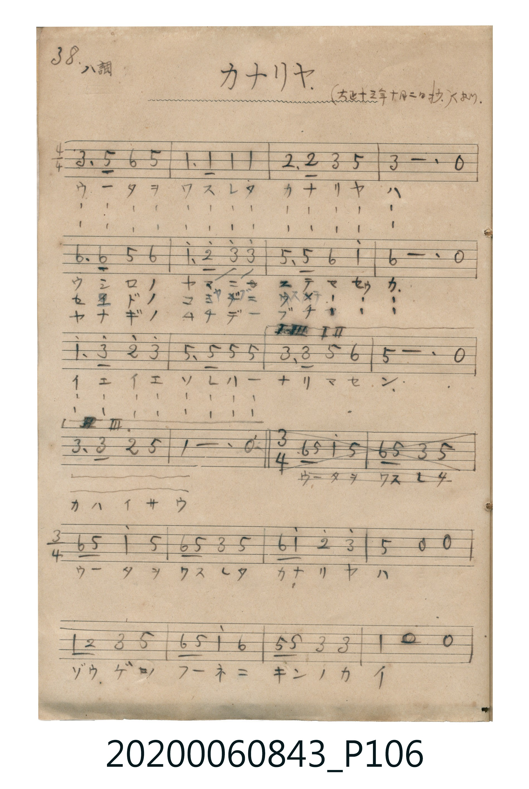
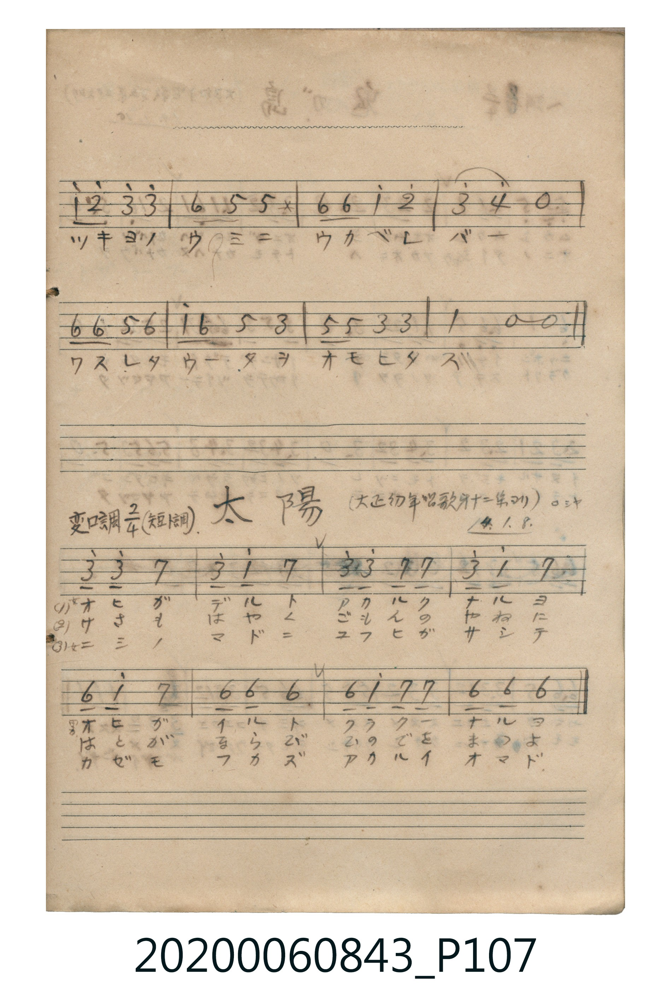

# カナリヤ

> Re:Shōka 使用 AI 協助辨識與重建樂譜，可能會有錯誤。歡迎回報。

- **鋼琴伴奏版**：<br><audio controls src="kanariya.mp3"></audio>

- 詞：西條八十
- 曲：成田為三
- 唱歌帳（2020.006.0843）P106.jpg–P107.jpg（第 38–39 頁，大正十三年十月二日抄）

## 說明

原書資訊與歌詞全文（對應 P106.jpg–P107.jpg 上半，手抄簡譜第 38–39 頁）：
調性與拍號：ハ調（C 大調），前三節 4/4 拍，第四節轉 3/4 拍
抄寫註記：「（大正十三年十月二日抄）人より.」
第一〜三節（4/4 拍）：
ウータヲワスレタ　カナリヤハ


## 歌詞

```text
1. ウシロノヤマニ　ステマセウカ
2. セドノコヤブニ　ウメマセウカ
3. ヤナギノムチデ　ブチマセウカ
イエイエソレハ　ナリマセン（一、二節結尾）
カハイサウ（三節結尾）

第四節（3/4 拍，P106.jpg 下半〜P107.jpg 上半）：
ウータヲワスレタ　カナリヤハ
ゾウゲノフーネニ　キンノカイ
ツキヨノウミニ　ウカベレバ
ワスレタウータヲ　オモヒダス
```

## ABC

<div class="abc-score" data-abc-src="kanariya.abc" aria-label="五線譜載入中"></div>

[下載 ABC 原始檔](kanariya.abc)

## TMD 檔案連結

- [主旋律 TMD 檔案](kanariya.tmd) [[在 TMD Studio 編輯](https://tmdlang.github.io/Tmd-TS/#tmd=s7IKdvYPcrWy4qpTUCpJTLdSSM7PyUlNLsnMz7MqzsjPTkzOyFeCS5bl55TmploBqXgDI4RwcX5pUXJqfEFieqpVgKGBGboM3KT4vPyS1KT8_GyEioKi_LLUvMQ8oKrcxLzS4uSizIKS-OT8gkqEmtSyzJRUkIrUlMyS_KLMxBwkJ6UWFYMdC3FDSVFiHsQMoCBCVUlGKtDdiXmZuch6gUalZ-ZZlSRmAh0YD8TlifG5iZl5OYl5KciqSjLy04sSCzIqrTIyi0EOSE7Mic9OzEtU4tLSUnjctPpxc9fj5lWPm5coaGlxKdoqWJpx2dsqOHPZmOib2IEMerFy3vs9s14s3f9s0dynrauf9jaCzX82exNQ-FnHhOdTNjxv2vVkRydY-OmUjc_W9jzdsfn9ng4jAyMDPQMDMz0DCxPj93s6QeGrl1WQ_qhhMpBpDmICVT1fs0bB2AIoZmyp8HJB4_s9PU-XLH-2djHQIqChT3duATKezel4sqvn2fSlz7pagAYpcXHpaynYUgtwKSgoPO2b_2z2jheb21-s6HrR0Q70A9DfT1tXPJvWDnTj0w29z9o7FbB4QOHJjq6nvV1AVz_r7Aa67vmGhS_WzsHwUycwrEDWvFi1_1nDcpAF3b0vZs4Hij5u7gcKAu1wVgD6G8wEKu552tkL9P3z9Q0KwHhQAKoGigFNfTp7NlDsxd5OBWOIMMhQoLVP169-sWL3ixUzQCY29ICcTCgQn-za9bip43FTl97jhl4ukDlA85_saHjcMAdiM9AQuN0w9z9uWva4ec_jpv2Pmzc9bl7_uGnn4-Y1IG5DA3JaAnoKpNpQD6yhafvj5rWPm_vAEvMeN3eDVQN1toG4TbvBalaDNBiBNOx-3NwJUt20GaxhGkwD0OaF6BqMgRpAiroeN60D27DgcXPj4-Z2kAaQTiAbVcPjpiWPm1bAyL0g1zf3g1VDnA5W3QxKveCgaASGGDAonm-d8HTDPmAwQIwAerQfbMRWoMFgpaDwQiiCBiYksoDy0LgCRiEsBQGTTTcw2QDDGiMhkRfUj5v2gT0JVAoMhakgnc29sJADBj4wLIEhuhroarDq5haw6AqwKNCe-YhABpk9ExwuEyBKkaxGdhJINdABix43T3rcDIpPkGrKMyMUKGjpc3F5A8uposzKREergMzEvHyHGoOaapAtCjYWWnZgBrZiAD0dw3KQgoaFwtMN_UARHXhO1sSiHWgzyOgaBWMFXSA0VTADk7pAEUOwiCGYBuEaBSOwiBFYLUQNRBcEGoBEwKb5GNaAYhQsCgxAYLBugqoBijevh4rvBLLXQFWAZZpWQ2Sau4B4FZi1BKqnH8meeIQ9RkC5xjaIrsb5QBMmIexpguh53DgTyO6BqgDLNHZDZVYBZbrALmiBykDchmGPMe39A40GUPDrAklQ8ILYwGiIAwsZxSkYg1hgogYsD4susAqYVvxxsR1o91qwS_qgLgG5COLKeWASFDYgHTuhom0wmabdUBmIWSARkP_QY2M2RK5xJRCvA6vaDNUHCmOI3DYwCdKNFH9NjUD2PuJsAsUH1OXg0G0C2wT30wK4nxrBZDtUfBpclBg_1SLypGteiqERvnyJWX4qaHjqKHh6aiJyGDQigREIjEuMiATRyHnKGCkJQNRgj1loKDStgLJBLIif9kJ9uwYpvYFCAZTiQeLA1I8aCs2gmMKVyyCx97ixA8oGsSDxNxfqgh6k_AMSB6V4kDgwfiDxCk4bIJdNxrAHNayN8Qc1ov4BBjJKEMOCDlRQIRdiGEEHztCw7NkPD7qtUAfCkgNWBzqRXEBD6kZYKwZYRxqaKTxt6AYLQArpZ_2zn6-bDmxaKhgagaVAxThEClqRQpthwCoTXykOKjjA6QySeEyhYQLhASXAKQ8oBlYCIkBhgggXUHghineIfrBxkFrBFCwFMRIUsBiawRYgiilE6jUFqjODOAFckcCVmMAcATMDpAqW8oGqzaAGQNyE2wHA-NG1U4DXodE-hrEKSALgDIwuCFRlhE0VqiBQlTG6KqD9CL4TiKPMBQA)]
- [鋼琴伴奏 TMD 檔案](kanariya_piano.tmd) [[在 TMD Studio 編輯](https://tmdlang.github.io/Tmd-TS/#tmd=s7IKdvYPcrWy4qpTUCpJTLdSyC8qychPL0osyKi0ysgsLskvykxOzInPTsxLVIIrKs4vLUpOjS9ITE-1CjA0MNMFEuYI6ZKM1NxUq9SU0uTEksz8PCUuLS2Fx02rHzd3PW5e9bh5yfs9HS-79zyfsOXJni1Pl_Y_7-x4v6dTQUuLS9FWwdKMy95WwZnLxkTfxA5k4ouV897vmfVi6f5ni-Y-bV39tLcRbNGz2ZuAws86JjyfsuF5064nOzrBwk-nbHy2tufpjs1AO4wMjAz0DAzM9AwsTIyBNoBcqpdVkP6oYTLIvSAmUNXzNWsUjC2AYsaWCi8XNL7f0_N0yfJnaxcDLQIa-nTnFiDj2ZyOJ7t6nk1f-qyrBWiQEheXNzA8ijIrE63C8oHB41BjUFPNpQAENhZadmBGjYKxgi4QmiqYgUldoIghWMQQTINwjYIRWMQIrBaiBqILAg1AIlDTQKboAkmQKhAbaFocRHOcgjGIBSZqwPIwW8EqYFoxjYQaANQINAPDABCN7CRjJKshajBNhKkEeQvZy9i8YwqxH2KoKVQzhAeUALsIKAZWAiJAmlEcjxRqEP1g4yCBbQqWghgJcgGGZrAFiGBD-MoUqM4M4gRw_MCVmMAcgfABIjKAqs2gBkDchNsBtUhpJyAzMS8_yANr6jHUhqUfE22QFcbauNKQebw2LBlBNMGVQo3AEk9gI0Fuh6iF8IF-0kYkKsM4bbDHYTRIFyxtQNRDVSOMwxLNMAOBRphrg0MTu3kQV6C62xgqAgkAYGRA1WNJyXAd0MCAKMUXBKDIM4a4DmILNBEhhSA4FZhCXA1KMxB3G8dp40yQqLpB5plArIB4AZQuIErAsYY_daKHPywUIKbD0inUfKB5qKFrFKeNNcUixzc01UKEIO4CuRDqMhxOxEi_Psjp1wSRfuNByARMAq2Oj0fBwLwCJEEYog6sHso1QDgYqtoYrgvTHJAcTB6hBiaCaRbUEpgDkayHuxjhOBBGGAFRABPH7mRspgKNhGsAK8alHKgQEmBgHtxsTE-AMNihcAvgzoY6ClUPLDiQ9CC8gWIPMHp17RRgMayAh63MBQA)]

## 分析

```text
================================================================================
📊 TMD Song Profile: [ カナリヤ ]
================================================================================
⏱  Duration:       1:55 (115.0s), 46 measures total
🎼 Key & Tempo:    首調基準 C, != 96.0 BPM, <4/4>
   - 分析範圍：      由實際發聲的音符與和弦推測調性；播放脈絡另行呈現
🎤 人聲音域:    C4 (MIDI 60) – G5 (MIDI 79) [跨度: 19 個半音 / 1.6 個八度, 難度: challenging]
   - 最低音:  C4 in [KanariyaA[L1] #1 @ m.2, 0:02]
   - 最高音: G5 in [KanariyaB #1 @ m.37, 1:30]
   - 適合: soprano, mezzo-soprano, tenor, baritone
🏛  結構:      KanariyaA[L1] (20.0s) -> KanariyaEnd12[L1] (10.0s) -> KanariyaA[L2] (20.0s) -> KanariyaEnd12[L2] (10.0s) -> KanariyaA[L3] (20.0s) -> KanariyaEnd3 (5.0s) -> KanariyaB (30.0s)
⚡ 編曲密度:        Peak 1 軌道同時演奏
🗝  調性診斷：       C 大調（推測轉調經歷 5 次）
   - 風格氣質:    純淨自然大調（陽光明朗、易唱易記，無明顯調外色彩）
   - 轉調歷程:    C 大調起奏 ➔ [KanariyaEnd12[L1]] 轉至 G 大調 (-2 半音 / 五度圈 -2 步) ➔ [KanariyaA[L2]] 轉至 A 小調 (+2 半音 / 五度圈 +2 步) ➔ [KanariyaEnd12[L2]] 轉至 G 大調 (-2 半音 / 五度圈 -2 步) ➔ [KanariyaA[L3]] 轉至 A 小調 (+2 半音 / 五度圈 +2 步) ➔ [KanariyaEnd3] 轉至 C 大調 (-9 半音 / 五度圈 -3 步)
   - 核心骨幹音:  G, E, A, C, D
   - 調性數值:    C 大調 [相關度: 0.79, 穩定度: Moderate, 自然音純度: 100.0%]
   - 候選調性 (K-S): C 大調 (0.79), E 小調 (0.74), A 小調 (0.68)
   - 五度圈歷程:   +3 -> +1 -> +3 -> +1 -> +3 -> +0 -> +0
   - 各段落調性細節:
     • [KanariyaA[L1] #1]: A 小調 (r: 0.83, 自然音純度: 100.0%)
     • [KanariyaEnd12[L1] #1]: G 大調 (r: 0.76, 自然音純度: 100.0%)
     • [KanariyaA[L2] #1]: A 小調 (r: 0.83, 自然音純度: 100.0%)
     • [KanariyaEnd12[L2] #1]: G 大調 (r: 0.76, 自然音純度: 100.0%)
     • [KanariyaA[L3] #1]: A 小調 (r: 0.83, 自然音純度: 100.0%)
     • [KanariyaEnd3 #1]: C 大調 (r: 0.84, 自然音純度: 100.0%)
     • [KanariyaB #1]: C 調性不明確 (r: 0.78, 自然音純度: 100.0%)

  [ 五度圈游移軌跡 ]
              [C ]*
         F           [G ]*
      Bb               D  
      Eb              [A ]*
         Ab           E  
            Db       B  
               F# 
     (* = active key center)

  [ 十二半音累積音高分佈 ]
     C  : ██████████████████        19.4%
     C# :                            0.0%
     D  : ███████                    8.1%
     D# :                            0.0%
     E  : ███████████████████████   25.4%
     F  : █                          0.6%
     F# :                            0.0%
     G  : ████████████████████████  26.6%
     G# :                            0.0%
     A  : ██████████████████        20.0%
     A# :                            0.0%
     B  :                            0.0%
--------------------------------------------------------------------------------
Assignment 軌道音域：
  - Piano         : C4 – G5 (19 個半音 / 1.6 個八度, 161 個音符)
================================================================================
```


## 原書掃描頁






